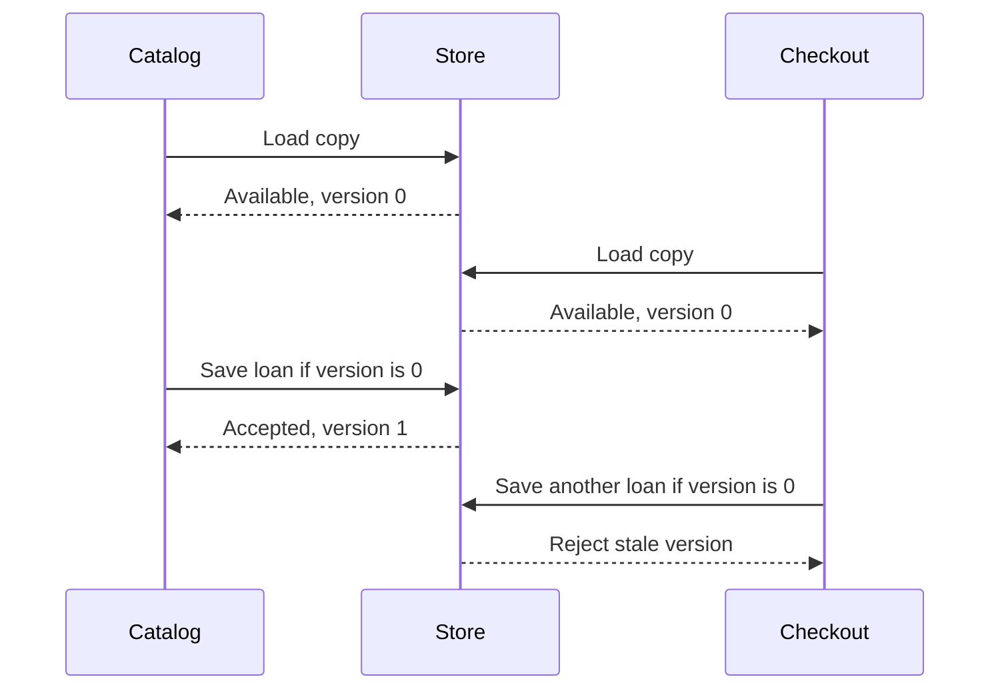

A library application has books, readers, and loans. Turning every noun into a class gives you a diagram, but not necessarily a useful design. A good object model answers more practical questions: who owns a decision, what state must remain valid, and which things need a lasting identity?

Let's model borrowing a book and use those questions to choose our types.

<!--more-->

## Start with a use case

Write down a behavior before choosing a hierarchy: a reader can borrow an available copy, and returning it makes that copy available again. Two copies of the same title are separate physical objects. A title and author describe a book; they don't identify the copy on the shelf.

That distinction suggests a value for the description and an object for a particular copy:

```swift
struct BookDescription {
    let title: String
    let author: String
}

enum BorrowError: Error {
    case alreadyBorrowed
}

final class LibraryCopy {
    let inventoryID: String
    let book: BookDescription
    private(set) var borrowerID: String?

    init(inventoryID: String, book: BookDescription) {
        self.inventoryID = inventoryID
        self.book = book
    }

    func borrow(by readerID: String) throws {
        guard borrowerID == nil else {
            throw BorrowError.alreadyBorrowed
        }
        borrowerID = readerID
    }

    func checkIn() {
        borrowerID = nil
    }
}

let copy = LibraryCopy(
    inventoryID: "COPY-42",
    book: BookDescription(title: "Swift Notes", author: "Maya")
)
try copy.borrow(by: "READER-7")
assert(copy.borrowerID == "READER-7")
copy.checkIn()
assert(copy.borrowerID == nil)
```

The methods express actions in the domain. A caller asks the copy to perform a valid transition rather than writing arbitrary state into it. The same copy can be referenced by a catalog and a checkout screen, so its identity is useful.

This is a small, synchronous teaching model. A real service must also enforce availability across concurrent requests and persist the loan transaction. A private property alone cannot coordinate two devices borrowing the same copy.

## Find responsibilities through questions

Should the copy calculate late fees? Perhaps, but first ask what information that decision needs. If a fee depends on membership plans, holidays, and library policy, putting all of that inside `LibraryCopy` makes the copy responsible for unrelated changes.

A `Loan` value could record the copy ID, reader ID, and due date. A separate fee policy could calculate a charge from that record. The copy would continue to control its availability without becoming a library management system.

Ownership of behavior matters more than physical resemblance. A real book cannot run a method; your software model can. You are modeling the rules your application needs, not recreating reality down to its furniture.

## Choose identity deliberately

Use a value when copying a description should produce independent data. Use an object when several collaborators intentionally refer to the same evolving entity. Neither choice requires that every related type use the same semantics.

An inventory ID also has a different job from reference identity. Two objects loaded from a database might represent the same inventory record while being separate allocations. Decide whether a comparison concerns the record, the contents, or the particular instance.

Swift supports properties and methods on both structures and classes, so responsibility does not require a reference type. See the language guide's [comparison of structures and classes](https://docs.swift.org/swift-book/documentation/the-swift-programming-language/classesandstructures/) for the language mechanics.

## Let the model earn its complexity

Begin with one borrowing scenario and add rules when a real use case needs them. Try borrowing twice, returning twice, and borrowing after a return. Those cases reveal whether the model protects its state more clearly than a class diagram alone.

Avoid introducing `LibraryEntity`, `BorrowableEntityManager`, and a factory before there is behavior that needs those layers. A small set of types with clear responsibilities is easier to extend than a large taxonomy of nouns.

## Model transitions, not a collection of flags

A boolean `isBorrowed` works until the requirements include reservations, lost copies, and maintenance. Adding an independent boolean for each condition creates combinations such as “available and lost” that the application must constantly reject.

Start by listing meaningful states and allowed transitions. For a borrowing workflow, a compact first model is:

| Current state | Command | Result |
|---|---|---|
| Available | Borrow for a reader | On loan to that reader |
| On loan | Borrow for another reader | Reject; leave state unchanged |
| On loan | Return | Available |
| Available | Return | Reject a duplicate return |

Rejecting duplicate returns is a deliberate policy here. Another system might treat them as idempotent successes. Neither policy follows automatically from OOP; choosing and documenting one is part of designing the model.

```swift
struct ReaderID: Hashable {
    let rawValue: String
}

struct LoanRecord: Equatable {
    let reader: ReaderID
    let dueDay: Int
}

enum CopyState: Equatable {
    case available
    case onLoan(LoanRecord)
}

enum LendingFailure: Error, Equatable {
    case unavailable
    case invalidDueDay
    case notOnLoan
}

final class CirculatingCopy {
    let inventoryID: String
    private(set) var state: CopyState = .available

    init(inventoryID: String) {
        self.inventoryID = inventoryID
    }

    func lend(to reader: ReaderID, today: Int, dueDay: Int) throws {
        guard dueDay > today else {
            throw LendingFailure.invalidDueDay
        }
        guard case .available = state else {
            throw LendingFailure.unavailable
        }
        state = .onLoan(LoanRecord(reader: reader, dueDay: dueDay))
    }

    func acceptReturn() throws -> LoanRecord {
        guard case let .onLoan(loan) = state else {
            throw LendingFailure.notOnLoan
        }
        state = .available
        return loan
    }
}

let circulating = CirculatingCopy(inventoryID: "COPY-99")
let reader = ReaderID(rawValue: "R-1")
try circulating.lend(to: reader, today: 10, dueDay: 24)
let beforeRejectedLoan = circulating.state

do {
    try circulating.lend(to: ReaderID(rawValue: "R-2"), today: 10, dueDay: 24)
    assertionFailure("A copy cannot have two current loans")
} catch LendingFailure.unavailable {
    assert(circulating.state == beforeRejectedLoan)
}

let returnedLoan = try circulating.acceptReturn()
assert(returnedLoan.reader == reader)
assert(circulating.state == .available)
```

`CopyState.onLoan` carries the information required by that state. There is no separate optional `dueDay` that can accidentally disappear while the copy remains borrowed. The compiler cannot prove every business rule, but the representation removes several invalid combinations before validation even runs.

The integer days keep calendar arithmetic out of this example. A real loan policy needs to define time zones, closing days, and what “two weeks” means. Put those decisions in a policy that produces a due date, rather than allowing each screen to calculate one differently.

## Separate entities, values, and services

The circulating copy is an **entity**: it has an identity that survives changes in borrowing state. `LoanRecord` is a **value** in this example: it describes a fact, and equal fields mean equal records. A due-date policy is a **service** or calculation: its purpose is making a decision, not representing a physical object.

These categories are design vocabulary, not Swift keywords. A persisted entity can be represented by a struct containing an ID; a class can implement a stateless service. The question is the semantic role, not merely which declaration keyword appears.

A useful test is to imagine replacement. Replacing a due-date policy with another implementation changes a rule. Replacing one inventory copy with another changes which physical item is involved. Replacing one equal loan record with another should change nothing observable. Those differences help locate identity and variation without forcing everything into a class hierarchy.

## Find the boundary of a consistency rule

The new class protects one copy's loan state. It cannot enforce “a reader may borrow at most five books,” because it has no trustworthy view of the reader's other loans.

That rule belongs at a boundary that can see and update the relevant records together. An application service might load the reader's lending account and the copy, validate both, then commit the changes in one database transaction. If two requests can run concurrently, the persistence layer needs a strategy such as a transaction or version check to prevent both from accepting stale availability.

Do not solve this by passing the whole application into `CirculatingCopy`. That gives the entity access to everything while leaving the consistency boundary unclear. Give each object enough information to make its own decision, and coordinate decisions that span several owners at a higher level.

## Keep infrastructure outside the domain conversation

A domain operation such as `lend` should not need to know about HTTP status codes, database row dictionaries, or which button initiated the action. Translate those representations at the edges.

For example, an endpoint can decode a request into `ReaderID`, load a copy, invoke the operation, save the result, and map `LendingFailure.unavailable` to a suitable response. A local UI can map the same domain failure to a message. The operation remains understandable without either interface.

This separation also changes what a test needs. A test of “a second loan is rejected without changing the first” needs two IDs and a copy. It should not need a running server or a mock navigation controller.

## Use behavior to evaluate the model

A stronger exercise than drawing more boxes is adding a reservation requirement: a copy reserved for one reader must reject other readers, and the reservation expires after a day.

First write the transition table. Then ask whether reservation data belongs in a new enum case, which operation expires it, and who supplies the current day. If the implementation starts reading a global clock in several methods, pass time into the operation or inject a time provider at the application boundary.

Finally, check what changed in the caller. A good model lets the UI continue to express a borrowing request while the domain's rules become richer. If every screen must inspect new flags and reproduce the same decision tree, responsibility is leaking out of the model.

## Case study: two screens borrow the same copy

The single-object model protects one in-memory instance. Now imagine the catalog and checkout screens each load the same database record. Both see an available copy. Each constructs an independent object, and each object's `lend` method succeeds. The individual objects preserved their invariants while the application accepted two loans for one physical copy.

This is a consistency problem at a boundary larger than one object. A useful solution is optimistic concurrency: each loaded snapshot carries a version, and a write succeeds only if that version is still current. The first writer advances the version; the second writer must reload and reconsider the operation.

```swift
struct StoredCopySnapshot {
    let inventoryID: String
    let version: Int
    let state: CopyState
}

enum CopyWriteFailure: Error {
    case wrongCopy
    case staleVersion
}

final class VersionedCopyStore {
    private var current: StoredCopySnapshot

    init(inventoryID: String) {
        current = StoredCopySnapshot(inventoryID: inventoryID, version: 0, state: .available)
    }

    func load() -> StoredCopySnapshot { current }

    func save(state: CopyState, basedOn snapshot: StoredCopySnapshot) throws {
        guard snapshot.inventoryID == current.inventoryID else {
            throw CopyWriteFailure.wrongCopy
        }
        guard snapshot.version == current.version else {
            throw CopyWriteFailure.staleVersion
        }
        current = StoredCopySnapshot(
            inventoryID: current.inventoryID,
            version: current.version + 1,
            state: state
        )
    }
}

let versionedStore = VersionedCopyStore(inventoryID: "COPY-100")
let catalogSnapshot = versionedStore.load()
let checkoutSnapshot = versionedStore.load()
let acceptedLoan = CopyState.onLoan(LoanRecord(reader: ReaderID(rawValue: "R-10"), dueDay: 30))
try versionedStore.save(state: acceptedLoan, basedOn: catalogSnapshot)

do {
    let competingLoan = CopyState.onLoan(LoanRecord(reader: ReaderID(rawValue: "R-11"), dueDay: 30))
    try versionedStore.save(state: competingLoan, basedOn: checkoutSnapshot)
    assertionFailure("A stale snapshot must not overwrite an accepted loan")
} catch CopyWriteFailure.staleVersion {
    assert(versionedStore.load().state == acceptedLoan)
    assert(versionedStore.load().version == 1)
}
```

The store is a synchronous, serial teaching implementation. A real database must make the version comparison and update atomic, for example with a conditional update inside the database. Putting these checks into a Swift class without synchronization would not make simultaneous thread access safe.

The repository also is not the place to decide whether a reader is eligible or a due date is valid. Those are domain decisions established before saving. Its job here is detecting that another accepted write made the proposed decision stale.



### Assign responsibilities after the failure is visible

An application service can now coordinate the borrowing use case: load the relevant state, ask the domain model to make a valid transition, attempt a conditional save, and translate a conflict into a useful result. A screen displays that result. An adapter handles database details.

This division matters because each layer has different information. The screen knows the user's intent. The domain knows the lending rules. The repository knows whether the persisted version changed. Asking one of them to guess another layer's information usually creates either duplicated rules or hidden coupling.

A conflict should not automatically trigger an endless retry. Reloaded state may show that the copy is now on loan. Re-running the domain operation should then produce an ordinary unavailable outcome rather than repeatedly trying to overwrite the accepted loan.

### Distinguish commands, events, and queries

A command requests a transition: borrow this copy for this reader. A query asks what is currently known: show its availability. An event records a fact that was accepted: this copy was lent at a particular time.

Those concepts can use similar data without being interchangeable. A queued command can become invalid before execution. A historical event should not be reinterpreted as a fresh borrowing request. A query snapshot should not be assumed current forever.

Use names that expose the distinction, especially when adding persistence or background work. `BorrowCopy`, `CopyLent`, and `CopyAvailability` communicate different responsibilities more clearly than a generic `CopyData` passed through every layer.

### Keep a transaction boundary smaller than the application

The rule “a reader may have five current loans” involves more than a copy version. A transaction may need the reader's lending account and the selected copy together. That does not mean every catalog record belongs in one enormous aggregate.

Group data that must be consistent for a particular decision. Other information, such as display names or recommendation results, can often be read separately. A model that requires loading the whole library to borrow one book has probably chosen too large a boundary.

### Test outcomes across competing histories

Test two stale snapshots as above, then reverse which writer wins. Verify an unsuccessful write leaves both state and version unchanged. Also test that a retry after reloading encounters the accepted loan's state rather than losing it.

For a service-level test, replace the store with a controlled implementation that reports a conflict once. Observe the result and number of attempts under the documented retry policy. This exercises a meaningful application contract without pretending that an in-memory test proves the database's transaction isolation.

The deeper lesson is that object modeling is the allocation of decisions, identity, and consistency. A class can own a local invariant while a different boundary owns the right to commit it.

Continue through the [Object-Oriented Programming roadmap](/swift-object-oriented-programming/).
