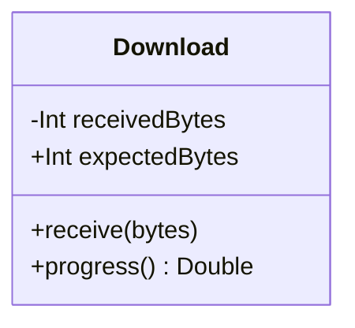
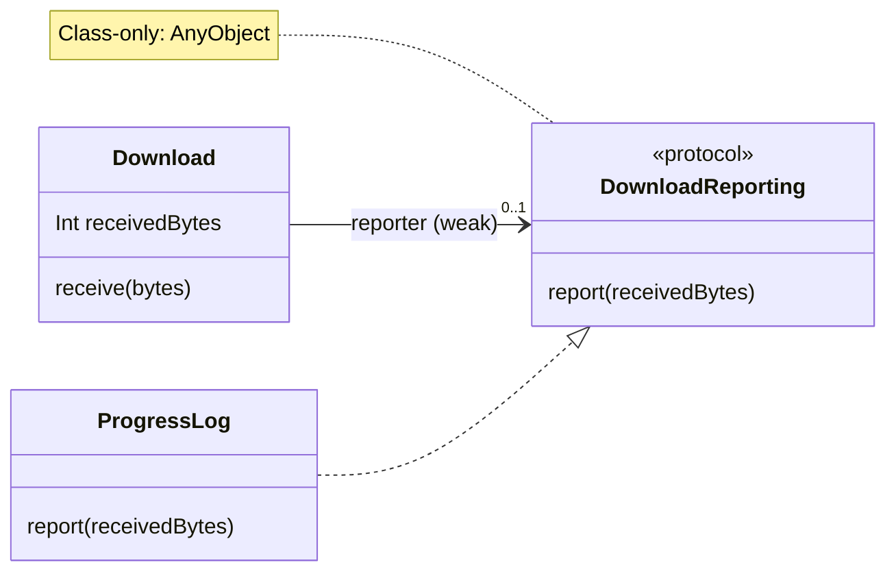
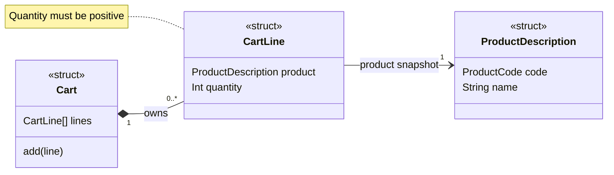
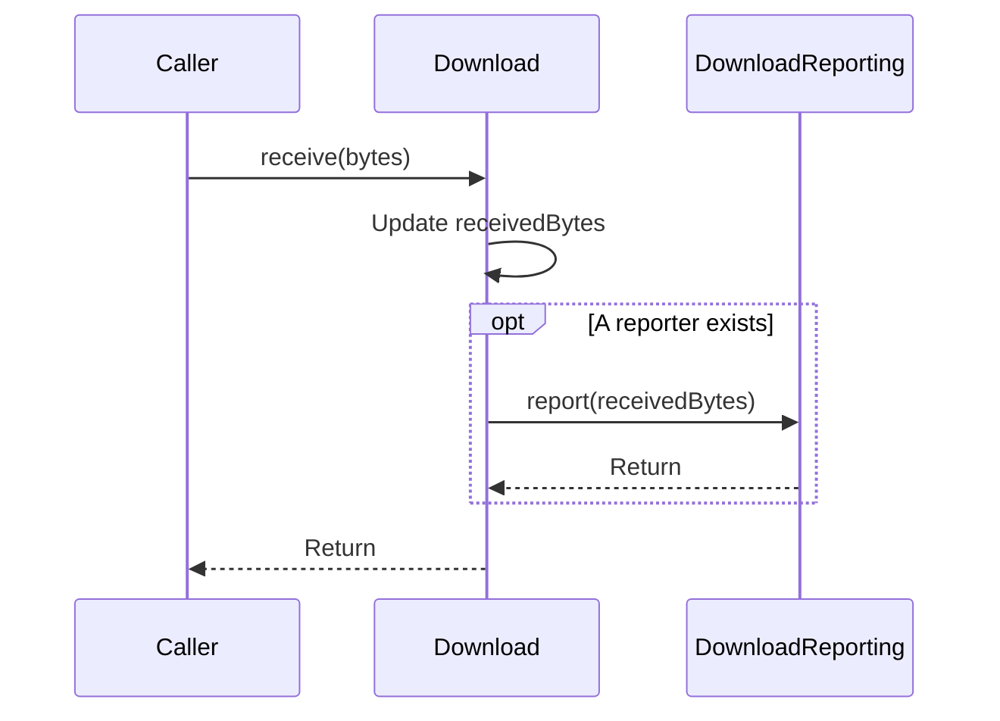
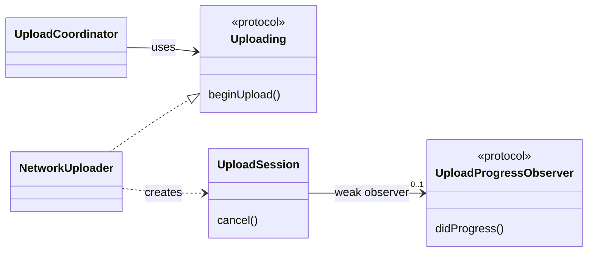
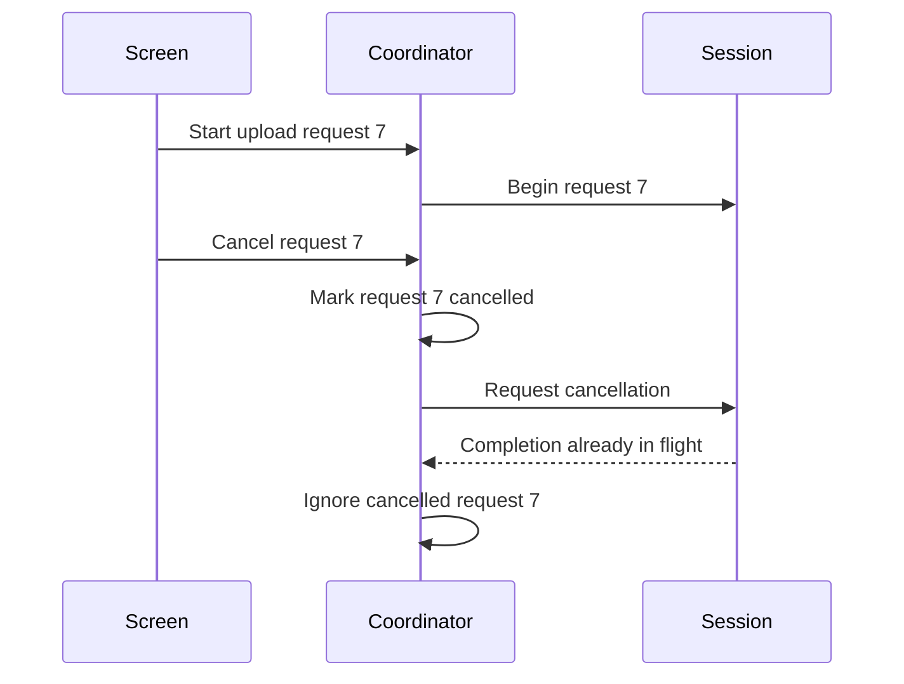
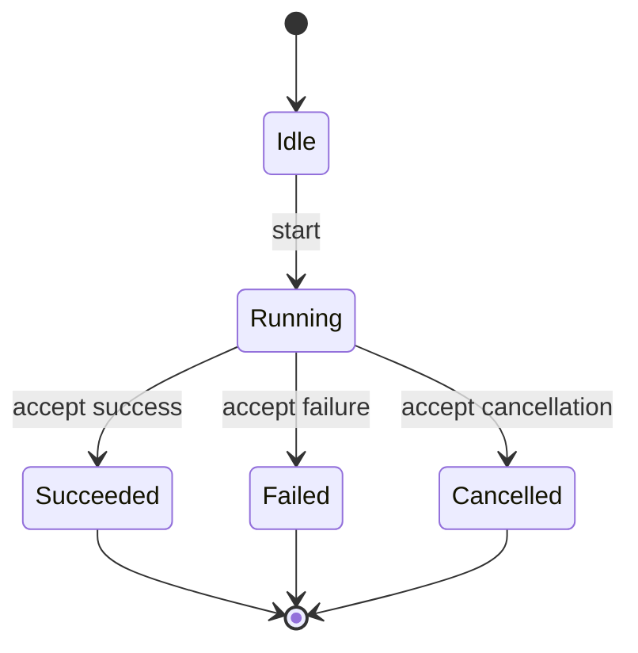

A class diagram is useful when it explains relationships that are difficult to see in one source file. It becomes less useful when it lists every property in the project. For Swift code, start with a handful of types and distinguish inheritance, conformance, and references between instances.

<!--more-->

## Read a type box

A basic UML class box has three compartments: the type name, its attributes, and its operations. Here is a rendered example:



The diagram presents an illustrative API and some internal state. The implementation below focuses on reporting and omits `expectedBytes` and `progress()`. A class diagram does not explain the transfer protocol, thread safety, or error handling. Add those in prose when they matter to the design discussion.

UML commonly uses `+` for public and `-` for private visibility, with `#` for protected and `~` for package visibility. Swift has no protected access level, and a Swift module is not a UML package in every modeling convention. Write `internal`, `fileprivate`, or `open` explicitly when a symbol would obscure the meaning.

The notation is standardized by the [Object Management Group's UML specification](https://www.omg.org/spec/UML/2.5.1/About-UML). A project diagram can use a smaller, documented subset.

## Distinguish the relationships

| Relationship | Standard visual cue | Meaning in a Swift design |
|---|---|---|
| Generalization | Solid line, hollow triangle toward the parent | A subclass inherits from a superclass |
| Realization | Dashed line, hollow triangle toward the contract | A type conforms to a protocol |
| Association | Solid line | Instances have a structural relationship |
| Dependency | Dashed arrow | A type uses another type, perhaps as a parameter |
| Composition | Filled diamond at the whole | The model treats the part as exclusively owned by the whole |

An arrow toward a protocol is not an inheritance arrow merely because both declarations use a colon in Swift. For example, `class Screen: Controller, Logging` inherits from `Controller` and conforms to `Logging`.

A `strong` property also does not automatically mean UML composition. Swift permits several strong references to one object. Exclusive domain ownership is a modeling claim, not an ARC annotation.

## Translate a small design

```swift
protocol DownloadReporting: AnyObject {
    func report(receivedBytes: Int)
}

final class Download {
    weak var reporter: (any DownloadReporting)?
    private(set) var receivedBytes = 0

    func receive(bytes: Int) {
        precondition(bytes >= 0)
        receivedBytes += bytes
        reporter?.report(receivedBytes: receivedBytes)
    }
}

final class ProgressLog: DownloadReporting {
    func report(receivedBytes: Int) {
        print("Received:", receivedBytes)
    }
}
```

Draw a realization from `ProgressLog` to `DownloadReporting`. Draw an association from `Download` to `DownloadReporting`, with multiplicity `0..1` at the reporter end. Add a `weak` note to explain the Swift ownership choice. The protocol's class constraint allows that weak relationship.

The diagram should show that a download can exist without a reporter. It need not list `print` as a dependency: that would add detail without helping the current question.

## Keep the diagram tied to a question

For a retain cycle investigation, include reference direction and weak edges. For a public API review, include protocol requirements and access levels. For a domain discussion, include identities and multiplicities such as `1`, `0..1`, and `0..*`.

Mark omitted details rather than pretending a sketch is a complete specification. A note such as “network scheduling omitted” keeps a reader from interpreting an absence as a design decision.

Review the diagram when relationships change. A stale dependency diagram can be more misleading than having no diagram at all, because its neat boxes suggest certainty the code no longer supports.

## Draw the relationships as well as the boxes

The download example contains three distinct ideas: a worker, a callback contract, and an implementation of that contract. A relationship sketch should make those ideas visible. This diagram shows the association and protocol realization directly:



The solid association points from the download to its optional reporter. The dashed realization points from `ProgressLog` toward the protocol it implements. The important facts are the association's target, its optional multiplicity, and the distinction between conformance and ownership. Label the reference `weak` because a conventional UML association alone does not communicate Swift ARC semantics.

This relationship view omits member visibility markers. The Swift code remains authoritative about access: `receivedBytes` has an internal getter and a private setter. Add that annotation when reviewing the access contract rather than treating it as a completely private field.

A reverse association from the reporter to the download should appear only if the reporter actually stores that reference. Receiving the download as a callback argument would instead be a temporary dependency. Otherwise the diagram suggests an ownership cycle that the code does not have.

## Multiplicity describes a domain constraint

A shopping cart might contain zero or more lines. Each line describes one product. A useful sketch can say:



The filled-diamond composition notation belongs at the whole, `Cart`. It claims exclusive conceptual ownership of the lines in this model. It does not require every line to be a heap object. A Swift implementation might store line structs in an array.

```swift
struct ProductCode: Hashable {
    let rawValue: String
}

struct ProductDescription {
    let code: ProductCode
    let name: String
}

struct CartLine {
    let product: ProductDescription
    let quantity: Int

    init(product: ProductDescription, quantity: Int) {
        precondition(quantity > 0)
        self.product = product
        self.quantity = quantity
    }
}

struct Cart {
    private(set) var lines: [CartLine] = []

    mutating func add(_ line: CartLine) {
        lines.append(line)
    }
}

let notebook = ProductDescription(code: ProductCode(rawValue: "N-1"), name: "Notebook")
var cart = Cart()
cart.add(CartLine(product: notebook, quantity: 2))
assert(cart.lines.count == 1)
```

The quantity check is an invariant of a line. The diagram's `0..*` describes how many line entries a cart can contain, not which quantities are valid. Add a note such as `{quantity > 0}` if the rule is important to the discussion.

Also notice the modeling decision hidden in `ProductDescription`: it is a snapshot value. If the product's current name changes in a catalog, this line does not automatically change. A diagram that only labels the target “Product” would not settle that question. Add a stereotype or note when the difference matters.

## Map Swift constructs without pretending they are identical

| Swift construct | Practical diagram notation | Detail to document |
|---|---|---|
| `protocol` | `«protocol»` classifier | Requirements and class constraints |
| `struct` | `«struct»` or `«value»` classifier | Copy semantics of nested references |
| `enum` with cases | `«enumeration»` plus cases | Associated values may need notes |
| `static` member | Underlined member or `{static}` note | Shared member, not instance storage |
| `class` type method | Type-level operation plus note | May be overridden |
| Optional reference | `0..1` multiplicity | Whether it is weak or strong |
| Generic constraint | Template parameter and constraint note | Relationships between associated types |

A diagram is a view of the code, so it may deliberately omit language details. The mistake is omitting a detail while implying the diagram proves something that depends on it. For example, a protocol box without its `AnyObject` constraint can lead someone to propose a value-type delegate even though the implementation stores it weakly.

## Do not encode chronology in a class diagram

Suppose a download updates its count, reports progress, and then checks whether to finish. A class diagram can show the collaborators, but it cannot clearly express the order of those steps or reentrant callbacks.

Use a sequence diagram or a state table alongside the class view when timing is the question:



The count has already changed when notification begins. The callback is synchronous in this example, so the reporter returns before `receive` returns to its caller. That ordering is a behavioral rule that a class diagram alone cannot express.

Similarly, a class diagram cannot establish that an API runs on the main actor or that a service transaction commits atomically. Those are behavioral contracts requiring annotations, prose, or another view.

## A repeatable drawing workflow

Start by writing the one question the drawing should answer: “Can this callback cycle retain the coordinator?” or “Which modules know about file storage?” Select only the types needed to answer it. Then add named edges and multiplicities before filling in members.

Read each edge aloud. “A download has zero or one reporter and does not own it.” “A progress log conforms to the reporting contract.” If the sentence is awkward or untrue, fix the model or label before polishing the layout.

Finally, compare the drawing with one construction site and one use site in the code. Construction reveals ownership; use reveals which API is actually relied on. A diagram based only on declarations often misses both.

## Review exercise: diagnose the hidden assumption

A teammate draws a filled diamond from a controller to its service because the controller stores `let service: Service`. Is that enough evidence for composition?

No. The property is a strong reference, but the service may also be injected into several other controllers. If exclusive ownership is the intended domain claim, inspect assembly and lifecycle. Otherwise an ordinary association with a strong-reference note communicates the code more accurately.

This is the central skill in reading class diagrams: distinguish what the notation asserts from what you merely assume about the implementation.

## Case study: review an upload workflow from three views

A single diagram rarely answers structural, temporal, and lifecycle questions equally well. Consider an upload feature with a coordinator, an uploader, a progress observer, and a cancellable session. Start by deciding what each view is allowed to claim.

The class view describes supported relationships. The sequence view describes one interaction scenario. The state view describes allowed transitions. None of them alone proves that the implementation enforces the model.



The creation dependency is deliberately dashed. It does not say the uploader retains every session forever. The observer association is optional and explicitly weak; a protocol realization arrow would mean conformance instead of a stored relationship.

The diagram also avoids claiming that `UploadCoordinator` is a superclass of `NetworkUploader`. Their relationship is collaboration, even though one object may create or configure the other in assembly code.

### Use a sequence diagram to expose cancellation races



The cancellation request does not assert that work stops immediately. A completion may already be in flight, so the coordinator must decide whether that completion is still relevant. Showing the state update before requesting cancellation also makes a reentrant completion easier to reason about.

If your service guarantees a different cancellation contract, draw that contract instead. A diagram should describe the implementation or intended API accurately, not an idealized ordering that the underlying system cannot provide.

### Model terminal states separately from delivery



This view describes the session's accepted lifecycle. It does not forbid receiving a stale completion after cancellation; it says such a completion must not cause another accepted terminal transition. That difference matters when comparing a state diagram with a callback trace.

If retry is supported, decide whether it creates a new session identity or moves the same session back to running. A new request ID often makes histories easier to distinguish. The diagram should make whichever policy you choose visible.

### Turn diagram assertions into review questions

| Diagram assertion | Code or test to inspect |
|---|---|
| Observer is weak | Stored property and lifetime test |
| Coordinator uses a protocol | Constructor parameter and consumer property type |
| Uploader creates a session | Construction path and returned ownership |
| Cancellation becomes terminal | State transition guard |
| Late completion is ignored | Request identity and settled-state checks |
| Success is accepted once | Duplicate-completion test |

This is where diagrams become useful engineering artifacts. Each important edge or transition leads to evidence that can confirm or reject it. A polished shape without corresponding code evidence is still only a hypothesis.

### Keep class and object diagrams distinct

A class diagram says a session can reference zero or one observer. A particular runtime object diagram might show session 7 referencing observer A and session 8 referencing observer B. The latter can help investigate a leak or unexpected sharing in one execution.

Do not infer that every instance shares one observer merely because the class diagram contains one observer box. Classifier boxes represent types, not a count of runtime allocations. Multiplicities constrain relationships between instances; they do not draw all those instances explicitly.

The distinction also matters for singleton claims. A class with static members is not automatically a singleton. If the architecture intentionally maintains one instance per application or per account, annotate that lifetime policy and check assembly code.

### Review diagrams as part of a change

Suppose progress reporting becomes a multi-subscriber stream. The weak optional one-to-one observer edge no longer describes the design. Update the structural view, then consider whether sequence delivery and cancellation states also changed.

Alternatively, a private refactor may replace one storage array without changing any relationship or behavior represented here. The diagram may need no update. Keeping diagrams useful does not mean reproducing every source-code edit.

A practical review asks which visible assertions changed, whether the new drawing makes those changes clear, and which tests demonstrate them. That approach keeps documentation close to the decisions a maintainer actually needs to assess.

Continue through the [Object-Oriented Programming roadmap](/swift-object-oriented-programming/).
