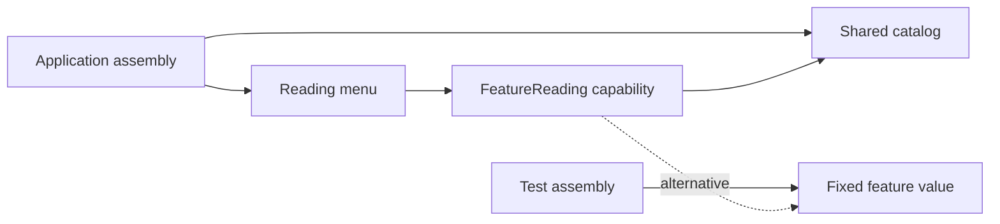

A singleton gives a service one shared identity and a globally reachable access point. Those are two separate decisions: an application may need one catalog instance without needing every feature to discover it through global state.

Swift makes one-time construction concise with `static let`. The harder questions are what the shared object owns, whether it can change, and how callers can be tested without resetting the whole process.

<!--more-->

These examples use Swift 5.7, including actors introduced in Swift 5.5. They distinguish safe initialization from safe access to mutable state.

## Start with an immutable shared capability

```swift
protocol FeatureReading {
    func contains(_ name: String) -> Bool
}

final class FeatureCatalog: FeatureReading {
    static let shared = FeatureCatalog()
    private let enabled: Set<String> = ["reading", "search"]
    private init() {}
    func contains(_ name: String) -> Bool { enabled.contains(name) }
}

let firstCatalog = FeatureCatalog.shared
let secondCatalog = FeatureCatalog.shared
assert(firstCatalog === secondCatalog)
assert(firstCatalog.contains("reading"))
```

The private initializer prevents ordinary callers from constructing another instance of this type. The stored type property supplies the shared instance on first use. Swift's [type-property rules](https://docs.swift.org/swift-book/documentation/the-swift-programming-language/properties/) guarantee one-time initialization even with simultaneous access.

That guarantee covers construction of the stored property. It does not serialize arbitrary mutations performed later by methods on the object. A `static let` reference to a mutable dictionary owner does not make that dictionary thread-safe.

This catalog has immutable value storage and exposes no mutation. Its sharing contract is consequently much smaller than that of a process-wide session manager.

## A singleton can still arrive through injection

```swift
struct FixedFeatures: FeatureReading {
    let enabled: Set<String>
    func contains(_ name: String) -> Bool { enabled.contains(name) }
}

struct ReadingMenu {
    private let features: any FeatureReading
    init(features: any FeatureReading = FeatureCatalog.shared) {
        self.features = features
    }
    var showsReading: Bool { features.contains("reading") }
}

assert(ReadingMenu().showsReading)
assert(!ReadingMenu(features: FixedFeatures(enabled: [])).showsReading)
```

Production assembly chooses the shared default, while a test can supply a small value. The menu does not need a reset method on the catalog or a mutable global override.

A default argument is still a dependency policy. Larger applications may prefer to remove the default and pass the shared catalog only at the composition root, making every feature's construction explicit.

Injection does not require constructing several production catalogs. It separates the consumer's capability from the application's lifetime choice. See [Dependency Injection](/swift-dependency-injection/) for that distinction.

## Mutable shared state needs its own isolation

An actor can own a shared counter while serializing updates:

```swift
actor TicketNumbers {
    static let shared = TicketNumbers()
    private var next = 0
    private init() {}

    func issue() -> Int {
        precondition(next < Int.max)
        next += 1
        return next
    }
}

let issued = await withTaskGroup(of: Int.self, returning: [Int].self) { group in
    for _ in 0..<20 { group.addTask { await TicketNumbers.shared.issue() } }
    var result: [Int] = []
    for await value in group { result.append(value) }
    return result
}
assert(Set(issued).count == 20)
```

The actor's isolation, rather than `shared`, protects the increment. Results arrive in task completion order, which need not match numeric order.

This is a process-local sequence, not a durable identifier generator. Restarting the app resets it; several processes each have their own counter. Persistence, cross-process coordination, and overflow are different requirements.

An actor also does not make an entire multi-step asynchronous workflow atomic. If a method suspends, other actor work can run before it resumes. Validate version-sensitive assumptions again after suspension when necessary.

## Draw the dependency and ownership separately



The singleton owns a process-lifetime access point. The consumer owns a required capability. A test selects another implementation without pretending it changed the real shared instance.

If a singleton retains a delegate, closure, or coordinator, its long lifetime can retain those features indefinitely. Use ownership rules appropriate to those relationships, and provide explicit subscription cancellation when observation ends.

## Global reach can hide temporal coupling

A shared object configured by `configure`, then `login`, then `load` contains a state machine even if its API exposes only unrelated methods. Callers can obtain the singleton before it is ready and then depend on undocumented setup order.

Prefer construction from valid configuration or an explicit state model. If configuration must change, define who may change it and what happens to existing work. A reset method used by tests can invalidate objects still retained by other tests or screens.

Singleton initialization should also avoid surprising effects. Starting network work or calling back into the same singleton while constructing it creates difficult lifetime and reentrancy questions. Keep initialization local and use an explicit activation boundary for effects that need one.

## Case study: one process, two signed-in accounts

Suppose a reader app starts with one account and stores bookmarks in `BookmarkStore.shared`. Every screen works because “current account” is a process-wide assumption. Later, the app adds two windows, each showing a different account. The singleton now combines two distinct decisions: how many stores should exist, and which account owns each store.

Changing a global `currentAccountID` when a window becomes active does not restore that separation. A background save started by the first window may finish after the second window changes the ID. Even serializing access to the singleton cannot make the ID represent both windows at once. Synchronization protects the storage; it does not choose the correct ownership scope.

A better composition root creates one store per account and injects that store into the window's feature graph. Both stores may share an immutable catalog of supported bookmark formats. The catalog has process scope, while account data has account scope. The useful question is therefore “which consumers must share this identity?” rather than “which type should have a static property?”

That distinction also improves tests. Two tests can construct independent account stores while sharing read-only fixtures. A test that verifies one-time static initialization should run in a fresh process if its correctness depends on initialization happening during that test. Resetting a shared instance halfway through a test suite changes the lifecycle being tested.

## Test the contract, not initialization timing accidents

Verify repeated access yields the same identity when that is the promise. Test consumer behavior through injected capabilities. For mutable shared actors, test uniqueness or state-transition invariants rather than assuming task scheduling order.

Do not make one test depend on being the first accessor in a whole test process. Such a test becomes fragile as the suite grows. A constructor or factory used by tests can provide isolated instances when the domain permits them; the production shared instance can still be unique by assembly policy.

## Initialization and lifetime are separate contracts

Swift initializes a stored type property lazily and guarantees its initialization happens once even when several threads access it. This guarantee applies to creating the stored value. Later calls on the returned object still need an appropriate isolation model, such as the actor used above.

A reference held by a static property normally remains reachable for the process lifetime. Do not rely on its `deinit` to flush an essential file or finish an account session. Make shutdown, logout, and persistence explicit operations with observable success or failure.

For a dependency that owns resources, write down three policies before choosing a singleton: who may use it, who may replace it, and who closes it. When all three answers are “the entire process,” a shared instance can be a reasonable convenience. When the answers mention a document, session, window, or test, construct the object at that boundary instead.

## Exercise: replace a global session

Take a service containing an active account and downloaded drafts. Move it into an account-scoped owner, inject the capability into two screens, and construct two independent account scopes in one test. Verify logging out of one scope does not change the other.

Explain which requirement still benefits from sharing and which requirement never needed a process-wide access point.

## Language and API reference

For Swift's type-property initialization guarantee, see Apple's [Managing a Shared Resource Using a Singleton](https://developer.apple.com/documentation/swift/managing-a-shared-resource-using-a-singleton).

Return to the [Design Patterns roadmap](/swift-design-patterns/).
