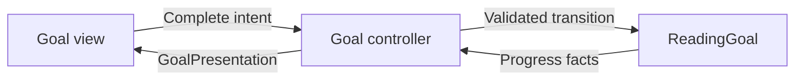

Model-View-Controller separates domain facts, visible presentation, and the coordination between them. The useful boundary is behavioral: changing a borrowing rule should not require editing a label, and changing a label should not redefine the borrowing rule.

Apple's UIKit controllers also participate in view lifecycle, containment, and navigation. A `UIViewController` is therefore a framework role, not a requirement that every application decision live in its subclass.

<!--more-->

This article uses Swift 5.7. The domain and controller core run without a UI; the final conditional UIKit adapter shows where real view lifecycle enters the design. The example is deliberately small enough to trace completely, but protects actual invariants rather than using an unexplained counter. The core and UIKit adapter together implement the controller role; splitting them is a testing choice, not a requirement of MVC.

## Give the model authority over its rules

A reading goal permits a positive target and progress between zero and that target. Buttons are one way to request a transition, but the model must preserve the rule for every caller.

```swift
enum GoalFailure: Error { case invalidTarget, alreadyFinished }

struct ReadingGoal: Equatable {
    let target: Int
    private(set) var completed: Int = 0

    init(target: Int) throws {
        guard target > 0 else { throw GoalFailure.invalidTarget }
        self.target = target
    }
    mutating func completeOne() throws {
        guard completed < target else { throw GoalFailure.alreadyFinished }
        completed += 1
    }
    var isFinished: Bool { completed == target }
}
```

The model has no label, view controller, color, or localization dependency. It is not merely a struct containing publicly writable fields. The private setter makes the valid transition the ordinary way to change progress.

This example stores one goal inside one screen controller. A shared goal used by several screens would need an owner and a change-notification policy. MVC names roles; it does not specify a database, singleton, or observation technology.

## Make the view contract about presentation

```swift
struct GoalPresentation: Equatable {
    let progress: String
    let canComplete: Bool
    let message: String?
}
@MainActor
protocol GoalDisplaying: AnyObject {
    func render(_ presentation: GoalPresentation)
}

@MainActor
final class GoalController {
    private var goal: ReadingGoal
    weak var view: (any GoalDisplaying)?
    private var message: String?

    init(goal: ReadingGoal) { self.goal = goal }
    func appear() { render() }
    func completeTapped() {
        do {
            try goal.completeOne()
            message = nil
        } catch {
            message = "This goal is already complete."
        }
        render()
    }
    private func render() {
        view?.render(GoalPresentation(
            progress: "\(goal.completed) of \(goal.target)",
            canComplete: !goal.isFinished,
            message: message
        ))
    }
}
```

`GoalController` translates a user action into a model operation and translates model facts into display data. The view chooses how to lay out that data. A disabled button is useful feedback, but the model still rejects an extra completion if another caller sends one.

The weak view reference prevents the core from retaining a screen indefinitely. Something else must retain the screen while it is presented. Weak references describe one ownership edge; they are not a complete lifecycle strategy.

## Trace the two directions of communication



The model does not call a view to enforce its invariant. The controller does not infer authoritative progress by reading the text of the label. Displayed strings are projections, not a second storage system.

A server-backed operation adds loading and failure to the coordination path. The controller can start an injected use case, receive its result, and render a state. Networking and decoding do not become view responsibilities simply because the result appears on screen.

## Test the contract without creating a window

```swift
@MainActor
final class GoalViewSpy: GoalDisplaying {
    private(set) var frames: [GoalPresentation] = []
    func render(_ presentation: GoalPresentation) { frames.append(presentation) }
}
try await MainActor.run {
    let display = GoalViewSpy()
    let controller = GoalController(goal: try ReadingGoal(target: 2))
    controller.view = display
    controller.appear()
    assert(display.frames.last?.progress == "0 of 2")
    controller.completeTapped()
    controller.completeTapped()
    assert(display.frames.last == GoalPresentation(
        progress: "2 of 2", canComplete: false, message: nil
    ))
    controller.completeTapped()
    assert(display.frames.last?.progress == "2 of 2")
    assert(display.frames.last?.message != nil)
    do {
        _ = try ReadingGoal(target: 0)
        assertionFailure("A nonpositive target is invalid")
    } catch GoalFailure.invalidTarget {}
}
```

The final tap tests a path a properly disabled button normally prevents. It establishes that the invariant does not depend on a particular widget behaving correctly.

These tests do not establish Auto Layout, accessibility, or target-action wiring. A small integration test for the actual view still has work to do. Separating logic makes the fast tests meaningful without pretending they replace all UI evidence.

## Connect the core to UIKit

```swift
#if canImport(UIKit)
import UIKit

@MainActor
final class GoalViewController: UIViewController, GoalDisplaying {
    private let core: GoalController
    private let progressLabel = UILabel()
    private let messageLabel = UILabel()
    private let completeButton = UIButton(type: .system)

    init(goal: ReadingGoal) {
        core = GoalController(goal: goal)
        super.init(nibName: nil, bundle: nil)
    }
    required init?(coder: NSCoder) { return nil }

    override func viewDidLoad() {
        super.viewDidLoad()
        view.backgroundColor = .systemBackground
        completeButton.setTitle("Complete a book", for: .normal)
        completeButton.addTarget(self, action: #selector(complete), for: .touchUpInside)
        let stack = UIStackView(arrangedSubviews: [progressLabel, messageLabel, completeButton])
        stack.axis = .vertical
        stack.spacing = 12
        stack.translatesAutoresizingMaskIntoConstraints = false
        view.addSubview(stack)
        NSLayoutConstraint.activate([
            stack.leadingAnchor.constraint(equalTo: view.safeAreaLayoutGuide.leadingAnchor, constant: 20),
            stack.trailingAnchor.constraint(equalTo: view.safeAreaLayoutGuide.trailingAnchor, constant: -20),
            stack.centerYAnchor.constraint(equalTo: view.centerYAnchor)
        ])
        core.view = self
        core.appear()
    }
    @objc private func complete() { core.completeTapped() }
    func render(_ presentation: GoalPresentation) {
        progressLabel.text = presentation.progress
        messageLabel.text = presentation.message
        completeButton.isEnabled = presentation.canComplete
    }
}
#endif
```

This adapter owns widgets and framework callbacks. It retains the controller core; the core refers weakly back to its display. The display contract and controller core are main-actor isolated, matching UIKit's UI executor. A background transport adapter must enter that isolation before invoking UI-facing coordination.

The conditional block lets the non-UI example run on macOS. It does not make UIKit available there. In an iOS target, remove the conditional if the whole module requires UIKit.

## Distinguish application state from controller lifetime

Recreating this screen creates a new controller-owned goal unless the composition root supplies the current goal from a longer-lived owner. That may be correct for a draft and wrong for an account-wide reading target.

Ask who owns the authoritative goal before choosing where to allocate the controller. A view loading twice should not duplicate a purchase, reset saved progress, or establish a new account session. View lifecycle is an input to application policy, not the policy itself.

For two windows displaying the same goal, put the shared goal behind an explicit document or account capability. Notify both controllers when it changes, or have both consume immutable snapshots from a store. Avoid making the view a hidden synchronization channel between controllers.

## When MVC is a good starting point

MVC works well when a controller coordinates a bounded interaction and delegates reusable rules and effects to the model layer. It becomes difficult when “coordination” expands to include parsing transport responses, choosing routes, formatting every value, caching data, and enforcing cross-feature business rules.

Extract responsibilities according to reasons to change, not to satisfy a desired class count. A pure formatter does not need a service hierarchy; a fallible remote write may deserve a carefully defined capability. The next article examines those [MVC tradeoffs](/swift-mvc-tradeoffs/) directly.

## Case study: an editor with unsaved changes

A document editor introduces a useful distinction between model rules and controller coordination. The document can validate a title and track its revision. The screen can track a draft title that the person has not saved yet. The navigation owner can decide whether leaving requires confirmation.

Keeping the draft only in a text field makes it difficult to preserve when the view is recreated. Putting the unfinished draft into the shared saved document can make another window display changes that were never committed. Use an explicit editing state containing the base revision and proposed value, and let a save use case perform the conditional commit.

The controller then coordinates three outcomes: saved, rejected by validation, or conflicted with a newer version. It should not turn a conflict into a successful save merely to keep the screen simple. Nor should the model decide which alert controller presents the conflict.

This remains MVC even if the model layer includes an editing session and a persistence capability. The pattern does not restrict “model” to one database-shaped struct.

A useful test begins with two editors of the same revision. Save through the first, then attempt the second save. Verify the authoritative document retains the first result and the second editor retains enough draft information for a meaningful resolution. A UI integration test can then verify that leaving a dirty editor offers the intended choice.

This scenario also identifies a real extraction boundary: when several controllers duplicate the same edit-and-conflict policy, move that policy into one reusable application capability. Extract because the behavior needs one authority, not because MVC has exceeded an arbitrary line limit.

## Exercise: share one goal between two screens

Replace the controller-owned value with an injected store that owns one goal. Show that completing through either controller updates both displays. Define notification timing, subscription cleanup, and what happens when a screen disappears. Add a rejected extra completion after the target is reached.

Apple's archived [MVC description](https://developer.apple.com/library/archive/documentation/General/Conceptual/DevPedia-CocoaCore/MVC.html) defines the classic roles; its [view controller guide](https://developer.apple.com/library/archive/featuredarticles/ViewControllerPGforiPhoneOS/) explains UIKit's framework responsibilities.

Return to the [App Architectures roadmap](/swift-architectures/).
