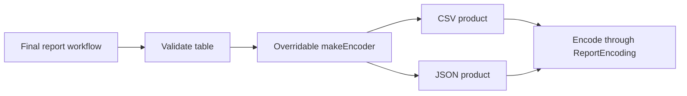

Factory Method lets a stable algorithm ask an overridable creation operation for the product it will use. The algorithm controls the workflow; a subclass chooses a compatible concrete product.

That is more specific than calling any function named `make` a Factory Method. A simple enum-based factory is often sufficient in Swift, but the classic pattern becomes useful when a framework deliberately offers an inherited workflow with a narrow construction hook.

<!--more-->

The Swift 5.7 case study exports a validated table. A base job defines validation and encoding order, while a subclass replaces the encoder. Every example has a working default; there is no abstract method implemented as an unconditional crash.

## Define a product capability

```swift
import Foundation

struct Report {
    let columns: [String]
    let rows: [[String]]
}

enum ReportFailure: Error, Equatable { case invalidShape, invalidEncoding }

protocol ReportEncoding {
    func encode(_ report: Report) throws -> String
}

struct CSVReportEncoder: ReportEncoding {
    private func field(_ value: String) -> String {
        "\"" + value.replacingOccurrences(of: "\"", with: "\"\"") + "\""
    }
    func encode(_ report: Report) throws -> String {
        ([report.columns] + report.rows)
            .map { $0.map(field).joined(separator: ",") }
            .joined(separator: "\r\n")
    }
}

struct JSONReportEncoder: ReportEncoding {
    func encode(_ report: Report) throws -> String {
        let data = try JSONSerialization.data(withJSONObject: [
            "columns": report.columns, "rows": report.rows
        ], options: [.sortedKeys])
        guard let text = String(data: data, encoding: .utf8) else {
            throw ReportFailure.invalidEncoding
        }
        return text
    }
}
```

Both products accept the same validated table model, but produce different encodings. CSV fields are quoted and embedded quotes doubled; commas and newlines inside a field therefore remain data rather than becoming extra fields.

The product contract says nothing about writing a file. Encoding is a calculation; a separate adapter can own file replacement and its failure semantics.

## Keep the workflow fixed and the creation hook replaceable

```swift
class ReportJob {
    final func run(_ report: Report) throws -> String {
        guard !report.columns.isEmpty,
              report.rows.allSatisfy({ $0.count == report.columns.count }) else {
            throw ReportFailure.invalidShape
        }
        let encoder = makeEncoder()
        return try encoder.encode(report)
    }

    func makeEncoder() -> any ReportEncoding { CSVReportEncoder() }
}

final class JSONReportJob: ReportJob {
    override func makeEncoder() -> any ReportEncoding { JSONReportEncoder() }
}

let report = Report(columns: ["title"], rows: [["Values, Objects"], ["A \"quote\""]])
let csv = try ReportJob().run(report)
assert(csv.contains("\"Values, Objects\""))
assert(csv.contains("\"A \"\"quote\"\"\""))
let job: ReportJob = JSONReportJob()
let json = try job.run(report)
let object = try JSONSerialization.jsonObject(with: Data(json.utf8)) as! [String: Any]
assert((object["rows"] as? [[String]]) == report.rows)
```

The call to `run` uses the same inherited algorithm, but dynamic dispatch chooses the subclass's factory hook. `final` prevents a subclass from bypassing validation by replacing the whole workflow.

The cast in the test checks the known shape generated by our encoder. A production JSON reader should validate arbitrary input instead of force-casting it.

## Distinguish the three participants

The creator is `ReportJob`, the factory method is `makeEncoder`, and the products conform to `ReportEncoding`. A concrete creator such as `JSONReportJob` chooses a concrete product.



The pattern matters because construction is an intentional extension point of a larger algorithm. A standalone switch returning CSV or JSON is a simple factory, discussed in [Protocol-Oriented Factories](/swift-protocol-factory-pattern/).

## Verify that validation precedes construction

```swift
final class CountingReportJob: ReportJob {
    private(set) var creations = 0
    override func makeEncoder() -> any ReportEncoding {
        creations += 1
        return CSVReportEncoder()
    }
}
let counting = CountingReportJob()
do {
    _ = try counting.run(Report(columns: ["one"], rows: [["a", "b"]]))
    assertionFailure("Invalid shape must fail before creating a product")
} catch ReportFailure.invalidShape {
    assert(counting.creations == 0)
}
```

The count protects a public sequencing promise: malformed data does not acquire a product. It would be brittle to assert every internal helper invocation if those calls were not part of a meaningful contract.

A resource-producing hook might open a transaction or allocate a renderer. Validation order can then prevent unnecessary effects, while cleanup remains the product owner's responsibility.

## Construction failure belongs in the signature

Our encoders are cheap values, so creation cannot fail. A hook constructing a file-backed writer might need `throws`. Make that explicit in the base declaration and propagate failure before executing the rest of the workflow.

Do not return an unusable placeholder product and hope its first method reports the original construction failure later. That spreads partially initialized state through the algorithm.

Freshness is also a contract. A factory may return a new value, a fresh class instance, or a shared immutable product. A subclass should not quietly return one mutable editor session when the creator promises independence between exports.

## Prefer injection when inheritance has no other purpose

If the only variation is choosing an encoder, a `ReportJob(encoder:)` initializer or a creation closure may be simpler. Factory Method earns its structure when the inherited algorithm is itself a supported extension framework.

An existing superclass with several unrelated override hooks can become fragile. New subclasses may depend on undocumented call order, and a base change can break them. Keep the hook narrow and document when and how often it runs.

The base should call overridable methods only after construction has established valid state. Dispatching to subclass behavior during initialization can expose incompletely initialized assumptions.

## Follow the extension point through a real change

Imagine adding a compressed JSON report. The requirement changes representation, while the checks for an empty report and inconsistent row widths remain the same. A new encoder and a subclass overriding the construction hook can reuse the existing workflow. The caller still invokes `run`; it does not need to remember a separate validation step for this format.

Now consider a streaming report that must validate and emit each row without holding the full document in memory. That requirement changes the algorithm itself. Returning another encoder from `makeEncoder` cannot make the original batch workflow stream. Forcing this change through the same hook would either hide buffering or let subclasses bypass the invariant. Design a separate streaming contract with its own failure and partial-output semantics.

This gives the pattern a practical boundary: an extension belongs in a factory hook when the product varies but the surrounding algorithm remains valid. A new algorithm needs an explicit design change, even if it produces the same file extension.

## Test products and creators at different seams

Encoder tests should focus on representation: commas inside CSV cells, embedded quotes, empty strings, Unicode, and JSON round trips. Creator tests should focus on the invariant surrounding construction: a malformed report fails before encoder creation, and a valid report creates the expected product exactly as often as the workflow promises.

The counting subclass above tests that second responsibility. A snapshot of one encoded file would not prove it; the snapshot might still match even if a creator unnecessarily opened resources before rejecting the input.

Subclasses also need to honor the base class's error behavior. An override that catches encoding failure and returns empty bytes silently turns failure into a successful empty report. The return type alone does not enforce the workflow's meaning.

## Decide who owns a created product

Creating a fresh encoder for each run is inexpensive here. A real product might hold an open file or a temporary archive. Then the workflow must say who closes it when validation, encoding, or finalization throws. Factory Method identifies where the product comes from; it does not provide automatic resource cleanup.

If there is only one creation variation and no useful subclass family, an injected `() -> any ReportEncoding` closure can express the same dependency with less inheritance. Choose the construction mechanism that makes the invariant easiest to review, and keep the workflow's ownership rules visible in either version.

## Exercise: add a fresh writer lifecycle

Change the product from an encoder to an export session with explicit `write` and `finish` operations. Define failure cleanup and whether `finish` is idempotent. Verify each `run` gets an independent session and invalid reports acquire none.

Then compare the subclass hook with constructor-injected creation. Explain which choice makes the consumer's extension needs clearer.

See Swift's [Inheritance chapter](https://docs.swift.org/swift-book/documentation/the-swift-programming-language/inheritance/) for overriding and final methods.

Return to the [Design Patterns roadmap](/swift-design-patterns/).
