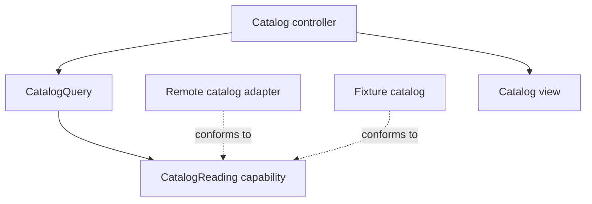

MVC is neither a promise of small controllers nor a sentence to enormous ones. It is a starting arrangement of responsibilities. Its value depends on whether changes stay local and whether the application's important rules remain understandable and testable.

A useful evaluation follows concrete changes through a feature. Counting files or comparing acronym popularity gives much weaker evidence.

<!--more-->

The Swift 5.7 example below compares two ways to obtain a book list. One leaks storage details into presentation; the other places a capability at the consumer's actual decision boundary. The point is not to add a protocol everywhere, but to isolate a change that genuinely varies.

## Start with the changes a feature must absorb

Suppose a library screen displays books, searches by title, opens details, and allows a refresh. Consider four independent requests:

| Change | Natural responsibility | Warning sign |
|---|---|---|
| Change card typography | View | Requires storage changes |
| Sort borrowed books first | Domain/query policy | Repeated in several controllers |
| Replace a remote API | Data adapter | Controller decodes vendor JSON |
| Open a different detail flow | Navigation owner | Every row knows destination construction |

MVC can support all four boundaries. It does not name every helper needed to express them. A small screen can use direct initialization and a few focused value types; a larger feature may need an explicit use case and a navigation capability.

The relevant question is how much unrelated knowledge the controller needs for each change. A ten-line controller that calls a global `EverythingManager` can still hide severe coupling.

## A concrete data boundary

```swift
struct BookSummary: Equatable {
    let id: Int
    let title: String
    let isBorrowed: Bool
}
enum CatalogFailure: Error { case unavailable }
protocol CatalogReading {
    func books() throws -> [BookSummary]
}

struct CatalogQuery {
    let source: any CatalogReading
    func titles(matching query: String) throws -> [String] {
        let candidates = try source.books()
        return candidates
            .filter { query.isEmpty || $0.title.lowercased().contains(query.lowercased()) }
            .sorted {
                if $0.isBorrowed != $1.isBorrowed { return $0.isBorrowed }
                return $0.id < $1.id
            }
            .map(\.title)
    }
}

struct FixtureCatalog: CatalogReading {
    let values: [BookSummary]
    func books() throws -> [BookSummary] { values }
}
struct UnavailableCatalog: CatalogReading {
    func books() throws -> [BookSummary] { throw CatalogFailure.unavailable }
}
```

The query knows the ordering policy and the source contract. It does not know HTTP status codes, a database context, or a table-view cell. Its synchronous API is appropriate for this in-memory example; an actual remote source should expose asynchronous work rather than block a UI thread behind `books()`.

This boundary earns its place because the source varies and failures matter. A protocol wrapping a pure string concatenation would usually offer much less value.

## Test both the selection rule and failure distinction

```swift
let query = CatalogQuery(source: FixtureCatalog(values: [
    BookSummary(id: 3, title: "Swift Patterns", isBorrowed: false),
    BookSummary(id: 8, title: "Swift Values", isBorrowed: true),
    BookSummary(id: 1, title: "Algorithms", isBorrowed: false)
]))
let matchingTitles = try query.titles(matching: "swift")
let missingTitles = try query.titles(matching: "missing")
assert(matchingTitles == ["Swift Values", "Swift Patterns"])
assert(missingTitles.isEmpty)
do {
    _ = try CatalogQuery(source: UnavailableCatalog()).titles(matching: "")
    assertionFailure("Unavailable is not an empty successful catalog")
} catch CatalogFailure.unavailable {}
```

An empty result means the query succeeded and found no matching books. An unavailable source has not established that fact. Turning every error into an empty array makes the controller shorter while making its behavior less honest.

In a UI, the controller can map these outcomes to content, empty state, or error presentation. A separate presenter or view model becomes useful when that mapping is substantial or reused. Introducing one before there is a real presentation responsibility can add forwarding without isolating a decision.

## Separate runtime flow from source dependency



The runtime call may reach a remote adapter. The query's source code still depends only on the capability. This distinction lets a storage implementation change without rewriting presentation rules.

A protocol does not automatically give that benefit. If it returns a vendor query builder, database-managed objects, or framework-specific cancellation tokens, the consumer may still need the vendor's lifecycle knowledge. Inspect the values crossing the boundary.

## The strengths that are easy to underestimate

MVC usually fits UIKit's existing controller lifecycle and target-action mechanisms. New team members can locate screen setup and event handling without learning a separate framework. Direct code can be straightforward to debug because the coordination path is visible.

For a bounded interaction, one controller and several model values can be easier to maintain than six abstractions that merely forward the same request. Small apps benefit from spending effort on validation, accessibility, persistence, and error handling instead of assembling empty layers.

MVC also permits gradual extraction. A controller can receive a query, formatter, repository, or coordinator without requiring every screen to adopt the same additional structure at once. That flexibility is useful in an established app with uneven feature complexity.

## The weaknesses that emerge under pressure

UIKit callbacks converge on controllers. Without deliberate boundaries, view loading becomes the place where services are constructed, requests begin, observations register, and navigation decisions accumulate. This concentration makes initialization order and teardown difficult to inspect.

Shared mutable state can make the problem worse. A controller reading “current account” from a global store may display one account while a delayed request completes for another. MVC does not prevent this, and renaming that controller to a view model does not fix it. Request identity and account scope need explicit contracts.

Presentation state can also become implicit in widgets. If the selected filter exists only as a button title, restoration and testing must reconstruct it from UI details. An explicit [view-state model](/swift-mvc-view-state/) can isolate that problem while retaining MVC.

## Evaluate a proposed extraction with a change experiment

Choose one real requirement, such as adding an offline cache. Implement the smallest boundary that lets the controller preserve its existing success and failure behavior while the source changes. Record which files and tests needed edits.

Then try a different kind of change, such as modifying the row subtitle. If the data adapter must change for a purely visual edit, the boundary still leaks. If adding a field requires updating many identical forwarding types without adding policy, the structure may be excessive.

These are local observations, not universal performance metrics. File counts and change counts depend on conventions and do not establish maintainability by themselves. Use them alongside review clarity, defect patterns, test setup, and onboarding experience.

## Know when another presentation pattern helps

MVP can make a passive view contract explicit and move presentation decisions out of UIKit. MVVM can expose observable state and intent methods for a declarative renderer. A coordinator can own navigation independently of either approach.

These patterns address different pressures. A screen with trivial formatting but difficult child-flow ownership may benefit more from a coordinator than from a presenter. A screen with complex validation and several UI projections may benefit from a presentation model even when navigation is simple.

Do not select an architecture by assuming all controllers are bad or all indirection is good. Preserve the smallest design that makes the important rules, effects, and lifetimes visible.

## Case study: the same query gains a second client

Suppose the borrowed-first catalog query is reused by a home-screen summary. Its stable ID tie-breaker makes results reproducible, but a product request now asks the full catalog to sort alphabetically while the summary keeps borrowed-first ordering.

That change reveals a contract question. If `CatalogQuery` represents the shared borrowed-first policy, keep that meaning and add a separate named query or explicit ordering policy. Silently changing its default would alter the summary too. If ordering was never intended to be shared policy, the original boundary was too broad.

Text matching has similar semantics. The example's lowercased substring search is deterministic for its fixtures, but a production catalog may need locale-aware matching, diacritic handling, or a server's search rules. Two adapters that both claim to implement “search” can disagree unless the contract states which semantics matter.

Do not resolve that disagreement by teaching every controller the adapter's quirks. Either define a common supported rule, expose a deliberate search mode, or make the differing capabilities explicit. An abstraction that hides a difference callers must handle is not providing useful simplicity.

The second client therefore provides better evidence than a class diagram. It tests whether the extracted capability actually contains stable shared policy. Reuse can expose an underspecified boundary just as easily as it can justify one.

Finally, measure expensive projection work where it occurs. Repeated normalization and sorting on every render can matter for a large catalog. Move work or cache it only with an input and invalidation policy; a cache added casually to a controller can reintroduce the freshness coupling the query boundary removed.

## Exercise: compare two concrete changes

Add a cached source with an explicit freshness policy, then add a new presentation subtitle. Identify which contract changes in each case. Preserve the distinction between empty data and unavailable data, and describe the owner that invalidates cached values on account changes.

Continue with [refactoring massive view controllers](/swift-massive-view-controller/) for an incremental extraction sequence.

Return to the [App Architectures roadmap](/swift-architectures/).
