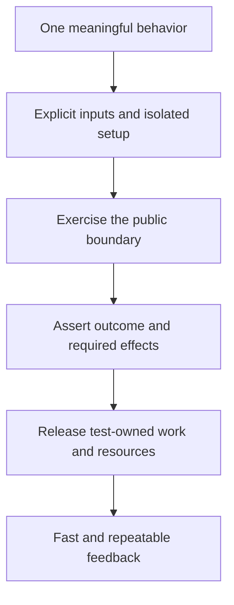

FIRST is a way to review whether a unit test gives useful feedback at a sustainable cost. A test should be fast enough to run often, independent of other tests, repeatable under its stated conditions, self-validating, and written while the behavior is being designed or changed.

These are design questions, not five labels to paste above a test file. A one-millisecond test with no meaningful assertion is weak. A deterministic test of the wrong behavior is still wrong.

<!--more-->

This article uses Swift 5.7 and XCTest. The examples form one test file: later Swift blocks extend the earlier definitions. The **I** is commonly called Independent or Isolated; here it includes both independent setup and useful fault isolation. The **T** means Timely in this guide, consistent with the [introduction](/gentle-introduction-to-unit-testing/).

## Start with one behavior and its boundary

A reading reminder is due only while enabled and once its scheduled instant has arrived. It should use one supplied reference time rather than read the wall clock differently for every comparison.

```swift
import Foundation
import XCTest

struct ReadingReminder: Equatable {
    let id: UUID
    let dueAt: Date
    let enabled: Bool
}
struct ReminderPolicy {
    func dueReminders(_ reminders: [ReadingReminder], at now: Date) -> [UUID] {
        reminders.filter { $0.enabled && $0.dueAt <= now }.map(\.id)
    }
}

final class ReminderPolicyTests: XCTestCase {
    func testIncludesEnabledReminderExactlyAtItsDeadline() {
        let now = Date(timeIntervalSince1970: 1_700_000_000)
        let dueID = UUID(uuidString: "00000000-0000-0000-0000-000000000001")!
        let futureID = UUID(uuidString: "00000000-0000-0000-0000-000000000002")!
        let disabledID = UUID(uuidString: "00000000-0000-0000-0000-000000000003")!
        let reminders = [
            ReadingReminder(id: dueID, dueAt: now, enabled: true),
            ReadingReminder(id: futureID, dueAt: now.addingTimeInterval(1), enabled: true),
            ReadingReminder(id: disabledID, dueAt: now.addingTimeInterval(-1), enabled: false)
        ]
        let result = ReminderPolicy().dueReminders(reminders, at: now)
        XCTAssertEqual(result, [dueID])
    }
}
```

This test establishes the deadline boundary and excludes two plausible wrong results. It does not ask the operating system to deliver a notification or wait for real time to pass. Those operations belong to a different integration boundary.

The fixed UUIDs express identities without an uncontrolled generator. Randomness can be useful in generated testing, but the seed and failing input must be recorded so a failure can be reproduced.

## Fast: shorten the feedback loop, including setup

A pure policy test should not boot the app, open a database, contact a server, or wait for a timer. Those costs make the test slower and introduce failures unrelated to the policy it claims to check.

Measure the whole test path: discovery, fixture creation, execution, and cleanup. A fast assertion after five seconds of shared setup is not a fast unit test. Split broad fixtures so an ordinary policy change can be checked without constructing an entire application graph.

There is no universal duration limit that makes every test good or bad. A unit suite should support frequent local runs; an integration suite can legitimately take longer because it verifies a broader boundary. Label and schedule those suites deliberately rather than weakening integration evidence to meet a unit-test budget.

Do not replace meaningful waits with arbitrary smaller sleeps to improve the stopwatch. Remove the uncontrolled dependency or wait for the actual completion condition.

## Independent: construct the state each test needs

A test must not rely on another test having logged in, created an account, or cleared a shared store. It should remain valid when run alone, in another order, or beside another test on an independent worker.

```swift
struct BookmarkList {
    private(set) var ids: Set<Int> = []
    mutating func add(_ id: Int) {
        guard id > 0 else { return }
        ids.insert(id)
    }
}
final class BookmarkListTests: XCTestCase {
    func testAddingTheSameBookTwiceKeepsOneBookmark() {
        var list = BookmarkList()
        list.add(7)
        list.add(7)
        XCTAssertEqual(list.ids, [7])
    }
    func testInvalidIdentityDoesNotCreateABookmark() {
        var list = BookmarkList()
        list.add(0)
        XCTAssertTrue(list.ids.isEmpty)
    }
}
```

Each test creates its own list. The second does not clear the first test's state; there is no shared state to repair. For a real database, use a fresh namespace, transaction, or isolated store with cleanup tied to that test's lifetime.

Independence also improves diagnosis. A failure message should identify the broken contract without requiring someone to reconstruct a hidden sequence of earlier tests. One coherent behavior can require several related assertions; the goal is fault isolation, not an arbitrary one-assertion rule.

## Repeatable: make environmental assumptions explicit

A reminder test using `Date()` can fail near a boundary even when it passed a moment earlier. A formatter can change with the machine's locale or calendar. A URL lookup can depend on a service that is unavailable in CI.

Pass varying facts as values or dependencies. The reminder policy accepts `now`. A formatter can accept a locale and time zone. A request coordinator can accept a controlled loader. Keep the assumptions visible in the test setup.

Repeatable does not mean production should behave like a test fixture. A real clock remains a real clock in the application; the seam makes the rule testable under a chosen reference time. Integration tests then verify the real adapter's contract separately.

For concurrency, repeatability often means controlling ordering rather than eliminating concurrency. Signal when an operation reaches a known suspension point, perform the competing action, then release it. Sleeping for a guessed duration does not establish that ordering.

## Self-validating: assert an outcome that could be wrong

A test that calls `save()` and prints the returned value cannot fail when the saved content is wrong. A test that asserts only “no error” can miss a successful-looking write that stored the wrong entity.

Use concrete observations: returned values, committed state, emitted presentation, or a required effect request. Assert the absence of effects when absence matters, such as invalid input not reaching persistence.

```swift
enum TitleFailure: Error { case empty }
final class TitleStoreSpy {
    private(set) var titles: [String] = []
    func save(_ title: String) { titles.append(title) }
}
struct SaveTitle {
    let store: TitleStoreSpy
    func execute(_ title: String) throws {
        guard !title.trimmingCharacters(in: .whitespacesAndNewlines).isEmpty else {
            throw TitleFailure.empty
        }
        store.save(title)
    }
}
final class SaveTitleTests: XCTestCase {
    func testBlankTitleIsRejectedBeforeStorageChanges() {
        let store = TitleStoreSpy()
        let operation = SaveTitle(store: store)
        XCTAssertThrowsError(try operation.execute("  \n")) { error in
            XCTAssertTrue(error is TitleFailure)
        }
        XCTAssertTrue(store.titles.isEmpty, "Rejected input must not reach storage")
    }
    func testValidTitleIsStoredUnchanged() throws {
        let store = TitleStoreSpy()
        try SaveTitle(store: store).execute("Swift values")
        XCTAssertEqual(store.titles, ["Swift values"])
    }
}
```

The storage observation matters because throwing alone does not prove a method failed before performing an effect. The success test also prevents a no-op implementation from satisfying only the rejection path.

A deliberately small spy is appropriate here because the effect itself is the observation. A real consumer usually accepts a narrow storage protocol; see [test doubles](/test-doubles-in-swift/) for choosing that seam without coupling tests to private choreography.

## Timely: use the test while the design is still negotiable

Writing a test before or alongside a change exposes awkward inputs and hidden dependencies while they are still easy to fix. If testing a one-line policy requires constructing five view controllers, that is useful design feedback.

A test-first cycle can state one expected failure, implement the smallest behavior, and refactor with that behavior protected. Verify the initial failure is for the intended reason, not a missing import or an unavailable fixture.

For legacy code, begin with a characterization test around an observable boundary. Preserve intended behavior while extracting one seam, then add focused tests for new rules. Timely is not a reason to abandon useful coverage because the code already exists.

## Review the principles together



The principles reinforce one another. Isolated fixtures reduce order dependence. Explicit time shortens tests and improves repeatability. Meaningful assertions make failures useful. Timely tests reveal seams before the implementation hardens around hidden assumptions.

They can also reveal tradeoffs. A real persistence test takes more work than a pure policy test because it proves a different claim. Keep both where the risk warrants them instead of demanding that every test have identical size.

## Exercise: review a test with one hidden dependency

Choose a test that reads the real clock, shared defaults, or a live service. State which behavior it intends to prove, replace the uncontrolled input at that boundary, and add an assertion that would catch a plausible defect. Run it independently and under reordered execution.

The [Agile in a Flash description of FIRST](https://agileinaflash.blogspot.com/2009/02/first.html) is a primary account of the principles. The Swift examples and practical tradeoffs here apply them to explicit testing boundaries.

Return to the [Testing roadmap](/swift-testing/).
