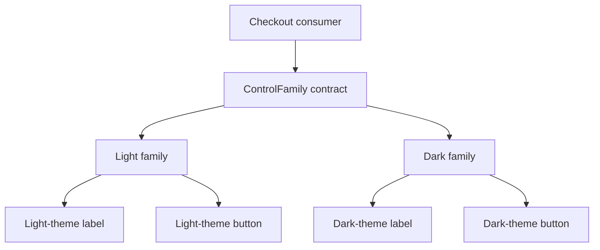

Abstract Factory creates related products that belong to one compatible family. A theme might supply labels and buttons, while another theme supplies another matching pair. The consumer should not need to select each concrete product independently and accidentally combine incompatible families.

The key distinction from Factory Method is the family relationship. A factory returning one exporter is not automatically an Abstract Factory merely because its return type is a protocol.

<!--more-->

The Swift 5.7 example uses lightweight rendered controls rather than a UI framework. Associated types make family compatibility visible to the compiler, while ordinary assertions check the actual rendered policy.

## Express the relationship between products

```swift
protocol LabelRendering {
    associatedtype Theme
    func draw(text: String) -> String
}
protocol ButtonRendering {
    associatedtype Theme
    func draw(title: String) -> String
}
protocol ControlFamily {
    associatedtype Theme
    associatedtype Label: LabelRendering where Label.Theme == Theme
    associatedtype Button: ButtonRendering where Button.Theme == Theme
    func makeLabel() -> Label
    func makeButton() -> Button
}

enum LightTheme {}
enum DarkTheme {}

struct ThemeLabel<Theme>: LabelRendering {
    let ink: String
    func draw(text: String) -> String { "label[\(ink)]: " + text }
}
struct ThemeButton<Theme>: ButtonRendering {
    let fill: String
    func draw(title: String) -> String { "button[\(fill)]: " + title }
}

struct LightControls: ControlFamily {
    typealias Theme = LightTheme
    func makeLabel() -> ThemeLabel<LightTheme> { ThemeLabel(ink: "dark") }
    func makeButton() -> ThemeButton<LightTheme> { ThemeButton(fill: "light") }
}
struct DarkControls: ControlFamily {
    typealias Theme = DarkTheme
    func makeLabel() -> ThemeLabel<DarkTheme> { ThemeLabel(ink: "light") }
    func makeButton() -> ThemeButton<DarkTheme> { ThemeButton(fill: "dark") }
}
```

The same-type constraints require a family's label and button to carry its theme marker. This prevents one factory from declaring a light label and a dark button as its statically compatible pair.

The marker is not a proof of visual quality. A programmer can still construct a `ThemeLabel<LightTheme>` with the wrong color text. Types preserve the relationship; implementation tests preserve the policy associated with that relationship.

## Let the consumer request a family

```swift
func checkout<F: ControlFamily>(using family: F) -> String {
    family.makeLabel().draw(text: "Total") + "\n" +
    family.makeButton().draw(title: "Pay")
}

let light = checkout(using: LightControls())
let dark = checkout(using: DarkControls())
assert(light == "label[dark]: Total\nbutton[light]: Pay")
assert(dark == "label[light]: Total\nbutton[dark]: Pay")
```

The checkout algorithm requests both products from the same family. It contains no branch for which theme is selected and no knowledge of concrete color choices.

This can model more substantial relationships: a storage family supplying readers and transactions for the same database, or a document family supplying encoders and validators for one schema version. The products should share a real compatibility requirement, not merely happen to be constructed together.

## Preserve compatibility when passing products separately

```swift
func renderPair<L: LabelRendering, B: ButtonRendering>(
    label: L, button: B
) -> String where L.Theme == B.Theme {
    label.draw(text: "Ready") + " / " + button.draw(title: "Continue")
}

let family = LightControls()
let pair = renderPair(label: family.makeLabel(), button: family.makeButton())
assert(pair.contains("label[dark]"))
// Passing LightControls().makeLabel() with DarkControls().makeButton()
// is rejected by the same-theme requirement.
```

Without the associated relationship, a pair of unrelated `any LabelRendering` and `any ButtonRendering` values would lose the fact that the consumer needs matching themes. Erasing types can be useful, but it should not erase a relationship the algorithm relies on.

For a runtime theme choice, branch at assembly and call the generic consumer in each branch. The result can be an ordinary rendered string or view model; the entire application does not need to become generic.

## Draw the family boundary



A new family adds implementations of the existing product roles. A new product role, such as a text field, requires extending the family contract and updating every family. That is an important tradeoff, not a defect hidden by the pattern name.

## Family identity and resource identity differ

A theme marker can express compile-time compatibility across instances. A database transaction may require a stronger runtime relationship: its reader must belong to the exact same database instance or connection.

If that identity matters, validate it with an owner-issued token or construct the related operations behind one session object. Two products sharing a generic database type are not necessarily from the same live database.

Likewise, a factory's lifetime does not determine product lifetime automatically. Lightweight styles can be reused, while an edit transaction must be fresh and explicitly finished. Define whether construction can fail and who closes acquired resources.

## Avoid multiplying factories for unrelated choices

If theme and export destination vary independently, combining both into one factory can create a cross-product of factory classes. The [Bridge pattern](/swift-bridge-pattern/) separates independent dimensions instead.

Abstract Factory is appropriate when products must move together as one coherent choice. It can become needless ceremony when a feature needs one simple dependency or when all configuration is a small immutable value.

An enum configuration and a direct initializer may be easier to read than a family protocol if there is no meaningful product compatibility or external extension requirement.

## Test product families as a matrix

For each family, verify every required product can be created, uses the intended policy, and works with the family's consumer. Include failure cases for resource-backed families and attempts to combine incompatible runtime owners.

Compiler checks can protect static relationships, but a runtime test still needs to establish actual behavior. A light marker with dark rendering passes a type check and fails the product contract.

## Case study: adding a high-contrast control family

A high-contrast theme needs both a readable label and an unmistakable primary action. Adding two unrelated factory functions makes it possible to accidentally combine a high-contrast label with a low-contrast button. The family abstraction moves that compatibility rule to one construction boundary.

With the generic relationship above, a high-contrast factory supplies products whose associated theme marker agrees. This is a useful compile-time guarantee about membership. It does not prove that the colors meet an accessibility requirement or that a button's focus outline is visible. Those properties still need tests against actual rendering and interaction.

A theme marker should therefore represent a meaningful compatibility boundary. Creating a new marker for every individual font size would make the type system harder to use without protecting an important invariant. Conversely, putting every theme under one universal marker would erase the relationship the factory exists to preserve.

## Runtime choice and static compatibility

An app often reads the theme from a setting at runtime. That does not require discarding the generic design. A switch at the composition boundary can choose a concrete family and call the same generic rendering function in each branch. The returned screen description or rendered result can have a common type even though the family used internally differs.

The more difficult case is storing several unknown families together and later extracting their products independently. A type-erased wrapper can hide each concrete family, but an erased label and an erased button no longer carry a statically visible equality between their theme types. Keep related products inside one erased bundle, or validate compatibility at runtime. Erasure changes which guarantees remain expressible; it is not merely shorter spelling.

## Product families have a maintenance cost

Adding another family is local: provide the existing products for that family. Adding a new kind of product, such as a progress indicator, changes the family contract and every factory that conforms to it. This asymmetry is part of the pattern's tradeoff.

Before adding a product to the factory, ask whether every family can provide an honest implementation. A print-only theme might have no meaningful interactive slider. Returning a broken placeholder to satisfy the protocol makes the abstraction weaker. Separate printable and interactive capabilities when they serve different consumers.

A useful review table lists each family across the top and each required capability down the side. An unexplained blank cell is a design question to resolve before adding another protocol requirement.

## Exercise: add a schema family

Define a family containing a document encoder and validator for one schema version. Make encoded output pass the matching validator and fail a deliberately incompatible version. Decide which compatibility can be expressed with associated types and which requires version metadata in serialized bytes.

For the language mechanism, see [Associated Types](/swift-associated-types/).

Return to the [Design Patterns roadmap](/swift-design-patterns/).
