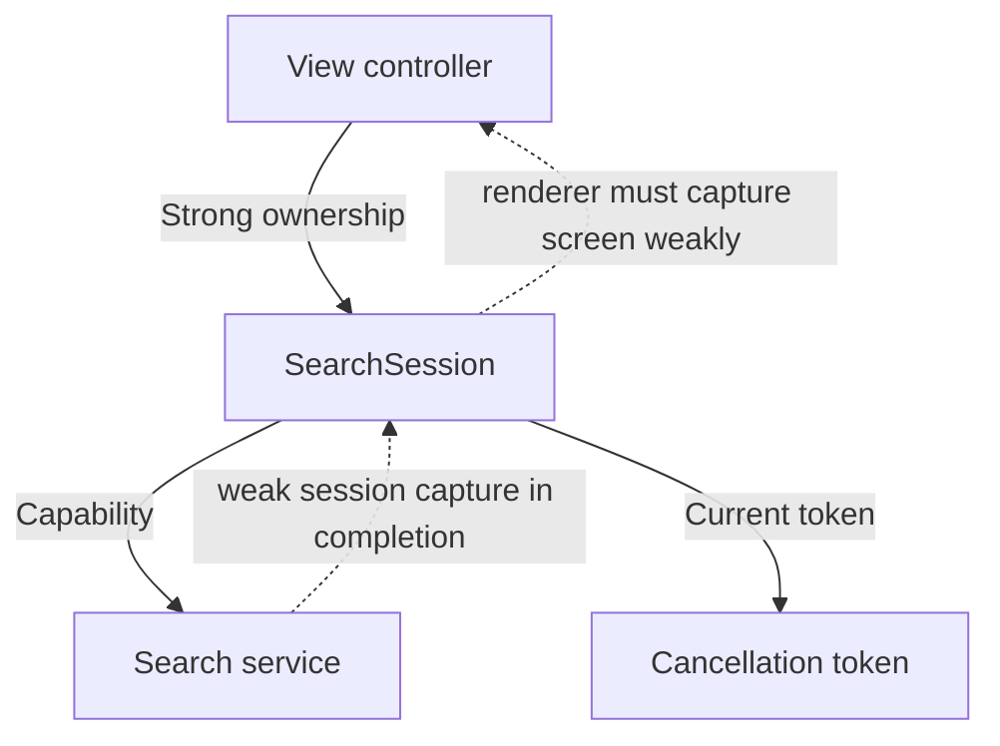

A massive view controller is difficult because unrelated decisions and lifetimes converge in one place. Line count is a clue, not the diagnosis. A long layout method can be straightforward; a short method that reaches through globals and starts hidden work can be much harder to change.

Refactor from a specific pain: a validation rule repeated across screens, an old response overwriting current content, or an object that survives dismissal. Each symptom suggests a different boundary.

<!--more-->

The Swift 5.7 example extracts request coordination from a catalog screen. It preserves a valuable behavior: replacing a search must prevent the old search's late response from changing the current screen, even if the underlying service ignores cancellation.

## Inventory responsibilities before moving methods

A typical overloaded controller contains widget layout, input parsing, business validation, transport calls, response decoding, cache policy, presentation formatting, navigation, and subscription cleanup.

Group those by why they change. Layout changes for visual design. Borrowing limits change for domain policy. Request decoding changes when the service contract changes. Search lifetime changes when interaction policy changes. Putting each group in a new file without defining its contract simply distributes the original coupling.

Start with a boundary that has a clear input and observable output. A search session receives a query, starts one current request, and publishes a typed phase. It can be tested without a navigation stack or an actual network.

## Define cancellation as a capability, then guard acceptance

```swift
struct SearchBook: Equatable { let id: Int; let title: String }
enum SearchFailure: Error { case offline }
protocol SearchCancellation: AnyObject { func cancel() }
protocol BookSearching {
    func search(_ query: String,
                completion: @escaping (Result<[SearchBook], SearchFailure>) -> Void)
        -> any SearchCancellation
}
enum SearchPhase: Equatable {
    case idle
    case loading(String)
    case loaded([SearchBook])
    case failed(String)
}

final class SearchSession {
    private let service: any BookSearching
    private var request: (any SearchCancellation)?
    private var generation = 0
    private var active = true
    private(set) var phase: SearchPhase = .idle
    var changed: ((SearchPhase) -> Void)?

    init(service: any BookSearching) { self.service = service }
    func search(_ query: String) {
        guard active else { return }
        precondition(generation < Int.max)
        generation += 1
        let ticket = generation
        request?.cancel()
        request = nil
        phase = .loading(query)
        changed?(phase)
        // A rendering callback can synchronously start a different search or stop.
        guard active, generation == ticket else { return }
        let returned = service.search(query) { [weak self] result in
            guard let self = self, self.active, self.generation == ticket else { return }
            switch result {
            case let .success(books): self.phase = .loaded(books)
            case .failure: self.phase = .failed("Search is unavailable.")
            }
            self.changed?(self.phase)
        }
        if active, generation == ticket { request = returned }
        else { returned.cancel() }
    }
    func stop() {
        guard active else { return }
        active = false
        request?.cancel()
        request = nil
        changed = nil
    }
    deinit { request?.cancel() }
}
```

All calls and completions here require the same serial executor. A real transport adapter must hop to the UI executor before calling completion, or the session and callback contract should be annotated consistently with `@MainActor`.

Cancellation requests that work stop. The ticket decides whether its result still belongs to this screen. These are different responsibilities, and both matter when cancellation races with completion.

The post-render check handles synchronous reentrancy. Without it, rendering a loading state could start a second search, after which the first call would still start obsolete work. The returned-token check also prevents an outer call from replacing the token of a newer reentrant request.

## Use a controllable service to reproduce the bug

```swift
final class SearchToken: SearchCancellation {
    private(set) var cancelled = false
    func cancel() { cancelled = true }
}
final class ControlledSearch: BookSearching {
    var completions: [(Result<[SearchBook], SearchFailure>) -> Void] = []
    var tokens: [SearchToken] = []
    func search(_ query: String,
                completion: @escaping (Result<[SearchBook], SearchFailure>) -> Void)
        -> any SearchCancellation {
        let token = SearchToken()
        tokens.append(token)
        completions.append(completion)
        return token
    }
}
let service = ControlledSearch()
let session = SearchSession(service: service)
var rendered: [SearchPhase] = []
session.changed = { rendered.append($0) }
session.search("Old")
session.search("New")
assert(service.tokens[0].cancelled)
let newBooks = [SearchBook(id: 2, title: "New result")]
service.completions[1](.success(newBooks))
service.completions[0](.success([SearchBook(id: 1, title: "Stale")]))
assert(session.phase == .loaded(newBooks))
let frameCount = rendered.count
session.stop()
service.completions[1](.failure(.offline))
assert(rendered.count == frameCount)
assert(service.tokens[1].cancelled)
```

This test uses no sleeps. It controls the exact completion order and deliberately delivers a callback after cancellation. A test in which cancellation simply deletes the callback would not establish the acceptance rule.

The service promises one completion per request. If an adapter can call completion repeatedly, it needs an additional completion-once guard or a stream-shaped contract. Extraction should make assumptions visible rather than silently broaden them.

## Draw ownership separately from events



The screen can bind `changed` with a weak capture and render `phase` in its widgets. On a true end of the feature, its owner calls `stop`. Merely disappearing under a temporary overlay may not mean the search feature should stop; lifecycle policy belongs to the feature owner.

Deinitialization provides fallback cleanup. It cannot serve as the only stop signal when an accidental cycle prevents deinitialization in the first place.

## Extract one responsibility at a time

First add a characterization test for the observed behavior. Then extract the smallest pure mapping or workflow boundary. Keep the old controller as an adapter that forwards user input and renders output. Remove the old implementation once the new path owns the behavior.

Next address other pressures independently. Move navigation to a coordinator if destination construction and child ownership are entangled with search. Move persistence behind a repository if freshness and write conflicts dominate. Move domain validation into a use case if several screens need the same invariant.

Avoid a `SearchManager` that receives the old controller and reaches into its fields. That preserves the coupling through a different name. The new object should receive values and capabilities, not a back door into the old implementation.

## Keep integration evidence after extraction

A passing session test does not prove the search button is wired, the UI updates on the correct executor, or a coordinator calls `stop` at the right moment. Keep a small integration test for those assembly decisions.

Likewise, resist asserting every private method call. Tests that observe phases, cancellation, and accepted results remain useful if the implementation changes from callbacks to tasks. Tests tied to helper names make the next refactor harder without proving more behavior.

## Verify the reentrant path, not just delayed responses

```swift
let reentrantService = ControlledSearch()
let reentrantSession = SearchSession(service: reentrantService)
var replaced = false
reentrantSession.changed = { phase in
    if phase == .loading("Old"), !replaced {
        replaced = true
        reentrantSession.search("New")
    }
}
reentrantSession.search("Old")
assert(reentrantService.completions.count == 1)
assert(reentrantSession.phase == .loading("New"))
reentrantService.completions[0](.success([SearchBook(id: 2, title: "Current")]))
reentrantSession.stop()
assert(reentrantService.tokens[0].cancelled)

final class ImmediateSearch: BookSearching {
    let token = SearchToken()
    func search(_ query: String,
                completion: @escaping (Result<[SearchBook], SearchFailure>) -> Void)
        -> any SearchCancellation {
        completion(.success([SearchBook(id: 1, title: query)]))
        return token
    }
}
let immediate = ImmediateSearch()
let immediateSession = SearchSession(service: immediate)
immediateSession.search("Synchronous")
assert(immediateSession.phase == .loaded([SearchBook(id: 1, title: "Synchronous")]))
immediateSession.stop()
assert(immediate.token.cancelled)
```

The first test checks that publishing a loading frame cannot cause an obsolete outer call to start transport work after a nested search replaces it. The second checks the opposite timing extreme: a dependency completes before returning its cancellation token.

Both are realistic adapter behaviors. A memory cache can complete synchronously even when the network implementation usually completes later. A refactor that only works with asynchronous timing has made an undocumented assumption about the dependency.

The tests also make the extracted API reviewable: its value is a stated ordering and lifetime contract, not merely fewer lines in a UIKit subclass.

## Exercise: test synchronous reentrancy

Make the loading callback start a second query immediately. Verify the first query never begins its transport call and the second token remains the one stopped by `stop`. Then create a service that completes synchronously and check that the completed phase remains correct. Compare these lifecycle decisions with the [Coordinator pattern](/swift-coordinator/).

Return to the [App Architectures roadmap](/swift-architectures/).
