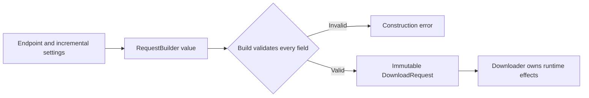

A builder separates assembling configuration from publishing a usable product. It is helpful when construction has several optional choices and cross-field validation that would make a large initializer difficult to read.

The goal is not a long chain of setters. The goal is a product that satisfies its invariant when construction succeeds, with an explicit distinction between an incomplete draft and a valid result.

<!--more-->

This Swift 5.7 case study builds an immutable download request. The endpoint is required at the start; timeout and headers are configurable. The demonstration validates an intentionally narrow HTTP-header policy rather than claiming to implement a complete networking stack.

## Make the product independent of its builder

```swift
import Foundation

struct DownloadRequest: Equatable {
    let endpoint: URL
    let timeoutSeconds: Int
    let headers: [String: String]
}

enum RequestBuildFailure: Error, Equatable {
    case invalidEndpoint
    case invalidTimeout
    case invalidHeader(String)
}

struct RequestBuilder {
    private let endpoint: URL
    private var timeoutSeconds = 30
    private var pendingHeaders: [(String, String)] = []

    init(endpoint: URL) { self.endpoint = endpoint }

    func timeout(_ seconds: Int) -> RequestBuilder {
        var next = self
        next.timeoutSeconds = seconds
        return next
    }

    func header(_ name: String, value: String) -> RequestBuilder {
        var next = self
        next.pendingHeaders.append((name, value))
        return next
    }

    func build() throws -> DownloadRequest {
        guard endpoint.scheme == "https", endpoint.host?.isEmpty == false else {
            throw RequestBuildFailure.invalidEndpoint
        }
        guard (1...120).contains(timeoutSeconds) else { throw RequestBuildFailure.invalidTimeout }
        var headers: [String: String] = [:]
        for (name, value) in pendingHeaders {
            let validName = !name.isEmpty && name.utf8.allSatisfy { byte in
                (65...90).contains(byte) || (97...122).contains(byte) ||
                (48...57).contains(byte) || byte == 45
            }
            guard validName, !value.unicodeScalars.contains(where: {
                $0.value == 13 || $0.value == 10
            }) else {
                throw RequestBuildFailure.invalidHeader(name)
            }
            headers[name.lowercased()] = value
        }
        return DownloadRequest(endpoint: endpoint, timeoutSeconds: timeoutSeconds, headers: headers)
    }
}

let base = RequestBuilder(endpoint: URL(string: "https://example.com/books")!)
let fast = try base.timeout(5).header("Accept", value: "application/json").build()
let ordinary = try base.build()
assert(fast.timeoutSeconds == 5 && ordinary.timeoutSeconds == 30)
assert(fast.headers["accept"] == "application/json")
assert(ordinary.headers.isEmpty)
```

Each modifier returns another builder value. Branching from `base` does not let one request's header or timeout leak into another. The product copies validated values and does not retain a mutable builder object.

The literal URL is fixed test data. An application receiving a URL string must handle parsing failure before constructing the builder.

## Validation should publish all or nothing

```swift
do {
    _ = try base.timeout(0).build()
    assertionFailure("Zero timeout is outside the application policy")
} catch RequestBuildFailure.invalidTimeout {}
do {
    _ = try base.header("X-Note", value: "one\r\ntwo").build()
    assertionFailure("Embedded line separators must be rejected")
} catch RequestBuildFailure.invalidHeader("X-Note") {}
let replaced = try base.header("Accept", value: "one").header("ACCEPT", value: "two").build()
assert(replaced.headers == ["accept": "two"])
```

Validation happens before a product escapes. Invalid drafts remain ordinary builder values and can be corrected; they are not partially usable requests passed to a network client.

The line-separator check examines Unicode scalars. CRLF can form one extended grapheme cluster in Swift, so testing only for individual `Character` values can miss the combined sequence. The explicit failing case protects that boundary.

The duplicate-header policy is last-write-wins after validated ASCII case normalization. Some HTTP headers support multiple values with field-specific semantics. Supporting them would require a richer model, not an undocumented change to dictionary assignment.

Endpoint validation establishes a local application constraint, not remote trust. It does not validate certificates, authorize a destination, or prevent every server-side request-forgery scenario in another system. Those belong to the adapter and deployment's actual requirements.

## When a staged builder helps

A staged API can make required construction steps visible in types: selecting an endpoint returns an endpoint-configured builder that exposes `build`. This can prevent a missing endpoint at compile time. It cannot establish that a runtime string is a valid endpoint, so parsing still returns an error.

Staging also increases the number of public types and can make conditional configuration awkward. For three required values supplied together, a validating initializer may be clearer. A builder earns its place when independent optional settings, reusable presets, or incremental form state make direct construction hard to follow.

Whichever API you choose, keep defaults explicit and test that deriving one configuration does not mutate another. Value semantics make that branching behavior natural in the example.

In this example, the endpoint is a required initializer argument. This removes a missing-endpoint state without introducing a separate builder phase type.

## Builder and Factory answer different questions

A factory chooses or creates a product. A builder collects choices and enforces construction rules across several steps. A factory may internally use a builder, and a builder may receive a factory for a resource it will need later.

Abstract Factory coordinates a family of related products; it is not a synonym for a configurable constructor. Factory Method varies creation inside an inherited algorithm. These distinctions help choose the smallest structure that fits the problem.

For an immutable value with only three obvious fields and no complex validation, a named initializer may already be the best builder. Do not add another type only to make construction look fluent.

## Build a value, then begin effects

Suppose a download screen collects an address, custom headers, and a timeout over several interactions. The intermediate form can be incomplete: an empty address is normal while the person is typing. The final `DownloadRequest` should still satisfy the rules required by the downloader.

Keeping a builder separate from the request gives those two states different meanings. Editing the builder does not start a network operation. Calling `build()` either produces a valid immutable request or reports why construction failed. The downloader receives a complete value and can focus on transport behavior.

Do not use construction validation as a guarantee that the future request will succeed. A syntactically valid URL can resolve to an unavailable service. A permitted timeout can expire. Builder validation checks properties available at construction time; the operation still returns its own runtime failures.

If construction acquires a file handle or transaction, define who closes it and whether retrying `build` creates another resource. A value builder keeps configuration branches independent; it does not manage acquired resources automatically.

## Snapshot semantics make tests meaningful

Build one request, continue modifying the builder, and verify the first request remains unchanged. Branch two variants from one base and compare their independent settings. Test invalid combinations, exact timeout boundaries, header normalization, and repeated build calls.

Assertions should target product behavior and failure reasons rather than the internal order in which a builder stores its fields. An implementation can move validation earlier without changing the published request contract, provided its documented error policy remains compatible.

## Order, normalization, and duplicate fields

The header example intentionally keeps pending entries until validation. If invalid input were silently dropped as each setter ran, a later successful build could conceal a configuration mistake. Likewise, normalizing names before deciding duplicate policy avoids treating `Accept` and `accept` as unrelated keys.

“Last value wins” is one explicit policy, not a general rule for HTTP headers. Some fields permit combining values, while others have special semantics. A production request builder should use the transport library's field rules rather than assume that every duplicate can be joined with a comma.

The CRLF check demonstrates why text rules need the right unit of inspection. Swift's `Character` represents an extended grapheme cluster; carriage return followed by line feed can form one character. Looking for their individual Unicode scalars checks the forbidden control values directly. Similar care is needed when validation concerns bytes, scalars, normalized text, or user-perceived characters.

## Show the construction boundary



The error edge leaves no partially valid request for the transport to discover later. The original builder value can still be edited and built again.

## Exercise: add mutually exclusive credentials

Support either a bearer token or a signed-request configuration, but not both. Decide whether incompatible modifiers fail immediately or at build time. Verify no credential leaks between builder branches and that a built request contains only the selected authentication policy.

For value behavior, see [Immutability](/swift-immutability/) and [Copy-on-Write](/swift-copy-on-write/).

## Language and API reference

For the distinction between extended grapheme clusters and Unicode scalars, see the Swift language guide's [Strings and Characters](https://docs.swift.org/swift-book/documentation/the-swift-programming-language/stringsandcharacters/).

Return to the [Design Patterns roadmap](/swift-design-patterns/).
