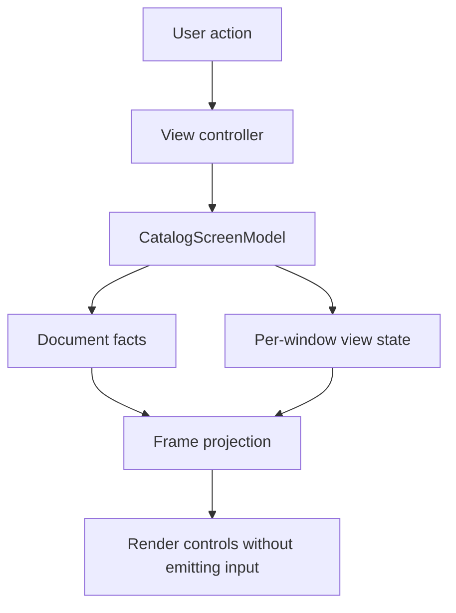

MVC with explicit view state separates the document's facts from the interaction facts needed to reconstruct a screen. A book's title belongs to the document. The search query, selected book, and expanded section usually belong to a particular screen or window.

Without that separation, UI controls become an accidental storage system. Restoration reads a button title to discover the filter, or a refresh forgets which item was selected because the selection existed only in a table view.

<!--more-->

This Swift 5.7 example models a catalog document and one window's view state. It follows the MVC+VS idea discussed in [App Architecture](https://www.objc.io/books/app-architecture/); the implementation below is original and uses ordinary Swift values rather than a particular reactive framework.

## Identify two kinds of state

```swift
struct CatalogBook: Equatable {
    let id: Int
    let title: String
}
struct CatalogDocument: Equatable {
    let books: [CatalogBook]
    init(books: [CatalogBook]) {
        precondition(Set(books.map(\.id)).count == books.count)
        self.books = books
    }
}
struct CatalogViewState: Equatable {
    var query = ""
    var selectedID: Int?
    var showsOnlySelected = false
}
enum CatalogAction {
    case queryChanged(String)
    case selected(Int?)
    case onlySelectedChanged(Bool)
    case documentReplaced(CatalogDocument)
}
struct CatalogFrame: Equatable {
    let rows: [CatalogBook]
    let selectedID: Int?
    let query: String
}
```

The document initializer checks unique IDs because selection uses identity, not array position. An untrusted decoder should return a validation error rather than trigger this programmer-facing precondition.

The view state is separate for each window. Two windows can show the same document with different queries and selections. Storing the query in the shared document would accidentally make those windows compete over one interaction choice.

Loading, errors, scroll position, and modal presentation are also candidates for view state. Include each fact that must survive reconstruction, but avoid indiscriminately storing every animation frame or transient pointer gesture.

## Make actions preserve cross-state invariants

```swift
final class CatalogScreenModel {
    private(set) var document: CatalogDocument
    private(set) var viewState: CatalogViewState
    var changed: ((CatalogFrame) -> Void)?

    init(document: CatalogDocument, viewState: CatalogViewState = CatalogViewState()) {
        self.document = document
        self.viewState = viewState
        reconcileSelection()
    }
    func send(_ action: CatalogAction) {
        switch action {
        case let .queryChanged(query): viewState.query = query
        case let .selected(id):
            guard id == nil || document.books.contains(where: { $0.id == id }) else { return }
            viewState.selectedID = id
        case let .onlySelectedChanged(enabled): viewState.showsOnlySelected = enabled
        case let .documentReplaced(document): self.document = document
        }
        reconcileSelection()
        changed?(frame)
    }
    private func reconcileSelection() {
        if let selected = viewState.selectedID,
           !document.books.contains(where: { $0.id == selected }) {
            viewState.selectedID = nil
        }
    }
    var frame: CatalogFrame {
        let state = viewState
        let rows = document.books.filter { book in
            let matches = state.query.isEmpty ||
                book.title.lowercased().contains(state.query.lowercased())
            return matches && (!state.showsOnlySelected || book.id == state.selectedID)
        }
        return CatalogFrame(rows: rows, selectedID: state.selectedID, query: state.query)
    }
}
```

All access requires one serial executor. The controller sends actions and renders frames. A widget changing because of a render must not emit another user action; use non-emitting rendering methods or suppress control feedback deliberately.

Selection is allowed to remain on a book hidden by the query. That is a product choice, not an inevitable architecture rule. Removing the selected book from the document clears the selection, because a reference to a nonexistent entity is invalid under this contract.

Turning on “only selected” with no selection yields an empty result. The UI could disable that toggle instead, but the model still needs a defined outcome if the action arrives from restoration or another caller.

## Reconstruct the screen from facts



Explicit view state does not require storing a screenshot. The projection can derive a frame from document and interaction facts. A frame is disposable; the underlying facts define what a newly created renderer should show.

Likewise, explicit state is not automatically a global Redux store. The controller can still coordinate effects and observations in MVC. MVC+VS specifically makes otherwise hidden interaction state addressable and restorable.

## Verify restoration and document changes

```swift
let document = CatalogDocument(books: [
    CatalogBook(id: 1, title: "Swift"),
    CatalogBook(id: 2, title: "Algorithms")
])
let screen = CatalogScreenModel(document: document)
screen.send(.selected(2))
screen.send(.queryChanged("Swift"))
assert(screen.frame.rows.map(\.id) == [1])
assert(screen.viewState.selectedID == 2)
let savedState = screen.viewState
let restored = CatalogScreenModel(document: document, viewState: savedState)
assert(restored.frame == screen.frame)
screen.send(.documentReplaced(CatalogDocument(books: [document.books[0]])))
assert(screen.viewState.selectedID == nil)
screen.send(.selected(999))
assert(screen.viewState.selectedID == nil)
let otherWindow = CatalogScreenModel(document: document)
assert(otherWindow.viewState.query.isEmpty)
assert(restored.viewState.query == "Swift")
```

These checks establish that view state can recreate presentation, that document replacement reconciles selection, and that windows have independent interaction state. They do not establish durable serialization; saving a Swift value in a local variable is not a persistence format.

## Restoring state requires validation and versioning

A persisted state record can reference a deleted book or an unsupported filter. Decode it through a versioned boundary, supply defaults for newly introduced fields, and reconcile references against the current document before rendering.

Scroll restoration is especially subtle. A raw pixel offset may no longer point to meaningful content after Dynamic Type changes, window resizing, or inserted rows. A stable item ID plus a relative position can be more resilient. The renderer must also wait until layout has enough information to apply that position.

Do not persist credentials, live tasks, controller references, or cancellation tokens as view state. Persist the minimum intent needed to reconstruct a valid interaction, then reacquire current capabilities from the composition root.

## Undo and time travel need a broader contract

Recording view-state actions can help reproduce a screen interaction. It does not automatically reproduce remote responses, clock values, or random IDs. A deterministic replay must record or substitute the external facts that influenced each transition.

Document undo and view-state undo may also have different expectations. Undoing a title edit may restore document content while preserving the person's current search. Restoring both indiscriminately can make the screen jump unexpectedly.

Choose which state participates in each history. An explicit view-state value makes the choice possible; it does not decide it for the product.

## Keep the two state owners honest

The example's document is a value snapshot owned by the screen model. A real shared document can emit replacements to several screen models. Do not mutate a shared reference behind the projection without notification, or the displayed frame can become stale while the view state looks current.

If the screen starts accumulating network policy, domain commands, and navigation in its view-state object, revisit the boundary. State describes facts; use cases perform domain work; controllers or effect owners coordinate external activity. A new state type should not become the old massive controller in disguise.

## Case study: refresh while a selection is filtered out

The example deliberately keeps selection when the query hides the selected book. Now imagine a refresh that replaces the document while the selected row is hidden. The selection should survive if the book still exists, even if it moves to another position. It should clear if the book was deleted.

This is why a stable ID and a reconciliation step are more useful than a selected array index. An index can remain in bounds while referring to an entirely different book after insertion or sorting. A bounds check alone cannot establish semantic identity.

A detail pane adds another choice: should it keep displaying a selected but filtered-out book, or close when the list no longer shows that book? The view-state policy should answer explicitly. Do not let table-view deselection callbacks accidentally decide the product behavior.

For a shared document, different windows can make different choices. One window may keep a detail pane open while another filters its list. They share book facts, not necessarily interaction policy.

Test these operations in sequence: select, filter, replace the document with reordered books, then remove the selected book. Inspect both the selected identity and the projected rows after every step. A restoration test that only compares the initial and final screenshots can miss an invalid intermediate reference.

If a remote detail load is tied to selection, attach its request identity to the selected ID and selection generation. Restoring the same ID after a different selection does not necessarily make an old request current again. View state describes the present interaction; effect acceptance must establish which operation belongs to it.

## Exercise: restore selection and a viewport

Add a viewport anchor using a stable book ID. Define what happens when that book is removed or filtered out. Serialize a versioned view-state record, restore it against a changed document, and verify two windows can restore different anchors over the same book data.

Return to the [App Architectures roadmap](/swift-architectures/).
