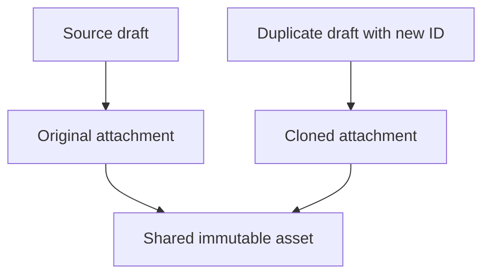

Prototype creates a new object from an existing example rather than assembling every field from scratch. The difficult part is defining what “copy” means: which editable state becomes independent, which immutable resources may remain shared, and which identities must be regenerated.

Swift value types make many copying tasks straightforward, but copying a struct that contains class references does not automatically clone those objects.

<!--more-->

These Swift 5.7 examples duplicate a document draft. Attachments have independent captions, while their immutable asset data is intentionally shared. The clone receives a new document identity.

## Separate editable state from shared resources

```swift
import Foundation

final class Asset {
    let id: UUID
    let bytes: Data
    init(id: UUID, bytes: Data) { self.id = id; self.bytes = bytes }
}

final class Attachment {
    let asset: Asset
    var caption: String
    init(asset: Asset, caption: String) { self.asset = asset; self.caption = caption }
    func clone() -> Attachment { Attachment(asset: asset, caption: caption) }
}

final class Draft {
    let id: UUID
    var title: String
    var attachments: [Attachment]
    init(id: UUID, title: String, attachments: [Attachment]) {
        self.id = id; self.title = title; self.attachments = attachments
    }
    func duplicate(as id: UUID) -> Draft {
        Draft(id: id, title: title, attachments: attachments.map { $0.clone() })
    }
}

let asset = Asset(id: UUID(), bytes: Data([1, 2, 3]))
let source = Draft(id: UUID(), title: "Template", attachments: [
    Attachment(asset: asset, caption: "Original caption")
])
let copy = source.duplicate(as: UUID())
copy.title = "My document"
copy.attachments[0].caption = "Edited caption"
assert(copy.id != source.id)
assert(source.title == "Template")
assert(source.attachments[0].caption == "Original caption")
assert(copy.attachments[0] !== source.attachments[0])
assert(copy.attachments[0].asset === source.attachments[0].asset)
```

This is a selective graph copy with an explicit policy. The mutable attachment object is fresh; the immutable asset is shared. Sharing the asset saves memory without sharing editable captions.

`Data` has value semantics, but the `Asset` object itself still has identity. Its interface exposes immutable fields and no mutation. If later code adds writable asset properties, reevaluate whether clones may still share it safely.

## A shallow copy preserves references

```swift
let shallow = Draft(id: UUID(), title: source.title, attachments: source.attachments)
shallow.attachments[0].caption = "Changed through alias"
assert(source.attachments[0].caption == "Changed through alias")
assert(copy.attachments[0].caption == "Edited caption")
```

The array is copied as a value, but its elements remain references to the same attachment objects. Array copy-on-write protects array membership and ordering; it does not recursively duplicate arbitrary referenced state.

This is why “make the model a struct” is not a complete cloning strategy. Inspect the reachable state that callers can observe and mutate, not only the outer type declaration.

## Duplicate, snapshot, and fork mean different things

Duplicating a draft usually creates a new business identity. Taking an undo snapshot usually preserves the identity of the edited document. Forking a collaborative document might create a new identity while preserving ancestry metadata. All three operations copy data, but they establish different relationships with future edits and persistence.

Name the operation according to that relationship. A universal `copy()` method invites callers to assume more than it promises. `duplicate(as:)` makes the identity choice visible at the call site, while the tests verify which mutable wrappers become independent.

Passing the new document ID into `duplicate` makes generation explicit. If attachment IDs are added, decide whether they identify placements, which may need fresh IDs, or existing assets, whose IDs may remain shared.

## Copying a graph requires an identity policy

The example duplicates a small ownership tree: one draft owns attachment wrappers, and wrappers share immutable assets. A larger document can be a graph. Two paragraphs might reference the same editable annotation, and that annotation might point back to its owning document.

A naive recursive clone has two problems. It can duplicate the shared annotation twice, breaking the original sharing relationship, and it can recurse forever through the back-reference. A graph clone needs a map from each original object's identity to its clone. It allocates a destination shell, records that mapping, and only then follows outgoing references. Encountering the same original again returns the existing clone.

This algorithm still needs domain decisions. A back-reference to an owner may need rewiring to the new owner; a reference to an external shared catalog may deliberately remain unchanged. “Deep copy everything” is incomplete until the boundary of “everything” is defined.

For Swift classes, `ObjectIdentifier` can identify live source objects while building that map. Keep the source graph alive throughout the operation. An identifier is an in-process identity aid, not a durable document ID or a value to serialize as an external reference.

File handles, connections, and running tasks generally require their own lifecycle. Clone their reusable configuration or deliberately share a capability; do not attempt to duplicate the live execution state blindly.

## Prototype is useful when an example carries meaningful configuration

A styled document template may contain dozens of choices. Duplicating it and making a small edit can be clearer than repeatedly supplying every field through a large initializer.

But a template containing active observers or runtime caches may copy unwanted lifetime. Keep reusable prototype data separate from live execution state when possible.

A builder can assemble a prototype, and a factory can choose one, but the duplication policy remains its own responsibility. Changing creation syntax does not decide deep versus shallow state independence.

## Serialization is not a universal deep-copy shortcut

Encoding and decoding can create new instances, but it applies the serialization schema's rules. It may drop caches, change numeric precision, omit unencoded fields, or lose intentional reference identity.

That can be exactly right for a persisted snapshot and wrong for a runtime clone. A serialization format also needs versioning and input validation. Do not use a JSON round trip solely to avoid deciding which state should be copied.

The cost of duplicating this example is proportional to attachment count plus the relevant value-copy work. Asset payloads are retained rather than eagerly duplicated. Measuring copied wrapper objects alone would miss the potentially large shared resource lifetime.

## Test observable independence and intentional sharing

Mutate a clone's title, caption, and attachment list and verify the source's corresponding editable state is unchanged. Also verify shared immutable resources retain the intended identity.

Retain several clones from one prototype and edit them in different orders. A test that checks only the first clone before any later edit can miss shared mutable aliases.

For a general graph cloner, include a cycle and two paths to the same original node. Verify the clone preserves the intended internal sharing without retaining mutable nodes from the source graph.

## Audit reference-bearing fields during maintenance

Adding a field can silently change copying behavior. A struct containing arrays of values still behaves differently from a struct containing arrays of mutable class instances. Copy-on-write storage does not recursively clone the objects stored inside a collection.

When adding a reference-bearing field, classify it as owned mutable state, shared immutable state, or external identity. Then extend the alias tests accordingly: mutate each owned field in the duplicate and verify the source stays unchanged; confirm intended immutable sharing remains shared.

## Trace which identities survive duplication



The shared asset is intentional. A line connecting the duplicate draft to the original editable attachment would instead represent the shallow-copy bug demonstrated above.

## Exercise: duplicate a reading workspace

A workspace contains documents, references between them, and shared immutable book assets. Define which IDs change when duplicating the workspace, then clone it while preserving references between cloned documents. Reject or explicitly share any live network session rather than copying it accidentally.

Continue with [Object Pools](/swift-object-pool/) for reuse of resources whose identity and return lifecycle are intentional.

Return to the [Design Patterns roadmap](/swift-design-patterns/).
