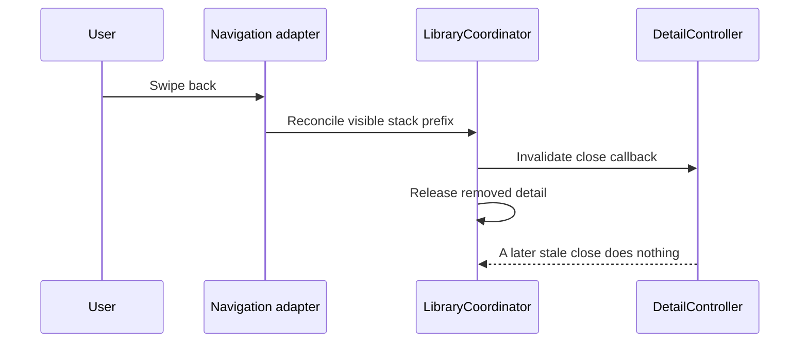

MVC with a coordinator keeps screen-level interaction in controllers while moving navigation policy and flow ownership into another object. A catalog controller can report that a book was selected without knowing which detail controller to construct or which navigation container should present it.

The hard part is lifetime. A coordinator that retains child screens forever merely moves the leak out of the view controller.

<!--more-->

This Swift 5.7 example uses a small navigation port so ownership can be tested without UIKit. A UIKit adapter would map its screen objects to view controllers and report interactive back navigation through the same reconciliation method.

## Let a controller express an event

```swift
final class CatalogController {
    var selectedBook: ((Int) -> Void)?
    func select(bookID: Int) {
        guard bookID > 0 else { return }
        selectedBook?(bookID)
    }
}
final class DetailController {
    let bookID: Int
    private var closeAction: (() -> Void)?
    init(bookID: Int, close: @escaping () -> Void) {
        self.bookID = bookID
        closeAction = close
    }
    func closeTapped() { closeAction?() }
    func invalidate() { closeAction = nil }
}
struct ScreenEntry: Equatable {
    let id: Int
    let bookID: Int?
}
protocol NavigationDriving: AnyObject {
    func show(_ entries: [ScreenEntry])
}
```

The catalog reports a domain identity. It does not report “push this view controller,” because that would move construction policy back into the screen.

The detail screen has a close intention, not authority over the navigation stack. Once the flow removes it, invalidation clears its callback. A retained stale controller cannot then close a different current screen.

## Give the coordinator one coherent flow

```swift
final class LibraryCoordinator {
    let catalog = CatalogController()
    private let navigation: any NavigationDriving
    private var details: [Int: DetailController] = [:]
    private var nextID = 0
    private var active = false
    private(set) var entries = [ScreenEntry(id: 0, bookID: nil)]

    init(navigation: any NavigationDriving) { self.navigation = navigation }
    func start() {
        guard !active else { return }
        active = true
        catalog.selectedBook = { [weak self] in self?.open(bookID: $0) }
        navigation.show(entries)
    }
    private func open(bookID: Int) {
        guard active else { return }
        precondition(nextID < Int.max)
        nextID += 1
        let id = nextID
        details[id] = DetailController(bookID: bookID) { [weak self] in self?.close(id: id) }
        entries.append(ScreenEntry(id: id, bookID: bookID))
        navigation.show(entries)
    }
    func detail(id: Int) -> DetailController? { details[id] }
    private func close(id: Int) {
        guard let index = entries.firstIndex(where: { $0.id == id }), index > 0 else { return }
        reconcile(Array(entries.prefix(index)))
    }
    func reconcile(_ visible: [ScreenEntry]) {
        guard active, !visible.isEmpty, visible.count <= entries.count,
              Array(entries.prefix(visible.count)) == visible else { return }
        let retained = Set(visible.map(\.id))
        for id in Array(details.keys) where !retained.contains(id) {
            details.removeValue(forKey: id)?.invalidate()
        }
        entries = visible
        navigation.show(entries)
    }
    func stop() {
        active = false
        catalog.selectedBook = nil
        for detail in details.values { detail.invalidate() }
        details.removeAll()
        entries = [ScreenEntry(id: 0, bookID: nil)]
        navigation.show(entries)
    }
}
```

All operations require serialized access, normally the main actor in an iOS app. `start` is idempotent while active. `stop` ends the current flow and releases its child ownership; starting again preserves the increasing ID sequence so old IDs are not reused.

Reconciliation accepts only a nonempty prefix of the current stack. This models back navigation, including popping several screens. Forward navigation goes through `open`, where construction and ownership happen together. Arbitrary deep-link restoration needs a separate validated entry point.

Closing a detail below another detail removes that screen and everything above it. That is the explicit policy here. If the UI should permit only the top screen to close itself, add that guard and test it.

## Ownership and navigation need to change together



A `UINavigationControllerDelegate` adapter can compare the navigation controller's resulting view-controller stack to its known entries after a completed transition. Report the actual stack after interactive cancellation or completion, not a guessed pop at gesture start.

The adapter must also avoid creating an endless feedback loop when `show` applies an already matching stack. Treat programmatic rendering and user navigation events distinctly, or make matching updates idempotent.

## Test back navigation and stale references

```swift
final class NavigationSpy: NavigationDriving {
    private(set) var frames: [[ScreenEntry]] = []
    func show(_ entries: [ScreenEntry]) { frames.append(entries) }
}
let navigation = NavigationSpy()
let coordinator = LibraryCoordinator(navigation: navigation)
coordinator.start()
coordinator.start()
assert(navigation.frames.count == 1)
coordinator.catalog.select(bookID: 7)
let oldID = coordinator.entries.last!.id
let staleDetail = coordinator.detail(id: oldID)!
coordinator.reconcile([ScreenEntry(id: 0, bookID: nil)])
assert(coordinator.detail(id: oldID) == nil)
coordinator.catalog.select(bookID: 9)
let current = coordinator.entries
staleDetail.closeTapped()
assert(coordinator.entries == current)
coordinator.stop()
coordinator.catalog.select(bookID: 11)
assert(coordinator.entries.count == 1)
```

Keeping `staleDetail` alive is intentional. It verifies logical invalidation rather than relying on deallocation to hide a callback bug. Separate weak-reference checks can establish that no accidental strong cycle retains the screen after all intentional owners release it.

## A coordinator does not own every business decision

A borrowing use case decides whether a book may be borrowed. A coordinator decides which interaction follows the result: show a receipt, request authentication, or remain on the same screen with an error.

Passing a repository into a coordinator can be appropriate for constructing child features, but making the coordinator implement every repository workflow creates another oversized object. Prefer injecting a completed child dependency graph or a narrow factory.

Likewise, presenters and view models can still be useful inside a coordinated flow. MVC+C changes navigation ownership; it does not forbid other presentation structures.

## Account and window scopes matter

An account flow may own one library coordinator per window while sharing an account repository. Logging out must stop each affected flow and prevent old child completions from navigating under the next account.

A weak capture alone does not establish this. The coordinator might remain alive for another reason. Use active-flow identity or explicit callback invalidation so a logically ended flow cannot act even when its objects are still reachable.

For modal flows, define which owner retains the modal coordinator, who dismisses it, and which completion means “finished.” Swiping a modal down is another lifecycle event that must release child ownership just as a back pop does.

## Case study: one destination, two navigation contexts

A detail controller may appear as a pushed screen in a compact layout and as a pane in a split layout. Its event contract can remain “close this detail” while the navigation adapter changes how that intention is rendered.

Do not make the controller inspect whether it has a navigation controller and choose between pop, dismiss, or remove-from-parent. Those mechanics depend on the owning flow and container. The controller should report the intention to that owner.

A coordinator can choose an appropriate route graph for each context, but sharing a controller does not require pretending both graphs are identical. A split layout may preserve list selection while a compact stack removes the detail route. Keep those product distinctions visible.

Deep links add another entry point. Validate the book ID and account context before constructing the destination graph. If the link arrives while a modal editor is active, define whether to queue it, replace the flow, or ask the person to finish editing. Pushing immediately from a global URL handler can bypass the very ownership policy the coordinator exists to centralize.

An integration test should cover the actual container's transition completion, including a cancelled interactive gesture. A policy test should cover the resulting child ownership and stale callback rejection. Keeping both tests gives evidence about the boundary between navigation mechanics and application decisions.

The coordinator's lifetime should also follow its scope. A window coordinator can survive several screen replacements, while an account coordinator must stop when that account ends. Neither scope should be inferred from whichever view controller happens to deallocate first.

## Exercise: build a UIKit navigation adapter

Map entries to real view controllers and reconcile only after a completed navigation transition. Test cancelled interactive pop, pop-to-root, repeated programmatic rendering, and a stale modal completion after logout. Reuse the lifecycle ideas in the [Coordinator article](/swift-coordinator/) while keeping UIKit's transition behavior in the adapter.

Return to the [App Architectures roadmap](/swift-architectures/).
