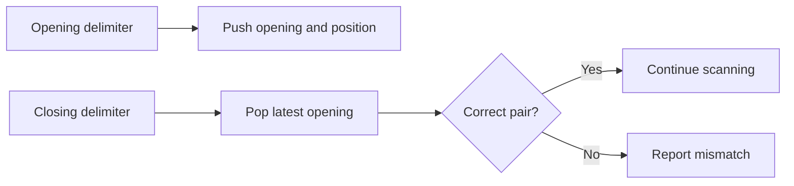

A stack exposes the most recently added item first: last in, first out. That simple rule models unfinished work, nested delimiters, navigation history, and the call frames used by recursion.

The interesting design question is what the stack represents. A correct container can still support a broken algorithm if the pushed state omits information needed when work resumes.

<!--more-->

These Swift 5.7 examples implement an array-backed stack and use it to validate nested delimiters. The parser ignores non-delimiter characters; it is not a Swift source parser and does not interpret comments or string literals.

## Keep the interface aligned with LIFO behavior

```swift
struct Stack<Element> {
    private var storage: [Element] = []
    var count: Int { storage.count }
    var isEmpty: Bool { storage.isEmpty }
    var peek: Element? { storage.last }
    mutating func push(_ value: Element) { storage.append(value) }
    mutating func pop() -> Element? { storage.popLast() }
}

var stack = Stack<Int>()
assert(stack.pop() == nil)
stack.push(10)
stack.push(20)
assert(stack.peek == 20 && stack.count == 2)
assert(stack.pop() == 20)
assert(stack.pop() == 10)
assert(stack.isEmpty)
```

The top lives at the array's end. Removing from the front would shift the remaining elements and change a natural constant-time operation into linear work.

Array append is amortized constant-time for an appropriate unique-owner workload, while a growth operation can be linear. Copy-on-write separation can also make the first mutation of shared storage linear. The wrapper does not erase its backing collection's cost model.

An optional result makes empty pop an expected condition. A nonoptional removal with a precondition would instead require callers to prove nonemptiness. Choose one deliberately rather than crashing on ordinary end-of-work behavior.

## Nested structure needs the most recent opening delimiter

Consider `([{}])`. When `}` arrives, it must match `{`, not the oldest opening delimiter. A queue would implement the wrong nesting discipline.



The stack stores positions too, so an unfinished opening can be explained without rescanning input.

```swift
enum DelimiterResult: Equatable {
    case valid
    case unexpectedClosing(position: Int)
    case mismatched(opening: Int, closing: Int)
    case unclosed(position: Int)
}

func delimiters(in text: String) -> DelimiterResult {
    let pairs: [Character: Character] = [")": "(", "]": "[", "}": "{"]
    let openings: Set<Character> = ["(", "[", "{"]
    var pending = Stack<(character: Character, position: Int)>()
    for (position, character) in text.enumerated() {
        if openings.contains(character) {
            pending.push((character, position))
        } else if let expected = pairs[character] {
            guard let opening = pending.pop() else {
                return .unexpectedClosing(position: position)
            }
            guard opening.character == expected else {
                return .mismatched(opening: opening.position, closing: position)
            }
        }
    }
    if let opening = pending.peek { return .unclosed(position: opening.position) }
    return .valid
}

assert(delimiters(in: "a([{}])") == .valid)
assert(delimiters(in: "([)]") == .mismatched(opening: 1, closing: 2))
assert(delimiters(in: ")") == .unexpectedClosing(position: 0))
assert(delimiters(in: "((") == .unclosed(position: 1))
assert(delimiters(in: "") == .valid)
```

Positions are zero-based character offsets, not UTF-8 byte offsets. A UI requiring `String.Index` positions should preserve those indices or translate deliberately.

## The invariant explains correctness

After scanning any valid prefix, the stack contains exactly its unmatched openings in encounter order, with the innermost at the top. An opening extends that state. A closing must remove its matching innermost opening. A mismatch proves the prefix cannot be repaired by later input.

At the end, an empty stack means no unmatched opening remains. A nonempty stack reports the most recent unfinished group. Reporting the oldest unfinished group would be another defensible diagnostic policy, but this implementation chooses the innermost.

For `n` characters and maximum nesting depth `d`:

$$
T(n)=O(n),\qquad S_{\mathrm{aux}}(n)=O(d).
$$

The delimiter alphabet is fixed, so its dictionary and set sizes are bounded. The stack grows with nesting, not necessarily with total text length.

## A stack turns recursion into explicit work

A recursive traversal implicitly stores the current node and where to resume after a child returns. An iterative translation must preserve both when the algorithm needs postorder behavior.

Pushing only nodes may be sufficient for reachability. For expression evaluation or postorder traversal, push frames containing a node and a phase, such as “visit left,” “visit right,” and “combine.” Otherwise the iterative version may process a parent before its dependencies are ready.

This matters for [Depth-First Search](/swift-depth-first-search/): a visited set alone discovers reachable nodes, while cycle detection also needs the active path. The choice of stack frame should follow the invariant being maintained.

## Undo needs more than popping a value

An undo stack can store earlier immutable states or inverse commands. Snapshots simplify restoration but retain data. Inverse commands can be smaller but need enough information to reverse the original change correctly.

Redo normally uses a second stack. A new edit after undo discards the abandoned future, while a no-op edit needs an explicit policy. Restoring local state does not reverse remote payments or file writes automatically.

For structural sharing and history retention, see [Persistent Data Structures](/swift-persistent-data-structures/). A stack can have a simple interface while the lifetime of the values it retains remains a significant memory concern.

## Validate the container independently

Compare a sequence of push and pop operations with a small array reference model. Include repeated empty pops, one element, many elements, and copies that later diverge. For optional elements, a popped nil element must remain distinguishable from an empty stack through the outer optional.

For delimiter validation, test each bracket family, crossed pairs, unmatched closings, and deep valid nesting. Do not infer parser completeness from these cases: a language lexer must first decide which characters are actual delimiters rather than characters inside literals.

## Store continuation state for nested work

A file explorer that recursively descends folders needs to remember which folder to return to and which child comes next. A stack frame can contain the folder ID and next-child offset. Popping just a folder ID would lose the progress needed to resume a postorder operation.

The same distinction appears in expression evaluation. A frame can say “evaluate left,” “evaluate right,” or “combine both results.” A second value stack holds computed operands. This is an explicit version of the call stack, not a different mathematical evaluation rule.

An explicit stack also creates a place to impose a maximum depth or work budget. Report budget exhaustion separately from invalid expression syntax; a resource decision does not prove the input is malformed.

## Define ownership for retained history

If an undo stack stores class references, pushing a reference does not capture an immutable snapshot of that object's properties. Later edits can change what every earlier entry appears to contain.

Store independent value snapshots, immutable persistent roots, or commands containing the exact data needed to reverse an edit. The appropriate choice depends on payload size and whether external effects are involved.

A history limit measured in entry count can still retain huge data if one entry holds a large image. Consider a byte estimate or checkpoint strategy when payload sizes vary significantly.

## Distinguish algorithmic overflow from container growth

A stack can grow until memory is exhausted; that differs from integer overflow in a postfix evaluator or call-stack exhaustion in recursive code. An explicit array stack makes storage visible but does not make it unbounded.

For imported nested data, validate input size and nesting according to the application's supported domain. A valid million-level expression can still exceed the feature's safe resource budget even if every delimiter matches.

## Exercise: evaluate postfix arithmetic

Implement an evaluator for integer tokens and binary `+` and `*`. Pop right operand first and left operand second. Reject missing operands and extra values at the end, and use checked arithmetic. Explain why subtraction would expose an accidentally reversed operand order more clearly than addition.

Return to the [Data Structures and Algorithms roadmap](/swift-data-structures-and-algorithms/).
