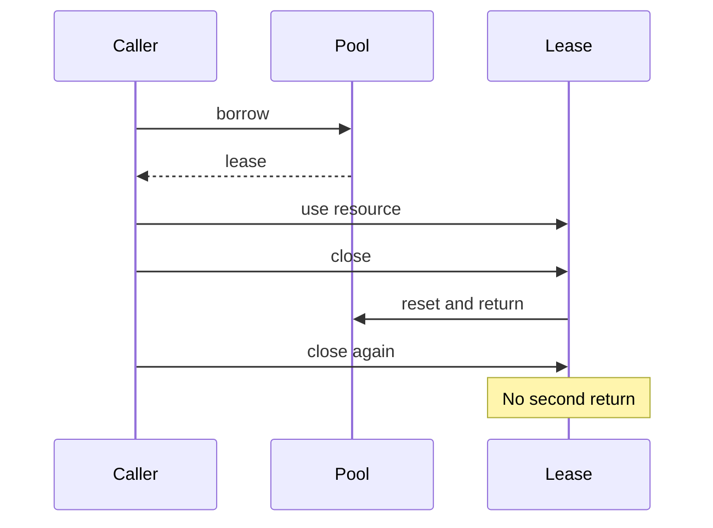

An object pool reuses a bounded set of resources instead of constructing a fresh resource for every operation. It is useful when acquisition is expensive and reset is safe. It is counterproductive when ordinary allocation is already cheap or reused objects carry stale state between borrowers.

A pool's important API is the lease: who may use the resource, when it returns, and what happens after return. An array of available objects alone does not establish those rules.

<!--more-->

The Swift 5.7 demonstration uses scratch buffers under a serial-access contract. It rejects acquisition when capacity is exhausted and resets buffers before reuse. It is not a concurrent waiting channel or a production memory allocator.

## Hide the pooled resource behind a lease

```swift
enum PoolFailure: Error { case exhausted, returned }

fileprivate final class ScratchBuffer {
    var values: [Int] = []
    func reset() { values.removeAll(keepingCapacity: true) }
}

final class BufferLease {
    private var buffer: ScratchBuffer?
    private var returnAction: ((ScratchBuffer) -> Void)?

    fileprivate init(buffer: ScratchBuffer, onReturn: @escaping (ScratchBuffer) -> Void) {
        self.buffer = buffer
        returnAction = onReturn
    }
    func append(_ value: Int) throws {
        guard let buffer = buffer else { throw PoolFailure.returned }
        buffer.values.append(value)
    }
    func snapshot() throws -> [Int] {
        guard let buffer = buffer else { throw PoolFailure.returned }
        return buffer.values
    }
    func close() {
        let resource = buffer
        let action = returnAction
        buffer = nil
        returnAction = nil
        if let resource = resource { action?(resource) }
    }
    deinit { close() }
}

final class BufferPool {
    private let capacity: Int
    private var created = 0
    private var available: [ScratchBuffer] = []
    var availableCount: Int { available.count }

    init(capacity: Int) { precondition(capacity > 0); self.capacity = capacity }

    func borrow() -> BufferLease? {
        let buffer: ScratchBuffer
        if let reused = available.popLast() { buffer = reused }
        else if created < capacity { buffer = ScratchBuffer(); created += 1 }
        else { return nil }
        return BufferLease(buffer: buffer) { [weak self] resource in
            resource.reset()
            self?.available.append(resource)
        }
    }

    func withLease<T>(_ body: (BufferLease) throws -> T) throws -> T {
        guard let lease = borrow() else { throw PoolFailure.exhausted }
        defer { lease.close() }
        return try body(lease)
    }
}
```

`close` clears the lease before invoking its return action. Repeated or reentrant close therefore cannot insert the same resource into the available list twice.

The return closure weakly references the pool, so a retained lease does not keep an abandoned pool alive. The lease itself keeps its resource alive until close. If the pool has gone away, closing releases that resource instead of returning it to a dead owner.

## Test exhaustion, reset, and use after return

```swift
let pool = BufferPool(capacity: 1)
let first = pool.borrow()!
try first.append(7)
assert(pool.borrow() == nil)
first.close()
first.close()
assert(pool.availableCount == 1)
let second = pool.borrow()!
let clean = try second.snapshot()
assert(clean.isEmpty)
do {
    try first.append(9)
    assertionFailure("A returned lease must not access a reused resource")
} catch PoolFailure.returned {}
second.close()
```

The stale lease still exists as an object, but its resource reference is gone. It cannot mutate a buffer now borrowed by another caller.

A raw-resource-returning API would require callers never to retain an alias after returning it. A restricted lease interface makes that rule easier to maintain and test, though the exact protection depends on which operations it exposes.

## Structured borrowing handles failures

```swift
enum WorkFailure: Error { case stopped }
do {
    let _: Int = try pool.withLease { lease in
        try lease.append(10)
        throw WorkFailure.stopped
    }
} catch WorkFailure.stopped {}
assert(pool.availableCount == 1)
let nextCount = try pool.withLease { lease in try lease.snapshot().count }
assert(nextCount == 0)
```

`defer` returns the resource on success and failure. Deinitialization is a fallback, not the only reliable signal that work has ended.

If a caller returns the lease object from `withLease`, it receives an already closed lease. The wrapper owns the borrowing interval. A resource API should not imply a returned alias remains valid beyond that interval.

## Capacity bounds objects, not necessarily bytes

For capacity `K`, the serial implementation maintains:

$$
\text{active}+\text{available}=\text{created}\le K.
$$

Each scratch array can still grow without a byte limit. Retaining capacity on reset reuses storage but can retain the largest allocation each buffer ever reached. A pool of four buffers is not automatically a small-memory pool.

For image or decoding resources, define maximum payload size, trimming policy, and failure behavior. Reset must clear all borrower-specific state, including delegates, credentials, and cancellation tokens where those exist.



## Add concurrency only with a complete policy

Every method here requires serialized access. Protecting only the available array would be insufficient if lease close can race with resource use. A concurrent design needs an isolation boundary covering lease state and pool bookkeeping.

An actor can serialize acquisition and return, but awaiting a lease requires a waiting queue, cancellation, and fairness decisions. Performing an entire synchronous operation inside the actor may serialize all useful work and eliminate the expected parallel benefit.

A nonblocking pool can report exhaustion. A suspending pool can wait. An unbounded fallback can construct more resources but abandons the capacity guarantee. Choose the behavior required by the feature rather than hiding it in a default branch.

## Pool only measured acquisition costs

Benchmark resource creation, reset, and reuse under representative payloads. Ordinary small Swift objects often do not benefit enough to justify pool lifetime complexity.

A pooled database connection or decoder may carry external state that reset cannot cheaply or safely restore. Test failed work and cancellation before returning such resources; some failures should discard and replace a resource rather than reuse it.

## What the capacity bound does and does not bound

A pool with capacity four limits the number of scratch buffers it creates. It does not automatically limit their total allocated bytes. One borrower can append a very large payload, and a reset that retains capacity can leave that allocation resident for later borrowers.

For a memory budget, define both a lease count and a buffer-size policy. Options include rejecting an append that exceeds a maximum, dropping oversized buffers on return, or maintaining separate size classes. The correct choice depends on observed workload sizes and the cost of rebuilding storage.

Measure the entire acquire-use-return cycle. A pool adds bookkeeping, reset work, and potentially waiting. If creating the underlying resource is cheap, these costs can exceed the allocation work saved. Benchmarking only acquisition from an already warm pool omits precisely the costs that often determine whether pooling helps.

## Waiting turns the pool into a scheduler

This implementation rejects an acquisition when all resources are leased. An asynchronous variant could suspend borrowers instead, but that requires a queue and a defined fairness policy. A cancellation must remove a waiting borrower without losing the resource that might be returned at the same time.

Decide what happens when the pool closes while borrowers are waiting or working. Do waiting calls fail immediately? Can active borrowers finish? Are returned resources destroyed rather than made available again? These are observable lifecycle rules, so represent them explicitly rather than hiding them inside a semaphore count.

The serialized assumption matters here. Making the pool an actor is a possible starting point, but moving a mutable buffer outside that actor can still create unsynchronized access. An async API should either keep resource use isolated or transfer exclusive ownership through a contract that actually enforces it.

## Reset is part of correctness

Resetting a pooled resource is not merely an optimization. A buffer that still contains a previous borrower's account data can leak information to the next borrower. A connection that still has an open transaction can apply the next operation in the wrong context.

List every piece of state that must be cleared before a resource reenters the available set. If reset can fail, discard that resource and adjust the created-resource accounting; do not publish it as healthy. Repeated `close()` calls should remain harmless even on that failure path.

The lease makes the return boundary visible, but callers still have to avoid storing sensitive snapshots longer than needed. Returning the buffer does not revoke copies of data that were intentionally handed out.

## Exercise: discard a damaged resource

Add a lease operation that marks its resource unusable. On close, discard it and decrement the created count so a later borrow can construct a replacement. Verify a failed borrower cannot return a damaged buffer to another caller and capacity remains consistent.

Return to the [Design Patterns roadmap](/swift-design-patterns/).
