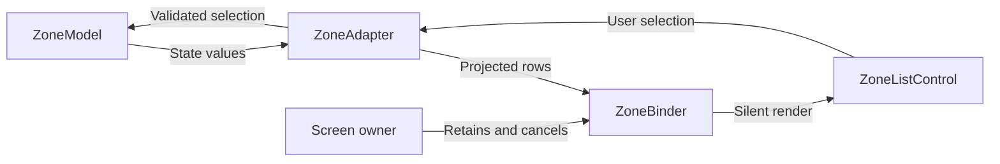

ModelAdapter-ViewBinder makes the connection between model capabilities and view properties an explicit construction artifact. Instead of putting each observation and event handler into a controller method, a model adapter exposes suitable values and actions, and a binder connects them to a view.

The important questions are what the binding observes, whether rendering emits input, and who disposes the connection. A shorter controller is not enough if subscriptions outlive the screen.

<!--more-->

Matt Gallagher introduced the MAVB name in [Model-View-Controller without the Controller](https://www.cocoawithlove.com/blog/mvc-without-the-c.html), describing work built around CwlViews. The Swift 5.7 example here demonstrates the separation with a small original binding mechanism; these types are not CwlViews APIs or a replacement implementation of that library.

## Establish a value source with a defined lifetime

```swift
final class BindingLifetime {
    private var dispose: (() -> Void)?
    init(_ dispose: @escaping () -> Void) { self.dispose = dispose }
    func cancel() { let action = dispose; dispose = nil; action?() }
    deinit { cancel() }
}
final class ValueSource<Value> {
    private(set) var value: Value
    private var nextID = 0
    private var observers: [Int: (Value) -> Void] = [:]
    init(_ value: Value) { self.value = value }
    func observe(_ observer: @escaping (Value) -> Void) -> BindingLifetime {
        precondition(nextID < Int.max)
        nextID += 1
        let id = nextID
        observers[id] = observer
        observer(value)
        return BindingLifetime { [weak self] in self?.observers.removeValue(forKey: id) }
    }
    func set(_ newValue: Value) {
        value = newValue
        for id in observers.keys.sorted() { observers[id]?(newValue) }
    }
}
```

The source replays the current value immediately on observation. Delivery and mutation require serialized access. Nested mutation is not supported by this minimal source; a reusable implementation should queue changes or reject reentrant writes explicitly instead of leaving their order accidental.

Observation registration can itself call consumer code because of immediate replay. Avoid binding before the destination view is ready, and do not assume that assigning a lifetime token happens before its first callback.

## Keep selection validity in the model

```swift
struct ZoneChoice: Equatable { let id: String; let title: String }
struct ZoneState: Equatable {
    let choices: [ZoneChoice]
    let selectedID: String
}
final class ZoneModel {
    let changes: ValueSource<ZoneState>
    init(choices: [ZoneChoice], selectedID: String) {
        precondition(Set(choices.map(\.id)).count == choices.count)
        precondition(choices.contains { $0.id == selectedID })
        changes = ValueSource(ZoneState(choices: choices, selectedID: selectedID))
    }
    func select(_ id: String) {
        let old = changes.value
        guard old.choices.contains(where: { $0.id == id }), id != old.selectedID else { return }
        changes.set(ZoneState(choices: old.choices, selectedID: id))
    }
}
struct ZoneRow: Equatable { let id: String; let text: String; let selected: Bool }
final class ZoneAdapter {
    private let model: ZoneModel
    init(model: ZoneModel) { self.model = model }
    func select(_ id: String) { model.select(id) }
    func observeRows(_ render: @escaping ([ZoneRow]) -> Void) -> BindingLifetime {
        model.changes.observe { state in
            render(state.choices.map {
                ZoneRow(id: $0.id, text: $0.title, selected: $0.id == state.selectedID)
            })
        }
    }
}
```

The adapter translates domain selection into rows. It does not construct a table view or decide how a selected row is drawn. The model rejects unknown IDs regardless of whether an action came from a control, restoration, or another client.

A production zone catalog would use real timezone identifiers and appropriate localized names. The fixed strings here keep the binding behavior deterministic and avoid conflating architecture with date-formatting rules.

## Bind rendering and input without a feedback loop

```swift
final class ZoneListControl {
    private(set) var rows: [ZoneRow] = []
    var userSelected: ((String) -> Void)?
    func render(_ rows: [ZoneRow]) { self.rows = rows } // Does not emit user input.
    func userSelects(_ id: String) { userSelected?(id) }
}
final class ZoneBinder {
    private var lifetime: BindingLifetime?
    private weak var control: ZoneListControl?
    private let adapter: ZoneAdapter
    init(adapter: ZoneAdapter, control: ZoneListControl) {
        self.adapter = adapter
        self.control = control
        control.userSelected = { [weak adapter] in adapter?.select($0) }
        lifetime = adapter.observeRows { [weak control] in control?.render($0) }
    }
    func cancel() {
        lifetime?.cancel()
        lifetime = nil
        control?.userSelected = nil
    }
    deinit { cancel() }
}
```

This binder assumes exclusive ownership of the control's `userSelected` slot. Two binders sharing that slot would overwrite one another, and cancelling the first could clear the second's handler. A reusable API should enforce one binding or issue owner-specific event tokens.

`render` changes the control without reporting a user selection. If rendering emitted input, model updates could loop back into the model indefinitely. In UIKit, assign display properties separately from target-action callbacks. For a custom control that emits on programmatic changes, add an explicit rendering suppression policy.

## Draw both directions and the disposer



The binder is a lifetime owner, not a new authoritative state store. The control contains its latest rendered rows, but those rows are a projection. Other code should not edit them and expect the model to follow automatically.

## Test initial replay, input, and disposal

```swift
let choices = [ZoneChoice(id: "a", title: "Amman"), ZoneChoice(id: "b", title: "Berlin")]
let model = ZoneModel(choices: choices, selectedID: "a")
let adapter = ZoneAdapter(model: model)
let control = ZoneListControl()
let binder = ZoneBinder(adapter: adapter, control: control)
assert(control.rows.first?.selected == true)
control.userSelects("b")
assert(model.changes.value.selectedID == "b")
assert(control.rows.last?.selected == true)
control.userSelects("unknown")
assert(model.changes.value.selectedID == "b")
binder.cancel()
let frozenRows = control.rows
model.select("a")
assert(control.rows == frozenRows)
control.userSelects("b")
assert(model.changes.value.selectedID == "a")
```

Cancellation stops both observation and input forwarding. A test that checked only model-to-view updates would miss an event handler left installed after the screen ended.

## What changes compared with MVC and MVVM

An MVC controller often performs these connections procedurally in lifecycle methods. MAVB emphasizes decomposing construction into explicit adapters and bindings. A view model can serve a similar projection role, but MAVB is not simply a universal synonym for MVVM; its originating design gives view construction and binding composition a central role.

Keep comparisons grounded in implementation. A project can call a type a binder while placing business rules inside it. Another can call a type a controller while keeping every binding small and disposable. Inspect the responsibilities and owners.

The approach is especially helpful when many independent view properties need reusable connections. It becomes harder to inspect if binding operators hide scheduling, error handling, or retention. Prefer a visible data path over a clever expression whose callbacks nobody can trace.

## Case study: reusing a binding in a reusable row

A reusable row can outlive the item it currently displays. When the row is assigned a different model adapter, cancel the old binding before installing the new one. Otherwise an update from the old item can overwrite the new item's content.

The exclusive event-slot assumption becomes especially important here. If two binding objects temporarily overlap, cancelling the first can clear the second's input handler. Owner-specific event tokens are a stronger design when rebinding cannot be kept strictly sequential.

A useful rebind test keeps both source models alive. Bind the control to model A, cancel that binder, then bind it to model B. Mutate A and verify the control stays on B; interact with the control and verify only B changes. Merely releasing A would hide a leaked observation.

Projection cost also belongs to the binding contract. Mapping a few rows synchronously is reasonable here. Rebuilding thousands of rows for every unrelated property change may require narrower sources or derived-value caching. Such a cache needs to be keyed by the facts the projection reads, not by the view's current label text.

When a binding performs asynchronous transformation, carry source identity through completion. Cancellation of the binding should suppress publication to a reused control even if the transformation cannot be stopped. An image loader attached to a reused cell is a common example of this problem.

These concerns are not arguments against binding composition. They explain why construction and disposal deserve explicit names and tests. A concise binding expression is valuable only when its scheduling, retention, and replacement behavior remain inspectable.

## Exercise: add a fallible asynchronous catalog

Load available zones through an injected service. Represent loading, failure, and a valid selection explicitly. Decide whether the old selection remains visible during refresh, reject stale completions, and verify cancelling the binder prevents UI updates without incorrectly cancelling work shared by another screen.

Return to the [App Architectures roadmap](/swift-architectures/).
