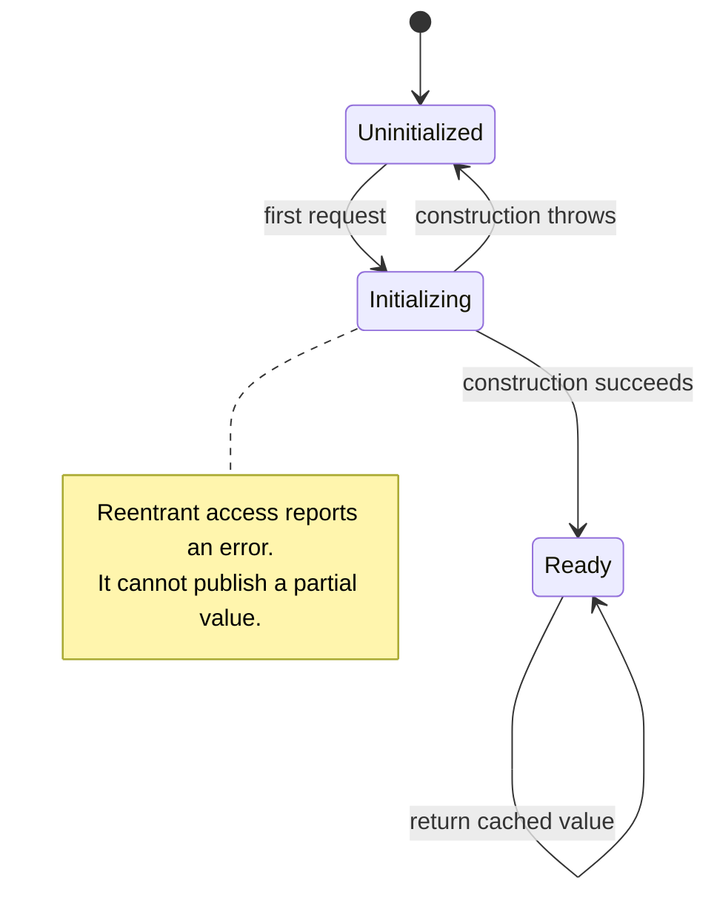

Lazy initialization defers work until its result is needed. That can avoid expensive startup work, but it moves cost, failure, and resource acquisition into a later access. It does not make those concerns disappear.

Swift's `lazy` stored property is one useful mechanism. A failure-aware or concurrent lazy resource often needs an explicit state machine instead of an optional value and a hopeful nil check.

<!--more-->

These examples use Swift 5.7. The first two implementations require serialized access. The final sections explain the additional decisions needed when construction is asynchronous or shared across tasks.

## A stored lazy property remembers a successful value

```swift
final class DocumentPreview {
    private let load: () -> String
    lazy var text: String = load()
    init(load: @escaping () -> String) { self.load = load }
}

var previewBuilds = 0
let preview = DocumentPreview {
    previewBuilds += 1
    return "Rendered document"
}
assert(previewBuilds == 0)
assert(preview.text == "Rendered document")
assert(preview.text == "Rendered document")
assert(previewBuilds == 1)
```

Creating the owner does not render the preview. First access performs the calculation, and later accesses reuse the stored result.

That result is a snapshot of the inputs observed during first access. If a captured document changes later, this property does not invalidate itself. Decide whether the preview is immutable for the owner's lifetime, manually resettable, or keyed by a document version.

A lazy property in a value type can require a mutable receiver because reading it may initialize storage. A class reference has different surface behavior, but still performs mutation internally.

## Failure needs a policy, not a magic default

A throwing loader cannot simply be used as an ordinary throwing property getter with this `lazy` declaration. An explicit wrapper can retry failed initialization while remembering successful values:

```swift
enum LazyFailure: Error { case reentrantInitialization }

final class LazyValue<Value> {
    private enum State {
        case uninitialized
        case initializing
        case ready(Value)
    }
    private var state: State = .uninitialized
    private let make: () throws -> Value
    init(make: @escaping () throws -> Value) { self.make = make }

    func value() throws -> Value {
        switch state {
        case let .ready(value): return value
        case .initializing: throw LazyFailure.reentrantInitialization
        case .uninitialized:
            state = .initializing
            do {
                let built = try make()
                state = .ready(built)
                return built
            } catch {
                state = .uninitialized
                throw error
            }
        }
    }
}

enum PreviewFailure: Error { case unavailable }
var attempts = 0
let retrying = LazyValue<String> {
    attempts += 1
    if attempts == 1 { throw PreviewFailure.unavailable }
    return "Ready"
}
do {
    _ = try retrying.value()
    assertionFailure("The first attempt must fail")
} catch PreviewFailure.unavailable {}
let ready = try retrying.value()
let readyAgain = try retrying.value()
assert(ready == "Ready" && readyAgain == ready && attempts == 2)
```

The initializing state rejects recursive construction. Without it, a factory that calls back into the same lazy value can recurse indefinitely.

A failed attempt returns to uninitialized. Caching the failure permanently would be another valid policy for immutable invalid configuration, but inappropriate for every transient resource failure. Name and test the chosen behavior.

## Optional payloads must not mean uninitialized

```swift
var optionalBuilds = 0
let optionalValue = LazyValue<Int?> {
    optionalBuilds += 1
    return nil
}
let first: Int? = try optionalValue.value()
let second: Int? = try optionalValue.value()
assert(first == nil && second == nil && optionalBuilds == 1)
```

An optional storage slot alone would conflate “not built” with “built successfully and returned nil.” The enum separates lifecycle state from the result's own data model.

The same issue appears with an empty collection, zero, or an unavailable cache entry. Use explicit states rather than domain values as undocumented initialization sentinels.

## Ordinary lazy properties are not a synchronization primitive

The Swift language guide explicitly distinguishes stored type-property one-time initialization from ordinary lazy instance properties accessed simultaneously. See [Properties](https://docs.swift.org/swift-book/documentation/the-swift-programming-language/properties/).

The wrapper above also has no lock or actor isolation. Two unsynchronized callers can race on its state. Adding a lock only around the initial nil check is insufficient if construction occurs after releasing the lock and both callers start work.

Holding a nonrecursive lock while invoking arbitrary factory code creates another risk: the factory may reenter or wait for work needing the same lock. Isolation and reentrancy need an intentional policy, not just a mutex added around a property.

## Async initialization needs an in-flight state

Suppose two callers request a thumbnail before it has loaded. A state machine containing only “empty” and “ready” allows both callers to begin the same expensive operation. Store an in-flight task or an equivalent shared operation if duplicate work is unacceptable.

That leads to another policy question: if one caller cancels, should the shared operation stop for every caller? Usually a caller abandoning its wait should not cancel work still needed by others. A resource-bound system may instead cancel when the last interested caller leaves. Both policies require tracking who owns the underlying task.

Invalidation adds a second race. A load started for document version one may finish after the cache was cleared for version two. Recording an initialization generation lets the completion check whether it still belongs to the current state before publishing. Merely setting the stored value back to `nil` does not prevent an old result from filling it again.

Failure cleanup needs the same identity check: an old failed waiter must not clear a newer in-flight task. Clear only the attempt that actually failed. For feature-scoped work, explicit async activation may communicate loading and cancellation better than a method named `value`.

## Deferred cost can become user-visible latency

Rendering during first scroll or first tap may feel worse than doing bounded work during a loading phase. Measure the interaction where cost moved, not merely faster owner initialization.

A warmed cache can also make benchmarks misleading. Test cold access, repeated access, failure and retry, and invalidation after a version change separately.

Retained lazy results can keep large graphs alive for the owner's lifetime. A cache with eviction or weak storage has different semantics from memoizing one successful value forever.

## A lazy value also retains a dependency graph

A deferred closure can capture everything needed to build its result. If it captures a large document or a view controller, those objects may remain alive even when the lazy value is never requested. Deferring computation can therefore reduce startup work while increasing retention.

After successful initialization, a reusable lazy container can release its construction closure if it no longer needs to retry or invalidate the result. After a failed attempt, retaining the closure may be necessary for retry. Make that lifecycle choice explicit; otherwise a cached ten-byte result can keep an entire import graph reachable.

Capturing `self` also deserves care. A class holding a closure that strongly captures the same class forms a cycle. Choosing a weak capture changes failure semantics because the owner may disappear before construction begins. Decide what that disappearance means rather than force-unwrapping a weak reference inside deferred work.

## Distinguish absent data from unfinished work

An optional result can be a legitimate completed result: for example, a document may have no embedded preview. The explicit state in `LazyValue` distinguishes “not attempted” from “attempted and found nothing.” Without that distinction, every access can repeat a successful absence lookup.

For a failed lookup, choose retry behavior according to the failure. A transient file-access error may justify another attempt; an unsupported format may be stable until input changes. Permanently caching every failure and retrying every failure are both simplistic defaults. Tie reset and retry to the lifetime of the input and the operation's error contract.

## Treat construction as a state transition



A completed optional `nil` still belongs to `Ready`. Failure returns to `Uninitialized` according to this container's retry policy.

## Exercise: add explicit invalidation

Add a generation counter and an invalidate operation to the serialized wrapper. Define whether an already returned reference value remains usable and what happens to a construction currently in progress. Test optional nil results, failed retries, recursive construction, and a factory that triggers invalidation.

Compare that API with [Proxy](/swift-proxy/), which controls access through the same capability consumers already use.

## Language and API reference

The Swift language guide documents [lazy stored properties and stored type properties](https://docs.swift.org/swift-book/documentation/the-swift-programming-language/properties/), including their different initialization guarantees.

Return to the [Design Patterns roadmap](/swift-design-patterns/).
