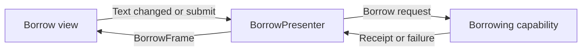

Model-View-Presenter gives presentation decisions an explicit owner outside the UI framework. The view reports user intent and displays a presentation contract. The presenter decides which state to display and invokes model or use-case capabilities to perform work.

A passive view is useful when the rules for enabling controls, showing errors, and handling outcomes deserve focused tests. It should not mean a view with no responsibility: layout, accessibility, focus, and framework lifecycle still need an owner.

<!--more-->

This Swift 5.7 example implements a borrowing form. It separates text parsing and presentation from the use case's rules, prevents duplicate submissions, and invalidates a late completion when the feature ends. Every call and callback uses one serial executor.

## Keep domain work behind a narrow capability

```swift
struct LoanReceipt: Equatable { let bookID: Int; let days: Int }
enum BorrowFailure: Error, Equatable { case invalidDays, unavailable }
protocol Borrowing {
    func borrow(bookID: Int, days: Int,
                completion: @escaping (Result<LoanReceipt, BorrowFailure>) -> Void)
}

struct BorrowFrame: Equatable {
    let durationText: String
    let isBusy: Bool
    let canSubmit: Bool
    let message: String?
}
protocol BorrowDisplaying: AnyObject { func display(_ frame: BorrowFrame) }
```

The use case receives numeric days and a book identity. It must enforce the authoritative allowed range even if a presenter already checked the form. Another presentation surface can call the same use case without this form.

The frame describes one coherent visual state. It does not expose label instances or ask the presenter to choose Auto Layout constraints. A UIKit view controller can implement `BorrowDisplaying` while remaining responsible for its widgets.

## Let the presenter own the interaction policy

```swift
final class BorrowPresenter {
    private let bookID: Int
    private let borrowing: any Borrowing
    private weak var view: (any BorrowDisplaying)?
    private var durationText = "14"
    private var busy = false
    private var active = true
    private var generation = 0
    private var message: String?

    init(bookID: Int, borrowing: any Borrowing) {
        precondition(bookID > 0)
        self.bookID = bookID
        self.borrowing = borrowing
    }
    func attach(_ view: any BorrowDisplaying) {
        guard active else { return }
        self.view = view
        render()
    }
    func durationChanged(_ text: String) {
        guard active, !busy else { return }
        durationText = text
        message = nil
        render()
    }
    func submit() {
        guard active, !busy else { return }
        guard let days = Int(durationText), (1...14).contains(days) else {
            message = "Choose between 1 and 14 days."
            render()
            return
        }
        precondition(generation < Int.max)
        generation += 1
        let ticket = generation
        busy = true
        message = nil
        render()
        guard active, generation == ticket else { return }
        borrowing.borrow(bookID: bookID, days: days) { [weak self] result in
            guard let self = self, self.active, self.generation == ticket, self.busy else { return }
            self.busy = false
            switch result {
            case let .success(receipt): self.message = "Borrowed for \(receipt.days) days."
            case .failure(.invalidDays): self.message = "The duration is no longer permitted."
            case .failure(.unavailable): self.message = "This book is unavailable."
            }
            self.render()
        }
    }
    func stop() { active = false; view = nil }
    private func render() {
        let valid = Int(durationText).map { (1...14).contains($0) } ?? false
        view?.display(BorrowFrame(durationText: durationText, isBusy: busy,
                                 canSubmit: valid && !busy, message: message))
    }
}
```

The view sends the edited text rather than expecting the presenter to query a text field later. That makes each intention explicit and keeps the presenter independent of widget types.

Submission sets `busy` before invoking the use case, so a synchronous completion is valid and a repeated tap while waiting is ignored. The acceptance check includes `busy`, making a duplicate completion inert until another request begins; the generation then distinguishes that new request from an older one.

The service contract still promises one completion per operation. Defensive acceptance is useful, but it does not turn a malformed service into a stream API or provide transport cancellation.

## Trace the presenter boundary



A presenter is allowed to invoke domain work. It should not implement inventory transactions, decode HTTP JSON, or establish account permissions simply because those decisions affect the frame. Those responsibilities belong behind the use-case boundary.

## Verify observable presentation behavior

```swift
final class BorrowViewSpy: BorrowDisplaying {
    var frames: [BorrowFrame] = []
    func display(_ frame: BorrowFrame) { frames.append(frame) }
}
final class ControlledBorrowing: Borrowing {
    var calls: [(Int, Int)] = []
    var completions: [(Result<LoanReceipt, BorrowFailure>) -> Void] = []
    func borrow(bookID: Int, days: Int,
                completion: @escaping (Result<LoanReceipt, BorrowFailure>) -> Void) {
        calls.append((bookID, days)); completions.append(completion)
    }
}
let service = ControlledBorrowing()
let view = BorrowViewSpy()
let presenter = BorrowPresenter(bookID: 7, borrowing: service)
presenter.attach(view)
presenter.durationChanged("30")
presenter.submit()
assert(service.calls.isEmpty && view.frames.last?.canSubmit == false)
presenter.durationChanged("3")
presenter.submit()
presenter.submit()
assert(service.calls.count == 1 && service.calls[0].1 == 3)
assert(view.frames.last?.isBusy == true)
service.completions[0](.success(LoanReceipt(bookID: 7, days: 3)))
assert(view.frames.last?.message == "Borrowed for 3 days.")
assert(view.frames.last?.isBusy == false)
presenter.submit()
let beforeStop = view.frames.count
presenter.stop()
service.completions[1](.failure(.unavailable))
assert(view.frames.count == beforeStop)
```

The test observes frames and service requests. It does not assert private helper calls, so the presenter can be reorganized without invalidating evidence about user-visible behavior.

A use-case test must separately establish the domain range and atomic availability check. Presenter tests prove that the form handles the domain result; they do not prove the dependency tells the truth.

## Avoid a view contract made of widget commands

A protocol containing `setLabelColor`, `hideSpinner`, `enableButton`, and `setConstraintConstant` can couple the presenter to a particular screen layout. Adding one visual detail then changes the presentation API and many tests.

Prefer content-level operations or one frame describing meaningful state. A single frame also makes attachment straightforward: the presenter can render its current state immediately to a new view, rather than replay a history of imperative widget commands.

There are legitimate exceptions. Focus movement and announcements are transient effects rather than persistent frame fields. Give them an explicit event contract if the product needs them. Do not store “announce this error now” as a Boolean that triggers again on every render.

## Connect lifecycle deliberately

The presenter holds the view weakly, while the screen or flow owner retains the presenter. The owner decides when the feature ends and calls `stop`. A weak view reference alone does not prevent a still-active presenter from performing unnecessary work after dismissal.

If the use case supports cancellation, retain a cancellation capability and stop it at the appropriate lifecycle boundary. Continue checking request identity because cancellation can race with completion.

A temporary disappearance under a modal is not necessarily the end of the form. Account logout usually is. Tie activation to the actual product scope rather than blindly mapping every `viewDidDisappear` to permanent teardown.

## Case study: validation rules change while a form is open

The presenter currently offers a maximum of fourteen days. Imagine the service changes the permitted range while the form is visible. Local validation can still provide fast feedback, but it cannot be the final authority for the write.

The `.invalidDays` outcome therefore remains meaningful even after the presenter accepted the text. The use case can reject a request according to current policy, and the presenter maps that outcome into an explanation. Returning a fabricated success because the form once considered the value valid would violate the operation contract.

If the UI needs current policy before submission, inject a policy snapshot with a version or load it through a separate capability. Define whether an open form updates immediately or keeps its original terms and revalidates at commit. Those choices affect user expectations and must not be hidden in a formatter.

Input parsing is also a presentation decision. `Int` parsing is adequate for the narrow example, but a localized numeric field can require different parsing rules. Pass a valid numeric request to the use case after parsing; keep the authoritative range check there as well.

For accessibility, render field errors near the relevant input and decide when an announcement is needed. A persistent frame can carry the current error, while a separate identified effect can request focus or an announcement once. Replaying the frame should not repeatedly move focus away from the person's current task.

This is a useful MVP seam because behavior spans several widgets yet can be specified without them. The adapter still needs integration evidence that the correct field and announcement receive those decisions.

## Exercise: add a required confirmation step

For long loans, require explicit confirmation before calling `Borrowing`. Model confirmation as a phase, prevent duplicate confirmation, and distinguish cancelling the prompt from ending the whole feature. Verify a response from the previous account cannot update a presenter retained during logout.

For deciding whether this separation is worth its cost, continue with [when MVP makes sense](/swift-mvp-tradeoffs/).

Return to the [App Architectures roadmap](/swift-architectures/).
