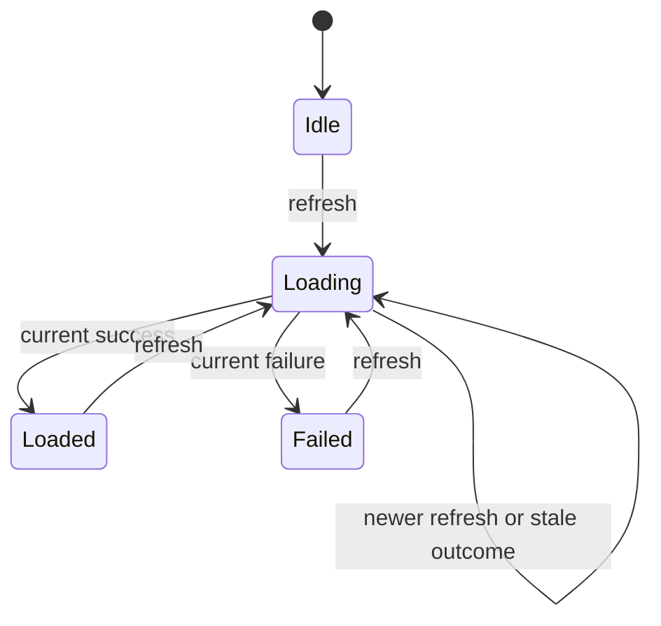

A screen represented by `isLoading`, `hasError`, and an optional result has more states than it probably needs. Can it be loading and failed at the same time? Can it report success without a result? Every extra representable combination becomes something the rest of the application must interpret.

Swift's structs and enums let us model the combinations that make sense. Algebraic data types give this familiar technique a precise vocabulary: products combine facts, and sums choose between alternatives.

<!--more-->

The examples use Swift 5.7. No external functional library is required; associated-value enums supply the central mechanism.

## Product types mean all of these facts

```swift
struct ArticlePage: Equatable {
    let titles: [String]
    let nextPage: Int?
}
```

An `ArticlePage` contains both its titles and its pagination information. For a small finite model, the number of possible product values is the product of the possibilities in its fields. Two independent Boolean fields allow four combinations.

This counting is a reasoning tool, not a suggestion to enumerate all possible strings or arrays. It helps reveal when a group of independent flags accidentally allows contradictory combinations.

Types still need invariants. An optional next-page integer can hold a negative value unless construction prevents it. A struct groups fields; it does not automatically validate their relationships.

## Sum types mean one of these alternatives

```swift
enum LoadFailure: Equatable {
    case offline
    case rejected(status: Int)
}

enum PageState: Equatable {
    case idle
    case loading(previous: ArticlePage?)
    case loaded(ArticlePage)
    case failed(LoadFailure, previous: ArticlePage?)
}

func headline(for state: PageState) -> String {
    switch state {
    case .idle:
        return "Ready"
    case .loading:
        return "Loading"
    case let .loaded(page):
        return "\(page.titles.count) articles"
    case let .failed(failure, _):
        switch failure {
        case .offline: return "Offline"
        case let .rejected(status): return "Request rejected: \(status)"
        }
    }
}

let page = ArticlePage(titles: ["Values"], nextPage: nil)
assert(headline(for: .loaded(page)) == "1 articles")
assert(headline(for: .failed(.offline, previous: page)) == "Offline")
```

The state is exactly one case. A loaded state always carries a page. A failed state always carries a reason. Loading and failure can deliberately retain previous content because that is a valid UX policy for this example.

Associated values are products inside each alternative. This combination is why enums scale beyond naming constants: each case can carry exactly the facts that make that state meaningful.

## State shape and transition rules are different



Loading can carry previous content. The state name describes the workflow, while its associated values preserve the facts needed to display it.

An enum prevents some invalid snapshots. It does not prevent every invalid sequence. The application could still accept an old network response after a new request starts unless the transition logic rejects it.

Add identity to the state and the events:

```swift
struct PageModel: Equatable {
    var generation = 0
    var activeRequest: Int?
    var state: PageState = .idle
}

enum PageEvent {
    case refresh
    case succeeded(request: Int, page: ArticlePage)
    case failed(request: Int, failure: LoadFailure)
}

func previousPage(in state: PageState) -> ArticlePage? {
    switch state {
    case .idle: return nil
    case let .loaded(page): return page
    case let .loading(previous): return previous
    case let .failed(_, previous): return previous
    }
}

func transition(_ model: PageModel, event: PageEvent) -> PageModel {
    var next = model
    switch event {
    case .refresh:
        next.generation += 1
        next.activeRequest = next.generation
        next.state = .loading(previous: previousPage(in: model.state))
    case let .succeeded(request, page):
        guard model.activeRequest == request else { return model }
        next.activeRequest = nil
        next.state = .loaded(page)
    case let .failed(request, failure):
        guard model.activeRequest == request else { return model }
        next.activeRequest = nil
        next.state = .failed(failure, previous: previousPage(in: model.state))
    }
    return next
}

let first = transition(PageModel(), event: .refresh)
let second = transition(first, event: .refresh)
assert(transition(second, event: .succeeded(request: 1, page: page)) == second)
let finished = transition(second, event: .succeeded(request: 2, page: page))
assert(finished.state == .loaded(page))
assert(transition(finished, event: .failed(request: 2, failure: .offline)) == finished)
```

Completion clears the active request so a duplicate outcome is ignored. The generation counter assumes a bounded number of refreshes in one owner's lifetime. Durable or cross-owner identity needs a stronger policy.

The coordinator still starts and cancels network work. The reducer handles accepted facts. A sum type makes the snapshots clearer, and a transition function makes the workflow clearer; neither replaces the effect owner's lifetime and isolation responsibilities.

## Ask whether two fields should be one alternative

`PageModel` still permits inconsistent values if arbitrary callers mutate all its fields. For a teaching example the fields are accessible, but a production implementation should restrict construction and mutation, or combine the active request with the loading case.

For example, `.loading(request: Int, previous: ArticlePage?)` puts the request identifier exactly where it is required. Settled cases then cannot accidentally retain an active request. You still need a separate monotonic generation source, but the state shape carries more of the invariant.

Do not force every independent fact into one giant enum. A screen can be loading articles while a separate settings panel is open. If those concerns vary independently, model them as a product of smaller state machines rather than multiplying every combination into a case name.

## Exhaustive switches turn growth into useful feedback

When a new case is added, exhaustive switches identify code that needs to interpret it. A broad `default` can suppress that feedback and make a new state silently look like an old one.

Use defaults when they express a real fallback policy, especially at resilience boundaries where unknown cases need handling. Within a closed domain model, explicit cases often make changes easier to review.

The same applies to error enums. `.offline` and `.rejected(status:)` are different reasons with different recovery options. Flattening both into a string makes display easy but loses structured behavior. Keep the model typed and derive user-facing text at the presentation boundary.

## Recursive enums describe syntax and trees

```swift
indirect enum Expression {
    case integer(Int)
    case add(Expression, Expression)
}

func evaluate(_ expression: Expression) -> Int {
    switch expression {
    case let .integer(value): return value
    case let .add(left, right): return evaluate(left) + evaluate(right)
    }
}

let expression = Expression.add(.integer(2), .add(.integer(3), .integer(4)))
assert(evaluate(expression) == 9)
```

`indirect` allows the recursive representation. The evaluator follows the structure of the data, so adding a multiplication case requires an explicit interpretation.

This tiny evaluator assumes shallow expressions and nonoverflowing sums. User-supplied expression trees need depth or work limits and checked arithmetic. A model can exclude missing operands while still permitting inputs that exceed runtime resources.

## Test the legal states and rejected transitions

For the page model, test initial loading, refresh with previous content, failure preserving content, stale success, and duplicate completion. Verify the UI projection for each case separately from network scheduling.

For an expression model, test nested structure rather than only single literals. A useful property is that wrapping an expression with addition of zero preserves its value within the defined arithmetic domain.

State models are particularly suited to sequence tests: generate events, apply them in order, and check invariants after each step. A test of one snapshot will not reveal a transition that briefly accepts an obsolete result.

## Derive presentation from state instead of storing duplicate flags

A screen often needs both a headline and visible content. Derive those projections from the model rather than adding more independently mutable fields:

```swift
func showsSpinner(_ state: PageState) -> Bool {
    if case .loading = state { return true }
    return false
}

let contentWhileLoading = PageState.loading(previous: page)
let contentAfterFailure = PageState.failed(.offline, previous: page)
assert(showsSpinner(contentWhileLoading))
assert(!showsSpinner(contentAfterFailure))
assert(previousPage(in: contentWhileLoading) == page)
assert(previousPage(in: contentAfterFailure) == page)
```

If `isLoading` were stored separately, every transition would need to keep it synchronized with `state`. A derived property removes that consistency obligation.

Not every value should be recomputed, especially when calculation is expensive. But caching a projection creates an invariant between source and cache. Start with one source of truth and introduce a cache only with an explicit invalidation policy.

The same principle applies to enabled buttons and error banners. A button can be disabled because the current state cannot accept its action, while a banner can display a structured failure reason. Storing duplicate booleans without a need expands the invalid state space again.

## Test sequences against invariants

Individual examples cover stale completion, but a small event sequence can check the relationship between active request and loading state after every event:

```swift
let events: [PageEvent] = [
    .refresh,
    .refresh,
    .succeeded(request: 1, page: page),
    .failed(request: 2, failure: .offline),
    .succeeded(request: 2, page: page),
    .refresh,
    .succeeded(request: 3, page: page)
]
var evolving = PageModel()
for event in events {
    evolving = transition(evolving, event: event)
    assert((evolving.activeRequest != nil) == showsSpinner(evolving.state))
}
assert(evolving.state == .loaded(page))
```

This invariant holds for values produced through our reducer from its valid initial state. It does not hold for every manually constructed `PageModel`, because the demonstration still exposes independently writable fields.

That distinction guides the next design improvement: hide arbitrary mutation or put request identity into the loading case. A runtime test can reveal an invariant, while a stronger type can remove opportunities to violate it.

## Distinguish closed models from extensible boundaries

An enum is a good fit when the application owns a finite set of alternatives and wants exhaustive interpretation. A protocol is useful when independent implementations must extend behavior without editing one central case list.

For example, the page's loading states are a closed domain model. The network client that supplies pages can have several implementations behind a protocol. The enum describes outcomes; the protocol describes a capability.

Neither should imitate the other mechanically. An enum containing every possible transport implementation couples the model to infrastructure. A separate class for every simple state can make exhaustive state handling harder to inspect.

Also consider persistence. Encoding a state enum creates a schema that must evolve when cases or payloads change. A compiler-guided update of local switches does not automatically migrate old saved data.

## Model impossible states selectively

There is a cost to increasingly precise types: more constructors, conversions, and generic parameters. Prevent the combinations that are likely to cause real bugs, especially missing payloads and contradictory workflow flags.

Some invariants remain easier to validate dynamically. A page's titles may have unique IDs, a next-page number may be positive, and a request generation may be bounded. A sum type alone does not enforce every property of the values it carries.

Use validated constructors for those constraints, keep the public mutation surface small, and make rejected transitions observable in tests. The aim is a model whose remaining assumptions are explicit enough for a reader to assess.

## Exercise: move request identity into the case

Refactor `PageModel` so only a loading case carries an active request. Update the reducer to reject completions in every settled state. Keep the earlier assertions passing.

Then add cancellation. Decide whether it restores previous content, returns to idle, or displays a distinct cancelled state. Write a sequence with two refreshes, cancellation, and both late outcomes.

Swift's [Enumerations chapter](https://docs.swift.org/swift-book/documentation/the-swift-programming-language/enumerations/) covers associated values and recursive enums. Return to the [Functional Programming roadmap](/swift-functional-programming/).
