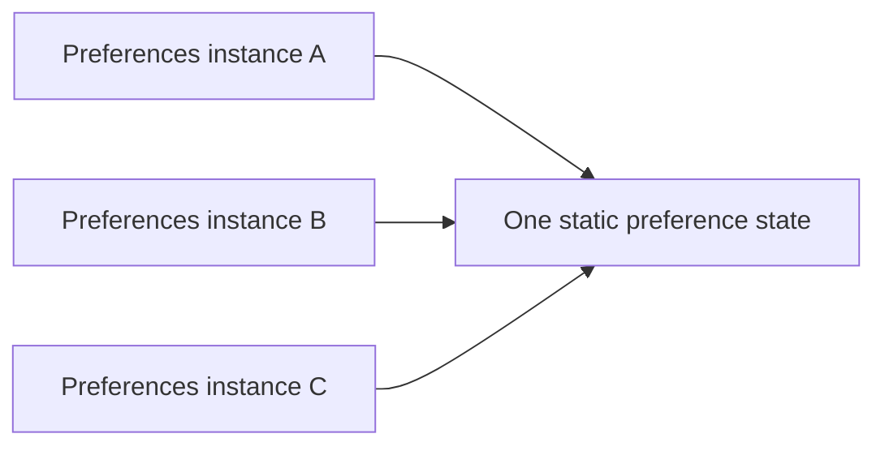

Monostate allows several object instances while their operations all use one shared state. It differs from Singleton's one shared object identity: two monostate objects can be distinct references yet observe the same preferences.

That can make a legacy instance-based interface convenient, but it can also hide global coupling behind code that looks independently constructed.

<!--more-->

The Swift 5.7 example isolates the shared preferences to the main actor, available since Swift 5.5. Isolation prevents unsynchronized access; it does not make the state local to each instance.

## Separate instance identity from storage identity

```swift
struct PreferenceSnapshot: Equatable {
    let theme: String
    let fontPercent: Int
}

@MainActor
final class AppPreferences {
    private static var storedTheme = "light"
    private static var storedFontPercent = 100

    var theme: String {
        get { Self.storedTheme }
        set { Self.storedTheme = newValue }
    }
    var fontPercent: Int {
        get { Self.storedFontPercent }
        set {
            precondition((75...200).contains(newValue))
            Self.storedFontPercent = newValue
        }
    }
    func snapshot() -> PreferenceSnapshot {
        PreferenceSnapshot(theme: theme, fontPercent: fontPercent)
    }
}

await MainActor.run {
    let first = AppPreferences()
    let second = AppPreferences()
    assert(first !== second)
    let original = first.snapshot()
    defer { first.theme = original.theme; first.fontPercent = original.fontPercent }
    first.theme = "dark"
    first.fontPercent = 125
    assert(second.snapshot() == PreferenceSnapshot(theme: "dark", fontPercent: 125))
}
```

The computed instance properties forward to static storage. Constructing `second` does not create new preferences. The defer restores this demonstration's prior state, but process-global reset is not a scalable isolation strategy for a parallel test suite.

A real preference model should validate supported theme identifiers as well as font range. Strings keep the example compact; a domain enum would avoid unsupported theme names internally.

## Main-actor isolation and global scope solve different problems

Actor isolation controls when mutable state is accessed. Monostate controls which callers observe the same state. Every instance above still belongs to the same process-wide preference scope.

Two windows cannot select independent themes merely by constructing two wrappers. Two test cases cannot obtain independent stores by calling the initializer twice.

If the intended policy is truly one application-wide appearance, that sharing may be appropriate. If the policy becomes account-, scene-, or document-specific, static storage is the wrong lifetime even though every access is race-free.



A Singleton diagram instead points callers to one object instance. The distinction matters to identity comparisons, construction expectations, and test setup.

## Do not let construction reset global state

An initializer that assigns default values into the static fields would change every existing instance whenever a new wrapper is created. A screen constructing its preferences could then unexpectedly reset another screen's choices.

Initialize shared storage once at its owner and make reset an explicit operation if the product needs it. Document which scope reset affects and whether active consumers receive a change event.

Persistence is separate again. Static fields disappear when the process ends. A wrapper around a persistent store needs loading, migration, error handling, and a coherent update policy rather than assuming that the monostate pattern provides durability.

## Prefer an explicit shared store when scope may vary

```swift
@MainActor
final class ThemeStore {
    var theme: String
    init(theme: String) { self.theme = theme }
}

@MainActor
final class ThemePresenter {
    let store: ThemeStore
    init(store: ThemeStore) { self.store = store }
    func select(_ theme: String) { store.theme = theme }
}

await MainActor.run {
    let accountA = ThemeStore(theme: "light")
    let accountB = ThemeStore(theme: "dark")
    let first = ThemePresenter(store: accountA)
    let second = ThemePresenter(store: accountB)
    first.select("sepia")
    assert(second.store.theme == "dark")
}
```

Assembly can still pass the same store to several presenters when sharing is desired. Different scopes can receive different stores without changing presenter implementation.

This alternative makes the sharing relationship visible in construction. Monostate may remain useful as a compatibility adapter for an API that must look instance-based, but new feature logic need not inherit that hidden global choice.

## Subclassing can make static-state expectations surprising

Swift stored type properties belong to a declared type; they are not automatically independent storage per subclass. A wrapper hierarchy can therefore share state more broadly than a caller expects.

The example is final to avoid implying subclass-specific preference scopes. If the product needs distinct families of state, construct distinct owners rather than encoding scope in inheritance and hoping static lookup creates separate storage.

Likewise, generic static-storage behavior and language restrictions should be checked before using a type parameter as an implicit scope key. An explicit dictionary keyed by a validated scope ID is easier to inspect when runtime scopes are the real requirement.

## Test the misleading independence directly

Construct two instances, mutate through one, and verify the other observes the change. That is a positive test of the pattern, not an accidental failure.

Then test the consumer through an explicit store abstraction so ordinary feature tests remain independent. Keep a small integration test for the monostate adapter's shared behavior.

If updates notify observers, verify the event describes one committed shared state and is delivered under the documented isolation. Broadcasting from a setter before all related fields are updated can expose a partially changed snapshot.

## Source compatibility can hide a migration trap

Monostate sometimes appears when a library already lets callers construct a preferences object, but its implementation changes to shared backing storage. Existing call sites continue to compile. Their behavior can still change substantially: two previously independent objects now observe one another's writes.

That change should be treated as a semantic API change. Tests that create a fresh instance to obtain clean state no longer have isolation. A preview that constructs two configurations side by side can show the same setting in both panels. A migration note needs to describe shared scope, not just say that the initializer remains available.

Conversely, migrating away from monostate requires finding consumers that relied on this implicit communication. Giving each call site a new private store can stop settings from propagating. Introduce an explicitly shared store at the correct ownership boundary, then inject it into those consumers together.

## Isolation and scope answer different questions

The `@MainActor` annotation serializes access to the shared backing state in this example. It does not make that state appropriate for every user, document, or window. It also does not make a workflow atomic if the workflow later adds a suspension point between reading and writing.

For example, a preference editor might read the current theme, await a confirmation dialog, and then write its edited result. Another operation can change the theme while the dialog is open. If overwriting that newer choice is undesirable, compare a version or revalidate at commit time. Shared storage plus isolation still needs a policy for edits that span time.

## Notifications need the same explicitness

Forwarding instance properties to static storage does not automatically notify every wrapper instance when the storage changes. Adding an observation mechanism to one wrapper can give the misleading appearance that all instances publish the same updates.

Choose one observable owner for the shared state and let wrappers subscribe to that owner, or expose the owner directly. Include subscriber cleanup and initial-value behavior in the contract. Otherwise a view may read the latest value when it refreshes for an unrelated reason while failing to refresh at the moment the setting changes.

Monostate can be useful behind a compatibility boundary, but it is an expensive surprise as a default application model. If consumers need distinct stores in tests or separate sessions in production, explicit state objects make those relationships visible. The alternative `ThemeStore` example demonstrates that the consuming presenter does not need to know whether the composition root shares or separates its store.

## Exercise: migrate a document-scoped setting

A text editor incorrectly stores its current document font in monostate. Replace it with a document-owned store, open two documents with different font settings, and verify edits remain independent. Keep application-wide defaults separate from each document's current value.

Compare [Singleton](/swift-singleton/) and [Dependency Injection](/swift-dependency-injection/) to describe identity, scope, and access as separate decisions.

Return to the [Design Patterns roadmap](/swift-design-patterns/).
