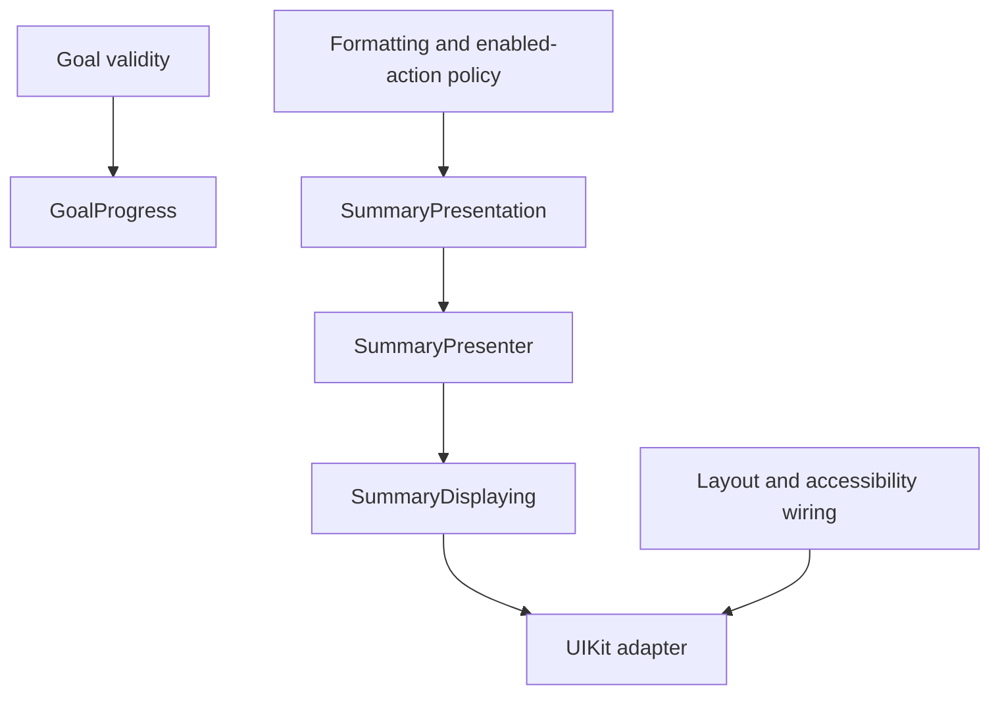

MVP is useful when presentation behavior forms a meaningful contract that can be exercised independently of UIKit. It is less useful when a presenter only forwards every call and adds another place to search for a one-line change.

Choose it by examining the decisions a screen makes: formatting, validation feedback, enabled actions, empty states, and interaction phases. The presence of a view controller alone is not a reason to create a presenter.

<!--more-->

This Swift 5.7 article develops a bounded presentation policy, compares view contracts, and explains where presenter tests stop providing evidence. The example computes a reading-goal summary using explicit limits so arithmetic and display behavior stay defined.

## Find a presentation rule worth isolating

A goal summary needs a progress label, an integer percentage, an accessibility description, and a decision about whether another completion is allowed. Those fields must agree. Computing each independently inside unrelated widget callbacks risks inconsistent results.

```swift
enum ProgressFailure: Error { case invalid }
struct GoalProgress: Equatable {
    let completed: Int
    let target: Int
    init(completed: Int, target: Int) throws {
        guard (1...365).contains(target), (0...target).contains(completed) else {
            throw ProgressFailure.invalid
        }
        self.completed = completed
        self.target = target
    }
}
struct SummaryFrame: Equatable {
    let heading: String
    let percentage: Int
    let accessibility: String
    let allowsCompletion: Bool
}
struct SummaryPresentation {
    func frame(for progress: GoalProgress) -> SummaryFrame {
        let percentage = progress.completed * 100 / progress.target
        return SummaryFrame(
            heading: "\(progress.completed)/\(progress.target)",
            percentage: percentage,
            accessibility: "\(progress.completed) of \(progress.target) books complete, \(percentage) percent",
            allowsCompletion: progress.completed < progress.target
        )
    }
}
```

The 365-book bound is a policy of this example, not a general library constraint. It guarantees the integer multiplication is safe and makes the displayed percentage floor toward the lower integer. A different product can choose rounding, but it should test that choice explicitly.

`GoalProgress` validates facts. `SummaryPresentation` chooses words and representation. Real localization should use localized resources and pluralization rules rather than concatenate English fragments. Inject locale or formatting policy when it varies in tests.

## Test the policy over its valid domain

```swift
let presentation = SummaryPresentation()
let partial = presentation.frame(for: try GoalProgress(completed: 1, target: 3))
assert(partial.percentage == 33 && partial.allowsCompletion)
for target in 1...365 {
    var previous = -1
    for completed in 0...target {
        let frame = presentation.frame(for: try GoalProgress(completed: completed, target: target))
        assert((0...100).contains(frame.percentage))
        assert(frame.percentage >= previous)
        assert(frame.allowsCompletion == (completed < target))
        if completed == target { assert(frame.percentage == 100) }
        previous = frame.percentage
    }
}
do {
    _ = try GoalProgress(completed: 4, target: 3)
    assertionFailure("Invalid progress must not reach rendering")
} catch ProgressFailure.invalid {}
```

This small exhaustive check verifies useful properties of the stated domain. It does not mirror every implementation branch. In particular, it checks that progress never decreases and that only unfinished goals permit another completion.

A screenshot of one partial goal cannot establish those properties. Conversely, these assertions cannot establish contrast, Dynamic Type layout, VoiceOver order, or that the accessibility text is actually assigned to the correct element.

## Prefer a coherent display boundary

```swift
protocol SummaryDisplaying: AnyObject { func show(_ frame: SummaryFrame) }
final class SummaryPresenter {
    private let presentation: SummaryPresentation
    private weak var view: (any SummaryDisplaying)?
    private var current: GoalProgress
    init(current: GoalProgress, presentation: SummaryPresentation = SummaryPresentation()) {
        self.current = current
        self.presentation = presentation
    }
    func attach(_ view: any SummaryDisplaying) {
        self.view = view
        view.show(presentation.frame(for: current))
    }
    func update(_ progress: GoalProgress) {
        current = progress
        view?.show(presentation.frame(for: progress))
    }
}
final class SummaryViewSpy: SummaryDisplaying {
    var frames: [SummaryFrame] = []
    func show(_ frame: SummaryFrame) { frames.append(frame) }
}
let view = SummaryViewSpy()
let presenter = SummaryPresenter(current: try GoalProgress(completed: 0, target: 3))
presenter.attach(view)
presenter.update(try GoalProgress(completed: 3, target: 3))
assert(view.frames.count == 2)
assert(view.frames.last?.allowsCompletion == false)
assert(view.frames.last?.percentage == 100)
```

The presenter immediately supplies current content on attachment. A replacement view does not need to reconstruct old callback order. The value contract keeps related display decisions together without claiming that UIKit draws every widget atomically.

If the only behavior is this pure projection and no interaction coordination exists, a function may be enough. The presenter object becomes more useful when it also owns a meaningful interaction state or consumes a fallible use case.

## Evaluate the change surface



Change the wording: the projection and its tests should change. Change the widget layout: the UI adapter should change. Change the maximum permitted target: domain validation and relevant domain fixtures should change. Some changes legitimately span several boundaries; the goal is intelligible responsibility, not an impossible promise of one file per requirement.

A chatty protocol with one method per widget tends to make visual changes propagate into presenter tests. A huge frame containing every implementation detail can have the same problem. Prefer concepts meaningful to the screen's consumer.

## Cases where MVP often helps

An established UIKit app with complex forms can gain fast presentation tests without replacing its navigation or storage stack. Several layout variants can share a presenter when they truly share interaction policy. A feature built by separate UI and domain owners can use the view contract as an explicit collaboration boundary.

MVP also makes it easier to drive a screen from a recording view in tests. Error branches, invalid input, and repeated submission can be exercised without launching the app. This is valuable when those rules change frequently or failures have been difficult to reproduce.

The benefit depends on keeping effects and dependencies controllable. A presenter that calls global services and reads the real clock is still hard to test, even though it no longer subclasses `UIViewController`.

## Cases where MVP can add friction

A static information screen may have no substantial presentation policy to extract. A SwiftUI view can already render an observable value directly; adding an imperative passive-view protocol can fight that model without isolating anything new.

A presenter per tiny reusable visual element can also obscure composition. A pure view taking a value is often simpler than another object with attach, detach, and callback methods. Use lifecycle machinery where a lifecycle exists.

Sharing a presenter across visually similar screens can become misleading if the screens have different validation or navigation rules. Common typography does not establish common interaction policy. Share the pure formatting capability and keep separate feature owners when their behavior diverges.

## Keep tests at the right boundary

Use projection tests for representation rules, presenter tests for interactions and outcomes, adapter tests for event wiring, and a few end-to-end tests for critical user journeys. Do not multiply identical scenarios at every layer merely to increase test count.

A useful presenter test fails when the person would see an incorrect state or a required use-case call is omitted. A brittle test fails because a private helper was renamed or two equivalent render steps were combined.

When choosing between MVP and [MVVM](/swift-mvvm/), ask whether the consumer benefits more from explicit display commands or an observable state model. Both can separate UI frameworks from policy; neither automatically solves ownership, cancellation, or concurrent writes.

## Case study: one presenter meets a different interaction

Suppose the compact summary is read-only, while the detailed screen adds a completion button and an undo action. Both still use the same percentage and accessibility formatting, but their interaction lifetimes have diverged.

Sharing `SummaryPresentation` remains straightforward because it is a pure policy over progress. Forcing both screens through one presenter with flags such as `isCompact`, `allowsUndo`, and `hideCompletion` can create a matrix of modes that is harder to test than two small owners.

Separate presenters can consume the same projection and use-case capability while owning their own interaction state. This preserves useful reuse without pretending the screens have identical behavior. Conversely, if the only difference is layout, keep one presentation contract and let the views render it differently.

An effective review follows a proposed change through the public API. If a typography change adds presenter methods, the contract may be too widget-specific. If a domain rule change requires editing localized string logic, domain and presentation may be mixed. If changing an interaction requires many unrelated mode flags, ownership may be too broad.

Also account for assembly. A new presenter needs an owner, dependencies, attachment policy, and teardown. That cost can be worthwhile for a complex form and needless for a static card. Small pure projections are useful on either side of the decision.

The goal is not maximum isolation at every line. It is a boundary that lets the person making a change understand which behavior they are responsible for and which existing guarantees they must preserve.

## Exercise: compare two renderer implementations

Implement a compact summary and a detailed summary using the same frame. Then introduce a genuinely different interaction requirement for one of them. Decide which behavior remains shareable and whether the presenter should remain common. Keep a small integration check for accessibility wiring in each renderer.

Return to the [App Architectures roadmap](/swift-architectures/).
