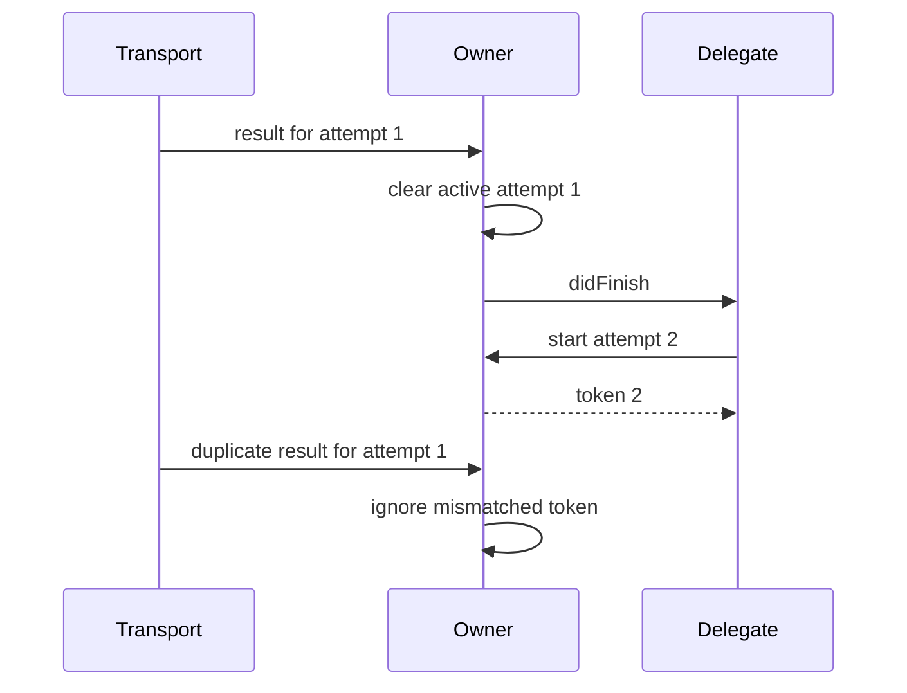

A picker knows which item the user selected. The screen that owns the picker knows what that selection means for the application. Delegation lets the picker report an event through a small contract without importing the screen's decisions into the picker.

The protocol is only half the design. The lifetime of the delegate matters just as much.

<!--more-->

## Define the event contract

```swift
protocol ItemPickerDelegate: AnyObject {
    func itemPicker(_ picker: ItemPicker, didSelect item: String)
}

final class ItemPicker {
    weak var delegate: (any ItemPickerDelegate)?

    func select(_ item: String) {
        delegate?.itemPicker(self, didSelect: item)
    }
}

final class SelectionCoordinator: ItemPickerDelegate {
    let picker = ItemPicker()
    private(set) var selectedItem: String?

    init() {
        picker.delegate = self
    }

    func itemPicker(_ picker: ItemPicker, didSelect item: String) {
        selectedItem = item
    }
}

let coordinator = SelectionCoordinator()
coordinator.picker.select("Swift")
assert(coordinator.selectedItem == "Swift")
```

The picker does not know about navigation, persistence, or labels on the owning screen. It knows only that a delegate can receive a selection event. Including the sender in the callback helps a delegate distinguish several pickers if necessary.

`AnyObject` restricts conformers to class instances, which allows the weak property. The language guide discusses [class-only protocols](https://docs.swift.org/swift-book/documentation/the-swift-programming-language/protocols/#Class-Only-Protocols) and [weak references](https://docs.swift.org/swift-book/documentation/the-swift-programming-language/automaticreferencecounting/#Weak-References).

## Explain who retains whom

The coordinator strongly owns the picker. The picker weakly references the coordinator, so the callback link does not create a strong cycle.

A weak delegate must be kept alive somewhere else. Assigning a newly constructed helper directly to a weak property, with no other owner, can leave the property `nil` immediately after the assignment. Weak means “does not own,” not “the system will keep this around until the next event.”

Not every collaborator should be weak. A required service injected into an object is often strongly retained because the object needs that service for its own work. Use weak references where the intended ownership graph calls for them.

## State timing and isolation explicitly

The example callback is synchronous. `select` does not return until the delegate finishes. A delegate can therefore call back into the picker before the first operation completes; real implementations should consider reentrancy and update internal state before reporting an event.

The example also assumes serial access. A UIKit-facing version would normally use main-actor isolation for the picker and delegate contract. A background worker should document where callbacks arrive rather than forcing every consumer to guess whether it may update UI.

A protocol signature alone does not promise a particular thread, executor, ordering, or delivery count.

## Choose delegation for a coherent relationship

Delegation fits a one-to-one relationship with several related events or decisions. A closure is often smaller for one simple completion. A stream or observer mechanism can be more appropriate when many consumers need independent subscriptions.

Avoid growing one delegate into a bucket of unrelated responsibilities. If selection, authentication, and analytics evolve independently, separate the contracts or inject dedicated collaborators.

## Test the event without a screen

A small recording delegate can store received items and verify that selecting one item reports exactly that item and sender. Keep that delegate in a strong local binding during the test.

Such a test exercises the callback contract without requiring a view controller or an application lifecycle. For dependencies that provide data rather than receive events, continue with [Dependency Injection](/swift-dependency-injection/).

## Make callback order observable

A delegate often reads the sender's state during a callback. Update the sender before reporting the event so observers see the new state, and decide what happens if the callback calls back into the sender.

```swift
protocol SelectionSessionDelegate: AnyObject {
    func selectionSessionDidChange(_ session: SelectionSession)
}

final class SelectionSession {
    weak var delegate: (any SelectionSessionDelegate)?
    private(set) var selected: String?

    func select(_ item: String) {
        selected = item
        delegate?.selectionSessionDidChange(self)
    }
}

final class SelectionRecorder: SelectionSessionDelegate {
    private(set) var observed: [String] = []

    func selectionSessionDidChange(_ session: SelectionSession) {
        observed.append(session.selected ?? "No selection")
    }
}

let selectionSession = SelectionSession()
let selectionRecorder = SelectionRecorder()
selectionSession.delegate = selectionRecorder
selectionSession.select("First")
selectionSession.select("Second")
assert(selectionRecorder.observed == ["First", "Second"])
```

The recorder is strongly retained by its local binding. The session can report synchronously, and its state is already valid when the callback reads it.

Now imagine a delegate that selects another item during notification. The second callback runs before the first call returns. If that is allowed, document it and ensure intermediate operations are valid. If it is not allowed, choose a policy such as rejecting reentrant changes or queueing them. Simply dispatching every callback asynchronously changes ordering and lifetime, so it is not a neutral fix.

## Separate questions from notifications

Some delegates answer a question: “May this item be selected?” Others receive a fact: “This item was selected.” Those operations belong at different moments in a transition.

A decision callback runs before committing state. A notification runs afterward. Calling the notification and then rolling back because another delegate method rejects the action creates a confusing history for observers.

If approval depends on several asynchronous systems, a synchronous delegate question may be the wrong shape. An explicit operation returning a result can represent that workflow more honestly. Keep delegation for a coherent relationship rather than forcing every interaction into a callback method.

## Define the behavior when no delegate exists

An optional weak delegate can disappear. Optional chaining silently skips the callback, which is appropriate for optional observation. It is dangerous when the callback is the only place a required business action happens.

For example, a download should not rely on an optional UI delegate to persist the downloaded file. The download service should own the required effect, while the delegate can update a progress display. Otherwise removing the screen changes whether data is stored.

If a collaborator is mandatory for correct operation, inject and retain it under an explicit contract instead of treating it as optional observation. The distinction between a service and a delegate is semantic, not just whether the property is named `delegate`.

## Compare a delegate with a closure

```swift
final class ClosurePicker {
    var onSelection: ((String) -> Void)?

    func select(_ item: String) {
        onSelection?(item)
    }
}

final class ClosurePickerOwner {
    let picker = ClosurePicker()
    private(set) var selected: String?

    init() {
        picker.onSelection = { [weak self] item in
            self?.selected = item
        }
    }
}

let closurePickerOwner = ClosurePickerOwner()
closurePickerOwner.picker.select("Swift")
assert(closurePickerOwner.selected == "Swift")
```

The closure is compact for one event. Its capture list makes the owner relationship visible. Without the weak capture in this ownership shape, the owner retains the picker, the picker retains the closure, and the closure can retain the owner.

A delegate protocol groups related events and questions under one named contract. That is useful when several callbacks form a coherent interaction. A closure is often easier for one completion, while a subscription or async sequence can better express multiple independent observers or a stream with cancellation.

Neither syntax removes the need to specify ordering, errors, completion, or ownership.

## Keep actor isolation in the contract

A UI-facing delegate generally needs an execution context compatible with UI access. Marking the appropriate types and protocol with main-actor isolation can make that intent visible to the compiler in a modern Swift application.

A worker must then cross the isolation boundary appropriately before delivering UI events. Do not assume that conforming to a protocol moves calls onto a particular thread or actor. A synchronous protocol requirement is simply invoked from the caller's context unless the surrounding isolation rules say otherwise.

When adapting an older callback API, also decide whether events may arrive after cancellation. A generation token or request identifier can help an owner reject stale results, while explicit unregistering prevents unnecessary work. Weak ownership alone prevents retaining an owner; it does not cancel the producer's operation.

## Build a meaningful delegate test

A useful recording delegate stores the sender identity, event payload, and state observed during notification. Test that one operation produces the expected event count, that a missing delegate does not break optional behavior, and that releasing the delegate removes callbacks safely.

For a one-shot completion, test exactly-once delivery and failure as well as success. For progress events, test order and the final event. These are consumer-facing contracts; checking merely that a method was invoked misses the harder failure modes.

As an exercise, add an approval callback to `SelectionSession`. Specify which state the approval callback sees, which state the notification sees, and whether the approval callback may reenter selection. Writing those three answers before implementation prevents a surprising amount of callback code from becoming an accidental state machine.

## Case study: deliver a one-shot result while ignoring late callbacks

A request owner starts work, can cancel it, and reports one successful result to a delegate. The underlying transport might still call back after cancellation. It might even invoke a completion twice because of an adapter bug. Weak ownership does not solve either problem.

Represent each attempt with a token and clear the active attempt before notifying the delegate:

```swift
struct AttemptToken: Equatable {
    let number: Int
}

protocol AttemptOwnerDelegate: AnyObject {
    func attemptOwner(_ owner: AttemptOwner, didFinish value: String)
}

final class AttemptOwner {
    weak var delegate: (any AttemptOwnerDelegate)?
    private var nextNumber = 0
    private(set) var active: AttemptToken?
    private(set) var lastValue: String?

    func start() -> AttemptToken {
        nextNumber += 1
        let token = AttemptToken(number: nextNumber)
        active = token
        return token
    }

    func cancel(_ token: AttemptToken) {
        guard active == token else { return }
        active = nil
    }

    func receive(_ value: String, for token: AttemptToken) {
        guard active == token else { return }
        active = nil
        lastValue = value
        delegate?.attemptOwner(self, didFinish: value)
    }
}

final class AttemptRecorder: AttemptOwnerDelegate {
    private(set) var values: [String] = []
    private(set) var observedSettledState = true
    var onFinish: ((AttemptOwner) -> Void)?

    func attemptOwner(_ owner: AttemptOwner, didFinish value: String) {
        values.append(value)
        observedSettledState = observedSettledState && owner.active == nil
        onFinish?(owner)
    }
}

let attemptOwner = AttemptOwner()
let attemptRecorder = AttemptRecorder()
attemptOwner.delegate = attemptRecorder
let abandonedAttempt = attemptOwner.start()
attemptOwner.cancel(abandonedAttempt)
attemptOwner.receive("Too late", for: abandonedAttempt)
assert(attemptRecorder.values.isEmpty)

let currentAttempt = attemptOwner.start()
attemptOwner.receive("Accepted", for: currentAttempt)
attemptOwner.receive("Duplicate", for: currentAttempt)
assert(attemptRecorder.values == ["Accepted"])
assert(attemptRecorder.observedSettledState)
assert(attemptOwner.lastValue == "Accepted")
```

Starting again supersedes any active attempt. Cancellation retains the last successful value and reports no success. These are explicit policies. A different product may need cancellation events or may reject starting while busy; adjust the state machine and delegate contract together.

The transport is omitted so the callback contract can be tested synchronously and deterministically. A real adapter associates the token with its request and forwards callbacks to the owner's isolated execution context.

### Reentrancy must preserve the new request

A delegate can start another attempt while handling a successful result. Because the old attempt is cleared before notification, the new attempt is preserved:

```swift
var restartedAttempt: AttemptToken?
attemptRecorder.onFinish = { owner in
    restartedAttempt = owner.start()
}
let finishingAttempt = attemptOwner.start()
attemptOwner.receive("First stage", for: finishingAttempt)
assert(restartedAttempt != nil)
assert(attemptOwner.active == restartedAttempt)
attemptOwner.receive("Old repeat", for: finishingAttempt)
assert(attemptOwner.active == restartedAttempt)
attemptRecorder.onFinish = nil
```

If `receive` cleared `active` after calling the delegate, it would erase the newly started request. This is a sequencing bug that a basic “delegate was called” assertion would miss.

The recorder's callback receives the owner as an argument and does not retain it. If a stored callback instead captures a coordinator that owns the recorder, inspect that extra ownership edge as carefully as the delegate property.



### At-most-once notification is a local guarantee

The owner accepts at most one result for its current token under serialized access. It cannot guarantee a callback will arrive, keep a weak delegate alive, or ensure that an external server performs an operation only once.

If a request creates a payment, a local attempt token is not a substitute for a server-side idempotency key. If the delegate must eventually observe a durable result after an app restart, an in-memory weak callback is not a delivery system. Store the result and expose an appropriate query or durable event mechanism.

### Cancellation has two responsibilities

Invalidating the active token protects the owner's state against a late callback. Cancelling the transport prevents unnecessary work when possible. Perform both when the application needs both. A transport's `cancel` can be best-effort, so retain the token check even if cancellation usually stops callbacks.

Similarly, a weak delegate becoming `nil` does not stop an active request. Decide whether the request belongs to a screen, a feature coordinator, or an application service. Its lifetime should follow that owner explicitly.

For a UI version, put the owner and delegate interaction under main-actor isolation. For a worker, choose an actor or another serialization mechanism. The token comparison and update must occur within the same protected operation; the synchronous example's plain properties do not supply thread safety.

Continue through the [Object-Oriented Programming roadmap](/swift-object-oriented-programming/).
