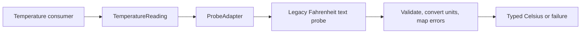

An adapter translates one contract into another so an existing capability can participate in a new system. The translation can involve units, error meanings, callback timing, or resource ownership, not just a differently named method.

A wrapper that compiles while silently changing those meanings is not a successful adaptation. The consumer should receive the behavior its own interface promises.

<!--more-->

The Swift 5.7 case study adapts a legacy probe returning Fahrenheit text into a typed Celsius-reading capability. It preserves missing readings as failures instead of turning them into a plausible temperature.

## Define the target contract from the consumer's needs

```swift
protocol LegacyProbeReading {
    func readText() -> String
}

struct Temperature: Equatable { let celsius: Double }
protocol TemperatureReading {
    func read() throws -> Temperature
}

enum TemperatureFailure: Error, Equatable {
    case missing
    case malformed(String)
    case outsideOperatingRange
}

struct ProbeAdapter: TemperatureReading {
    let legacy: any LegacyProbeReading

    func read() throws -> Temperature {
        let text = legacy.readText()
        guard text != "NO_DATA" else { throw TemperatureFailure.missing }
        guard let fahrenheit = Double(text), fahrenheit.isFinite else {
            throw TemperatureFailure.malformed(text)
        }
        let celsius = (fahrenheit - 32) * 5 / 9
        guard celsius.isFinite, (-80...150).contains(celsius) else {
            throw TemperatureFailure.outsideOperatingRange
        }
        return Temperature(celsius: celsius)
    }
}

struct RecordedProbe: LegacyProbeReading {
    let text: String
    func readText() -> String { text }
}

let freezing = try ProbeAdapter(legacy: RecordedProbe(text: "32")).read()
let boiling = try ProbeAdapter(legacy: RecordedProbe(text: "212")).read()
let negative = try ProbeAdapter(legacy: RecordedProbe(text: "-40")).read()
assert(abs(freezing.celsius) < 1e-9)
assert(abs(boiling.celsius - 100) < 1e-9)
assert(abs(negative.celsius + 40) < 1e-9)
```

The operating range is this example sensor's application policy, not a universal Celsius limit. The typed result prevents a consumer from casually treating Fahrenheit and Celsius numbers as interchangeable.

The legacy text format is deliberately locale-independent numeric text. A human-entered localized number requires a different parsing policy; accepting a comma or period by guess can change magnitude unexpectedly.

## Preserve failure distinctions

```swift
do {
    _ = try ProbeAdapter(legacy: RecordedProbe(text: "NO_DATA")).read()
    assertionFailure("Missing data must remain missing")
} catch TemperatureFailure.missing {}
do {
    _ = try ProbeAdapter(legacy: RecordedProbe(text: "not-a-number")).read()
    assertionFailure("Malformed data must be reported")
} catch TemperatureFailure.malformed("not-a-number") {}
do {
    _ = try ProbeAdapter(legacy: RecordedProbe(text: "nan")).read()
    assertionFailure("Nonfinite data is outside the target contract")
} catch TemperatureFailure.malformed("nan") {}
```

Returning zero for every parse failure would produce a valid freezing-point temperature while hiding a device problem. An optional or structured error is better than a numeric sentinel when callers need to distinguish those states.

A real adapter can map infrastructure errors to domain errors while retaining diagnostic details at the appropriate boundary. Avoid exposing arbitrary vendor error strings as the entire public error model.

## Timing is part of compatibility

The target `read` operation is synchronous and performs one legacy read per call. It does not promise caching or background execution.

```swift
final class CountingProbe: LegacyProbeReading {
    private(set) var reads = 0
    func readText() -> String { reads += 1; return "50" }
}
let probe = CountingProbe()
let adapter = ProbeAdapter(legacy: probe)
_ = try adapter.read()
assert(probe.reads == 1)
```

If a legacy call blocks for seconds, wrapping it in this interface does not make it suitable for a UI thread. Expose asynchronous behavior when the underlying capability requires it, and define cancellation and completion delivery.

Conversely, adapting a callback API to `async` needs exactly-once continuation resumption and a cancellation race policy. A method-name change does not solve those lifecycle requirements.

## Adapter, Decorator, and Proxy have different intentions

An adapter changes the interface or interpretation so two contracts can meet. A decorator preserves a capability while adding behavior. A proxy preserves a capability while controlling access to its real subject.

One concrete wrapper can play several roles, but its contract should explain each. Adding a cache to the probe adapter changes freshness semantics and should be a deliberate additional policy rather than an invisible optimization.

A facade provides a higher-level entry point across several collaborators. It may contain adapters internally, while its purpose is coordinating one coherent use case rather than translating one vendor interface.



## Translate ownership as carefully as values

If the legacy source returns a borrowed buffer valid only during a callback, the adapter must not hand that buffer to a consumer expecting an owned value. Copy or retain under a documented lifetime guarantee.

If the target promises a fresh session, returning the same mutable vendor object on every call violates independence even when the method signatures align. If the vendor requires an explicit close, the adapted capability needs an owner for it.

These are substitution requirements. The adapter should preserve every observable promise consumers rely on, including ordering, delivery count, resource validity, and failure behavior.

## Keep translation at the boundary

The rest of the application should not repeatedly check the legacy sentinel or apply Fahrenheit conversion. Put those rules in one adapter and pass `TemperatureReading` inward.

Do not make the target protocol mirror every vendor method. Design it around the consumer's needed capability. Otherwise replacing the vendor still forces changes throughout the feature despite the extra protocol layer.

At the same time, avoid discarding information future decisions already require. A timestamp or quality flag may be part of the target result when freshness or reliability matters; a bare number would then be insufficient.

## Boundary translation should preserve uncertainty

Imagine that the legacy probe starts returning the string `"--"` while warming up. Mapping that value to zero degrees would make the adapter easy to consume, but it would invent a measurement. The caller could then trigger a temperature-based action using data that never existed.

Add an explicit unavailable or warming-up outcome if the application needs to distinguish it from malformed input. If the old API supplies a timestamp or quality flag, decide whether the new contract must carry that information too. Adapting a low-level response into a more pleasant type should not discard facts that affect the caller's decision.

The same principle applies to units. A bare `Double` from one API may mean Fahrenheit while another assumes Celsius. The conversion in the adapter establishes one interpretation at the boundary. Keep that meaning visible in property names or unit-specific types so later code does not convert it twice.

## Numeric parsing is a protocol decision

`Double` parsing is appropriate for the narrow textual format assumed here. It is not a universal parser for human-entered numbers. Decimal separators, localized digits, whitespace rules, and sentinels depend on the source protocol.

A production adapter should describe the accepted wire format and test examples from that format. Include negative values, boundary temperatures, non-finite representations, and trailing junk. Rejecting infinity is meaningful even if parsing succeeds: a syntactically recognized number can still violate the target domain.

If the source rounds to whole degrees, converting it does not create new measurement precision. A display may choose one decimal place, but downstream logic should not interpret the converted fractional value as evidence of a more precise sensor.

## Choose the seam before rewriting a client

An adapter is valuable during migration because it lets a new client depend on a stable target contract while one legacy implementation remains behind it. Test the client with a target-protocol fake, and test the adapter separately with legacy responses. This keeps device quirks out of every client test.

Eventually the legacy API may be replaced by a native Celsius sensor. Implement the target protocol directly for that source. Avoid routing it through the Fahrenheit adapter just to preserve an old class hierarchy; the seam exists to support interchangeable contracts, not to require a particular historical route through them.

If several adapters disagree about absence, timestamps, or valid ranges, revisit the target protocol. That disagreement often signals an underspecified domain contract rather than a need for another conversion helper.

## Exercise: adapt timestamped readings

Extend the legacy format with a device timestamp and status flag. Return a domain value carrying Celsius, measurement time, and quality. Distinguish missing, malformed, stale, and valid-but-low-quality readings, and test that the adapter performs one coherent legacy read rather than combining fields from different samples.

Continue with [Bridge](/swift-bridge-pattern/) for separating independent variation within a design rather than translating an existing interface.

Return to the [Design Patterns roadmap](/swift-design-patterns/).
