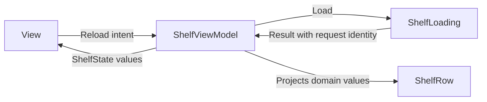

Model-View-ViewModel exposes presentation state and user intentions without requiring the view model to know concrete widgets. The view renders state and forwards interactions. The model layer owns domain rules and persistence behavior.

The view model is useful when it provides a deliberate state contract. Renaming a view controller and moving its globals into a new class does not create that contract.

<!--more-->

This Swift 5.7 example loads a shelf through a callback capability. It preserves old content during refresh, distinguishes failed refresh from an empty successful result, and rejects a response from an obsolete request. The binding is a single serial callback; other binding mechanisms are covered separately.

## Model the facts a view actually needs

```swift
struct ShelfBook: Equatable { let id: Int; let title: String }
enum ShelfFailure: Error { case offline }
protocol ShelfLoading {
    func load(completion: @escaping (Result<[ShelfBook], ShelfFailure>) -> Void)
}
struct ShelfRow: Equatable { let id: Int; let title: String }
struct ShelfState: Equatable {
    var rows: [ShelfRow] = []
    var isRefreshing = false
    var errorMessage: String?
    var showsEmpty: Bool { rows.isEmpty && !isRefreshing && errorMessage == nil }
}
```

A structure permits content and refreshing to coexist because that is valid product behavior. A simplistic enum containing only loading, loaded, and failed would need extra payloads to preserve the old content deliberately.

`showsEmpty` is derived. Keeping it as another independently writable Boolean would create invalid combinations that every transition had to repair. The initial state technically satisfies it; the view can request the first load before presenting or add an explicit initial phase if “not yet attempted” needs different UI.

Rows contain stable identities and presentation text. They are not database-managed objects. Domain entities can evolve independently of the view's row representation.

## Own transitions and reject obsolete publication

```swift
final class ShelfViewModel {
    private let loader: any ShelfLoading
    private var generation = 0
    private var active = true
    private(set) var state = ShelfState()
    private var render: ((ShelfState) -> Void)?

    init(loader: any ShelfLoading) { self.loader = loader }
    func bind(_ render: @escaping (ShelfState) -> Void) {
        guard active else { return }
        self.render = render
        render(state)
    }
    func reload() {
        guard active else { return }
        precondition(generation < Int.max)
        generation += 1
        let ticket = generation
        state.isRefreshing = true
        state.errorMessage = nil
        publish()
        guard active, generation == ticket else { return }
        loader.load { [weak self] result in
            guard let self = self, self.active, self.generation == ticket,
                  self.state.isRefreshing else { return }
            self.state.isRefreshing = false
            switch result {
            case let .success(books):
                self.state.rows = books.map { ShelfRow(id: $0.id, title: $0.title) }
                self.state.errorMessage = nil
            case .failure:
                self.state.errorMessage = "Could not refresh the shelf."
            }
            self.publish()
        }
    }
    func stop() { active = false; render = nil }
    private func publish() { render?(state) }
}
```

All methods and callbacks require serialized access. In an iOS module, apply `@MainActor` consistently or have the transport adapter deliver on the UI executor. Changing a callback implementation to use a background queue without changing this contract introduces a data race.

The view model does not retain a view protocol. It emits values through one callback. A view should bind with a weak capture of its owning controller, and a SwiftUI adapter can expose equivalent observable state.

`stop` is terminal for this instance. It suppresses future calls and late results even if another owner still retains the view model. It does not cancel transport work because this loading capability exposes no cancellation operation.

## Verify refresh semantics and ordering

```swift
final class ControlledShelf: ShelfLoading {
    var completions: [(Result<[ShelfBook], ShelfFailure>) -> Void] = []
    func load(completion: @escaping (Result<[ShelfBook], ShelfFailure>) -> Void) {
        completions.append(completion)
    }
}
let loader = ControlledShelf()
let model = ShelfViewModel(loader: loader)
var frames: [ShelfState] = []
model.bind { frames.append($0) }
model.reload()
loader.completions[0](.success([ShelfBook(id: 1, title: "Existing")]))
model.reload()
assert(model.state.rows.first?.title == "Existing" && model.state.isRefreshing)
loader.completions[1](.failure(.offline))
assert(model.state.rows.count == 1 && model.state.errorMessage != nil)
model.reload()
model.reload()
loader.completions[3](.success([ShelfBook(id: 2, title: "Current")]))
loader.completions[2](.success([]))
assert(model.state.rows.first?.id == 2)
let renderedCount = frames.count
model.stop()
loader.completions[3](.failure(.offline))
assert(frames.count == renderedCount)
```

A failed refresh retains the last known content and exposes a warning. A successful empty response would replace the content with an empty list. The distinction gives the UI enough information to avoid telling the person their shelf is empty merely because the connection failed.

The request ticket establishes local latest-request acceptance. It says nothing about which remote snapshot is globally newest. For version-aware caching and conditional writes, the [Repository article](/swift-repository/) defines a different boundary.

## Draw state flow without hiding effects



The graph is similar to other presentation patterns because the same information has to move. The distinction is the public presentation boundary: the view consumes a state model rather than a sequence of widget instructions.

An actual binding mechanism determines when and how state becomes visible. Closures, Combine, and Observation have different replay, lifetime, and invalidation rules. “MVVM” does not select one automatically.

## Keep domain invariants out of display state

A row can expose whether borrowing appears available, but the borrowing use case must check authoritative availability at commit time. A stale enabled button cannot be the domain's security or inventory boundary.

Similarly, the view model can validate form text for helpful feedback while passing a validated value or request to the use case. It should not duplicate transaction logic simply because an error message depends on the result.

If the view model starts coordinating many unrelated screens, extract navigation ownership. If it accumulates shared caches and persistence conflicts, extract a repository or use case. A view model can become oversized just as a controller can.

## Scope state to the consumer that owns it

One view model per feature instance is a useful default. Two windows may share a repository while keeping separate search text, selection, and request generations. A global view model can accidentally share those interactions across windows.

A view may be recreated without the feature ending. In SwiftUI, identity-preserving ownership matters; constructing a new model in every `body` evaluation resets state and can duplicate effects. In UIKit, binding should happen after the view is ready and teardown should correspond to the actual feature lifetime.

The state callback here has one consumer. Supporting several consumers requires subscription tokens, replay policy, and cancellation. Adding a public callback property without explaining that only the last assignment survives is an API trap.

## Case study: optimistic edits inside a refreshed list

A shelf that supports renaming a book introduces two timelines: remote refresh and local editing. If the view model simply replaces every row when a refresh completes, it can erase an unfinished edit or an optimistic local title.

Separate the authoritative snapshot from the editing state. The edit can retain the book ID, base revision, and proposed title. The rendered row can project that draft while the use case performs a conditional save. A conflict result then has enough context for a meaningful resolution.

Do not make a second writable copy of the whole shelf merely to preserve one field. That creates broad synchronization work. Keep the smallest explicit draft needed by the interaction, and decide which remote changes invalidate or coexist with it.

An optimistic update also needs operation identity. If save A fails after save B succeeds, rolling back the whole row to A's original value can erase B's success. Roll back only state still owned by the failed operation, or reconcile from an authoritative version.

The local request generation in this article protects refresh publication. It does not solve that write-conflict problem by itself. Refresh identity, edit revision, and account scope describe different relationships and should not be collapsed into one vaguely named token.

Test a sequence containing refresh, edit, save, another refresh, and reversed save outcomes. Observe the rendered title, retained draft, and authoritative revision separately. This exposes synchronization bugs that a test of one loaded list cannot reveal.

## Exercise: add cancellable search and identity validation

Extend the loader to accept a query and return a cancellation capability. Keep old content during refresh, reject duplicate book IDs from malformed responses, and verify cancellation plus request identity protects against delayed results. Then compare the resulting API with [MVP](/swift-mvp/) and [data binding mechanisms](/swift-data-binding/).

Return to the [App Architectures roadmap](/swift-architectures/).
