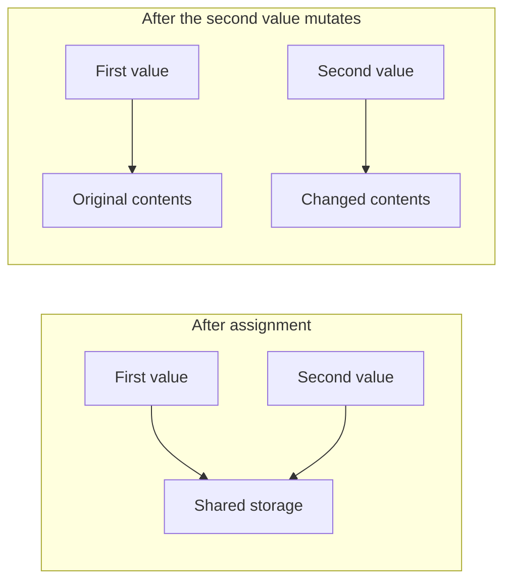

Value semantics describe what a caller can observe: changing one value does not unexpectedly change another independent value. Copy-on-write describes an implementation strategy: share storage while it is safe, then make it unique before mutation.

Keeping those ideas separate helps explain Swift arrays, diagnose reference-sharing bugs, and decide whether a custom storage wrapper is justified at all.

<!--more-->

The examples use Swift 5.7. We will first observe the standard library's behavior, then build a small copy-on-write value with a deliberately narrow mutation surface.

## Start with observable independence

```swift
var first = [1, 2, 3]
var second = first
second.append(4)
assert(first == [1, 2, 3])
assert(second == [1, 2, 3, 4])
```

The array assignment behaves like a value copy. Its implementation can share underlying storage until mutation requires separation. The program should depend on the independence, not on a particular address or allocation count.

Copy-on-write lets APIs pass and return collection values without necessarily duplicating their entire buffers immediately. It is a reason to start with a clear value interface before introducing manual shared ownership.

It is not a promise that copying is always free. Holding multiple versions and mutating each can require substantial memory and element copying. A workload repeatedly modifying a large shared array can pay a large cost at each fork.

## An array of references still contains references

```swift
final class MutableNote {
    var text: String
    init(_ text: String) { self.text = text }
}

let notes = [MutableNote("Draft")]
let copiedNotes = notes
copiedNotes[0].text = "Published"
assert(notes[0].text == "Published")
```

The two arrays are independent collections of references, but those references point to the same note. Array copy-on-write does not recursively clone arbitrary object graphs.

The same issue can hide inside a struct wrapper. A value type is a language category; full value semantics require its implementation to prevent unexpected shared observable mutation.

Deep cloning is not always the answer either. Object graphs may contain cycles, shared identities, or external resources whose duplication has no sensible meaning. Often the right snapshot stores the few immutable facts a calculation actually needs.

## A naive reference-backed struct is not enough

Suppose a log-like value stores a reference to a buffer. Assigning the struct copies that reference. If append mutates the same buffer unconditionally, both apparent values change together.

The remedy is to keep storage private and establish uniqueness before every mutation that can affect another owner. Here is a complete minimal wrapper:

```swift
struct ValueLog<Element> {
    private final class Storage {
        var elements: [Element]

        init(_ elements: [Element]) { self.elements = elements }
        func copy() -> Storage { Storage(elements) }
    }

    private var storage: Storage

    init(_ elements: [Element] = []) {
        storage = Storage(elements)
    }

    var count: Int { storage.elements.count }
    var elements: [Element] { storage.elements }

    subscript(index: Int) -> Element {
        get { storage.elements[index] }
        set {
            ensureUniqueStorage()
            storage.elements[index] = newValue
        }
    }

    mutating func append(_ element: Element) {
        ensureUniqueStorage()
        storage.elements.append(element)
    }

    private mutating func ensureUniqueStorage() {
        if !isKnownUniquelyReferenced(&storage) {
            storage = storage.copy()
        }
    }
}

var logA = ValueLog(["opened"])
var logB = logA
logB.append("saved")
logB[0] = "restored"
assert(logA.elements == ["opened"])
assert(logB.elements == ["restored", "saved"])
```

The uniqueness check receives an `inout` reference to the storage property. A false result means the wrapper must not assume exclusive ownership, so it replaces the storage before changing it.

This wrapper demonstrates the mechanism. Since its payload is already a Swift array, it adds a storage layer that an ordinary application probably does not need. Real custom copy-on-write types are useful when several fields must share one ownership decision or when wrapping a lower-level buffer.

## Audit every mutation route



This is an ownership illustration, not a promise about physical addresses or the exact number of allocations. The required observation is that the first value's contents remain unchanged.

Append is not the only way to mutate a collection-like value. Subscript setters, removal, sorting, bulk replacement, and mutable buffer access all need the same ownership discipline.

Returning `Storage` or exposing an unsafe mutable pointer would let callers bypass the check. A small public interface makes the invariant easier to maintain. Advanced accessors that yield mutable storage require careful lifetime and exclusivity reasoning.

The `elements` getter returns an array value. Mutating that returned array preserves the wrapper's collection storage semantics, but an `Element` that is itself a mutable reference can still expose shared objects. The wrapper's generic parameter does not promise deep independence of arbitrary element internals.

```swift
var extracted = logA.elements
extracted.append("outside")
assert(logA.count == 1)

let objectLog = ValueLog([MutableNote("One")])
let anotherObjectLog = objectLog
anotherObjectLog[0].text = "Two"
assert(objectLog[0].text == "Two")
```

Document what the value owns: the sequence of elements, not an automatic clone of every resource reachable through each element.

## Uniqueness is an optimization under an ownership contract

`isKnownUniquelyReferenced` is not a general-purpose lock. Concurrent access to the same mutable variable can race before or during the uniqueness decision. Synchronization or actor isolation must establish safe access independently.

Nor should code make user-visible behavior depend on whether a uniqueness check returns true. The two paths must implement the same semantics; one simply avoids a copy when safe.

Unnecessary local references can also interfere with uniqueness opportunities. Keep the storage reference private, perform the check at the mutation boundary, and avoid clever ownership tricks unless measurement justifies them. Apple's [isKnownUniquelyReferenced documentation](https://developer.apple.com/documentation/swift/isknownuniquelyreferenced(_:)) describes the primitive and its synchronization caveats.

## Copy-on-write and persistence have different cost shapes

Copying an array value is cheap while storage remains shared. Editing one element of a shared large array can require copying a buffer proportional to its size.

A persistent tree instead reconstructs the path to the edited element while sharing untouched branches. A balanced tree can therefore have a smaller edit cost for many retained versions, at the price of pointer traversal, allocation, and less contiguous storage.

Choose from the workload. A mostly read-only contiguous array is excellent for many app features. An editor retaining many versions of a very large structure may benefit from a persistent representation. Neither label establishes performance without representative measurements.

## Test the invariant through public behavior

Create two copies, mutate one through every public route, and verify the other is unchanged. Repeat with three copies and interleaved edits so one uniqueness transition cannot accidentally hide a later aliasing bug.

Test extraction too: obtaining an array snapshot and mutating it should not alter the wrapper's sequence. Include empty storage and replacement of the first and last element.

Reference-element tests should assert the documented sharing behavior or enforce a stronger element contract. A test expecting arbitrary objects to be deep-cloned would demand a feature the implementation never claimed to provide.

Performance tests should separate unique-owner mutation, shared-owner first mutation, and repeated mutation after separation. Those scenarios exercise different paths and can have very different costs.

## Test several owners and several mutation routes

A single copy followed by append can miss a bug in another setter. Interleave operations on several values and compare complete public snapshots:

```swift
var ownerOne = ValueLog([1, 2])
var ownerTwo = ownerOne
var ownerThree = ownerTwo
ownerOne.append(3)
ownerTwo[0] = 9
ownerThree.append(4)
assert(ownerOne.elements == [1, 2, 3])
assert(ownerTwo.elements == [9, 2])
assert(ownerThree.elements == [1, 2, 4])

var copyAfterSeparation = ownerOne
copyAfterSeparation[1] = 8
assert(ownerOne.elements == [1, 2, 3])
assert(copyAfterSeparation.elements == [1, 8, 3])
```

The second phase copies a value after an earlier uniqueness transition. That catches implementations which accidentally treat storage as permanently unique after the first write.

Use the same pattern for every new mutator. A method that clears or sorts storage must preserve independence just as append does. A code review can maintain an explicit list of mutation entry points and verify each reaches the uniqueness guard.

## Equality should observe content rather than storage identity

Two independently constructed logs with equal elements should be equal if the type claims ordinary sequence value semantics:

```swift
extension ValueLog: Equatable where Element: Equatable {
    static func == (left: ValueLog<Element>, right: ValueLog<Element>) -> Bool {
        left.elements == right.elements
    }
}

assert(ValueLog([1, 2]) == ValueLog([1, 2]))
assert(ownerOne != ownerTwo)
```

A shared storage identity can be a fast path when it is safe, but it should not be the definition of equality. Different buffers can hold the same value, and a caller should not need to know which copies the optimizer avoided.

For mutable reference elements, `Element`'s own equality and mutation semantics still matter. The wrapper cannot make equality stable over time if the element's comparison-relevant state changes through an external alias.

## In-place access is a larger contract than a setter

The simple subscript getter and setter keep mutation paths visible. More advanced collection implementations may yield direct mutable access to storage for efficiency. That access must begin only after uniqueness is established and must not escape its valid lifetime.

Unsafe buffers introduce additional obligations: initialized element counts, capacity, alignment, destruction, and exclusivity. A correct uniqueness check is only one part of implementing such storage safely.

Do not add unsafe storage merely to imitate the standard library's internals. A wrapper around ordinary arrays can often deliver the needed behavior with far less maintenance risk. If a profile identifies a real buffer-copy bottleneck, narrow the optimization to that path and retain semantic tests.

## Measure the first write separately from later writes

A benchmark that assigns a large value and then performs many writes may hide the cost of the first separation inside a long average. Conversely, a benchmark creating a new alias before every write may exaggerate a workload that normally has one owner.

Use separate scenarios: unique storage, one shared copy followed by many edits, and many retained versions each receiving one edit. Track peak memory as well as elapsed time, because history retention changes which buffers can be released.

Element destruction and reference counting may also contribute significantly when elements own resources. Copy-on-write reduces some copies; it does not erase element lifetime costs.

The result should guide whether to keep an array, introduce a custom buffer, or choose a persistent tree. Those designs have different traversal and update behavior, so compare complete representative operations rather than one isolated assignment.

## Exercise: add removeLast

Implement an optional-returning `removeLast` that leaves an empty log unchanged. Establish unique storage before modifying nonempty storage. Test removal from one of several copies.

Then ask whether the wrapper provides enough benefit over `[Element]` to keep. A successful exercise can end by removing an abstraction whose only purpose was demonstrating a mechanism.

Continue with [Purely Functional Data Structures](/swift-persistent-data-structures/) or return to the [Functional Programming roadmap](/swift-functional-programming/).
