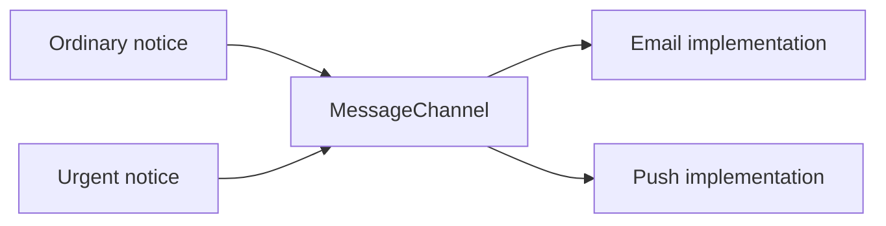

Bridge separates a high-level abstraction from the implementation capability it uses, so both can vary independently. A notification's presentation policy and its delivery channel are a useful example: urgent versus ordinary content should not require a subclass for every email, push, and future transport combination.

The pattern is a decision about the design's axes of change. It is not simply another name for any object containing a protocol property.

<!--more-->

These Swift 5.7 examples keep rendering in an abstraction hierarchy and delivery behind a protocol. Transport adapters record through injected closures so the examples run without sending messages.

## Identify independent dimensions

A naive hierarchy might contain `OrdinaryEmailNotice`, `UrgentEmailNotice`, `OrdinaryPushNotice`, and `UrgentPushNotice`. Adding a digest mode or another channel multiplies combinations.

If there are `n` presentation variants and `m` channel variants, the combination space has `n × m` possibilities. Separating the implementation dimensions gives roughly `n + m` variant implementations:

$$
N_{\mathrm{combined}}=n m,\qquad N_{\mathrm{separated}}\approx n+m.
$$

The possible runtime combinations still exist and need appropriate integration testing. Bridge reduces duplicated implementation structure, not the mathematical number of configurations a product may support.

## Define the implementation capability

```swift
protocol MessageChannel {
    func deliver(_ text: String) throws
}

struct EmailChannel: MessageChannel {
    let address: String
    let send: (String, String) throws -> Void
    func deliver(_ text: String) throws { try send(address, text) }
}

struct PushChannel: MessageChannel {
    let deviceToken: String
    let send: (String, String) throws -> Void
    func deliver(_ text: String) throws { try send(deviceToken, text) }
}

class Notice {
    private let channel: any MessageChannel
    init(channel: any MessageChannel) { self.channel = channel }
    func render(title: String, body: String) -> String { title + "\n" + body }
    final func send(title: String, body: String) throws {
        try channel.deliver(render(title: title, body: body))
    }
}

final class UrgentNotice: Notice {
    override func render(title: String, body: String) -> String {
        "[URGENT] " + title + "\n" + body
    }
}
```

`Notice` describes the high-level operation. `MessageChannel` is the bridge to delivery. A refined abstraction changes rendering without importing email addresses or device-token rules.

The channel examples are synchronous capability boundaries. A real network-backed channel should expose asynchronous behavior and delivery outcomes honestly rather than block behind this signature.

## Assemble combinations without adding combination subclasses

```swift
var emails: [(String, String)] = []
var pushes: [(String, String)] = []
let email = EmailChannel(address: "maya@example.com") { address, text in
    emails.append((address, text))
}
let push = PushChannel(deviceToken: "device-1") { token, text in
    pushes.append((token, text))
}
try Notice(channel: email).send(title: "Reading", body: "New chapter")
try UrgentNotice(channel: push).send(title: "Sync", body: "Action required")
assert(emails[0].1 == "Reading\nNew chapter")
assert(pushes[0].1 == "[URGENT] Sync\nAction required")
try UrgentNotice(channel: email).send(title: "Account", body: "Review changes")
assert(emails[1].1.hasPrefix("[URGENT]"))
```

The caller selects one abstraction and one implementation. No `UrgentEmailNotice` class is needed. A value configuration or factory can choose these combinations at assembly time.

The captured arrays are test recorders under serial execution, not production delivery mechanisms. They make the same rendering and channel contracts observable without external effects.



## The bridge separates variation, not responsibility for results

Suppose notices gain a third presentation style while the app also gains a third delivery channel. With the bridge, each change has a natural home: rendering rules live in the notice abstraction, and delivery mechanics live in a channel implementation. A review can discuss urgency wording without also discussing the push provider's request headers.

The split remains useful only while the sides have a shared contract. If the abstraction produces arbitrary HTML while one channel can carry only a short plain-text string, the channel cannot honestly deliver every possible result. Specify a channel-neutral message representation, or make capabilities and adaptation rules explicit.

For example, a structured message could contain a title, plain body, and optional rich body. The email channel may use the rich body, while push uses a documented truncation policy. The application must decide whether truncation is acceptable for an urgent notice; the bridge cannot make that product decision disappear.

## Bridge and Adapter can coexist

The system's abstraction-to-channel separation is the Bridge. A channel translating a vendor SDK into `MessageChannel` also acts as an Adapter.

A Strategy usually selects an algorithm within a context. The mechanical code can look similar, but Bridge emphasizes independently evolving abstraction and implementation families. Pattern names explain the reason for a boundary rather than dictate a unique class diagram.

Abstract Factory is useful when related products must be selected together. Here channel and presentation are intentionally independent. Combining them into one factory family would recreate the coupling the bridge removes unless a product policy requires only certain combinations.

## Inheritance is optional, independent evolution is not

The small hierarchy makes the classic structure visible. In ordinary Swift, presentation can instead be a value or a function injected into a service with the channel. That may be simpler when there is no supported subclassing framework.

Avoid retaining inheritance merely for the pattern's name. The essential property is that a new presentation policy does not require editing every delivery implementation, and a new channel does not require duplicating rendering policy.

At the same time, do not separate choices that always need to change together. Excessive interfaces can hide a cohesive domain concept behind several forwarding objects.

## Test the seams and the combinations

Separating two axes reduces duplicated implementation, but it does not eliminate interactions. An urgent prefix might push a message over the push channel's payload limit. A Unicode title might satisfy an email test while exceeding a byte-based limit elsewhere.

Test rendering in isolation, delivery behavior in isolation, and representative cross-axis cases at the integration boundary. Include the combinations most likely to violate capability assumptions rather than assuming that separate unit tests prove every pairing works.

If nearly every abstraction method needs to inspect which concrete channel it holds, the axes may not be independent enough for this bridge. Reconsider the shared message contract before adding type checks and special cases throughout the abstraction hierarchy.

Verify failure propagation at the delivery boundary as well. A rendered string is not a successful send. Inject a channel scoped to the correct account instead of discovering global credentials during delivery.

## Failure and retry belong in the delivery contract

The recording closures keep this example deterministic. A real delivery channel should report meaningful outcomes. A local API accepting a message does not establish that a recipient read it, or even that a remote provider accepted it.

Name the result according to what was actually confirmed: queued locally, accepted by a provider, or delivered according to a receipt. If retry is supported, specify whether repeated calls can produce duplicate notifications and whether a stable operation ID provides deduplication.

A common extension mistake is putting automatic retries into the base notice while also enabling them inside each channel. One user action can then multiply into several delivery attempts. Keep the retry policy at one deliberate boundary, or define how nested retry budgets compose.

## Exercise: add a structured digest

Add a digest presentation that groups several items and a third recording channel. Keep delivery implementations unchanged. Then introduce a channel payload limit and define whether the application rejects, splits, or summarizes oversized digests; test that policy without silently losing required content.

Return to the [Design Patterns roadmap](/swift-design-patterns/).
