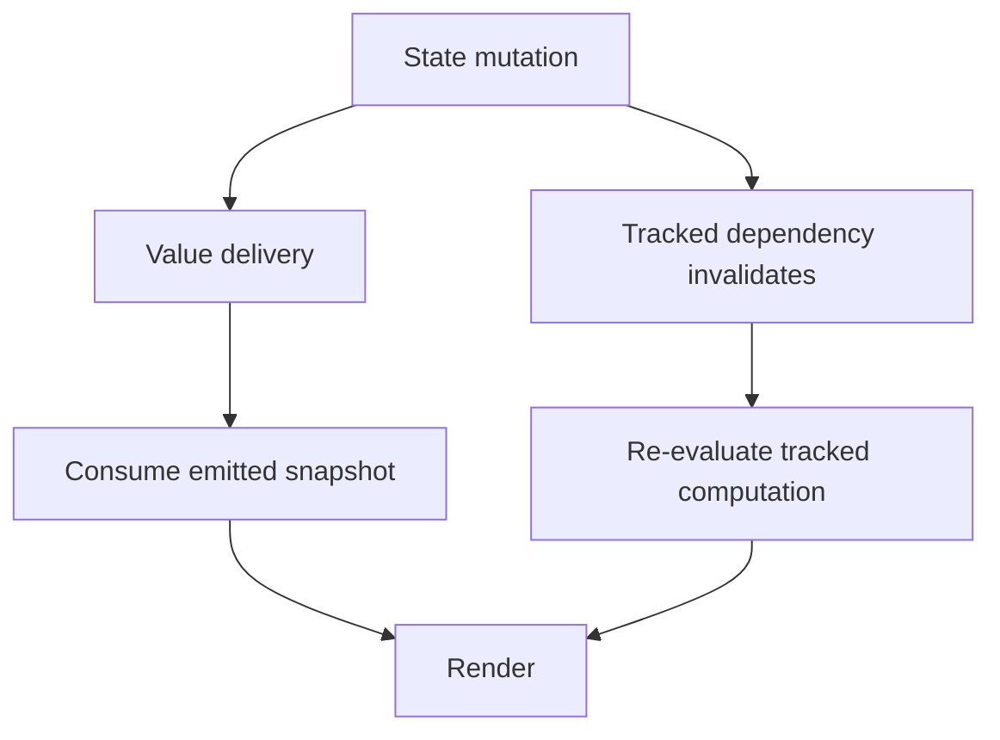

A data binding connects a source of state to a consumer. Its contract includes initial delivery, later changes, execution context, ownership, cancellation, and what happens when the consumer changes the source in response.

Closures, Combine, and Observation can all support MVVM, but they do not promise the same behavior. Treating them as interchangeable “automatic updates” hides bugs around stale reads and subscriptions that never end.

<!--more-->

The examples use Swift 5.9. Combine has been available since the 2019 Apple platform releases; native Observation and `@Observable` arrived with Swift 5.9 and the iOS 17/macOS 14 generation. This October 2023 article uses those APIs explicitly rather than applying them retroactively to an earlier deployment target.

## Write the binding contract before choosing a tool

For a screen state, ask whether a new subscriber receives the current value, whether duplicate values emit, whether callbacks run synchronously, and who ends the connection. For a transient effect, ask whether replay would be wrong: showing the same alert again after rotation is different from redisplaying the same title.

Also distinguish a snapshot from a stream and an invalidation signal. A snapshot contains state. A stream sends values over time. Invalidation says a dependency changed and a computation should run again. Observation primarily supports the last model; it does not automatically provide an event history.

## Closures make a small contract explicit

```swift
final class ClosureCount {
    private(set) var count = 0
    private var observer: ((Int) -> Void)?
    func bind(_ observer: @escaping (Int) -> Void) {
        self.observer = observer
        observer(count)
    }
    func increment() {
        precondition(count < Int.max)
        count += 1
        observer?(count)
    }
    func unbind() { observer = nil }
}
let closureModel = ClosureCount()
var closureValues: [Int] = []
closureModel.bind { closureValues.append($0) }
closureModel.increment()
closureModel.unbind()
closureModel.increment()
assert(closureValues == [0, 1])
```

This is one subscriber, synchronous delivery, immediate replay, and explicit removal. Binding a second subscriber replaces the first. Those are limitations, but they are understandable ones.

A production multi-subscriber source needs owner-specific tokens so one consumer cannot accidentally remove another consumer's binding. A weak capture of a controller avoids one strong cycle, but the connection still needs a logical end if it owns work or retains other resources.

Rendering should not emit the same intention again. A text field binding can use a setter to express user edits while a renderer assigns text without simulating another edit. If programmatic changes emit events, use an explicit feedback-suppression or equality policy.

## Combine provides a publisher contract

```swift
import Combine

final class PublishedCount: ObservableObject {
    @Published var count = 0
}
let publishedModel = PublishedCount()
var publishedValues: [Int] = []
var storedValuesDuringDelivery: [Int] = []
let subscription = publishedModel.$count.sink { newValue in
    publishedValues.append(newValue)
    storedValuesDuringDelivery.append(publishedModel.count)
}
publishedModel.count = 1
assert(publishedValues == [0, 1])
assert(storedValuesDuringDelivery == [0, 0])
subscription.cancel()
publishedModel.count = 2
assert(publishedValues == [0, 1])
```

`@Published` sends its new value during `willSet`. In the callback for value one, the stored property can still read zero. Consume the emitted value rather than assuming that rereading the object yields the same snapshot.

This example uses synchronous assignments on one executor. Combine does not make arbitrary upstream work run on the main actor. A UIKit subscriber often needs delivery on the main scheduler, and actor-isolated APIs still require a coherent isolation strategy. Scheduling and actor isolation are related concerns, not identical guarantees.

Retain the `AnyCancellable` for the intended subscription lifetime. Storing it in an account-wide bag for a screen-local binding can retain unnecessary work. Capturing `self` strongly while `self` retains the cancellable can also form a cycle.

## Observation tracks the properties a computation reads

```swift
import Foundation
import Observation

final class ObservationProbe: @unchecked Sendable {
    private let lock = NSLock()
    private var count = 0
    func record() { lock.lock(); defer { lock.unlock() }; count += 1 }
    var value: Int { lock.lock(); defer { lock.unlock() }; return count }
}

@available(macOS 14, iOS 17, *)
@Observable
final class ObservedCounts {
    var visible = 0
    var unrelated = 0
}

if #available(macOS 14, iOS 17, *) {
    let model = ObservedCounts()
    let probe = ObservationProbe()
    withObservationTracking {
        _ = model.visible
    } onChange: {
        probe.record()
    }
    model.unrelated = 1
    assert(probe.value == 0)
    model.visible = 1
    assert(probe.value == 1)
    model.visible = 2
    assert(probe.value == 1)
    withObservationTracking { _ = model.visible } onChange: { probe.record() }
    model.visible = 3
    assert(probe.value == 2)
}
```

The probe locks its counter because the invalidation callback is sendable; the unchecked conformance is justified by that synchronization, not by assuming callbacks can never cross executors. The observed model itself still requires serialized access in this example.

The first tracking computation reads only `visible`, so changing `unrelated` does not invalidate it. Tracking is one-shot: after a tracked change, another tracking pass is needed to establish the next dependencies. SwiftUI performs dependency tracking as part of evaluating a view's body; a hand-written observer loop must arrange its own re-evaluation and lifetime.

The callback is an invalidation notification, not a stream carrying every new value. It can fire before the new value is stored. Schedule a later re-read when building a manual loop, rather than treating the callback as a post-mutation snapshot delivery.

## Compare the contracts directly

| Mechanism shown | Initial behavior | Later behavior | Lifetime boundary |
|---|---|---|---|
| Single closure | Explicit current-value replay | Assigned values sent synchronously | `unbind` |
| `@Published` publisher | Current value on subscription | New values published during `willSet` | Cancellable |
| Observation tracking | Computation reads dependencies | One-shot invalidation of those reads | Re-evaluation and owner policy |



No mechanism automatically gives domain transactions, account scoping, or protection from obsolete network responses. Those rules belong to the state and effect owners. A perfectly functioning binding can faithfully display an incorrect stale value.

## Keep state and one-time effects separate

A current title should replay to a newly attached view. A “show success toast now” instruction often should not. Putting the instruction in replayed state can show it again whenever a view reattaches.

Possible designs include consuming effect IDs, an explicitly non-replayed output channel, or deriving navigation from durable route state. Each needs clear delivery and acknowledgment semantics. An event channel that drops an effect while no consumer exists may be fine for an animation and wrong for a required confirmation.

Similarly, a two-way binding is not permission to mutate every model field. A binding setter can dispatch a validated intent. The owner still decides whether the proposed change is legal and whether it starts work.

## Case study: one-time navigation during reconnection

Suppose a save succeeds while a screen is temporarily detached. Replaying content state is desirable when it reconnects, but navigation is more subtle. An output sent through a non-replayed callback may be lost; a persistent `shouldNavigate` Boolean may navigate repeatedly.

Choose the delivery requirement first. If navigation must survive detachment, represent a route or an identified pending outcome in an owner that outlives the view. The consumer acknowledges the outcome or the route remains part of authoritative navigation state. If a transient toast can be dropped, a non-replayed output can be appropriate.

The binding mechanism should implement that policy rather than accidentally decide it. A Combine subject does not make an event durable. Observation invalidation does not record a history of missed effects. A closure does not establish whether an absent observer means “discard” or “wait.”

Reconnection tests should therefore detach the consumer, mutate the model, and reconnect it. Verify current content appears exactly as intended and required effects have a defined fate. Include repeated attachment and cancellation so old observers cannot act alongside the new one.

For two-way fields, test a programmatic update followed by a user edit. Equality checks can prevent some feedback, but they are not a universal substitute for distinguishing rendering from input. Normalization can legitimately change a value, and a loop can alternate between two different normalized forms.

A good binding boundary names these semantics explicitly. Concise syntax is a convenience after the contract is understood.

## Exercise: reconnect without replaying an alert

Build a screen with replayed content state and a separately identified confirmation effect. Disconnect and reconnect the view, then verify content appears immediately while an already handled confirmation does not appear twice. Repeat with a delayed result after the feature stops.

Apple documents [`Published`](https://developer.apple.com/documentation/combine/published) timing and introduced native Observation in [Discover Observation in SwiftUI, WWDC23](https://developer.apple.com/videos/play/wwdc2023/10149/).

Return to the [App Architectures roadmap](/swift-architectures/).
