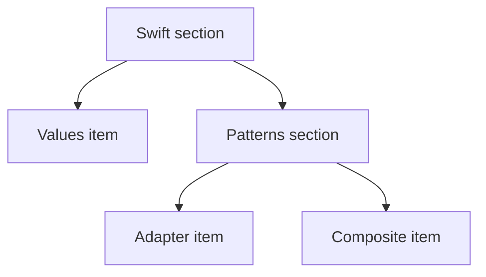

Composite lets a client work uniformly with individual elements and groups of elements. A document outline is a natural fit: an item contributes a line, while a section contributes its heading and recursively renders its children.

The shared contract should contain operations that make sense for both. Forcing leaves to implement meaningless child-insertion methods turns uniformity into a runtime trap.

<!--more-->

The Swift 5.7 example uses value leaves and groups behind one rendering capability. It counts item occurrences, preserves child order, and handles empty groups deliberately.

## Give leaves and groups a meaningful common operation

```swift
protocol OutlineComponent {
    var itemCount: Int { get }
    func appendLines(to output: inout [String], depth: Int)
}

struct OutlineItem: OutlineComponent {
    let text: String
    var itemCount: Int { 1 }
    func appendLines(to output: inout [String], depth: Int) {
        output.append(String(repeating: "  ", count: depth) + "- " + text)
    }
}

struct OutlineGroup: OutlineComponent {
    let title: String
    let children: [any OutlineComponent]
    var itemCount: Int { children.reduce(0) { $0 + $1.itemCount } }
    func appendLines(to output: inout [String], depth: Int) {
        output.append(String(repeating: "  ", count: depth) + title)
        for child in children { child.appendLines(to: &output, depth: depth + 1) }
    }
}

func render(_ component: any OutlineComponent) -> String {
    var lines: [String] = []
    component.appendLines(to: &lines, depth: 0)
    return lines.joined(separator: "\n")
}

let outline = OutlineGroup(title: "Swift", children: [
    OutlineItem(text: "Values"),
    OutlineGroup(title: "Patterns", children: [
        OutlineItem(text: "Adapter"), OutlineItem(text: "Composite")
    ])
])
assert(outline.itemCount == 3)
assert(render(outline) == "Swift\n  - Values\n  Patterns\n    - Adapter\n    - Composite")
assert(render(OutlineGroup(title: "Empty", children: [])) == "Empty")
```

The renderer accepts one component and need not inspect whether it is a leaf or a group. The group delegates the same operation to its children.

Child management belongs to group construction. A leaf does not need an `addChild` method that throws “unsupported.” This keeps the common interface honest while still allowing uniform rendering.

## Trees, shared subtrees, and cycles

The outline example counts occurrences. If the same leaf appears in two groups, rendering visits it twice and `itemCount` includes it twice. This is appropriate for a presentation tree: the two positions are two appearances, even when their values are equal.

A storage report may require a different answer. If two folders reference the same underlying asset, a disk-usage calculation might count the asset once. That operation needs asset identity and a visited set; it cannot infer uniqueness from the visual tree alone. Keep “number of appearances” and “number of unique entities” as separate operations with explicit names.

Cycles are a further concern when components use mutable references. A group that can contain itself, directly or indirectly, makes unguarded recursive traversal fail to terminate. The immutable construction here does not expose an API for wiring such a cycle. A mutable production tree should either reject cycles when attaching children or make each traversal handle revisits according to a defined policy.

A visited set also changes output semantics. Silently skipping a second occurrence might hide a valid repeated appearance. If cycles are invalid input, report a cycle instead of treating every repeated identity as an error.



## Keep traversal order explicit

The child array defines display order. Replacing it with a set would not preserve the same document contract. A sorted view is a separate transformation with its own key and tie policy.

Postorder operations such as calculating a section's aggregate require children before the parent. Preorder rendering writes a heading before its contents. The same structure can support both, but the operation decides the dependency order.

A generic fold can reduce repeated traversal code for closed tree representations. A protocol-based composite favors independently defined component implementations. An enum-based tree favors exhaustive handling of a known node set; see [Algebraic Data Types](/swift-algebraic-data-types/).

## Account for output size, not just node count

Rendering visits each occurrence, but indentation and text length contribute to the amount written. A deeply nested chain can produce many indentation characters even when each label is short.

The local line accumulator avoids recursively concatenating whole subtree strings at every level. Joining once constructs the final output, while intermediate lines still consume storage proportional to rendered content.

`itemCount` traverses the structure independently. Repeatedly asking every node for its full subtree count can become quadratic on an unfavorable shape. Cache summaries only if updates maintain their consistency, or calculate needed summaries in one traversal.

## Mutation and ownership need a separate policy

This example's fields are immutable values, so editing an outline means constructing replacement values. A mutable UI tree can be appropriate, but then parent ownership, child movement, and notification timing must be defined.

Moving a child should not leave it attached to two parents unless sharing is intentional. Parent back-references should not create strong ownership cycles. A transactional edit can validate the proposed topology before publishing it.

A composite interface does not enforce those graph invariants by itself. A decoder or builder accepting external nested data should limit depth and node count before exposing recursive operations.

## Uniform operations can still need context

A permission-aware renderer may need user roles, localization, or a formatting policy. Pass those facts explicitly rather than letting every component read mutable globals.

Decide whether a hidden group also hides all descendants or whether visible descendants can be promoted. That is domain behavior, not an automatic consequence of recursion.

Similarly, an operation like deletion may not mean the same thing for a leaf and group. Removing a group can remove a subtree, dissolve the grouping, or be forbidden. Define that operation separately rather than assuming the common rendering contract answers it.

## Test structure and behavior together

Cover a leaf root, an empty group, several sibling groups, deep nesting within supported limits, and repeated values. Verify exact output order as well as aggregate counts.

A count-only test can miss a lost or duplicated item if another item compensates numerically. Tagged identities or exact rendered fixtures make those defects visible.

For an editable implementation, retain an earlier snapshot and verify later edits leave it unchanged when value semantics are promised. If reference identity is intentional, test that sharing explicitly instead.

## Uniform access does not imply uniform mutation

Both a leaf and a group can contribute rendered lines. Only a group has children to edit. Adding `addChild` to the common protocol would force a leaf to throw, ignore the request, or pretend to support an operation it cannot perform meaningfully.

Prefer a narrow shared read interface and a separate group-editing capability. A caller that renders any component needs only the read interface. An editor that inserts children can require the stronger group capability deliberately.

This is especially useful with value types. Editing a nested immutable group means producing a replacement along the path to that group. If external code needs to address nodes across replacements, introduce stable domain IDs rather than relying on object addresses.

## Depth and incremental work

Recursive code is easy to read for ordinary document depth. Input controlled by an external source can be deeply nested, so an import boundary may need a depth limit or an iterative traversal with an explicit stack. The Composite pattern itself supplies neither limit.

For large outlines, recomputing every descendant count after each edit can also become expensive. Cached aggregates need an invalidation rule along the ancestor path. Introduce that extra state after measuring a workload, and test that structural edits invalidate every affected aggregate.

## Exercise: add a filtered outline view

Implement a transformation that keeps items matching a predicate. Decide whether empty groups remain, disappear, or retain a placeholder. Preserve relative order and test a nested group where all children are removed.

Then compare the protocol composite with a closed recursive enum and explain which extension direction matters more for the application: new component types or new operations.

Return to the [Design Patterns roadmap](/swift-design-patterns/).
