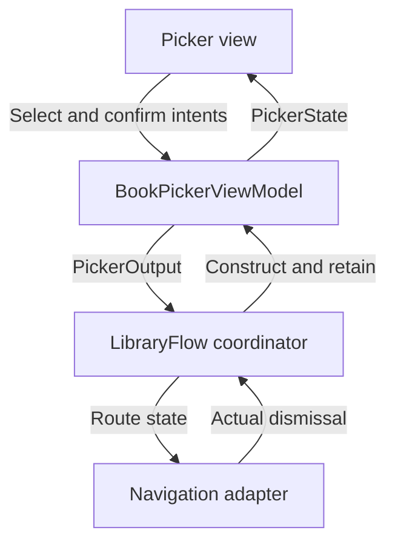

MVVM-C separates observable presentation from navigation policy. A view model publishes screen state and emits typed outcomes. A coordinator interprets those outcomes, constructs the next feature, and owns its lifetime.

The distinction matters when a screen can appear in several flows. A book picker should be able to return a selection to a lending flow or a reading-list flow without knowing either flow's navigation container.

<!--more-->

The Swift 5.7 example uses a picker with state and outputs, plus a coordinator that guards flow identity. It is UI-independent so the same ownership decisions can be tested before connecting a UIKit stack or SwiftUI path.

## Separate a state value from an output event

```swift
struct PickerBook: Equatable { let id: Int; let title: String }
struct PickerState: Equatable {
    let books: [PickerBook]
    var selectedID: Int?
    var canConfirm: Bool { selectedID != nil }
}
enum PickerOutput: Equatable { case picked(Int), cancelled }

final class BookPickerViewModel {
    private(set) var state: PickerState
    var stateChanged: ((PickerState) -> Void)?
    var output: ((PickerOutput) -> Void)?
    private var finished = false

    init(books: [PickerBook]) {
        precondition(Set(books.map(\.id)).count == books.count)
        state = PickerState(books: books)
    }
    func select(_ id: Int) {
        guard !finished, state.books.contains(where: { $0.id == id }) else { return }
        state.selectedID = id
        stateChanged?(state)
    }
    func confirm() {
        guard !finished, let id = state.selectedID else { return }
        finish(.picked(id))
    }
    func cancel() { guard !finished else { return }; finish(.cancelled) }
    func invalidate() { finished = true; stateChanged = nil; output = nil }
    private func finish(_ event: PickerOutput) {
        finished = true
        let send = output
        output = nil
        stateChanged = nil
        send?(event)
    }
}
```

The selected row is state: a replacement view should display it. Confirmation is an output: it asks the owning flow to act once. Clearing the callback before invoking it prevents reentrant confirmation from emitting twice.

The picker does not construct a receipt screen or access a navigation controller. Its output carries a book identity, not a destination view. This makes the feature reusable across flows with genuinely different next steps.

## Let a coordinator own construction and acceptance

```swift
enum LibraryRoute: Equatable { case home, picker(Int), details(Int) }
final class LibraryFlow {
    private(set) var routes: [LibraryRoute] = [.home]
    private(set) var picker: BookPickerViewModel?
    private var nextID = 0
    private var currentPickerID: Int?
    var routesChanged: (([LibraryRoute]) -> Void)?

    func chooseBook(from books: [PickerBook]) {
        invalidatePicker()
        precondition(nextID < Int.max)
        nextID += 1
        let id = nextID
        let model = BookPickerViewModel(books: books)
        currentPickerID = id
        picker = model
        model.output = { [weak self] event in self?.accept(event, from: id) }
        routes = [.home, .picker(id)]
        routesChanged?(routes)
    }
    private func accept(_ output: PickerOutput, from id: Int) {
        guard currentPickerID == id else { return }
        invalidatePicker()
        switch output {
        case let .picked(bookID): routes = [.home, .details(bookID)]
        case .cancelled: routes = [.home]
        }
        routesChanged?(routes)
    }
    func pickerWasDismissed(id: Int) {
        guard currentPickerID == id else { return }
        invalidatePicker()
        routes = [.home]
        routesChanged?(routes)
    }
    func stop() {
        invalidatePicker()
        routes = [.home]
        routesChanged = nil
    }
    private func invalidatePicker() {
        picker?.invalidate()
        picker = nil
        currentPickerID = nil
    }
}
```

All calls are serialized, normally on the main actor. This flow intentionally replaces any existing picker and returns to home before showing a new one. A stack-preserving design would need a more general route policy.

The ID guards stale callbacks even when an external owner keeps an old closure alive. Invalidation also makes stale view-model methods inert. These are complementary protections: one closes the child's output capability, while the other protects the parent's acceptance boundary.

`stop` ends the current child graph and detaches its route observer. This minimal type can start another picker afterward; if stop should be permanently terminal, represent that as a separate active state and reject later starts.

## Test retained stale callbacks deliberately

```swift
let books = [PickerBook(id: 7, title: "Swift")]
let flow = LibraryFlow()
flow.chooseBook(from: books)
let oldModel = flow.picker!
let oldOutput = oldModel.output!
flow.chooseBook(from: books)
let newModel = flow.picker!
let newRoutes = flow.routes
oldOutput(.picked(999))
assert(flow.routes == newRoutes)
oldModel.select(7)
oldModel.confirm()
assert(flow.routes == newRoutes)
newModel.select(7)
assert(newModel.state.canConfirm)
newModel.confirm()
assert(flow.routes == [.home, .details(7)] && flow.picker == nil)
newModel.confirm()
assert(flow.routes == [.home, .details(7)])
flow.chooseBook(from: books)
if case let .picker(id) = flow.routes.last! { flow.pickerWasDismissed(id: id) }
assert(flow.routes == [.home] && flow.picker == nil)
```

A weak capture alone would not make `oldOutput` safe if the flow remained alive. The flow identity check is what prevents it from navigating after replacement.

Test interactive dismissal as well as explicit cancellation. A navigation adapter must report that the picker disappeared, or the coordinator can retain an invisible active child.

## Draw the two contracts independently



The view model's public state does not contain a navigation controller. The coordinator does not reach into a text field to discover which book was chosen. Stable values cross the boundary in both directions.

The navigation adapter owns framework mechanics such as animation completion and interactive pop cancellation. The coordinator owns product flow. Keeping those apart allows navigation tests to verify policy without pretending a fake stack proves UIKit behavior.

## Avoid a global navigation event bus

A process-wide bus receiving `showBook` from every feature can hide which account, window, or flow owns the request. Several coordinators may subscribe and navigate at once. A typed child output tied to one parent scope makes that relationship explicit.

For cross-feature deep links, route through an application-level entry point that validates context and chooses an owning flow. Do not bypass child construction by mutating a private navigation path from arbitrary view models.

Likewise, a single enormous coordinator can become a new maintenance bottleneck. Compose child flows around coherent lifetimes, and let children return results rather than manipulate siblings directly.

## Keep completion separate from domain success

A picker returning an ID means the person selected that item. It does not establish that borrowing, purchasing, or saving the selection succeeded. The owning use case must still perform and report that work.

If a child flow includes a remote write, define whether completion occurs after local validation, after server acceptance, or after durable confirmation. A vague `done` callback can hide materially different guarantees.

## Case study: a child result starts another asynchronous flow

After selecting a book, a lending flow may need to load eligibility before showing confirmation. The picker output should still mean only “this identity was chosen.” The parent begins the next use case under its own lifetime and accepts the result only if that continuation is current.

If the person cancels or logs out while eligibility loads, stopping the picker is no longer sufficient: the parent now owns another operation. Give that operation an identity and cancellation capability, and invalidate it when the flow ends.

This makes the ownership transfer explicit. Before completion, the picker owns its interaction. After completion, the parent owns the continuation. A callback should not leave both objects independently navigating in response to the same result.

For modal presentation, use the actual dismissal outcome to end child ownership. A cancelled interactive dismissal leaves the child active; a completed dismissal invalidates it. Treating gesture start as completion can make a still-visible screen inert.

The same picker can serve another parent that simply returns the selected ID to a document editor. Sharing the child remains useful because the parent-specific continuation stays outside its view model.

Test the transfer by retaining the old child, its output closure, and the parent's delayed eligibility callback. Replace the flow, then invoke all three. The new flow must remain unchanged. This is stronger evidence than checking only that one expected route was pushed on the happy path.

## Exercise: reuse the picker in two parent flows

Use the same picker in a reading-list flow and a lending flow. Give each parent a different continuation while preserving the picker's state and output contract. Verify a stale callback after account logout cannot start either continuation, and keep framework transition tests at the navigation adapter.

Return to the [App Architectures roadmap](/swift-architectures/).
