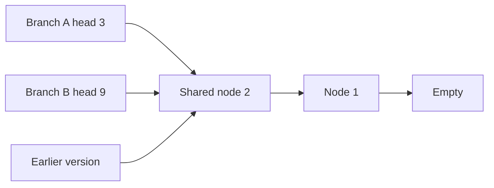

A persistent data structure keeps earlier versions usable after an update. Here “persistent” describes version preservation, not saving to disk. An editor can retain yesterday's document state while constructing today's state, and a search can branch from a shared position without changing that position.

Copying an entire structure would provide this behavior, but structural sharing can make updates much cheaper. The key rule is that shared parts remain immutable.

<!--more-->

These Swift 5.7 examples build a linked list, then use two lists to build a queue. They demonstrate persistence and its cost model rather than replacing the standard library for ordinary app code.

## An immutable list is either empty or a head and tail

```swift
indirect enum PersistentList<Element> {
    case empty
    case node(Element, PersistentList<Element>)

    func prepending(_ element: Element) -> PersistentList<Element> {
        .node(element, self)
    }

    var first: Element? {
        guard case let .node(value, _) = self else { return nil }
        return value
    }

    func removingFirst() -> (Element, PersistentList<Element>)? {
        guard case let .node(value, tail) = self else { return nil }
        return (value, tail)
    }

    func array() -> [Element] {
        var result: [Element] = []
        var cursor = self
        while case let .node(value, tail) = cursor {
            result.append(value)
            cursor = tail
        }
        return result
    }

    func reversed() -> PersistentList<Element> {
        var result = PersistentList<Element>.empty
        var cursor = self
        while case let .node(value, tail) = cursor {
            result = result.prepending(value)
            cursor = tail
        }
        return result
    }
}

let empty = PersistentList<Int>.empty
let one = empty.prepending(1)
let two = one.prepending(2)
assert(empty.array() == [])
assert(one.array() == [1])
assert(two.array() == [2, 1])
```

Prepending creates a new head whose tail is the earlier list. That earlier list is still a valid value. No operation needs to walk the tail to change its contents.

The indirect enum gives Swift a representation for recursive cases. Structural sharing is enabled by the immutable representation; exact allocation and retain behavior remain implementation details. The algorithm constructs a constant amount of new list structure for a prepend.

## Sharing is safe because nodes do not change



Each root describes a different version. Keeping the shared tail immutable lets all three versions remain meaningful.

```swift
let branchA = two.prepending(3)
let branchB = two.prepending(9)
assert(branchA.array() == [3, 2, 1])
assert(branchB.array() == [9, 2, 1])
assert(two.array() == [2, 1])

let popped = branchA.removingFirst()!
assert(popped.0 == 3)
assert(popped.1.array() == two.array())
```

Both branches can reuse the same tail because neither can mutate it. Removing a head returns the tail rather than editing the old list.

Element semantics still matter. A list of mutable class references preserves the sequence of references, but it does not freeze each object's internals. For historical snapshots, store value-like elements or document the shared identities explicitly.

A stack is the natural application: push and pop occur at the head, so they fit this representation. A list is a poor drop-in replacement for an array when the workload needs frequent random indexing or cache-friendly scans.

## Know which operations are expensive

| List operation | Structural work | New list structure |
| --- | --- | --- |
| Prepend | Constant | One head node |
| Inspect or remove first | Constant | No rebuilt tail |
| Traverse or reverse | Linear in element count | Reverse builds a new spine |
| Append at the end | Linear in list length | Rebuilds the path to the end |

These bounds describe the list structure. Element construction, destruction, and externally owned payloads can add their own costs.

Prepending and inspecting the first node take constant structural work. Traversal, reversal, and conversion to an array visit the list and take linear work. Appending to the end requires rebuilding the path to the end in a singly linked immutable list.

Repeatedly appending while building a list can therefore become quadratic. Build by prepending and reverse once when the output order requires it, or use a locally owned array builder.

The iterative traversals above avoid recursive call-stack growth during traversal. They do not guarantee every aspect of a very large recursive value's lifetime is stack-free; allocation and destruction behavior also deserve measurement at extreme sizes.

## Build a queue from a front list and a reversed back list

A queue removes from the front and adds at the back. Store the front in dequeue order and the back in reverse enqueue order:

```swift
struct PersistentQueue<Element> {
    private let front: PersistentList<Element>
    private let back: PersistentList<Element>

    init() {
        front = .empty
        back = .empty
    }

    private init(front: PersistentList<Element>, back: PersistentList<Element>) {
        self.front = front
        self.back = back
    }

    func enqueuing(_ value: Element) -> PersistentQueue<Element> {
        PersistentQueue(front: front, back: back.prepending(value))
    }

    func dequeuing() -> (Element, PersistentQueue<Element>)? {
        if let (value, tail) = front.removingFirst() {
            return (value, PersistentQueue(front: tail, back: back))
        }
        guard let (value, tail) = back.reversed().removingFirst() else {
            return nil
        }
        return (value, PersistentQueue(front: tail, back: .empty))
    }
}

let queue = PersistentQueue<Int>().enqueuing(1).enqueuing(2).enqueuing(3)
let (a, afterA) = queue.dequeuing()!
let (b, afterB) = afterA.dequeuing()!
let (c, afterC) = afterB.dequeuing()!
assert([a, b, c] == [1, 2, 3])
assert(afterC.dequeuing() == nil)
assert(queue.dequeuing()!.0 == 1)
```

Enqueue prepends to `back`. Dequeue removes from `front`; only when the front is empty does it reverse the back. The old queue is unchanged, including when reversal is needed.

The representation invariant is that logical contents equal `front` followed by the reverse of `back`. That statement is more valuable in review than merely calling the type “functional.” Every method must preserve it.

## Amortized claims need a usage model

Along one linear sequence of queue versions, each element moves from back to front once. The occasional linear reversal can be amortized across the enqueue and dequeue operations in that sequence.

Persistence introduces a caveat: repeatedly dequeuing the same old version with an empty front repeats the reversal. Branching histories can pay that cost on every branch. The simple queue does not memoize the reversed front.

That distinction matters in search algorithms that explore many branches from a common state. A more sophisticated persistent queue can use lazy memoized scheduling, but brings a more complicated implementation and ownership model. State the guarantee for the structure you actually built.

## Persistent does not mean free history

Retaining a version retains everything reachable from it. Sharing reduces duplication, but a long history can still keep large substructures alive after they disappear from the current version.

An undo system needs a retention policy: a maximum number of versions, a memory budget, or periodic checkpoints with discarded history. A small root value is not evidence that its retained object graph is small.

Persistence also does not provide disk durability. Saving and restoring a structure requires a format, validation, and a policy for shared identity. Serializing each version independently may duplicate shared content even when the in-memory representation shares it efficiently.

## Compare against the standard library honestly

Swift arrays already provide value semantics through copy-on-write. They have excellent locality and efficient append for a unique owner. A linked persistent structure adds allocations and pointer traversal that may outweigh its sharing benefits.

Persistent structures become interesting when many versions coexist and edits affect only small paths. They are less compelling when one owner builds a sequence once and scans it repeatedly.

Benchmark the workload: version count, edit positions, element sizes, traversal frequency, and lifetime. Counting allocations alone misses cache behavior; timing only one prepend misses the application's dominant scans.

## Test against a simple model

For the queue, use an array as a reference model in tests. Generate enqueue and dequeue operations, compare each returned value, and compare empty behavior. The test model can use inefficient removal because its purpose is clarity over a small domain.

Retain selected earlier versions and verify later operations leave them unchanged. Branch from the same queue twice, with different enqueues, and confirm both branches preserve FIFO order independently.

Boundary cases include an empty queue, one element, repeated reversals across a sequence, and enqueuing after a dequeue. These protect the representation invariant where control changes between front and back.

## Exercise the queue across front-to-back transitions

A deterministic mixed workload can compare the queue against a simple array model while retaining an older version:

```swift
var workingQueue = PersistentQueue<Int>()
var referenceQueue: [Int] = []
for step in 0..<100 {
    if step % 3 != 0 || referenceQueue.isEmpty {
        workingQueue = workingQueue.enqueuing(step)
        referenceQueue.append(step)
    } else {
        let removed = workingQueue.dequeuing()!
        let expectedValue = referenceQueue.removeFirst()
        assert(removed.0 == expectedValue)
        workingQueue = removed.1
    }
}
while !referenceQueue.isEmpty {
    let removed = workingQueue.dequeuing()!
    assert(removed.0 == referenceQueue.removeFirst())
    workingQueue = removed.1
}
assert(workingQueue.dequeuing() == nil)
assert(queue.dequeuing()!.0 == 1)
```

`removeFirst()` is intentionally acceptable in this small reference model even though it is not an efficient production queue. The reference should be easy to trust; matching the tested implementation's representation would risk repeating the same bug.

This workload includes enqueues after dequeues and eventually drains the structure. Add a separately retained checkpoint inside the loop if testing a more complex implementation, then branch from it after the main workload completes.

## An operation's result should preserve the whole next state

The dequeue result contains both the removed element and the new queue. Returning only the element would leave the caller without the next version; mutating a shared queue behind the scenes would abandon persistence.

The optional outside the tuple expresses empty versus nonempty. For a queue of optional elements, the removed element may itself be nil while the outer dequeue result is present. Preserve that distinction just as an iterator distinguishes an absent element from exhaustion.

For an API with many related operations, a named result struct can make these facts clearer than a positional tuple. The small tuple works here because it has only two well-understood parts.

## Sharing granularity determines update behavior

A linked list shares tails. A tree shares subtrees. A vector-like persistent structure can share chunks of contiguous elements behind a shallow tree. Each representation makes a different set of edits cheap.

The choice is more specific than “immutable versus mutable.” A persistent list can be excellent for a stack and poor for updating a middle element. An array with copy-on-write can be excellent for unique-owner bulk construction and costly when every version edits a different position.

Ask which paths are rebuilt, how many nodes are allocated, and what existing versions keep alive. Those questions explain the workload better than the number of source lines in an update method.

## Memory reclamation follows reachability, not current membership

Removing an element from the newest queue does not release it if an old queue still reaches the node containing it. That is necessary for persistence and can surprise a feature holding long undo histories.

If elements contain large payloads or retained service objects, the memory impact can be much larger than the queue node itself. Prefer lightweight values or stable identifiers when history does not need the full resource.

An application should decide when earlier roots are discarded. A background search may release a branch after exploration; an undo system may keep a bounded history; an audit store may serialize selected checkpoints. The structure cannot infer those product lifetimes.

## Keep persistence separate from thread safety

Two readers of immutable value-like nodes can reason independently about the structure. Two threads replacing the same variable holding the current root still need synchronization.

Likewise, a list element can be a mutable reference with its own unsafe operations. The structure's immutable links do not make every reachable object's methods safe to call concurrently.

Treat the root owner and the element contract as explicit parts of the design. Persistence reduces mutation in the graph, while isolation governs who can publish and access its versions.

## Exercise: add a persistent stack history

Use `PersistentList` to store undo states for a small value model. Implement push, undo, and a bounded history policy. Decide whether limiting history requires walking and rebuilding the list, and compare that cost with an array-backed ring buffer.

Then test a branching queue workload that repeatedly dequeues the same old version. Measure the repeated reversal and explain why a linear-history amortized argument does not describe that benchmark.

For Swift's recursive representation, see [Recursive Enumerations](https://docs.swift.org/swift-book/documentation/the-swift-programming-language/enumerations/#Recursive-Enumerations). Continue with [Binary Search Trees and Tries](/swift-functional-trees-tries/) or return to the [Functional Programming roadmap](/swift-functional-programming/).
