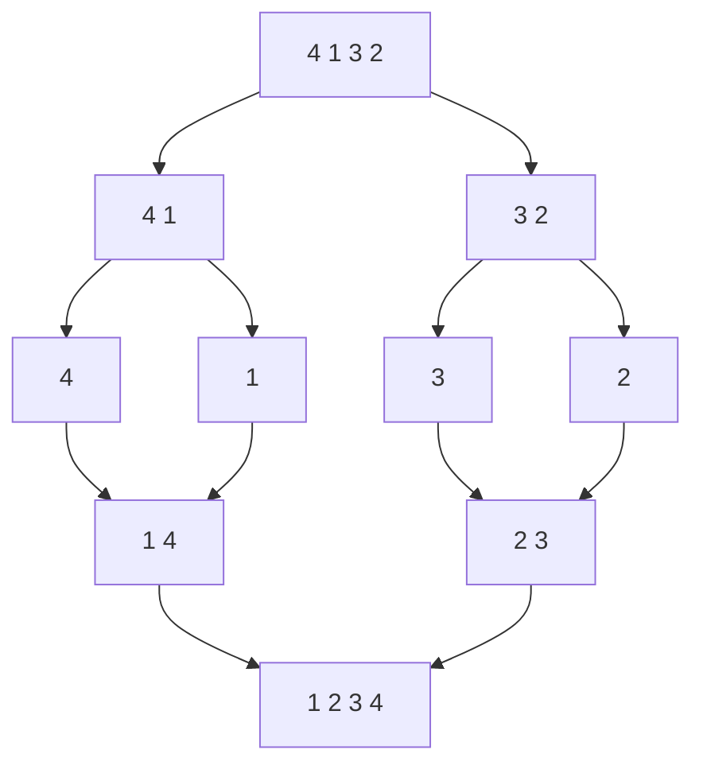

Merge sort splits input into smaller regions, sorts them, and merges ordered results. Its reliable `O(n log n)` comparison bound comes from balanced subdivision, while its stability comes from one precise tie decision during merging.

The representation matters. An implementation that repeatedly copies slices and concatenates arrays has different allocation behavior from one that reuses a single merge buffer.

<!--more-->

This Swift 5.7 implementation uses half-open integer ranges over an array and one reusable auxiliary array. It returns a sorted value and keeps the caller's input unchanged.

## Divide ranges rather than rebuilding subarrays



A region `[low, high)` is empty or a singleton when its length is at most one. Otherwise `middle` splits it into two smaller regions. Half-open ranges make emptiness and adjacent regions straightforward.

```swift
func mergeSorted<T>(_ input: [T], by before: (T, T) -> Bool) -> [T] {
    var values = input
    var buffer = input

    func sort(_ low: Int, _ high: Int) {
        guard high - low > 1 else { return }
        let middle = low + (high - low) / 2
        sort(low, middle)
        sort(middle, high)
        for index in low..<high { buffer[index] = values[index] }
        var left = low
        var right = middle
        for output in low..<high {
            if left == middle {
                values[output] = buffer[right]; right += 1
            } else if right == high {
                values[output] = buffer[left]; left += 1
            } else if before(buffer[right], buffer[left]) {
                values[output] = buffer[right]; right += 1
            } else {
                values[output] = buffer[left]; left += 1
            }
        }
    }

    sort(0, values.count)
    return values
}

let cases: [[Int]] = [[], [1], [4, 1, 3, 2], [5, 1, 5, 0, 3]]
for input in cases { assert(mergeSorted(input, by: <) == input.sorted()) }
```

The buffer holds a stable snapshot of both halves while `values` is overwritten. Reading from the same locations being overwritten would risk consuming already modified data.

## The merge invariant proves the local step

Before each output write, the two unread buffer suffixes remain individually sorted, and the written output prefix contains the smallest consumed elements in order. Choose the smaller head, advance that side, and the invariant continues.

If one side is exhausted, copy from the other. Every input position is consumed exactly once, so the merge preserves the multiset as well as ordering.

The recursive proof then follows: singleton regions are sorted; recursively sorted halves are merged correctly; therefore the parent region is sorted.

## Left-first ties provide stability

The comparison asks whether the right item strictly precedes the left. If not, the left item wins, including equivalent keys. Since left-half items originally precede right-half items, this preserves their identity order.

```swift
struct Entry: Equatable { let key: Int; let id: Int }
let entries = [Entry(key: 2, id: 0), Entry(key: 1, id: 1), Entry(key: 2, id: 2)]
let stable = mergeSorted(entries) { $0.key < $1.key }
assert(stable.map { $0.id } == [1, 0, 2])
assert(entries.map { $0.id } == [0, 1, 2])
```

A tempting `if left < right, else take right` chooses the right item on ties and can destroy stability across the split. Test equal keys placed on opposite sides, not only duplicates within one half.

## Derive work and storage separately

Balanced recursion gives:

$$
T(n)=2T(n/2)+\Theta(n)=\Theta(n\log n).
$$

Each level copies and merges a total of linear elements, and the number of levels is logarithmic. This straightforward implementation performs that work even on sorted input.

The auxiliary buffer uses `O(n)` elements and recursion uses `O(log n)` frames. The returned array is additional result storage relative to the caller's input. Copy-on-write can share initial buffers temporarily, but mutations eventually require independent contents.

This is a peak-live-storage bound, not a sum of allocations across recursive calls. Reusing one buffer avoids allocating a new pair of subarrays at every node.

## Exploit ordered runs only with a valid test

After sorting both halves, if the last left item does not follow the first right item, the whole region is already ordered. A check can then skip copying and merging that region.

That adaptation can make already sorted input linear across the recursion tree's boundary checks. It does not change the worst-case bound. Natural merge sorts go further by discovering existing runs, but require additional policy for run lengths and merging order.

Do not skip the merge based only on the original endpoints before recursively sorting the halves. Unordered interior values can invalidate that shortcut.

## Large datasets may need external merging

When input does not fit memory, sort bounded runs, store them, and merge their streams. The high-level decomposition still applies, but file lifetime, failures, buffering, and I/O volume become central.

A heap can select the next item from several sorted runs. Stable external merging must preserve a tie policy across runs, often using original sequence information. An in-memory proof does not by itself provide durable partial-output recovery.

## Test the buffer boundaries

Include odd lengths, empty halves created by small regions, all-equal input, and lengths just above powers of two. Check descending order too so hidden assumptions about `<` do not pass.

For small generated arrays, compare with the standard library and independently check occurrence counts. For tagged records, verify stability by original position within each equivalent-key group.

## Merge two already sorted streams

The merge operation is useful independently of recursive sorting. Two time-ordered event batches can be combined in linear traversal work, preserving a chosen tie policy, instead of concatenating and sorting them again.

But the precondition must be real: both batches must use the same comparator and have stable key values. A server-sorted batch using different collation or timestamp interpretation is not automatically compatible with a local batch.

For streaming sources, keep only the current head from each input and pull the next value after selecting one. If reads can fail, the output owner needs a partial-result policy; earlier emitted events cannot be retracted merely because a later read throws.

## Stability extends across merge boundaries

If the left batch represents earlier arrival order, left-first equal keys preserve that precedence. For a k-way external merge, carry a run order or original sequence number when equivalent records must retain global source order.

A priority queue that compares only the primary key may scramble those ties even though every individual run is stable. Stability belongs to the whole pipeline, including run generation and final merging.

## Test lengths around split boundaries

For lengths three, five, seven, and nine, the two recursive halves are unequal. A buffer bug may only appear when one half exhausts before the other by more than one item.

Use tagged all-equal records at those lengths to test stability and identity preservation together. Add already sorted and reversed fixtures to cover opposite exhaustion patterns. An optimization that skips merging ordered boundaries should leave all these observations unchanged.

## Exercise: implement bottom-up merging

Merge runs of width one, then two, then four, using the same buffer. Handle an incomplete final run without reading outside bounds. Compare outputs and stability with the recursive version, and explain which stack storage disappears and which buffer storage remains.

Continue with [Quicksort](/swift-quicksort/) for a partition-based alternative.

Return to the [Data Structures and Algorithms roadmap](/swift-data-structures-and-algorithms/).
