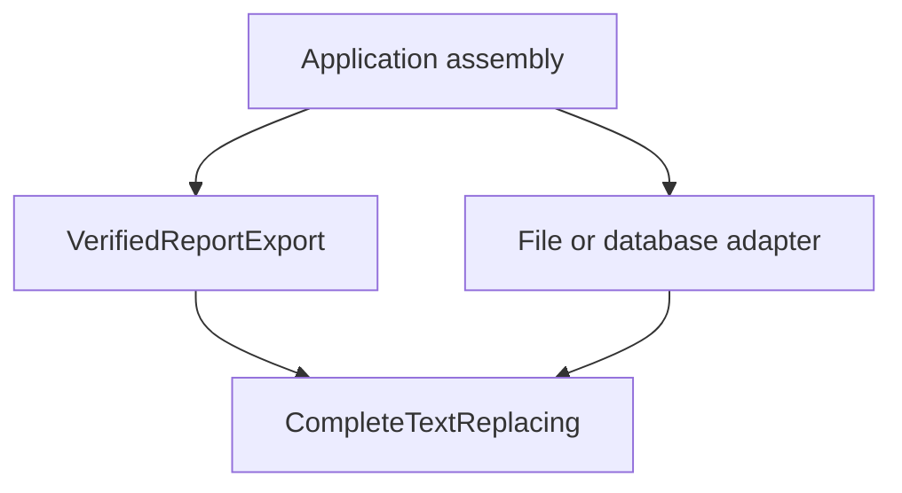

SOLID names five design principles for managing change in object-oriented programs. The principles are useful questions to ask about dependencies and contracts; they are less useful as a demand to create an interface for every class.

A small export feature shows how they work together without turning the application into a maze of abstractions.

<!--more-->



## S: Single Responsibility

A report exporter can gather records, calculate totals, format text, save files, and update a screen. Those tasks can change for unrelated reasons. Separating formatting from storage lets a new file destination leave formatting alone.

Robert C. Martin explains responsibility in terms of reasons to change in [The Single Responsibility Principle](https://blog.cleancoder.com/uncle-bob/2014/05/08/SingleReponsibilityPrinciple.html). The practical question is which stakeholders or policies can force this type to change, not whether the class has exactly one method.

```swift
struct Report {
    let title: String
    let lines: [String]
}

struct ReportFormatter {
    func text(for report: Report) -> String {
        ([report.title] + report.lines).joined(separator: "\n")
    }
}

protocol TextSaving {
    func save(_ text: String) throws
}

final class RecordingTextStore: TextSaving {
    private(set) var saved: [String] = []

    func save(_ text: String) throws {
        saved.append(text)
    }
}

struct ReportExporter {
    let formatter: ReportFormatter
    let store: any TextSaving

    func export(_ report: Report) throws {
        try store.save(formatter.text(for: report))
    }
}

let store = RecordingTextStore()
let exporter = ReportExporter(formatter: ReportFormatter(), store: store)
try exporter.export(Report(title: "Build", lines: ["Passed"]))
assert(store.saved == ["Build\nPassed"])
```

The formatter owns text layout; the store owns the side effect; the exporter coordinates the use case. These boundaries correspond to plausible changes rather than arbitrary line counts.

## O: Open/Closed

The exporter can use another `TextSaving` implementation without editing its workflow. Extension happens through the boundary that was chosen to vary. Martin describes this goal in [The Open/Closed Principle](https://blog.cleancoder.com/uncle-bob/2014/05/12/TheOpenClosedPrinciple.html).

This does not mean existing code may never change. If product requirements redefine what exporting means, changing the exporter is appropriate. Predict every possible extension point and you will spend more effort maintaining speculation than shipping features.

## L: Liskov Substitution

A replacement must preserve the behavioral expectations of the abstraction. If successful `save` means the text was accepted for storage, an implementation that discards the text and reports success violates that contract unless it is explicitly a test double with that purpose.

A subclass example has the same issue: a read-only specialization cannot safely inherit a public mutation operation and simply crash whenever it is called. The signatures fit; the behavior does not.

Clarify preconditions, outcomes, error semantics, and side effects. Substitutability is broader than “the compiler accepts this conformance.”

## I: Interface Segregation

`ReportExporter` only needs to save text. It should not depend on an enormous storage protocol that also requires listing directories, deleting users, and uploading images.

A small consumer-focused protocol lets a production store expose other capabilities elsewhere while a test double implements only the contract the exporter uses. Separate protocols when consumers have genuinely different needs, not merely because every method could technically have its own protocol.

## D: Dependency Inversion

The export use case depends on `TextSaving`, while a concrete storage implementation conforms to that contract. Low-level file or database details no longer define the exporter's dependency.

[Dependency Injection](/swift-dependency-injection/) supplies the implementation at construction time. It is one way to assemble the design; dependency inversion describes the direction of the dependency itself. The two concepts are related but not interchangeable.

## Apply the principles to observed pressure

If a small pure function solves a feature clearly, keep it. If tests need a live database merely to verify formatting, there is probably a useful boundary missing. If adding a storage backend requires edits across the UI, review dependency direction.

Use SOLID to explain a concrete source of change or a contract problem. A design with fewer types and clearer responsibilities is often the stronger result.

## Start with a change scenario, then choose a boundary

Suppose the export feature now needs two output formats and two storage destinations. The original formatter was concrete because there was only one formatting policy. That was reasonable. The new requirement supplies evidence that formatting now varies independently of storage.

```swift
protocol ReportRendering {
    func render(_ report: Report) -> String
}

struct LineReportRenderer: ReportRendering {
    func render(_ report: Report) -> String {
        ([report.title] + report.lines).joined(separator: "\n")
    }
}

struct CompactReportRenderer: ReportRendering {
    func render(_ report: Report) -> String {
        report.title + ": " + report.lines.joined(separator: "; ")
    }
}

struct ConfiguredReportExporter {
    let renderer: any ReportRendering
    let destination: any TextSaving

    func export(_ report: Report) throws {
        try destination.save(renderer.render(report))
    }
}

let compactStore = RecordingTextStore()
let compactExporter = ConfiguredReportExporter(
    renderer: CompactReportRenderer(),
    destination: compactStore
)
try compactExporter.export(Report(title: "Build", lines: ["Compile", "Test"]))
assert(compactStore.saved == ["Build: Compile; Test"])
```

This extension point is justified by an actual variation. It allows the format and destination to be combined independently. It does not require a factory hierarchy, a service locator, or a protocol for the immutable `Report` value.

The Single Responsibility question is whether formatting and persistence change for independent reasons. The Open/Closed question is whether a new formatting policy can be supplied without rewriting the stable export sequence. Those questions describe the resulting behavior more clearly than a claim that the code “uses SOLID.”

## Make Liskov Substitution testable

Consider a stronger repository contract: after a successful write, reading the same key through that repository returns the written text. An implementation that discards writes violates that contract even if its methods have the right signatures.

```swift
protocol TextRepository {
    func write(_ text: String, key: String) throws
    func read(key: String) throws -> String?
}

final class MemoryTextRepository: TextRepository {
    private var values: [String: String] = [:]

    func write(_ text: String, key: String) throws {
        values[key] = text
    }

    func read(key: String) throws -> String? {
        values[key]
    }
}

struct DiscardingRepository: TextRepository {
    func write(_ text: String, key: String) throws {}
    func read(key: String) throws -> String? { nil }
}

func satisfiesReadAfterWrite(_ repository: any TextRepository) throws -> Bool {
    try repository.write("Expected content", key: "contract-example")
    return try repository.read(key: "contract-example") == "Expected content"
}

let memoryContractResult = try satisfiesReadAfterWrite(MemoryTextRepository())
let discardingContractResult = try satisfiesReadAfterWrite(DiscardingRepository())
assert(memoryContractResult)
assert(!discardingContractResult)
```

`DiscardingRepository` is a deliberate negative control: it compiles, but the behavioral check rejects it. The test is only one part of the contract. Add overwrite semantics, failures, missing keys, and concurrency rules if consumers rely on them.

The contract itself must be appropriate. A remote eventually consistent store might not promise immediate read-after-write. In that case, do not force it into this abstraction and dismiss the discrepancy as an implementation detail. Change the abstraction or adapt the workflow so consumers receive truthful semantics.

## Interface Segregation is about consumers, not method counts

Suppose a preview screen needs only to read reports, while an exporter needs only to save text. Giving both a full administrative repository interface exposes operations neither requires.

Separating reader and writer capabilities reduces the consumer's assumptions. It also lets a read-only implementation exist without dummy write methods. The useful boundary follows a coherent need, not the rule that every protocol must contain one method.

An interface with three closely related operations can be smaller conceptually than three protocols that must always be passed together. Review actual use sites: which operations does each consumer require to fulfill its job?

## Dependency Inversion is visible in the dependency direction

If the domain layer imports a database framework because its core protocol exposes database row types, changing the concrete class to a protocol has not fully inverted the dependency. The high-level policy still knows the infrastructure's representation.

Use domain values at the boundary when the policy owns the concept. An adapter in the infrastructure layer can translate database records into those values. Both the exporter and its adapter then depend on the domain-facing contract rather than the exporter depending directly on the storage library.

Constructor injection supplies an implementation of that contract. It can also supply concrete dependencies without inversion, so the mere presence of an initializer argument does not prove the architectural principle has been applied.

## Single Responsibility does not mean one action per object

A reservation object may validate a request, update state, and report availability. Those operations can belong together because they preserve one coherent set of rules. Splitting them into separate objects can scatter the invariant and make invalid transitions easier.

Conversely, one method that parses a network response, updates a cache, formats a date, and drives navigation can still have several responsibilities. Method count and line count are clues about size, not definitions of responsibility.

Ask which policies are likely to change independently, who owns those changes, and what information each decision needs. Keep closely related state and behavior together; separate unrelated effects and presentation choices where that makes the design easier to understand.

## Apply the principles in tension, not isolation

More extension points can improve Open/Closed flexibility while increasing the number of abstractions a reader must navigate. Smaller interfaces can improve segregation while making assembly noisier. Moving every detail behind an abstraction can obscure a simple algorithm.

Evaluate the tradeoff against a concrete scenario. For a one-off local formatter, direct code is usually clearer. For a feature that must support disk and cloud destinations while testing failures independently, a storage boundary has an obvious benefit.

A useful review exercise is to name the change each abstraction protects. If no one can name a plausible current change or consumer requirement, leave the code concrete until evidence appears. If a replacement violates error semantics or lifecycle assumptions, fix the contract before adding another implementation.

## Case study: an export that must never announce a failed save

A feature now requires a receipt after a report is saved. Invalid reports must not reach storage, storage failures must not produce success receipts, and the destination must accept complete replacements. This change tests whether the earlier boundaries describe behavior precisely enough.

Keep validation and rendering together as a domain policy, and make replacement semantics explicit in the storage contract:

```swift
enum VerifiedExportFailure: Error, Equatable {
    case missingTitle
    case destinationUnavailable
}

protocol CompleteTextReplacing {
    // Success means the full text was accepted as the new value for this key.
    // A failure must leave the previous value intact.
    func replace(_ text: String, at key: String) throws
}

struct ValidatedReportRenderer {
    func render(_ report: Report) throws -> String {
        guard !report.title.isEmpty else { throw VerifiedExportFailure.missingTitle }
        return ([report.title] + report.lines).joined(separator: "\n")
    }
}

struct ExportReceipt: Equatable {
    let key: String
    let characterCount: Int
}

struct VerifiedReportExport {
    let renderer: ValidatedReportRenderer
    let destination: any CompleteTextReplacing

    func export(_ report: Report, key: String) throws -> ExportReceipt {
        let text = try renderer.render(report)
        try destination.replace(text, at: key)
        return ExportReceipt(key: key, characterCount: text.count)
    }
}

final class ReplacementStore: CompleteTextReplacing {
    private(set) var values: [String: String] = [:]
    private(set) var attempts = 0
    var acceptsWrites = true

    func replace(_ text: String, at key: String) throws {
        attempts += 1
        guard acceptsWrites else { throw VerifiedExportFailure.destinationUnavailable }
        values[key] = text
    }
}

let replacementStore = ReplacementStore()
let verifiedExport = VerifiedReportExport(
    renderer: ValidatedReportRenderer(), destination: replacementStore
)
let exportReceipt = try verifiedExport.export(Report(title: "Build", lines: ["Passed"]), key: "latest")
assert(exportReceipt == ExportReceipt(key: "latest", characterCount: 12))
assert(replacementStore.values["latest"] == "Build\nPassed")
```

The receipt is returned after storage succeeds. Its character count uses Swift `String.count`, counting extended grapheme clusters, not UTF-8 bytes. If an upload API needs a byte length, name and calculate that different quantity explicitly.

There is no receipt notifier in this design. The caller can update the screen from the returned value. Introducing another protocol and callback solely to report a synchronous return would add a lifecycle and failure boundary without a current requirement.

### Make the forbidden effects observable

```swift
do {
    _ = try verifiedExport.export(Report(title: "", lines: ["Invalid"]), key: "latest")
    assertionFailure("A missing title must fail")
} catch {
    assert(error as? VerifiedExportFailure == .missingTitle)
}
assert(replacementStore.attempts == 1)

replacementStore.acceptsWrites = false
do {
    _ = try verifiedExport.export(Report(title: "Next", lines: []), key: "latest")
    assertionFailure("The destination should reject this write")
} catch {
    assert(error as? VerifiedExportFailure == .destinationUnavailable)
}
assert(replacementStore.attempts == 2)
assert(replacementStore.values["latest"] == "Build\nPassed")
```

The validation test establishes that invalid input causes no storage attempt. The failure test establishes that this implementation preserves its previous value. A real file adapter needs an appropriate replacement operation; a database adapter needs a transaction with equivalent semantics. Merely conforming to the protocol does not verify those infrastructure guarantees.

### Relate each principle to one actual decision

Single Responsibility keeps text policy separate from persistence mechanics. It does not require moving the two title-validation lines into a separate validator object. They currently change with the report rendering rules.

Open/Closed permits another destination implementation without changing the export sequence. A new domain rule may still require editing the renderer. “Closed” does not mean freezing incorrect behavior forever.

Liskov Substitution requires every destination to honor complete replacement and failure preservation. An append-only adapter cannot truthfully satisfy this contract by appending text and hoping the caller will not notice.

Interface Segregation gives the exporter only replacement capability. It cannot delete unrelated records or administer the database because the destination's concrete implementation happens to support those operations.

Dependency Inversion places the replacement contract alongside the export policy, using strings and domain keys rather than database transaction classes. The infrastructure adapter depends on that contract and translates it to its storage system.

### Module ownership matters more than diagram arrows



If the protocol lived in a database module and exposed database-specific values, the high-level code would still import that module. Drawing a protocol box between classes would not change the dependency direction. Verify actual imports and ownership when separating modules.

### Recognize the next change that would require a new design

A remote store can accept a request but lose the response. Retrying might write twice. If the product requires retry-safe identity, add an operation identifier and define its behavior at the destination. A receipt returned by this synchronous example is not proof of distributed exactly-once processing.

Likewise, sending a notification after saving creates two effects. If notification failure must not lose the saved event, an outbox or another durable coordination mechanism may be required. Do not solve that hypothetical requirement now, but do recognize it when it arrives instead of treating it as another incidental delegate call.

The value of the principles is that they expose these contract questions. Their success is measured by truthful behavior under change, including failure, rather than by the number of interfaces in the folder.

Continue through the [Object-Oriented Programming roadmap](/swift-object-oriented-programming/).
