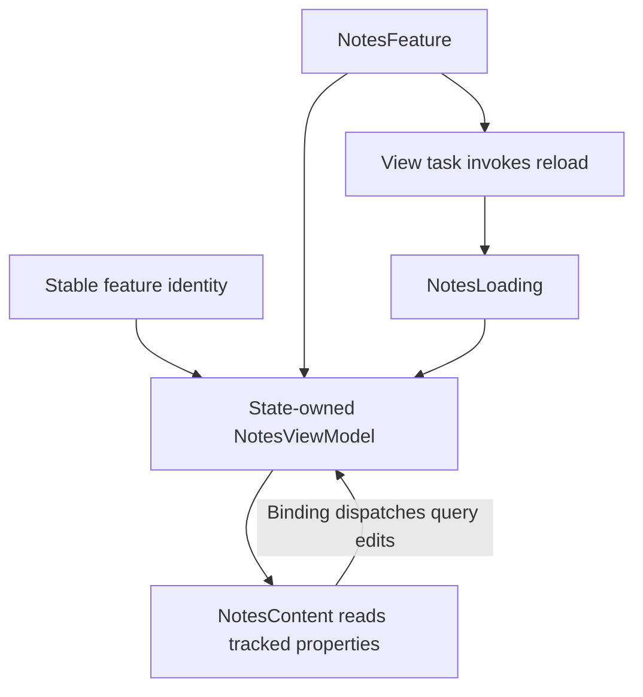

MVVM in SwiftUI works best when the view remains a projection of owned state and the view model owns a coherent feature interaction. SwiftUI recreates view values frequently; that does not mean the feature's state object should be recreated at the same frequency.

A useful design explains who constructs the model, what identity preserves it, and which owner starts or cancels asynchronous work. Property wrappers alone do not answer those questions.

<!--more-->

This December 2023 example requires Swift 5.9 and iOS 17 or macOS 14 for native Observation. It uses `@Observable`, `@State`, and `@Bindable`. For earlier deployment targets, the corresponding ownership approach uses `ObservableObject`, `@StateObject`, and `@ObservedObject` rather than assuming the new APIs are back-deployed.

## Keep the service independent of SwiftUI

```swift
import Foundation
import Observation
import SwiftUI

struct Note: Sendable, Equatable, Identifiable {
    let id: Int
    let title: String
}
protocol NotesLoading: Sendable { func load() async throws -> [Note] }
struct FixedNotes: NotesLoading {
    let notes: [Note]
    func load() async throws -> [Note] { notes }
}
```

The service returns values, not `Text` views or `Binding` objects. A network adapter can implement this contract, while previews and tests can provide deterministic values.

`Sendable` makes the transfer expectations explicit; it does not validate note identities or guarantee a service implementation's business semantics. A production adapter should reject malformed duplicate IDs before those values reach a `ForEach`.

## Give the model state and a bounded async operation

```swift
@available(macOS 14, iOS 17, *)
@MainActor
@Observable
final class NotesViewModel {
    private let loader: any NotesLoading
    private var generation = 0
    private(set) var notes: [Note] = []
    private(set) var isLoading = false
    private(set) var message: String?
    var query = ""

    init(loader: any NotesLoading) { self.loader = loader }
    var visibleNotes: [Note] {
        notes.filter { query.isEmpty || $0.title.localizedCaseInsensitiveContains(query) }
    }
    func reload() async {
        precondition(generation < Int.max)
        generation += 1
        let ticket = generation
        isLoading = true
        message = nil
        do {
            let loaded = try await loader.load()
            try Task.checkCancellation()
            guard ticket == generation else { return }
            guard Set(loaded.map(\.id)).count == loaded.count else {
                isLoading = false
                message = "The service returned duplicate note identities."
                return
            }
            notes = loaded
            isLoading = false
        } catch {
            guard ticket == generation else { return }
            isLoading = false
            if error is CancellationError { return }
            message = "Notes could not be refreshed."
        }
    }
}
```

The model is main-actor isolated because its mutable state drives UI. Awaiting a loader does not block the main thread, but synchronous work performed before a suspension still runs on its current executor. Move expensive decoding or processing to an appropriate implementation boundary rather than assuming `async` means background execution.

The generation protects newer loads from older publication. `Task.checkCancellation` also prevents a cancelled task from publishing a returned result when the dependency did not itself throw on cancellation.

A failed refresh retains existing notes and exposes a message. The example does not preserve a distinct “never loaded” phase; add one if the product needs a different initial screen from an empty successful result.

## Preserve identity at the view's ownership boundary

```swift
@available(macOS 14, iOS 17, *)
@MainActor
struct NotesFeature: View {
    @State private var model: NotesViewModel

    init(loader: any NotesLoading) {
        _model = State(initialValue: NotesViewModel(loader: loader))
    }
    var body: some View {
        NotesContent(model: model)
            .task { await model.reload() }
    }
}

@available(macOS 14, iOS 17, *)
@MainActor
struct NotesContent: View {
    @Bindable var model: NotesViewModel
    var body: some View {
        VStack {
            TextField("Filter notes", text: $model.query)
            if model.isLoading { ProgressView() }
            if let message = model.message { Text(message) }
            List(model.visibleNotes) { note in Text(note.title) }
        }
    }
}
```

`NotesFeature` establishes ownership in state storage associated with its SwiftUI identity. `NotesContent` receives that model and uses `@Bindable` to create a binding for an editable property; it does not establish a second owner or a second source of truth.

The initial value expression can be evaluated when new view values are constructed even though SwiftUI preserves installed state for a stable identity. Keep model initialization free of external effects. Start loading in the explicit task lifecycle instead.

Changing the injected loader while preserving the same feature identity does not automatically replace the state-owned model. If switching accounts changes its lifetime, provide a new stable feature identity at that boundary or define an explicit dependency-replacement operation.

## Test model behavior without rendering a view

```swift
if #available(macOS 14, iOS 17, *) {
    let model = NotesViewModel(loader: FixedNotes(notes: [
        Note(id: 1, title: "Swift values"), Note(id: 2, title: "Navigation")
    ]))
    await model.reload()
    await MainActor.run {
        model.query = "swift"
        assert(model.visibleNotes.map(\.id) == [1])
        assert(!model.isLoading && model.message == nil)
    }
    let malformed = NotesViewModel(loader: FixedNotes(notes: [
        Note(id: 1, title: "A"), Note(id: 1, title: "B")
    ]))
    await malformed.reload()
    await MainActor.run {
        assert(malformed.notes.isEmpty && malformed.message != nil)
    }
}
```

A separate controlled loader should test cancellation and reversed completion order. Those tests need explicit suspension gates rather than timing sleeps. Rendering tests should verify that query editing and visible rows are actually connected to the model.

## Draw identity and task ownership



The task belongs to the view lifecycle. SwiftUI cancels its task when the relevant view disappears, but cancellation is cooperative. The model must still check acceptance before publishing, especially when a dependency ignores cancellation.

Do not automatically interpret every appearance as “fetch again forever.” If cached content should remain valid for a session, put freshness policy in the model or repository. A view task is a trigger, not a cache policy.

## Decide whether a separate view model is needed

A small SwiftUI view with local toggles may be clearest with local `@State` values. An observable domain model can sometimes be consumed directly. A separate view model earns its place when it isolates interaction state, projection, or effect acceptance that would otherwise clutter the view.

Avoid wrapping every domain property in an identical mutable view-model property. That creates synchronization work without adding a useful boundary. Prefer derived projections and explicit intents for validated operations.

Navigation, persistence conflicts, and account ownership remain separate responsibilities. An observable object can become as overloaded as any controller if it owns all of them indiscriminately.

## Case study: an input changes without changing view identity

A parent can reconstruct `NotesFeature(loader:)` with a new loader while SwiftUI preserves the existing feature identity. The installed `@State` model remains the old model, so its original loader remains in use.

That is correct when the input is a stable construction dependency and incorrect when the caller expected it to behave like a live configuration value. Make the distinction explicit in the feature API. An account-scoped dependency generally belongs to account-scoped feature identity; a changing filter may belong to an intent or a task ID instead.

Using `.id(accountID)` at the owning boundary can intentionally replace the whole feature state when the account changes. It also discards local query and selection, so choose that behavior deliberately. An explicit reconfiguration method can preserve selected local state, but must invalidate old requests and replace every account-specific capability coherently.

Do not rely on `init` running only once. SwiftUI can construct new view values while preserving state storage. Side effects in the initial-value expression can therefore run even when the newly constructed model is not the installed state object.

For testing, first verify model-level acceptance with controlled suspension. Then use a rendering or integration test to reconstruct the view under stable identity and changed identity. These are different questions: the model test proves request policy, while the identity test proves the composition root gives that model the intended lifetime.

Previews should use the same ownership shape with deterministic dependencies. A preview that bypasses the real ownership boundary may look correct while missing the lifecycle problem entirely.

## Exercise: change account identity during a load

Use a loader that waits before returning. Switch the owning account and construct a new feature identity, then release the old result. Verify the new model remains unaffected and the old task does not publish after cancellation. Add a preview using a fixed loader, and keep initialization free of network work.

Apple's [Discover Observation in SwiftUI](https://developer.apple.com/videos/play/wwdc2023/10149/) explains the native Observation model and its property-wrapper roles.

Return to the [App Architectures roadmap](/swift-architectures/).
