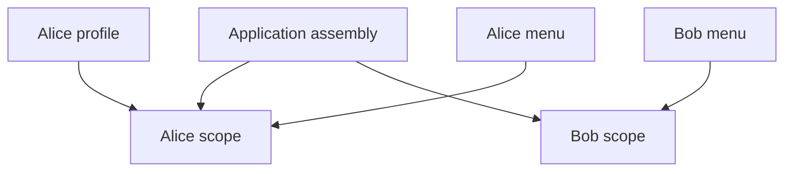

A feature is difficult to test when it secretly reads the clock, opens a database, or creates its own network client. Dependency injection makes those collaborators explicit: the caller supplies what the feature needs instead of the feature reaching out for it.

You can start with a plain initializer. A dependency injection framework is optional.

<!--more-->



## Move construction to the boundary

```swift
protocol GreetingReading {
    func greeting(for name: String) throws -> String
}

struct LocalGreetingReader: GreetingReading {
    func greeting(for name: String) throws -> String {
        "Hello, " + name
    }
}

final class GreetingPresenter {
    private let reader: any GreetingReading
    private(set) var message = ""

    init(reader: any GreetingReading) {
        self.reader = reader
    }

    func showGreeting(for name: String) throws {
        message = try reader.greeting(for: name)
    }
}

let presenter = GreetingPresenter(reader: LocalGreetingReader())
try presenter.showGreeting(for: "Maya")
assert(presenter.message == "Hello, Maya")
```

The presenter owns presentation behavior. Another part of the application chooses the reader implementation. That assembly location is often called the composition root: an application entry point or feature factory that constructs concrete objects and connects them.

The small synchronous reader keeps the example focused. A network-backed operation should expose asynchronous behavior rather than blocking behind this signature.

## Inject failure as well as success

```swift
enum GreetingFailure: Error {
    case unavailable
}

struct FailingGreetingReader: GreetingReading {
    func greeting(for name: String) throws -> String {
        throw GreetingFailure.unavailable
    }
}

let failingPresenter = GreetingPresenter(reader: FailingGreetingReader())
do {
    try failingPresenter.showGreeting(for: "Maya")
    assertionFailure("Expected an unavailable reader")
} catch GreetingFailure.unavailable {
    assert(failingPresenter.message.isEmpty)
}
```

The test does not need to change global state or make a service unavailable. It chooses a collaborator with a precise behavior and observes the presenter's response. A real UI feature might convert that failure into an error state; the important point is that the failure is now easy to exercise.

Protocol substitution works because the presenter depends only on the declared requirement. The mechanics are covered in Swift's [Protocols chapter](https://docs.swift.org/swift-book/documentation/the-swift-programming-language/protocols/).

## Choose the injection form by the lifetime

Constructor injection works well for required dependencies that should remain stable throughout an object's life. Property injection fits dependencies that are genuinely optional or assigned by a framework after construction, but it introduces a period in which configuration may be incomplete.

Method injection is appropriate for a collaborator or value needed by just one operation. A closure is often enough for a single capability, such as obtaining the current time. A plain configuration value should remain a value rather than becoming a service protocol solely for consistency.

The dependency can also be concrete. Injection describes how a collaborator arrives; it does not require a protocol around every type.

## Keep discovery out of the feature

A feature that accepts a service locator and then asks it for arbitrary collaborators still hides its real requirements. A reader must inspect the implementation to know what construction will need.

Prefer an initializer that names those dependencies directly. A very long initializer may indicate that the feature owns too many responsibilities, though it can also be a legitimate orchestration boundary. Investigate the relationships before introducing a container to conceal the list.

Dependency inversion is a related architectural choice: policy depends on an abstraction rather than an infrastructure detail. Martin discusses that direction in [A Little Architecture](https://blog.cleancoder.com/uncle-bob/2016/01/04/ALittleArchitecture.html). Injection assembles objects; inversion chooses what the policy depends on.

## Make ownership and isolation explicit

An injected object is usually strongly retained when it is required for ongoing work. A delegate back-reference has a different ownership role and is often weak. Shared dependencies also need a concurrency contract if several tasks may use them.

Explicit construction makes those choices reviewable. It does not remove the need to make them.

## Inject a source of nondeterminism as a small capability

Time is a dependency even when no object named `ClockService` exists. Reading the current time inside a calculation makes boundary cases difficult to reproduce. A function can supply time without requiring a container or a large protocol.

```swift
struct ExpiringNotice {
    let expiresAtSecond: Int
    let now: () -> Int

    var isExpired: Bool {
        now() >= expiresAtSecond
    }
}

var simulatedSecond = 99
let notice = ExpiringNotice(expiresAtSecond: 100, now: { simulatedSecond })
assert(!notice.isExpired)
simulatedSecond = 100
assert(notice.isExpired)
```

The test controls the exact expiration boundary and never sleeps. The closure deliberately reads a mutable local binding for this serial test. A concurrent production clock abstraction needs a compatible isolation and transfer contract.

Notice the distinction between injecting a time **value** and a time **provider**. A value freezes one observation. A provider obtains a new observation each time. Use the value when the operation must evaluate every rule against the same instant; use the provider when the object genuinely needs changing time across its lifetime.

Randomness, UUID generation, environment lookup, and locale can be treated similarly. Inject the smallest capability the behavior needs, rather than passing one enormous application environment through every layer.

## Construct a feature graph in one place

Assembly is ordinary Swift code. A named factory can make the graph visible and keep concrete choices out of the consumer.

```swift
struct GreetingConfiguration {
    let prefix: String
}

struct ConfiguredGreetingReader: GreetingReading {
    let configuration: GreetingConfiguration

    func greeting(for name: String) throws -> String {
        configuration.prefix + ", " + name
    }
}

func makeGreetingFeature(configuration: GreetingConfiguration) -> GreetingPresenter {
    let reader = ConfiguredGreetingReader(configuration: configuration)
    return GreetingPresenter(reader: reader)
}

let formalFeature = makeGreetingFeature(configuration: GreetingConfiguration(prefix: "Welcome"))
let casualFeature = makeGreetingFeature(configuration: GreetingConfiguration(prefix: "Hi"))
try formalFeature.showGreeting(for: "Maya")
try casualFeature.showGreeting(for: "Maya")
assert(formalFeature.message == "Welcome, Maya")
assert(casualFeature.message == "Hi, Maya")
```

The two features coexist because configuration belongs to their construction, not to a shared global switch. The presenter still knows only its reader contract.

A large application may have an application-level assembly function and smaller feature factories. The important property is that a consumer's requirements are visible in its API. Whether a framework automates part of that assembly is a separate tooling decision.

## Scope is a lifetime policy

A database pool might be shared for the application, a user session might be shared only while signed in, and an edit draft might exist for one screen. A dependency container's labels do not remove the need to understand those lifetimes.

If a long-lived service retains a short-lived user-specific collaborator, signing out may not release account state. If every request creates a supposedly shared cache, no request benefits from earlier work. Construction sites should make those decisions deliberate.

Write down which objects own each other and which are reused. An injected required service is commonly retained strongly. A weak delegate back-reference is a different relationship and should not be copied as the default ownership rule for all dependencies.

## Factories are dependencies too

Sometimes a feature should create a new collaborator for each operation rather than retain one instance. Injecting a factory function can express that policy. For example, a document workflow can receive a function that creates a fresh editing session for a selected document.

That is different from injecting an already active session. The factory controls creation, while the resulting owner controls the new session's lifetime. Define whether the factory may throw and whether callers must close the resource explicitly.

Do not use a generic resolver function that returns arbitrary services by type merely to hide a long initializer. That shifts dependency discovery into runtime execution and makes the feature's actual needs harder to review. Prefer a named factory capability with a concrete result.

## Test outcomes and interaction only where interaction matters

The earlier failure reader makes an error deterministic. A recording reader can also capture the requested name, but avoid turning every implementation detail into an interaction assertion.

If the contract is “show the greeting returned for this name,” observing the resulting message may be sufficient. If the contract requires exactly one request, cancellation of a previous request, or no write after validation failure, those interactions deserve explicit assertions.

Test doubles should behave consistently with the real contract. A fake that cannot fail may make a success path easy to test while leaving recovery code unreachable. A fake that returns synchronously when the real operation is asynchronous can miss ordering and cancellation problems. Use an appropriate double for the behavior under test, not one universal fake for every scenario.

## Avoid optional dependencies that conceal invalid construction

Property injection is sometimes necessary, especially around framework-owned construction. But a required collaborator represented as an optional means the object can exist in a state where its main operation cannot work.

If that state is unavoidable, make the activation boundary explicit and report missing configuration clearly. Do not scatter optional chaining over required effects; silently skipping a database write is not a successful dependency-management strategy.

For dependencies known at construction, an initializer provides a simpler guarantee: if the feature exists, the collaborator exists. Default arguments can preserve convenience for production assembly, but tests and alternate environments should still be able to supply the dependency directly.

## Exercise: identify hidden inputs in an apparently pure feature

Take a method that formats “expires in five minutes.” List the current time, locale, calendar, time zone, and policy for rounding. Decide which are fixed configuration, which are per-call values, and which require changing observations.

Then test the exact expiration boundary and a locale variation without changing process-wide settings. That exercise usually teaches more about injection than adding a container: it makes the behavior's real inputs explicit and controllable.

## Case study: share a cache within an account and revoke it on sign-out

A profile screen and a menu should share account preferences. A second signed-in account must not reuse those cached values. A process-wide singleton is too broad, while constructing a separate cache for every screen is too narrow.

Model an account scope as an explicit object. It owns the account identity, a small cache, and an injected loading capability:

```swift
enum AccountScopeFailure: Error, Equatable { case closed }

final class AccountPreferenceScope {
    let accountID: String
    private let load: (String, String) throws -> String?
    private var cache: [String: String] = [:]
    private var closed = false

    init(accountID: String, load: @escaping (String, String) throws -> String?) {
        self.accountID = accountID
        self.load = load
    }

    func value(for key: String) throws -> String? {
        guard !closed else { throw AccountScopeFailure.closed }
        if let existing = cache[key] { return existing }
        let value = try load(accountID, key)
        if let value { cache[key] = value }
        return value
    }

    func close() {
        closed = true
        cache.removeAll()
    }
}

struct AccountPreferenceLabel {
    let scope: AccountPreferenceScope
    let key: String

    func text() throws -> String {
        try scope.value(for: key) ?? "Not configured"
    }
}

struct AccountFeatureFactory {
    let load: (String, String) throws -> String?

    func makeScope(accountID: String) -> AccountPreferenceScope {
        AccountPreferenceScope(accountID: accountID, load: load)
    }
}

var accountPreferenceLoads: [String] = []
let accountFeatureFactory = AccountFeatureFactory { accountID, key in
    accountPreferenceLoads.append(accountID + "/" + key)
    return accountID + " value"
}
let aliceScope = accountFeatureFactory.makeScope(accountID: "alice")
let aliceProfile = AccountPreferenceLabel(scope: aliceScope, key: "displayName")
let aliceMenu = AccountPreferenceLabel(scope: aliceScope, key: "displayName")
let aliceProfileText = try aliceProfile.text()
let aliceMenuText = try aliceMenu.text()
assert(aliceProfileText == "alice value")
assert(aliceMenuText == "alice value")
assert(accountPreferenceLoads == ["alice/displayName"])

let bobScope = accountFeatureFactory.makeScope(accountID: "bob")
let bobMenu = AccountPreferenceLabel(scope: bobScope, key: "displayName")
let bobMenuText = try bobMenu.text()
assert(bobMenuText == "bob value")
assert(accountPreferenceLoads == ["alice/displayName", "bob/displayName"])
```

The factory creates a fresh scope, not a globally registered service. Assembly chooses which labels share it. The labels receive a concrete dependency because substituting the loading effect at the scope boundary already gives the tests the control they need.

This small cache stores present values only. A missing value will be loaded again. Caching absence requires a separate representation, such as an enum with missing and present cases, because assigning `nil` to a dictionary subscript removes an entry. Choose that policy based on freshness requirements instead of accidentally conflating absence with “not loaded.”

### Releasing an owner is different from revoking access

A screen can retain an old scope after the application has removed it from its current-session property. Simply assigning that property to `nil` does not invalidate references held elsewhere. An explicit close operation gives old consumers a defined failure:

```swift
aliceScope.close()
aliceScope.close()
do {
    _ = try aliceMenu.text()
    assertionFailure("A closed account scope must reject reads")
} catch {
    assert(error as? AccountScopeFailure == .closed)
}
let stillActiveBobText = try bobMenu.text()
assert(stillActiveBobText == "bob value")
assert(accountPreferenceLoads.count == 2)
```

Closing is idempotent, clears cached values, and rejects access before consulting the loader. Bob's scope remains active. This is an application lifecycle policy; it is not a substitute for server authorization or secure credential storage.

An asynchronous loader needs more care. A result can arrive after close, so check the scope's active generation before accepting it and cancel owned work where possible. The synchronous example intentionally does not pretend a boolean solves that race across suspension points or threads.

### Draw scopes as ownership decisions



A container could automate this graph, but it would still need to know when account scopes begin and end. Explicit factories make that policy visible in ordinary Swift code. They also permit two scopes in one test process without resetting shared globals.

### Test lifetime and reuse separately

A useful scope test proves two things: expected consumers reuse one cache, and unrelated scopes remain independent. A lifecycle test then keeps an old consumer alive deliberately and verifies that closing its scope disables further work.

Also decide how updates invalidate a cached value. This teaching example models read-mostly state for the scope's lifetime. A settings editor would need an explicit update or invalidate operation; injecting a loader does not make cached values fresh automatically.

### Avoid a factory that becomes a service locator

The factory's result and construction argument are specific. A generic `resolve(type:)` method would let a feature request arbitrary services during execution, hiding its true dependencies again. Keep factories focused on resources whose creation and lifetime matter.

The important outcome is a reviewable ownership graph: application-level assembly supplies a loading capability, account scopes own account state, and feature objects share precisely the scope intended for them. Injection makes those choices explicit; the scope's API enforces the lifecycle decisions.

Continue through the [Object-Oriented Programming roadmap](/swift-object-oriented-programming/).
