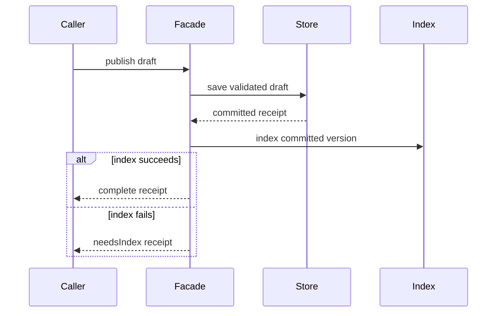

A facade gives a caller one coherent entry point to a subsystem's use case. It can validate input, coordinate storage, and update a search index without making every screen reproduce the same sequence.

It does not turn several independent effects into one transaction. A good facade makes partial completion explicit instead of hiding it behind an easy-looking method name.

<!--more-->

The Swift 5.7 case study publishes an article draft. Storage is authoritative; indexing happens afterward. If indexing fails after storage succeeds, the result identifies the committed version that still needs repair.

## Choose a use case rather than a bag of services

```swift
struct ArticleDraft {
    let id: Int
    let title: String
    let body: String
}
struct PublishReceipt: Equatable { let articleID: Int; let revision: Int }
enum PublishOutcome: Equatable {
    case complete(PublishReceipt)
    case needsIndex(PublishReceipt)
}
enum PublishingFailure: Error { case emptyTitle, emptyBody }

protocol ArticleSaving {
    func save(_ draft: ArticleDraft) throws -> PublishReceipt
}
protocol ArticleIndexing {
    func index(_ draft: ArticleDraft, receipt: PublishReceipt) throws
}

struct PublishingFacade {
    let store: any ArticleSaving
    let index: any ArticleIndexing

    func publish(_ draft: ArticleDraft) throws -> PublishOutcome {
        guard !draft.title.isEmpty else { throw PublishingFailure.emptyTitle }
        guard !draft.body.isEmpty else { throw PublishingFailure.emptyBody }
        let receipt = try store.save(draft)
        do {
            try index.index(draft, receipt: receipt)
            return .complete(receipt)
        } catch {
            return .needsIndex(receipt)
        }
    }
}
```

The operation expresses a real workflow. A facade with unrelated `loadProfile`, `playAudio`, and `clearCache` methods would merely relocate a service container rather than define a coherent use case.

The validation policy distinguishes empty strings from whitespace. Trimming, localization, and title-length requirements would be explicit domain changes with their own tests.

## Keep partial completion observable

```swift
final class MemoryArticleStore: ArticleSaving {
    private(set) var saved: [Int: ArticleDraft] = [:]
    private var revision = 0
    func save(_ draft: ArticleDraft) throws -> PublishReceipt {
        revision += 1
        saved[draft.id] = draft
        return PublishReceipt(articleID: draft.id, revision: revision)
    }
}

enum IndexFailure: Error { case unavailable }
final class RecordingIndex: ArticleIndexing {
    var shouldFail = false
    private(set) var receipts: [PublishReceipt] = []
    func index(_ draft: ArticleDraft, receipt: PublishReceipt) throws {
        if shouldFail { throw IndexFailure.unavailable }
        receipts.append(receipt)
    }
}

let store = MemoryArticleStore()
let index = RecordingIndex()
let publishing = PublishingFacade(store: store, index: index)
let draft = ArticleDraft(id: 7, title: "Values", body: "Independent state")
let completed = try publishing.publish(draft)
assert(completed == .complete(PublishReceipt(articleID: 7, revision: 1)))
index.shouldFail = true
let partial = try publishing.publish(draft)
assert(partial == .needsIndex(PublishReceipt(articleID: 7, revision: 2)))
assert(store.saved[7]?.title == "Values")
assert(index.receipts.count == 1)
```

The second result does not say the article was not published. It says authoritative storage committed revision two while search indexing remains incomplete.

`needsIndex` is a repair requirement, not evidence that repair has already been durably queued. The caller or a more complete application service must own that next step. If the process can crash between commit and reporting the result, an outbox or another durable protocol may be required.



## Validation should prevent effects on invalid input

```swift
do {
    _ = try publishing.publish(ArticleDraft(id: 9, title: "", body: "Body"))
    assertionFailure("An invalid draft must not be saved")
} catch PublishingFailure.emptyTitle {}
assert(store.saved[9] == nil)
```

That sequencing test protects a public requirement. It does not need to assert which private helper checked the title.

A storage failure also prevents indexing. A production adapter should preserve enough diagnostic context for operational investigation while mapping outcomes into the application's stable error model.

## A simpler interface does not guarantee atomicity

Retrying `publish` after a partial outcome saves again in this demonstration, producing another revision. That is intentional evidence that the facade does not provide idempotency automatically.

A real publishing service can accept an idempotency key, store a pending-index record in the same transaction as the article, and let a worker retry indexing the exact committed revision. Those guarantees come from storage and delivery protocols, not from putting calls in one method.

Likewise, reversing the calls creates a different partial failure: a search result pointing to content that was never saved. Choose the authoritative boundary and recovery policy before choosing the convenient call order.

## Domain policy should not disappear into the facade

The facade coordinates validation and effects, but complex eligibility or revision rules deserve their own clear domain operation. Avoid growing one facade into the only place where every business decision lives.

It can delegate pure decisions to functions and retain orchestration. [Mixing OOP and Functional Programming](/swift-oop-functional-programming/) develops that separation with state transitions and explicit effect descriptions.

A facade may call repositories, adapters, or factories. Its role is the consumer-facing use case, not replacing every lower-level abstraction.

## Keep the caller independent of infrastructure details

The caller receives a `PublishOutcome` and receipt, not database rows or a vendor indexing response. Replacing the search service should not change the screen's basic completion model.

At the same time, do not erase information the caller needs. A screen may need to show that search visibility is pending rather than display a generic failure after the authoritative save succeeded.

The in-memory store assumes serial use and a bounded demonstration revision count. Production revisions need durable scope and concurrency control. A facade cannot protect a check-and-write sequence from concurrent writers unless the persistence contract supplies the required atomic operation.

## Test the failure matrix

Cover validation failure, save failure, indexing success, indexing failure after save, and repeated requests. Observe stored state and returned receipt together; one alone can hide partial completion.

For repair, test that indexing revision two does not accidentally index revision three's content under revision two's receipt. A receipt is useful only when the system can retrieve or retain the corresponding committed facts.

## Partial success needs a next action

A published document that is saved but not indexed is a real state of the system. Treating it as an ordinary thrown failure can prompt a caller to repeat the entire publish action, possibly creating another revision. Treating it as complete can leave the document missing from search indefinitely.

The `needsIndex` result preserves the successful save receipt. A production caller can use that receipt to display an accurate status and request indexing of the specific saved revision. Repair should target that revision rather than blindly index whatever happens to be current later.

The example keeps this state in the returned result only. If the process exits before the caller schedules repair, that information is lost. A reliable background-repair design needs durable pending work, typically recorded with the authoritative save when the storage system can make them atomic. Otherwise a crash can occur between saving the document and recording the repair task.

This is why a single convenient method is not evidence of a transaction. The facade simplifies interaction; the underlying stores determine which effects can commit together.

## A facade should not erase useful distinctions

It is tempting to reduce every result to a Boolean `published`. That loses whether validation failed, saving failed, or indexing remains incomplete. The caller may need a different response to each situation.

A useful facade narrows the operations a caller must coordinate while preserving outcomes needed for decisions. It can expose one use-case method with a small result enum rather than dozens of subsystem methods or a single ambiguous flag.

Likewise, do not return every internal persistence object “just in case.” A stable receipt or domain result lets the subsystem change its indexing library without forcing UI code to follow that change.

## Test failure positions, not only the happy path

For an operation with validation, storage, and indexing, place a failing fake at each boundary. Invalid input must not reach storage. Failed storage must not reach indexing. Failed indexing must retain evidence of the successful save.

Also test repeated repair. If indexing the same revision twice is harmless, document that idempotency and verify it. If it is not harmless, the repair path needs a deduplication rule. Do not assume that a retry is safe simply because the public operation sounds read-like or administrative.

As the subsystem evolves, keep the facade centered on a use case. A class that accumulates unrelated account, export, billing, and search operations becomes a dependency hub whose convenience obscures unrelated ownership and failure policies.

## Exercise: add durable repair intent

Extend the saving capability so it atomically records an article and a pending-index intent. Let the facade return the committed receipt while a worker processes intents. Define duplicate delivery handling and test a worker crash after indexing but before acknowledging the intent.

Return to the [Design Patterns roadmap](/swift-design-patterns/).
