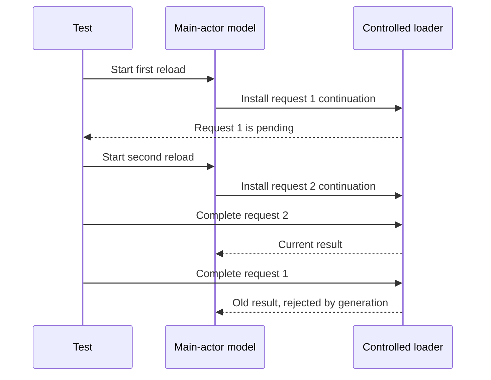

An asynchronous test should establish when an operation completed and what happened because of it. Waiting for an arbitrary amount of time establishes neither. A fast machine can hide a race that appears on a busy CI worker, while a slow test can still inspect state before the relevant work finishes.

Swift's concurrency tools let a test await an operation directly. For callback APIs and controlled interleavings, use completion signals that describe the actual event being tested.

<!--more-->

This January 2024 article uses Swift 5.7 syntax and XCTest. Its async expectation example uses `fulfillment(of:timeout:)`, available in [Xcode 14.3 and later](https://developer.apple.com/documentation/xcode-release-notes/xcode-14_3-release-notes). Later Swift blocks extend the definitions in this article's test file. Apple documents both direct async tests and expectation-based tests in [Asynchronous Tests and Expectations](https://developer.apple.com/documentation/xctest/asynchronous-tests-and-expectations).

## Await a result instead of guessing its duration

```swift
import Foundation
import XCTest

struct BookSummary: Sendable, Equatable {
    let id: Int
    let title: String
}
protocol BookLoading: Sendable { func load() async throws -> BookSummary }
struct FixedBookLoader: BookLoading {
    let book: BookSummary
    func load() async throws -> BookSummary { book }
}
final class DirectAsyncTests: XCTestCase {
    func testReturnsTheLoadedBook() async throws {
        let expected = BookSummary(id: 7, title: "Swift")
        let actual = try await FixedBookLoader(book: expected).load()
        XCTAssertEqual(actual, expected)
    }
}
```

An `async throws` test fails if the awaited call throws unexpectedly. Put explicit error assertions around a call when failure is the behavior under test. Do not use `try?` merely to keep the test running; it can erase the distinction between a thrown error and a valid absent result.

Awaiting a method establishes only that method's completion contract. If the method launches an unstructured task and returns immediately, awaiting it does not wait for that task. Expose a result, task handle, or explicit completion signal when the caller needs to observe the work.

## Control a suspension point to reproduce a race

An actor serializes access to its fields, but another call can run while one method is suspended. A screen model therefore needs an acceptance rule for a load that finishes after a newer load.

```swift
actor ControlledBookLoader: BookLoading {
    private var nextID = 0
    private var pending: [Int: CheckedContinuation<BookSummary, Error>] = [:]
    private var waiters: [Int: [CheckedContinuation<Void, Error>]] = [:]
    private var closed = false

    func load() async throws -> BookSummary {
        guard !closed else { throw CancellationError() }
        precondition(nextID < Int.max)
        nextID += 1
        let id = nextID
        return try await withCheckedThrowingContinuation { continuation in
            pending[id] = continuation
            let ready = waiters.removeValue(forKey: id) ?? []
            for waiter in ready { waiter.resume() }
        }
    }
    func waitUntilPending(_ id: Int) async throws {
        guard !closed else { throw CancellationError() }
        if pending[id] != nil { return }
        try await withCheckedThrowingContinuation { waiters[id, default: []].append($0) }
    }
    func succeed(_ id: Int, with book: BookSummary) {
        guard let continuation = pending.removeValue(forKey: id) else {
            preconditionFailure("No pending load for this identity")
        }
        continuation.resume(returning: book)
    }
    func failAll() {
        closed = true
        let current = Array(pending.values)
        pending.removeAll()
        for continuation in current { continuation.resume(throwing: CancellationError()) }
        let waiting = waiters.values.flatMap { $0 }
        waiters.removeAll()
        for continuation in waiting { continuation.resume(throwing: CancellationError()) }
    }
}

@MainActor
final class BookScreenModel {
    private let loader: any BookLoading
    private var generation = 0
    private(set) var book: BookSummary?
    private(set) var isLoading = false
    init(loader: any BookLoading) { self.loader = loader }
    func reload() async throws {
        precondition(generation < Int.max)
        generation += 1
        let ticket = generation
        isLoading = true
        defer { if ticket == generation { isLoading = false } }
        let loaded = try await loader.load()
        try Task.checkCancellation()
        guard ticket == generation else { return }
        book = loaded
    }
}
```

The controlled loader signals after its continuation has been installed. The test can then release a specific request without a timing assumption. Each continuation must be resumed exactly once; removing it before resuming enforces that ownership in the fake.

`failAll` is terminal cleanup for this fake: it cancels pending results and readiness waiters, and rejects later loads. This fake does not automatically remove a cancelled waiter or implement production cancellation. Tests must release pending calls explicitly before awaiting their task handles. A checked continuation diagnoses misuse; it does not supply a timeout or cancellation policy by itself.

## Test reversed completion order directly

```swift
final class RequestOrderingTests: XCTestCase {
    @MainActor
    func testOldLoadCannotReplaceNewerContent() async throws {
        let loader = ControlledBookLoader()
        let model = BookScreenModel(loader: loader)
        let first = Task { try await model.reload() }
        try await loader.waitUntilPending(1)
        let second = Task { try await model.reload() }
        try await loader.waitUntilPending(2)
        await loader.succeed(2, with: BookSummary(id: 2, title: "Current"))
        try await second.value
        await loader.succeed(1, with: BookSummary(id: 1, title: "Obsolete"))
        try await first.value
        XCTAssertEqual(model.book, BookSummary(id: 2, title: "Current"))
        XCTAssertFalse(model.isLoading)
        await loader.failAll()
    }

    @MainActor
    func testCancelledCallerDoesNotPublishALateResult() async throws {
        let loader = ControlledBookLoader()
        let model = BookScreenModel(loader: loader)
        let task = Task { try await model.reload() }
        try await loader.waitUntilPending(1)
        task.cancel()
        await loader.succeed(1, with: BookSummary(id: 1, title: "Late"))
        do {
            try await task.value
            XCTFail("The cancelled load must reject publication")
        } catch is CancellationError {}
        XCTAssertNil(model.book)
        XCTAssertFalse(model.isLoading)
        await loader.failAll()
    }
}
```

The cancellation test deliberately returns a value after cancellation. It proves the model checks acceptance when a dependency does not cooperate. A fake that simply deletes the callback on cancellation would conceal that path.

These tests run model interactions on the main actor because the model is UI-facing. Actor isolation is not a reason to block that actor with a semaphore. Blocking can prevent the very task that should complete the operation from running.

## Use expectations for callback APIs

```swift
final class CallbackBookLoader {
    func load(completion: @escaping (BookSummary) -> Void) {
        completion(BookSummary(id: 7, title: "Callback result"))
    }
}
final class CallbackTests: XCTestCase {
    func testCallbackDeliversTheExpectedIdentity() async {
        let completed = expectation(description: "Book completion received")
        completed.assertForOverFulfill = true
        CallbackBookLoader().load { book in
            XCTAssertEqual(book.id, 7)
            XCTAssertEqual(book.title, "Callback result")
            completed.fulfill()
        }
        await fulfillment(of: [completed], timeout: 1)
    }
}
```

The expectation is created before work begins, so synchronous completion is valid. Its timeout is a maximum failure bound, not a request to sleep for one second. A successful callback lets the wait complete immediately.

The assertions are inside the callback, and fulfillment confirms it ran. A callback containing assertions without a wait can execute after the test has already passed. The synchronous fake keeps the mechanics visible; a real callback adapter should be tested for its promised executor and completion count.

Use nonblocking `fulfillment` in async tests rather than blocking `wait(for:)`. If several independent completions are required, wait for all of them. Enforce their order only when order is part of the contract.

## Distinguish a task from the effect it requested



A local cancellation request does not prove a server rolled back an operation. For writes, distinguish known rejection from uncertain completion and use the service's idempotency or reconciliation contract. An async test should not assert “nothing happened” merely because its caller stopped waiting.

## Keep test-owned work inside its lifetime

Retain task handles, release controlled continuations, cancel obsolete work, and await completion before the test ends. Avoid spawning detached tasks that can mutate a shared fixture during the next test.

A wait that never reaches its signal can hang a test. Use the test runner's execution limits as a backstop and make the controlled protocol fail clearly when setup is invalid. When a fake supports only a particular number of calls, state that limitation rather than silently waiting for an impossible event.

## Exercise: add a controlled failure

Add a method that fails one pending request with a domain error. Verify the current request reports failure, an obsolete failure does not erase newer content, and all continuations and task handles are finished at test teardown. Keep the ordering controlled through signals rather than sleeps.

Return to the [Testing roadmap](/swift-testing/).
