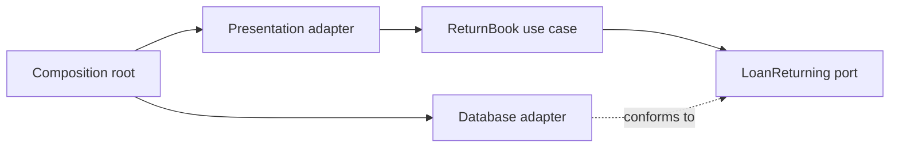

Clean Architecture organizes source dependencies so application policy does not depend on UI frameworks, databases, or transport libraries. The inner use case defines what it needs; outer adapters supply those capabilities.

This is a dependency rule, not a prescribed number of folders. A project can have four beautifully named layers while its business rules still depend on a database context passed through every method.

<!--more-->

The Swift 5.7 example returns a borrowed book. It puts validation in the use case and an atomic return operation behind a port. It also makes retry identity explicit, because a timeout must not cause inventory to be incremented twice.

## Define the inner contract in domain terms

```swift
struct ReturnRequest: Equatable {
    let loanID: Int
    let operationID: String
}
enum ReturnDisposition: Equatable { case returned, alreadyReturned }
struct ReturnReceipt: Equatable {
    let loanID: Int
    let disposition: ReturnDisposition
}
enum ReturnFailure: Error, Equatable {
    case invalidRequest, missingLoan, operationConflict
}
protocol LoanReturning {
    func commitReturn(_ request: ReturnRequest) throws -> ReturnReceipt
}
struct ReturnBook {
    let loans: any LoanReturning
    func execute(_ request: ReturnRequest) throws -> ReturnReceipt {
        guard request.loanID > 0, !request.operationID.isEmpty,
              request.operationID.utf8.count <= 64 else { throw ReturnFailure.invalidRequest }
        return try loans.commitReturn(request)
    }
}
```

The port describes one operation whose atomicity matters. A generic `load`, then `save`, then `incrementInventory` API would leave callers to coordinate a race-sensitive transaction.

The use case knows neither a database row nor a UIKit controller. Its input and output belong to the application contract. In a larger module, place the protocol beside that contract and let the persistence target import the application target, not the other way around.

The operation ID is not authentication. A real boundary must establish the account and permission context, and scope deduplication records accordingly. An arbitrary client string does not authorize returning another person's loan.

## Make the adapter's guarantee observable

```swift
final class MemoryLoanReturns: LoanReturning {
    private var activeLoans: Set<Int>
    private var knownLoans: Set<Int>
    private var completed: [String: (ReturnRequest, ReturnReceipt)] = [:]
    private(set) var restocked = 0
    init(activeLoans: Set<Int>) {
        self.activeLoans = activeLoans
        knownLoans = activeLoans
    }
    func commitReturn(_ request: ReturnRequest) throws -> ReturnReceipt {
        if let (oldRequest, receipt) = completed[request.operationID] {
            guard oldRequest == request else { throw ReturnFailure.operationConflict }
            return receipt
        }
        guard knownLoans.contains(request.loanID) else { throw ReturnFailure.missingLoan }
        let disposition: ReturnDisposition
        if activeLoans.remove(request.loanID) != nil {
            precondition(restocked < Int.max)
            restocked += 1
            disposition = .returned
        } else { disposition = .alreadyReturned }
        let receipt = ReturnReceipt(loanID: request.loanID, disposition: disposition)
        completed[request.operationID] = (request, receipt)
        return receipt
    }
}
```

This in-memory adapter requires serialized access and performs no suspension between checking and updating. A database adapter needs a transaction or equivalent conditional operation covering the loan transition, inventory change, and operation record.

Durable idempotency also needs a retention policy and a defined key scope. This dictionary survives only as long as the object. It demonstrates the contract, not crash recovery or cross-process consistency.

Returning the original receipt for the same operation is deliberate. A retry of an operation that first returned `.returned` receives that same result rather than a different `.alreadyReturned` result. A different operation on the already returned loan receives the latter disposition without another restock.

## Test inner behavior through the port

```swift
let storage = MemoryLoanReturns(activeLoans: [7, 8])
let useCase = ReturnBook(loans: storage)
let request = ReturnRequest(loanID: 7, operationID: "return-7")
let first = try useCase.execute(request)
let retry = try useCase.execute(request)
assert(first == retry && first.disposition == .returned)
let again = try useCase.execute(ReturnRequest(loanID: 7, operationID: "another-7"))
assert(again.disposition == .alreadyReturned && storage.restocked == 1)
do {
    _ = try useCase.execute(ReturnRequest(loanID: 8, operationID: "return-7"))
    assertionFailure("An operation ID cannot be reused for different input")
} catch ReturnFailure.operationConflict {}
do {
    _ = try useCase.execute(ReturnRequest(loanID: 0, operationID: "bad"))
    assertionFailure("Invalid input must not commit")
} catch ReturnFailure.invalidRequest {}
assert(storage.restocked == 1)
```

A separate adapter conformance suite should run the same scenarios against the real database implementation. A fake satisfying the protocol proves the use case can be exercised in isolation; it does not prove the database honors the atomicity promise.

## Dependency direction differs from runtime calls



At runtime, `ReturnBook` invokes an object implemented by the database adapter. In source code, it refers only to `LoanReturning`. Dependency inversion allows that outward runtime call while preserving an inward source dependency.

The composition root is allowed to know concrete implementations because its job is assembly. Hiding construction behind a global service locator does not strengthen the dependency rule; it can make the actual graph harder to inspect.

## Put policy at the boundary that can enforce it

The use case validates request shape. The storage operation enforces atomic return semantics. A presentation adapter maps outcomes to language and navigation. These are different guarantees, and each needs evidence at its own boundary.

If business policy requires a maximum return window, obtain authoritative time or loan facts through a suitable capability and enforce the rule where concurrent changes cannot invalidate the decision before commit. Checking a stale snapshot in the UI is insufficient.

Likewise, adding notification after a successful return introduces partial completion. A durable requirement may call for pending work recorded with the transaction, followed by a sender with retries. Clean Architecture names dependency direction; it does not make several external effects atomic.

## Avoid abstractions that leak their implementation

A port returning `NSManagedObject`, a vendor query builder, or an HTTP response object makes inner policy learn outer lifecycle details. Translate to stable values before crossing the boundary unless that framework is intentionally part of the application's core contract.

Do not interpret this as a ban on all Foundation types. A value such as `UUID` can be a reasonable domain identifier. The question is whether the dependency exposes volatile mechanisms or makes the use case inseparable from an infrastructure lifecycle.

Use-case boundaries should also reflect actual operations. A repository with dozens of unrelated methods can force every test to understand far more than one consumer needs. Split capabilities at meaningful consumer seams, not automatically one protocol per concrete class.

## Case study: a second delivery channel reuses the use case

Suppose a staff tablet and a background import both return loans. If the return rule lives in the tablet presenter, the import either duplicates it or bypasses it. With a use-case contract, both entry adapters translate their inputs into `ReturnRequest` and consume `ReturnReceipt` without importing one another's UI.

Their presentation needs can differ. The tablet might show an already-returned message; the importer might record that disposition as an idempotent reconciliation outcome. The use case preserves the fact, and each caller chooses its appropriate representation.

The operation ledger also exposes a subtle policy: how long must a retry remain recognizable? An in-memory map cannot answer that across relaunch. A persistent adapter must define key scope, expiry, and whether an expired key can safely be reused. The inner contract should not promise indefinite exactly-once behavior if infrastructure retains keys for only a bounded period.

A data migration can preserve the use-case boundary while changing the adapter, but both implementations must agree about these semantics. Run shared contract tests for repeated IDs, mismatched input, missing loans, and concurrent returns. Merely producing the same happy-path receipt is insufficient.

This is the practical benefit of inward dependency direction: consumers can remain stable while mechanisms change, provided the contract's meaning remains stable too. The compiler can enforce imports and signatures; it cannot establish that a newly substituted adapter preserves atomicity or retry guarantees.

When reviewing a boundary, write down both kinds of evidence. A module build proves the dependency direction is possible. An adapter conformance suite proves selected semantic promises. A production recovery test establishes behavior across the failures the in-memory example cannot represent.

## Exercise: add a persistent adapter

Implement the return operation with a real transaction and run the same retry and conflict cases against it. Simulate a response lost after commit and verify retrying the same operation ID returns the original receipt. Document how long deduplication records remain valid and what happens after that period.

Robert C. Martin's original [Clean Architecture article](https://blog.cleancoder.com/uncle-bob/2012/08/13/the-clean-architecture.html) explains the dependency rule. The transaction and retry policies here are explicit application contracts built around that rule.

Return to the [App Architectures roadmap](/swift-architectures/).
