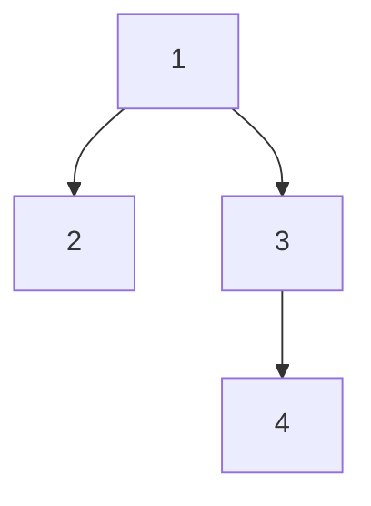

A binary tree gives each node up to two children. It does not automatically provide fast lookup: a binary search tree adds an ordering invariant, a heap adds a priority invariant, and an expression tree assigns meaning to position.

Understanding the plain shape first makes those stronger structures easier to reason about. Traversal order and height are properties of the representation, not incidental implementation choices.

<!--more-->

The examples use Swift 5.7 and immutable recursive values. Empty children are represented explicitly, so a node with only a right child remains distinguishable from one with only a left child.

## Represent shape without inventing a sentinel payload

```swift
indirect enum BinaryTree<Element> {
    case empty
    case node(left: BinaryTree, value: Element, right: BinaryTree)

    func fold<Result>(empty: Result, combine: (Result, Element, Result) -> Result) -> Result {
        switch self {
        case .empty: return empty
        case let .node(left, value, right):
            return combine(left.fold(empty: empty, combine: combine), value,
                           right.fold(empty: empty, combine: combine))
        }
    }
}

let tree = BinaryTree<Int>.node(
    left: .node(left: .empty, value: 2, right: .empty),
    value: 1,
    right: .node(left: .empty, value: 3, right:
        .node(left: .empty, value: 4, right: .empty))
)
let count = tree.fold(empty: 0) { left, _, right in 1 + left + right }
let height = tree.fold(empty: 0) { left, _, right in 1 + max(left, right) }
assert(count == 4 && height == 3)
```

An empty tree has height zero; a leaf has height one. Some texts count edges instead, assigning a leaf height zero. Both conventions work, but formulas and balance checks must use one consistently.

The fold visits children before combining the parent, making it suitable for subtree summaries. It does not guarantee constant work if the combining closure itself concatenates long arrays or performs expensive searches.

## Traversal order expresses a dependency

Preorder processes the parent before its children. Inorder processes left, parent, then right. Postorder processes children before the parent.

For a binary search tree, inorder yields sorted keys because of its additional key invariant. For an arbitrary binary tree, inorder is simply an order of visitation. Our sample's root is `1` with left child `2`, so it is intentionally not a search tree.



Preorder is `1, 2, 3, 4`; inorder is `2, 1, 3, 4`; postorder is `2, 4, 3, 1`. Those differences matter when a parent needs child results before it can be evaluated.

## Make the traversal stack explicit

```swift
func preorder<T>(_ tree: BinaryTree<T>) -> [T] {
    var pending = [tree]
    var output: [T] = []
    while let current = pending.popLast() {
        guard case let .node(left, value, right) = current else { continue }
        output.append(value)
        pending.append(right)
        pending.append(left)
    }
    return output
}

assert(preorder(tree) == [1, 2, 3, 4])
assert(preorder(BinaryTree<Int>.empty).isEmpty)
```

Push right first because the stack removes the most recently pushed item. Reversing those pushes produces root-right-left traversal, not the documented order.

The explicit stack avoids recursive call frames during traversal. It still requires storage proportional to the unfinished frontier, bounded by `O(h)` for this depth-first binary traversal, plus the `O(n)` output.

Recursive construction, folds, or destruction can have their own deep-tree behavior. Replacing one traversal with a loop is not a blanket stack-safety guarantee for every operation on a recursive representation.

## Height controls the difference between balanced and chain-shaped trees

For `h` levels, a binary tree can contain at most:

$$
n\le 1+2+\cdots+2^{h-1}=2^h-1.
$$

Therefore any binary tree holding `n` nodes needs at least `ceil(log₂(n+1))` levels. A chain can require `n` levels. Balanced search structures maintain a stronger invariant to keep height logarithmic.

A perfect tree fills every level. A complete tree fills levels from left to right, with only the last potentially incomplete. A full tree gives every internal node exactly two children. These definitions are different; a tree can be full without being complete or balanced.

An array representation works especially well for complete trees, where children of index `i` are at `2i + 1` and `2i + 2`. For a sparse chain, preserving those positions can waste enormous space. Choose representation from shape constraints.

## Structural transformations preserve earlier values

```swift
func mirrored<T>(_ tree: BinaryTree<T>) -> BinaryTree<T> {
    switch tree {
    case .empty: return .empty
    case let .node(left, value, right):
        return .node(left: mirrored(right), value: value, right: mirrored(left))
    }
}
assert(preorder(mirrored(tree)) == [1, 3, 4, 2])
assert(preorder(tree) == [1, 2, 3, 4])
assert(preorder(mirrored(mirrored(tree))) == preorder(tree))
```

The final assertion compares traversal observations for this fixture. Preorder values alone do not prove structural equality when duplicate payloads exist. A serialization that records empty children, or a structural equality implementation, is needed to distinguish every shape.

This is an important testing lesson: equal node counts and equal traversed values can conceal different parent-child relationships.

## Expression evaluation is a postorder problem

An expression node representing addition needs its left and right values before producing a result. A postorder fold matches that dependency naturally. A serializer producing a prefix language might instead choose preorder with explicit markers.

Input-derived expressions need depth limits and checked arithmetic. A well-typed tree can still be deep enough to exhaust resources or contain operations whose result overflows.

For ordered membership, continue with the [persistent binary search tree implementation](/swift-functional-trees-tries/). It adds the left-less-than-right invariant that this article deliberately does not assume.

## Same traversal values can conceal different shapes

A root `A` with only a left child `B` and a root `A` with only a right child `B` both have preorder payloads `A, B`. They also have the same node count and height.

A serialization that includes empty markers distinguishes them. For example, a prefix representation can encode a node tag followed by payload, left subtree, and right subtree, with a separate tag for empty. The decoder then knows exactly where each child ends.

This illustrates why tests should observe the property the algorithm claims to preserve. A mirror-twice check based only on payload preorder is weaker than structural equality, especially when payloads repeat.

## Trees can be views of graphs with extra constraints

A class-node representation permits accidentally attaching the same child below two parents, producing a DAG, or attaching an ancestor below a descendant, producing a cycle. A traversal assuming a tree can then duplicate work or never terminate.

The recursive value enum naturally describes a finite tree-shaped value at its interface. A reference-backed importer needs validation of parent relationships and cycles before exposing tree-only algorithms.

If shared subexpressions are intentional, model a DAG and use memoization or topological evaluation. Calling it a tree and adding a visited set later can change semantics when repeated occurrences are supposed to be evaluated separately.

## Exercise: serialize shape faithfully

Write preorder serialization that emits a marker for every empty child. Decode it while rejecting truncated and trailing input. Include two trees with the same preorder payloads but different shapes and show that their serialized representations differ.

Then implement iterative postorder using frames with a phase flag. Explain why a stack of nodes without phase information is insufficient for a general combine-after-children operation.

Return to the [Data Structures and Algorithms roadmap](/swift-data-structures-and-algorithms/).
