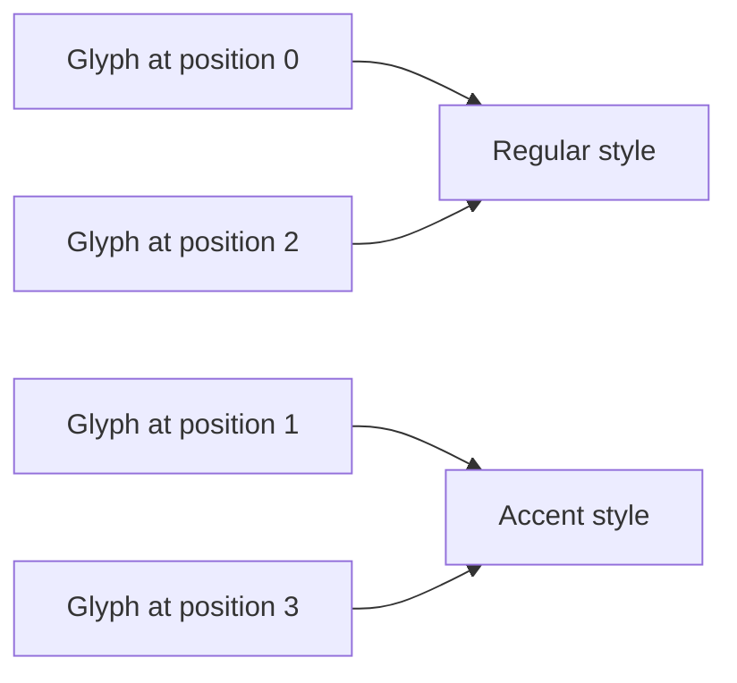

Flyweight shares immutable intrinsic state across many small objects while keeping context-specific state separate. A text layout can share style resources across thousands of glyph placements without making all glyphs share the same position.

The useful distinction is intrinsic versus extrinsic state. Sharing a mutable object simply because it is large can create coupling rather than a memory optimization.

<!--more-->

The Swift 5.7 example interns immutable text styles in a pool and stores positions in independent glyph values. It demonstrates the ownership structure; it does not claim this wrapper outperforms Swift's existing value storage without measurement.

## Give the shared state a complete key

```swift
struct StyleKey: Hashable {
    let font: String
    let points: Int
    let color: String
}

final class SharedStyle {
    let key: StyleKey
    fileprivate init(key: StyleKey) { self.key = key }
}

enum StyleFailure: Error { case invalidSize }
final class StylePool {
    private var styles: [StyleKey: SharedStyle] = [:]
    var count: Int { styles.count }
    func style(for key: StyleKey) throws -> SharedStyle {
        guard (8...72).contains(key.points) else { throw StyleFailure.invalidSize }
        if let existing = styles[key] { return existing }
        let created = SharedStyle(key: key)
        styles[key] = created
        return created
    }
}

struct Glyph {
    let character: Character
    var x: Double
    var y: Double
    let style: SharedStyle
}

let pool = StylePool()
let regularKey = StyleKey(font: "Body", points: 14, color: "ink")
let emphasisKey = StyleKey(font: "Body", points: 14, color: "accent")
let regular = try pool.style(for: regularKey)
let sameRegular = try pool.style(for: regularKey)
let emphasis = try pool.style(for: emphasisKey)
assert(regular === sameRegular && regular !== emphasis)
assert(pool.count == 2)
```

The key includes every intrinsic property used by this model. Omitting color would let a request for an accent style incorrectly reuse an ink style.

A real font resource may also depend on weight, variation axes, locale, scale, and rendering configuration. Cache identity must include the facts the resource actually depends on, or the shared result becomes stale or incompatible.

## Keep placement outside the flyweight

```swift
let glyphs = (0..<1_000).map { index in
    Glyph(character: "A", x: Double(index), y: 0,
          style: index % 2 == 0 ? regular : emphasis)
}
var moved = glyphs[0]
moved.x = 500
assert(glyphs[0].x == 0)
assert(moved.style === glyphs[0].style)
assert(glyphs[0].style === glyphs[2].style)
```

Moving one placement changes a value, not a shared style. Editing the style should produce or select another immutable flyweight rather than mutating a resource used by every placement.

The example stores a Swift `Character`, which can be an extended grapheme cluster. Actual text shaping can map characters to glyphs in more complex ways; this is a resource-sharing model, not a full typography engine.



## Estimate savings with the actual representation

If `n` placements would otherwise duplicate intrinsic storage `S`, and only `k` unique styles exist, a rough model is:

$$
M_{\mathrm{naive}}\approx n(S+P),\qquad
M_{\mathrm{shared}}\approx kS+n(P+R)+M_{\mathrm{pool}}.
$$

`P` is per-placement state and `R` is reference overhead. Savings depend on `k` being small relative to `n` and on intrinsic storage actually being duplicated in the alternative.

Swift arrays, strings, and other values can already share buffers through copy-on-write. Replacing a small value with a class reference and a dictionary lookup may increase overhead rather than reduce it. Measure retained memory and access cost on representative layouts.

## Interning and caching have different promises

An interning pool can promise that equal live keys resolve to the same canonical identity within one pool. A cache usually promises a reusable result but may evict and recreate it.

If consumers depend on `===`, eviction changes what that identity means over time. Prefer value equality for semantic comparisons unless canonical identity is a deliberate requirement.

Two independent pools can return different objects for equal keys. The scope of sharing is the pool, not automatically the process. A document or rendering session may be the right owner when resources depend on its configuration.

## An unbounded pool can become a retention problem

The small pool here holds each created style strongly. If users can request arbitrarily many distinct sizes or colors, the dictionary grows with distinct keys rather than with currently visible glyphs.

A document-scoped pool naturally releases its entries when the document closes. A process-wide pool may instead need eviction, weak references, or a bounded key space. Each choice changes identity guarantees. With eviction, requesting the same key later can produce a different instance with equivalent value.

That can be perfectly valid when clients depend on style values. It is a breaking change if clients use reference identity as a permanent external identifier. Keep the pool's identity-sharing guarantee local to the period and scope in which it is actually maintained.

Resource reclamation may also require a particular thread or executor, especially for graphics-backed objects. Sharing a resource does not remove its cleanup requirements.

## Intrinsic state must remain immutable in practice

`SharedStyle.key` is immutable, and its fields are values. Adding a mutable color property would let one glyph's style edit change every glyph using that flyweight.

A reference to a mutable external configuration can break immutability even if the flyweight's property is `let`. Capture the resolved facts or a versioned immutable resource, not a live settings object whose answers can change.

Likewise, lazy initialization inside a shared resource needs synchronization. Immutable public fields do not prove that every private cache is safe under concurrent access.

## Test key completeness and independent context

Request the same key repeatedly and verify sharing within one pool. Change each key field separately and verify an appropriate distinct resource appears. Reject unsupported sizes before inserting a partial entry.

Copy and move placements while checking their coordinates remain independent. If styles wrap external resources, test that a resource remains alive while a placement needs it and is released according to the pool policy afterward.

Do not use object-count reduction alone as proof of lower memory. Include dictionary entries, reference counting, keys, and retained payloads in the measurement.

## The key defines which objects may share

A style key is more than a lookup optimization. It declares that two requests with equal keys are interchangeable for the operation. If rendering depends on a missing key field, the pool can return a style created under the wrong conditions.

For example, an application might later add a locale-sensitive font choice or a display-scale-dependent resource. Those inputs must either become part of the key or belong to a separate layer whose behavior is independent of the shared style. An incomplete key creates a correctness bug even if memory usage improves.

Canonicalization also needs care. Lowercasing a font family name or rounding a point size may improve reuse, but it changes equality. Apply such normalization only when the rendering contract treats the normalized values as equivalent. A pool should not silently merge visually distinct styles to achieve a better hit rate.

## Measure retained memory, not just allocation counts

Fewer constructed objects do not always mean proportionally less memory. Dictionary buckets, object headers, reference storage, and retained capacities contribute overhead. Swift's value representations may already share some storage through copy-on-write, so a class-based flyweight can add indirection without saving the expected bytes.

Use a representative document with realistic repetition. Compare peak memory, retained memory after closing the document, construction time, and rendering performance. A workload with almost entirely unique styles may favor direct value storage.

The strongest design benefit here is explicit separation: shared immutable style and per-glyph placement have different owners. Even if measurement later favors a different representation, preserve that separation so changing one glyph's position cannot accidentally move every glyph using its style.

## Exercise: add a bounded style cache

Choose a maximum style count and an eviction policy. Define whether live glyphs can continue using an evicted style, and whether later equal-key requests may return a new identity. Verify eviction affects pool retention without changing existing glyph rendering facts.

Return to the [Design Patterns roadmap](/swift-design-patterns/).
