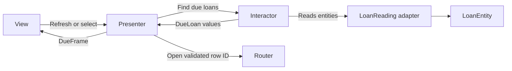

VIPER separates a feature into View, Interactor, Presenter, Entity, and Router roles. Its value is in the boundaries: use-case work can change independently from presentation formatting, and navigation can change independently from both.

Five filenames do not establish those boundaries. A presenter that performs storage transactions and a router that validates business rules still mix responsibilities, regardless of their names.

<!--more-->

This Swift 5.7 example implements a due-soon loan list. The interactor selects eligible loans from a store; the presenter formats display data; the view receives a complete frame; the router receives validated navigation intent. The example uses plain Swift so the use case is executable without a UI framework.

## Put the entity and use case before presentation

```swift
struct LoanEntity: Equatable {
    let id: Int
    let title: String
    let dueDay: Int
}
struct DueLoan: Equatable {
    let id: Int
    let title: String
    let daysRemaining: Int
}
protocol LoanReading { func loans() throws -> [LoanEntity] }
protocol DueLoanFinding { func dueSoon(today: Int) throws -> [DueLoan] }
enum LoanListFailure: Error { case invalidDay, unavailable }

struct DueLoanInteractor: DueLoanFinding {
    let source: any LoanReading
    func dueSoon(today: Int) throws -> [DueLoan] {
        guard (0...1_000_000).contains(today) else { throw LoanListFailure.invalidDay }
        return try source.loans().compactMap { loan in
            guard loan.dueDay >= today, loan.dueDay <= today + 7 else { return nil }
            return DueLoan(id: loan.id, title: loan.title, daysRemaining: loan.dueDay - today)
        }.sorted {
            if $0.daysRemaining != $1.daysRemaining { return $0.daysRemaining < $1.daysRemaining }
            return $0.id < $1.id
        }
    }
}
```

The bounded integer day is a deterministic example calendar. A production feature needs an injected calendar and reference time, with a clear definition of “due today” across time zones. Do not replace civil-day logic with an unexplained multiple of seconds.

The interactor returns a use-case result with only the facts presentation needs. It does not return mutable persistence objects or require the presenter to filter database rows itself.

## Let the presenter prepare a view contract

```swift
struct DueRow: Equatable { let id: Int; let title: String; let subtitle: String }
struct DueFrame: Equatable { let rows: [DueRow]; let message: String? }
protocol DueDisplaying: AnyObject { func display(_ frame: DueFrame) }
protocol DueRouting: AnyObject { func openLoan(id: Int) }

final class DuePresenter {
    private let interactor: any DueLoanFinding
    private let router: any DueRouting
    private weak var view: (any DueDisplaying)?
    private var visibleIDs: Set<Int> = []
    private var current = DueFrame(rows: [], message: nil)
    init(interactor: any DueLoanFinding, router: any DueRouting) {
        self.interactor = interactor; self.router = router
    }
    func attach(_ view: any DueDisplaying) { self.view = view; view.display(current) }
    func refresh(today: Int) {
        do {
            let loans = try interactor.dueSoon(today: today)
            visibleIDs = Set(loans.map(\.id))
            let rows = loans.map { loan in
                DueRow(id: loan.id, title: loan.title,
                       subtitle: loan.daysRemaining == 0 ? "Due today" : "Due in \(loan.daysRemaining) days")
            }
            current = DueFrame(rows: rows, message: rows.isEmpty ? "No loans due soon." : nil)
        } catch {
            visibleIDs = []
            current = DueFrame(rows: [], message: "Loans could not be loaded.")
        }
        view?.display(current)
    }
    func selected(id: Int) {
        guard visibleIDs.contains(id) else { return }
        router.openLoan(id: id)
    }
}
```

The presenter maps a successful empty list differently from a load failure. Its selection guard prevents a stale or invented row ID from being routed under this screen's current presentation. The destination's use case must still validate authoritative access and existence.

This synchronous source is appropriate for the in-memory example. A remote implementation needs an asynchronous use-case contract and request acceptance policy. Do not conceal network waiting inside this signature on the UI thread.

## Assemble and test the module

```swift
struct FixtureLoans: LoanReading {
    let values: [LoanEntity]
    func loans() throws -> [LoanEntity] { values }
}
final class DueViewSpy: DueDisplaying {
    var frame: DueFrame?
    func display(_ frame: DueFrame) { self.frame = frame }
}
final class DueRouterSpy: DueRouting {
    var opened: [Int] = []
    func openLoan(id: Int) { opened.append(id) }
}
let source = FixtureLoans(values: [
    LoanEntity(id: 1, title: "Today", dueDay: 100),
    LoanEntity(id: 2, title: "Next week", dueDay: 107),
    LoanEntity(id: 3, title: "Later", dueDay: 108),
    LoanEntity(id: 4, title: "Overdue", dueDay: 99)
])
let interactor = DueLoanInteractor(source: source)
let result = try interactor.dueSoon(today: 100)
assert(result.map(\.id) == [1, 2])
let view = DueViewSpy()
let router = DueRouterSpy()
let presenter = DuePresenter(interactor: interactor, router: router)
presenter.attach(view)
presenter.refresh(today: 100)
assert(view.frame?.rows.first?.subtitle == "Due today")
presenter.selected(id: 3)
presenter.selected(id: 2)
assert(router.opened == [2])
presenter.refresh(today: 200)
assert(view.frame?.rows.isEmpty == true && view.frame?.message == "No loans due soon.")
```

The composition root supplies the concrete dependencies. In UIKit, the view controller can implement `DueDisplaying`, retain its presenter, and forward refresh and row-selection actions. The presenter keeps its view weakly; the router must avoid retaining the entire graph through an unintended cycle.

An assembly object may retain the router and navigation adapter for the feature lifetime. Weakening every reference indiscriminately is not a solution: necessary collaborators can disappear before use. Draw intended strong ownership first.

## Draw the role boundaries



Runtime communication is not the same as source dependency direction. Protocols should be placed so application policy does not import concrete UI or persistence modules. A diagram with many arrows does not prove the dependency rule is enforced.

## Keep each role from absorbing the others

The interactor owns the due-soon rule, including boundary days and ordering. The presenter owns human-facing subtitles and empty-state text. The router owns destination construction and transition mechanics. The view owns layout and event wiring.

If the due-soon policy is reused in a notification workflow, reuse the use case rather than create a headless presenter. If two layouts share the same presentation policy, they may share a presenter contract. If only typography matches, a reusable view component may be the right boundary.

VIPER can support large teams by making these seams explicit, but it adds assembly and protocol maintenance. A trivial static screen may not benefit from every role being a separate object. Combine responsibilities only when their reasons to change genuinely coincide, and keep the public contract clear.

## Test failures and lifecycle separately

The happy path above does not establish storage-failure rendering or router construction. Add a throwing source to verify failure differs from empty content, and an integration test showing that a visible row reaches the actual navigation adapter.

For async work, test a completion after teardown and a response from a replaced request. The acronym supplies no cancellation policy. For routing, test interactive back navigation and release of child modules, not merely that `openLoan` was called.

## Case study: a due-soon widget and an overdue screen

A widget can reuse the due-soon use case while applying a different presentation, such as one title and a count of remaining items. It should not instantiate a screen presenter merely to obtain the filtered loans.

An overdue screen has a different selection rule. Reusing the same interactor with an undocumented negative-day interpretation would obscure that difference. Introduce a named query or an explicit window policy whose boundary semantics are tested. Shared storage access does not require every product operation to share the same use-case type.

Calendar boundaries deserve special care. “Within seven days” might include today and the seventh following civil day, as this example does. Another product might mean the next seven full days excluding today. A daylight-saving transition makes fixed-hour arithmetic a poor substitute for a stated civil-calendar rule.

Capture the reference date once per request. If each row asks a real clock for now independently, a midnight transition can make one response internally inconsistent. Injecting reference time also lets tests place loans exactly on both boundaries.

The presenter should receive enough information to format the chosen meaning without recomputing eligibility. A relative-day count is suitable for this example; a localized date formatter may also need the due date and calendar context. Keep that formatting dependency explicit.

This comparison shows where VIPER's extra roles can help: use-case selection and human-readable representation evolve independently. It also shows where careless reuse can hurt: sharing a class name is not a reason to merge two different business questions into one ambiguous method.

## Exercise: add an overdue section

Extend the use case to return overdue and upcoming groups, with explicit ordering and boundary rules. Keep calendar decisions out of the presenter and localized headings out of the interactor. Verify the same use-case result can drive a compact widget and a full screen without exposing persistence objects.

The original [VIPER article by Jeff Gilbert and Conrad Stoll](https://www.objc.io/issues/13-architecture/viper/) describes the role separation. This example supplies its own domain, contracts, and tests.

Return to the [App Architectures roadmap](/swift-architectures/).
