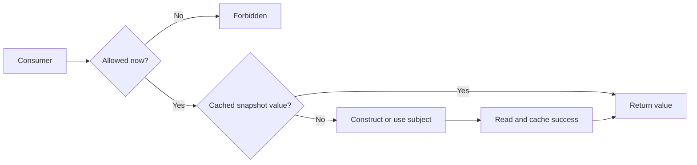

A proxy presents a subject's interface while controlling access to that subject. It may defer construction, check permission, or reuse a cached value. Consumers call the same capability, while the proxy owns an access policy.

The dangerous shortcut is treating a cache hit as permission to skip every other check. Revocation and account scope still matter even when bytes are already in memory.

<!--more-->

This Swift 5.7 example combines protection, deferred construction, and success caching around an immutable document snapshot. It requires serialized access; a concurrent proxy needs isolation and an in-flight request policy.

## Preserve the subject interface

```swift
struct Document: Equatable { let id: Int; let body: String }
protocol DocumentReading {
    func read(id: Int) throws -> Document
}

enum DocumentFailure: Error, Equatable { case missing(Int) }
struct SnapshotDocuments: DocumentReading {
    let documents: [Int: Document]
    func read(id: Int) throws -> Document {
        guard let document = documents[id] else { throw DocumentFailure.missing(id) }
        return document
    }
}

enum ProxyFailure: Error { case forbidden, reentrantConstruction }
final class ProtectedDocumentProxy: DocumentReading {
    private enum SubjectState {
        case absent
        case constructing
        case ready(any DocumentReading)
    }
    private var state: SubjectState = .absent
    private var cache: [Int: Document] = [:]
    private let mayRead: (Int) -> Bool
    private let makeSubject: () throws -> any DocumentReading

    init(mayRead: @escaping (Int) -> Bool,
         makeSubject: @escaping () throws -> any DocumentReading) {
        self.mayRead = mayRead
        self.makeSubject = makeSubject
    }

    private func subject() throws -> any DocumentReading {
        switch state {
        case let .ready(subject): return subject
        case .constructing: throw ProxyFailure.reentrantConstruction
        case .absent:
            state = .constructing
            do {
                let created = try makeSubject()
                state = .ready(created)
                return created
            } catch {
                state = .absent
                throw error
            }
        }
    }

    func read(id: Int) throws -> Document {
        guard mayRead(id) else { throw ProxyFailure.forbidden }
        if let cached = cache[id] { return cached }
        let document = try subject().read(id: id)
        cache[id] = document
        return document
    }
}
```

Permission is checked before cache lookup and before subject construction. An unauthorized request neither returns retained content nor acquires the real subject.

The subject is an immutable snapshot for this proxy's lifetime, making cached successful reads compatible with its freshness contract. A live repository would need a version, expiry, or invalidation policy instead.

## Verify deferred creation and revocation

```swift
var allowed: Set<Int> = []
var constructions = 0
let proxy = ProtectedDocumentProxy(mayRead: { allowed.contains($0) }) {
    constructions += 1
    return SnapshotDocuments(documents: [1: Document(id: 1, body: "Private draft")])
}
do {
    _ = try proxy.read(id: 1)
    assertionFailure("The initial request must be rejected")
} catch ProxyFailure.forbidden {}
assert(constructions == 0)
allowed.insert(1)
let document = try proxy.read(id: 1)
let cached = try proxy.read(id: 1)
assert(document == cached && constructions == 1)
allowed.remove(1)
do {
    _ = try proxy.read(id: 1)
    assertionFailure("A cached value must not bypass revocation")
} catch ProxyFailure.forbidden {}
```

The mutable set is a serial test policy, not a complete authentication system. A production policy must receive trustworthy account and authorization facts from its actual security boundary.

Revocation stops later reads through this API. It does not erase values already returned to a caller or revoke arbitrary copies elsewhere in the process.

## Keep cache identity aligned with scope

A document ID may be unique only within an account. Reusing one global proxy while switching its account policy can then return account A's cached document for account B's equal numeric ID.

Scope the proxy and subject to one account snapshot, or include account and version in the cache key and invalidation protocol. A successful permission check against a new account does not make an old account's cached payload correct.

The same issue applies to locale, schema, and server environment. A key must include every dependency the returned value changes with.



## Construction and reading can fail independently

A failed subject factory resets the state to absent, allowing retry. A reentrant attempt reports a distinct failure instead of recursively constructing another subject.

Once construction succeeds, a missing document does not destroy the subject. Only successful reads enter the cache; an error is propagated rather than converted to an empty document.

Caching failures is another policy that may be appropriate for an immutable snapshot but not for a transient live service. Name the lifetime and retry behavior before choosing it.

## Concurrency adds more than a dictionary lock

If subject construction or reading suspends, several callers may enter while earlier work is in flight. An actor can serialize bookkeeping, but actor reentrancy still requires sharing or distinguishing pending work explicitly.

Invalidation after a newer request must not be undone by a stale completion writing into the cache. Associate work with a generation and accept results only for the matching snapshot.

Cancellation also needs ownership: one caller losing interest should not necessarily cancel shared work awaited by others. A proxy's convenient interface can otherwise conceal surprising cross-caller effects.

## Proxy and Decorator share mechanics but differ in intent

Both can forward through the same protocol. Proxy emphasizes controlling access to a subject, often including its creation or location. Decorator emphasizes adding composable behavior around an existing capability.

A caching wrapper can reasonably be described by either intent in different designs. The useful discussion is its authorization, freshness, lifetime, and failure contract, not winning an argument over one class label.

## Revocation changes the meaning of a cache hit

The authorization check deliberately precedes both lazy construction and cached return. A successful read yesterday does not grant permission today. Reversing those steps would let the cache bypass a revoked access policy.

That check still has a precise limit: it establishes permission according to the local policy at the moment it runs. A remote server remains responsible for enforcing access when it performs an operation. If authorization can change while a request is in flight, the server's decision cannot safely be replaced by a prior client-side check.

The same issue appears with account switching. A proxy created for one account should not hand a cached private document to another account merely because the document ID is the same. Include the account and version in cache scope, or destroy the old proxy when the owning session ends.

Revocation may also require clearing retained content. Preventing new reads does not erase strings already returned to callers. If the product needs visible content removed on logout, the presentation layer and every relevant cache must participate in that lifecycle.

## A proxy preserves a role while changing access mechanics

A remote proxy can offer the same conceptual capability as a local object, but latency and partial failure remain observable. A synchronous interface that hides a network call can block a UI thread. An async interface makes waiting explicit and permits cancellation.

Do not pretend that a remote property read has the cost and certainty of accessing a local field. If callers need batching, freshness control, or an explicit load state, expose those operations in the capability rather than relying on transparent-looking syntax.

This also distinguishes proxy and facade. The proxy stands in for a particular subject capability. A facade coordinates several capabilities into a higher-level use case. They can be composed, but their reasons to change differ.

## Construction failures should leave a recoverable state

The explicit `constructing` state catches reentrant construction. If initialization throws, returning to `absent` allows a later attempt rather than leaving the proxy permanently stuck. Whether a particular failure should be retried remains a policy choice; a missing configuration might deserve a stable failure until the configuration changes.

Test construction count, source-read count, and policy-check count independently. A returned-value assertion cannot reveal unauthorized construction, duplicate expensive initialization, or a cache hit that skipped the permission check. These observations are part of the proxy's behavioral contract.

## Exercise: add snapshot invalidation

Introduce a snapshot version and explicit replacement of the subject factory. Clear or partition cached values by version. Test a read completing after a newer snapshot becomes active and verify obsolete content cannot repopulate the current cache.

For the underlying lifecycle problem, see [Lazy Initialization](/swift-lazy-initialization/).

Return to the [Design Patterns roadmap](/swift-design-patterns/).
