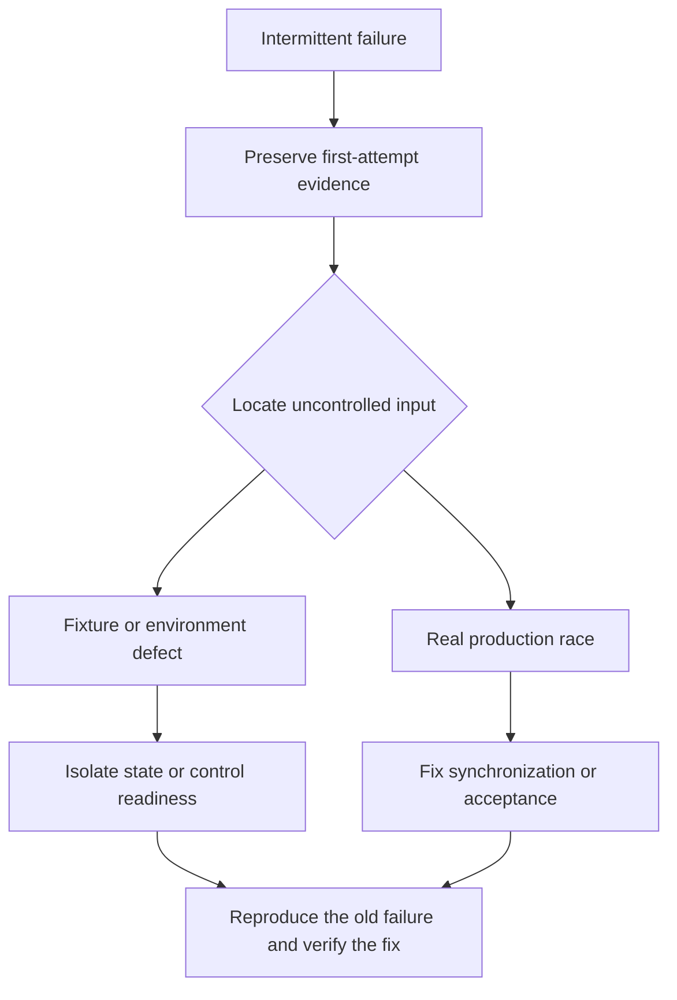

A flaky test passes and fails with the same code under conditions the test did not control. The cause may be a weak test fixture, an unreliable environment, or a real concurrency bug in production code. Calling the failure “flaky” identifies a symptom; it does not establish that the product is correct.

Reliable tests replace timing guesses and hidden shared state with explicit contracts. They also finish the work they start, so one test cannot leave callbacks or files behind for another.

<!--more-->

This Swift 5.7 article uses XCTest and a manual scheduler to test debounce without wall-clock waiting. It also delivers callbacks after cancellation to expose stale-result bugs that an overly cooperative fake would conceal.

## Diagnose the uncontrolled input

| Symptom | Likely uncontrolled input | Focused investigation |
|---|---|---|
| Passes alone, fails in the suite | Shared state or leaked work | Fixture ownership and teardown |
| Fails only on busy CI workers | Timing assumption | Awaited completion or readiness |
| Fails near midnight | Clock, calendar, or time zone | Supplied reference time |
| Changes with parallel workers | Shared namespace or global handler | Per-test resource scope |
| Old content appears after cancellation | Callback ordering | Result acceptance identity |
| Screenshot differs across machines | Rendering environment | Device, locale, fonts, and OS |

Preserve the first failure's evidence: test identity, revision, seed, worker, environment, timestamps, and relevant logs. Repeated reruns without that evidence can turn a reproducible ordering defect into a mystery.

If the failure is a real race, fix the production acceptance or synchronization rule. Serializing the test suite might conceal it while the application remains vulnerable.

## Replace sleeping with a controllable scheduler

A debounce test that sleeps for roughly the debounce interval is racing the scheduler. Test the logical deadline directly instead.

```swift
import XCTest

protocol ScheduledCancellation: AnyObject { func cancel() }
protocol DelayedScheduling: AnyObject {
    func schedule(after ticks: Int, action: @escaping () -> Void) -> any ScheduledCancellation
}
final class ScheduleToken: ScheduledCancellation {
    private var cancellation: (() -> Void)?
    init(_ cancellation: @escaping () -> Void) { self.cancellation = cancellation }
    func cancel() { let old = cancellation; cancellation = nil; old?() }
    deinit { cancel() }
}
final class ManualScheduler: DelayedScheduling {
    private struct Job { let due: Int; let action: () -> Void }
    private var jobs: [Int: Job] = [:]
    private var nextID = 0
    private var advancing = false
    private(set) var now = 0

    func schedule(after ticks: Int, action: @escaping () -> Void) -> any ScheduledCancellation {
        precondition(ticks >= 0 && now <= Int.max - ticks && nextID < Int.max)
        nextID += 1
        let id = nextID
        jobs[id] = Job(due: now + ticks, action: action)
        return ScheduleToken { [weak self] in self?.jobs.removeValue(forKey: id) }
    }
    func advance(to target: Int) {
        precondition(target >= now && !advancing)
        advancing = true
        defer { advancing = false }
        var executed = 0
        while let next = jobs.filter({ $0.value.due <= target }).min(by: {
            if $0.value.due != $1.value.due { return $0.value.due < $1.value.due }
            return $0.key < $1.key
        }) {
            precondition(executed < 1_000, "Probable zero-time scheduling loop in fixture")
            executed += 1
            jobs.removeValue(forKey: next.key)
            now = next.value.due
            next.value.action()
        }
        now = target
    }
}
```

Ticks are abstract units in this fixture, not measured milliseconds. A production adapter can map the requested delay to a real scheduler. The test checks deadline policy without depending on how quickly its machine runs.

The scheduler requires serialized access and forbids reentrant `advance`. Jobs at the same deadline run in creation order. It removes a job before invoking arbitrary callback code, so cancelling that job from its callback is harmless.

Tokens cancel on deinitialization, so the owner must retain a token for work it intends to keep. That is an explicit lifetime contract rather than an accidental requirement hidden in a fake.

## Guard the operation as well as requesting cancellation

```swift
final class DebouncedSearch {
    private let scheduler: any DelayedScheduling
    private let delay: Int
    private var token: (any ScheduledCancellation)?
    private var generation = 0
    private var active = true
    private var pending = false
    var perform: ((String) -> Void)?

    init(scheduler: any DelayedScheduling, delay: Int = 300) {
        precondition(delay > 0)
        self.scheduler = scheduler; self.delay = delay
    }
    func changed(_ query: String) {
        guard active else { return }
        precondition(generation < Int.max)
        generation += 1
        let ticket = generation
        pending = true
        token?.cancel()
        token = scheduler.schedule(after: delay) { [weak self] in
            guard let self = self, self.active, self.generation == ticket, self.pending else { return }
            self.pending = false
            self.token = nil
            self.perform?(query)
        }
    }
    func stop() {
        active = false
        pending = false
        token?.cancel()
        token = nil
        perform = nil
    }
    deinit { token?.cancel() }
}
```

This scheduling capability must not invoke a positive-delay action before `schedule` returns. The manual fixture meets that contract. If a different capability permits synchronous completion, token installation needs an additional reentrancy policy.

Cancelling the old token saves obsolete work. The generation protects the state even if an old callback is already queued and cannot be withdrawn. Consuming the pending flag before invoking search also makes duplicate delivery inert. `stop` is terminal for this instance and makes a retained old callback harmless.

## Test both sides of the deadline

```swift
final class DebounceDeadlineTests: XCTestCase {
    func testOnlyTheLatestQueryRunsAfterItsFullDelay() {
        let scheduler = ManualScheduler()
        let search = DebouncedSearch(scheduler: scheduler)
        var queries: [String] = []
        search.perform = { queries.append($0) }
        search.changed("Sw")
        scheduler.advance(to: 200)
        search.changed("Swift")
        scheduler.advance(to: 499)
        XCTAssertTrue(queries.isEmpty)
        scheduler.advance(to: 500)
        XCTAssertEqual(queries, ["Swift"])
        scheduler.advance(to: 1_000)
        XCTAssertEqual(queries, ["Swift"])
        search.stop()
    }
    func testStoppingBeforeTheDeadlinePreventsWork() {
        let scheduler = ManualScheduler()
        let search = DebouncedSearch(scheduler: scheduler)
        var calls = 0
        search.perform = { _ in calls += 1 }
        search.changed("Swift")
        search.stop()
        scheduler.advance(to: 1_000)
        XCTAssertEqual(calls, 0)
    }
}
```

The test proves no early execution, one accepted execution, and no later duplicate. It runs without a debounce-sized sleep. An assertion only after a long wait could pass even if the implementation fired too early.

Negative assertions need a bounded observation interval. Here advancing past every relevant deadline gives that bound. For a real asynchronous source, subscribe before triggering it and wait for the documented completion or cancellation boundary before concluding an event did not occur.

## Make the fake adversarial enough to test acceptance

```swift
final class LateDeliveryScheduler: DelayedScheduling {
    var callbacks: [() -> Void] = []
    private(set) var cancellations = 0
    func schedule(after ticks: Int, action: @escaping () -> Void) -> any ScheduledCancellation {
        callbacks.append(action)
        return ScheduleToken { [weak self] in self?.cancellations += 1 }
    }
}
final class LateDeliveryTests: XCTestCase {
    func testCancelledAndStoppedCallbacksCannotStartSearch() {
        let scheduler = LateDeliveryScheduler()
        let search = DebouncedSearch(scheduler: scheduler)
        var queries: [String] = []
        search.perform = { queries.append($0) }
        search.changed("Old")
        search.changed("Current")
        XCTAssertEqual(scheduler.cancellations, 1)
        scheduler.callbacks[0]()
        XCTAssertTrue(queries.isEmpty)
        scheduler.callbacks[1]()
        scheduler.callbacks[1]() // A duplicate delivery must also be inert.
        XCTAssertEqual(queries, ["Current"])
        search.changed("After")
        search.stop()
        scheduler.callbacks[2]()
        XCTAssertEqual(queries, ["Current"])
    }
}
```

The fake records cancellation but still lets the test invoke a retained callback. This represents the important race without pretending that cancellation is synchronous revocation of every possible delivery.

The test checks cancellation and acceptance separately. That distinction generalizes to network reads, image loading in reused cells, navigation completions, and account-scoped work.

## Remove hidden shared state

Use fresh fixture objects per test. Give temporary files, database namespaces, test accounts, and mock-server routes unique identities. Resetting one shared global before each test does not make parallel execution safe when another test is still using it.

Clean up through the test's ownership boundary. Remove observers, invalidate sessions, cancel tasks, resume controlled continuations, and await test-owned work before returning. A leaked task can make a later test fail even when that later test has correct setup.

Inject locale, calendar, time zone, clock, and randomness when they influence behavior. If randomized testing finds a failure, save the seed and smallest failing input. Replaying only the seed can be insufficient when the generator or iteration order changes later.

## Understand how small flake rates compound

Let `F` count false failures in a suite. If `n` test outcomes independently have false-failure probability `p`, then:

$$
P(F\ge1)=1-(1-p)^n.
$$

For an illustrative `p = 0.01` and `n = 100`, that is about 63.4 percent. This is a hypothetical model, not a measured rate for XCTest or a particular project. Shared infrastructure failures are often correlated, so independence is a simplifying assumption.

The practical consequence is that a low per-test failure rate can still make a large suite hard to trust. Measure first-attempt outcomes and group failures by root cause rather than reporting only the final green result after retries.

## Use retries and quarantine as visible containment

A retry can collect evidence or reduce immediate disruption, but a passing retry does not erase the original failure. Record attempt counts, preserve artifacts, and distinguish unstable tests from confirmed product defects.

If quarantine is necessary, assign an owner, a tracked issue, a review date, and a path back into the required suite. Keep the test running in a visible diagnostic lane where feasible. Permanently hiding it removes evidence without fixing the underlying behavior.



## Exercise: reproduce one flaky failure deterministically

Choose an intermittent failure and identify the competing events. Add explicit gates or a manual scheduler that reproduces the bad ordering without sleeps. Verify the test fails against the old behavior and passes after the focused fix. Keep a separate check for cleanup and parallel fixture isolation.

John Micco's [Flaky Tests at Google and How We Mitigate Them](https://testing.googleblog.com/2016/05/flaky-tests-at-google-and-how-we.html) discusses the trust and workflow costs of intermittent results. The scheduler, acceptance tests, and probability example here are independent demonstrations.

Return to the [Testing roadmap](/swift-testing/).
