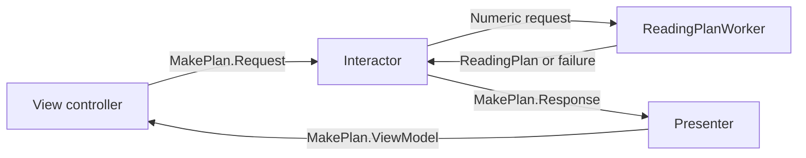

Clean Swift organizes a scene around a VIP cycle: the view sends a request to the interactor, the interactor sends a response to the presenter, and the presenter sends a view model back to the view.

The direction matters. Moving methods into types named View, Interactor, and Presenter while allowing each to reach into the others' internals leaves the original coupling intact.

<!--more-->

This Swift 5.7 example builds a reading plan from form text. Request, response, and view model are separate values because each boundary needs different facts. It follows the VIP communication idea described by Clean Swift's creator, Raymond Law, without depending on generated templates.

## Define values for the three boundaries

```swift
enum PlanFailure: Error, Equatable { case invalidPages, invalidDays }
struct ReadingPlan: Equatable { let pages: Int; let days: Int; let dailyPages: Int }
enum MakePlan {
    struct Request { let pagesText: String; let daysText: String }
    struct Response { let result: Result<ReadingPlan, PlanFailure> }
    struct ViewModel: Equatable { let summary: String?; let error: String? }
}
protocol PlanBusinessLogic { func makePlan(_ request: MakePlan.Request) }
protocol PlanPresentationLogic: AnyObject { func present(_ response: MakePlan.Response) }
protocol PlanDisplayLogic: AnyObject { func display(_ model: MakePlan.ViewModel) }
```

The request carries user input. The response carries the application outcome. The view model carries display-ready content. A view model in this VIP vocabulary is a value crossing the presentation boundary, not necessarily an observable MVVM object.

Do not create three identical structures automatically. They are useful when they isolate meaningful differences. Avoid exposing UIKit controls, a database context, or transport response objects inside these values.

## Put planning rules in a worker and interactor

```swift
struct ReadingPlanWorker {
    func make(pages: Int, days: Int) throws -> ReadingPlan {
        guard (1...100_000).contains(pages) else { throw PlanFailure.invalidPages }
        guard (1...365).contains(days) else { throw PlanFailure.invalidDays }
        let daily = (pages + days - 1) / days
        return ReadingPlan(pages: pages, days: days, dailyPages: daily)
    }
}
final class PlanInteractor: PlanBusinessLogic {
    private let worker: ReadingPlanWorker
    private let presenter: any PlanPresentationLogic
    init(worker: ReadingPlanWorker, presenter: any PlanPresentationLogic) {
        self.worker = worker; self.presenter = presenter
    }
    func makePlan(_ request: MakePlan.Request) {
        let result: Result<ReadingPlan, PlanFailure>
        if let pages = Int(request.pagesText), (1...100_000).contains(pages) {
            if let days = Int(request.daysText), (1...365).contains(days) {
                do { result = .success(try worker.make(pages: pages, days: days)) }
                catch let error as PlanFailure { result = .failure(error) }
                catch { preconditionFailure("Worker violated its declared failure policy") }
            } else { result = .failure(.invalidDays) }
        } else { result = .failure(.invalidPages) }
        presenter.present(MakePlan.Response(result: result))
    }
}
```

The worker protects numeric rules for callers outside the form. The interactor translates text input into the use-case request and chooses which invalid field to report first. It does not choose the error wording.

The bounds keep addition safe and define the supported product domain. The daily quota rounds upward so a plan can cover all pages within the requested number of days. It is an even quota estimate; a real scheduler might distribute the final remainder rather than prescribe the same count every day.

A worker is not mandatory for every expression. Here it isolates a reusable rule from input parsing. A larger worker can wrap a repository or another effect capability, while the interactor remains responsible for the scene's use case.

## Complete the cycle with presentation and display

```swift
final class PlanPresenter: PlanPresentationLogic {
    weak var view: (any PlanDisplayLogic)?
    func present(_ response: MakePlan.Response) {
        let model: MakePlan.ViewModel
        switch response.result {
        case let .success(plan):
            model = MakePlan.ViewModel(summary: "Read up to \(plan.dailyPages) pages per day.", error: nil)
        case .failure(.invalidPages):
            model = MakePlan.ViewModel(summary: nil, error: "Enter 1 to 100000 pages.")
        case .failure(.invalidDays):
            model = MakePlan.ViewModel(summary: nil, error: "Enter 1 to 365 days.")
        }
        view?.display(model)
    }
}
final class PlanViewControllerCore: PlanDisplayLogic {
    let interactor: any PlanBusinessLogic
    private(set) var model = MakePlan.ViewModel(summary: nil, error: nil)
    init(interactor: any PlanBusinessLogic) { self.interactor = interactor }
    func submit(pages: String, days: String) {
        interactor.makePlan(MakePlan.Request(pagesText: pages, daysText: days))
    }
    func display(_ model: MakePlan.ViewModel) { self.model = model }
}
```

A real `UIViewController` can implement the display role and map the value to labels. The core here stands in for that adapter so the assembled cycle can run without UIKit. It contains no planning policy.

The view retains the interactor, which retains the presenter, which refers weakly back to the view. That intended graph survives for the screen lifetime without forming a strong cycle. If a worker starts async work, define which owner stops it when the scene ends.

## Verify the assembled cycle and the worker separately

```swift
let presenter = PlanPresenter()
let interactor = PlanInteractor(worker: ReadingPlanWorker(), presenter: presenter)
let view = PlanViewControllerCore(interactor: interactor)
presenter.view = view
view.submit(pages: "101", days: "10")
assert(view.model == MakePlan.ViewModel(summary: "Read up to 11 pages per day.", error: nil))
view.submit(pages: "many", days: "10")
assert(view.model.summary == nil && view.model.error == "Enter 1 to 100000 pages.")
view.submit(pages: "100", days: "0")
assert(view.model.error == "Enter 1 to 365 days.")
let plan = try ReadingPlanWorker().make(pages: 100_000, days: 365)
assert(plan.dailyPages * plan.days >= plan.pages)
assert((plan.dailyPages - 1) * plan.days < plan.pages)
```

The final assertions verify the quota's ceiling property rather than copying the division formula. Boundary checks should also include one page, one day, and the maximum supported values.

## Keep the direction visible



In the [VIPER example](/swift-viper/), the view sends actions to the presenter, which invokes the interactor. In this VIP cycle, the view invokes the interactor directly and the presenter formats the response. Treat the names as precise communication contracts instead of assuming every VIP-family acronym has identical arrows.

## Generated structure is only a starting point

Templates can reduce mechanical setup and encourage consistent naming across a team. They do not decide whether an operation is atomic, whether a request can complete after logout, or which fields belong to domain state.

If a scene has many independent use cases, organize names around those operations rather than accumulating methods called `doSomething`. A typed namespace such as `MakePlan` keeps request, response, and view-model relationships discoverable.

For asynchronous operations, include request identity in the coordination policy and define whether repeated submission replaces, queues, or rejects work. A response type alone does not prevent stale results from overwriting current content.

Routing remains a separate responsibility. Passing data to another scene should use stable identities or explicit results, not give the next view controller access to the previous controller's interactor internals.

## Case study: several use cases share one scene

A planning scene can calculate a plan, save it, and load a previous plan. They share a view, but they do not necessarily share one request or one response shape.

Use names that reveal each operation. A `SavePlan.Request` can carry a validated plan and expected revision, while `LoadPlan.Response` can distinguish absence from unavailable storage. Reusing one giant `PlanData` object with many optional fields makes it harder to know which combinations are meaningful at each boundary.

The interactor can coordinate these operations, but should not become an unrestricted scene service. Extract reusable domain policy and effect capabilities when they have independent lifetimes or consumers. Keep the scene-specific orchestration visible rather than forwarding every line into a differently named worker.

For an asynchronous save, decide which operation owns the busy state. Starting a load while saving may be forbidden, queued, or allowed under separate request identities. The VIP cycle does not choose that concurrency policy. Add it to the interactor's contract and test the relevant sequence.

Presentation can also need a mixture of persistent content and transient effects. The current saved-plan summary belongs in a view-model value. A one-time request to focus an invalid field may need a separate identified effect, so redisplaying the current summary does not repeatedly steal focus.

Review assembly after adding a second use case. The view should still call business-logic capabilities, the presenter should still format responses, and neither should need a mutable reference to the other's internal state. Generated protocols are useful only while those boundaries remain coherent.

## Exercise: save the plan asynchronously

Add a persistence capability to the interactor. Distinguish invalid input, successful save, and unavailable storage. Prevent duplicate saves while one is pending, and reject a late response after the scene is stopped. Keep error wording in the presenter and verify the real persistence adapter honors its write contract.

Raymond Law's [Clean Swift architecture introduction](https://clean-swift.com/clean-swift-ios-architecture/) is the primary description of the VIP cycle and its boundary models.

Return to the [App Architectures roadmap](/swift-architectures/).
