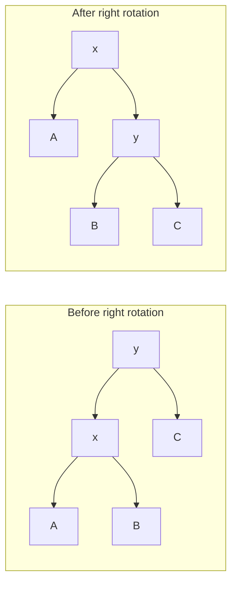

A binary search tree is fast only when its height stays small. Inserting sorted keys into an ordinary tree can produce a chain, turning search into a linear walk. An AVL tree maintains a local height invariant strong enough to prevent that degeneration.

Every node's left and right subtree heights differ by at most one. Insertions repair violations with rotations that preserve search order.

<!--more-->

This Swift 5.7 example implements set insertion, lookup, ordered traversal, and an invariant checker. It is a mutable reference type, not a value-semantic wrapper around shared mutable nodes. Deletion is discussed separately because it requires additional repair logic.

## Cache height and define balance consistently

An empty subtree has height zero and a leaf height one. The balance factor is left height minus right height:

$$
h(v)=1+\max(h(v_L),h(v_R)),\qquad b(v)=h(v_L)-h(v_R).
$$

Valid AVL balance factors are `-1`, `0`, and `1`. Cached height must be updated whenever a child changes.

```swift
final class AVLTree<Key: Comparable> {
    private final class Node {
        let key: Key
        var left: Node?
        var right: Node?
        var height = 1
        init(_ key: Key) { self.key = key }
    }
    private var root: Node?
    var height: Int { root?.height ?? 0 }
    private func h(_ node: Node?) -> Int { node?.height ?? 0 }
    private func update(_ node: Node) { node.height = 1 + max(h(node.left), h(node.right)) }

    private func rotateRight(_ node: Node) -> Node {
        let promoted = node.left!
        node.left = promoted.right
        promoted.right = node
        update(node)
        update(promoted)
        return promoted
    }
    private func rotateLeft(_ node: Node) -> Node {
        let promoted = node.right!
        node.right = promoted.left
        promoted.left = node
        update(node)
        update(promoted)
        return promoted
    }

    func insert(_ key: Key) { root = inserting(key, into: root) }
    private func inserting(_ key: Key, into node: Node?) -> Node {
        guard let node = node else { return Node(key) }
        if key < node.key { node.left = inserting(key, into: node.left) }
        else if key > node.key { node.right = inserting(key, into: node.right) }
        else { return node }
        update(node)
        let balance = h(node.left) - h(node.right)
        if balance > 1 {
            if key > node.left!.key { node.left = rotateLeft(node.left!) }
            return rotateRight(node)
        }
        if balance < -1 {
            if key < node.right!.key { node.right = rotateRight(node.right!) }
            return rotateLeft(node)
        }
        return node
    }

    func contains(_ key: Key) -> Bool {
        var cursor = root
        while let node = cursor {
            if key == node.key { return true }
            cursor = key < node.key ? node.left : node.right
        }
        return false
    }
    func sortedKeys() -> [Key] {
        var keys: [Key] = []
        func visit(_ node: Node?) {
            guard let node = node else { return }
            visit(node.left); keys.append(node.key); visit(node.right)
        }
        visit(root)
        return keys
    }
    func isValid() -> Bool {
        func inspect(_ node: Node?, lower: Key?, upper: Key?) -> (Bool, Int) {
            guard let node = node else { return (true, 0) }
            if let lower = lower, !(lower < node.key) { return (false, 0) }
            if let upper = upper, !(node.key < upper) { return (false, 0) }
            let left = inspect(node.left, lower: lower, upper: node.key)
            let right = inspect(node.right, lower: node.key, upper: upper)
            let actual = 1 + max(left.1, right.1)
            return (left.0 && right.0 && abs(left.1 - right.1) <= 1 && node.height == actual, actual)
        }
        return inspect(root, lower: nil, upper: nil).0
    }
}
```

The force unwraps follow from an already detected imbalance: a left-heavy node necessarily has a left child, and the corresponding inner rotation has its required child under the insertion case. Keep those preconditions visible when refactoring rotation helpers.

## Four shapes reduce to two rotation primitives

Left-left insertion needs a right rotation. Right-right needs a left rotation. Left-right first rotates the left child left, then the parent right. Right-left is symmetric.



The middle subtree `B` moves between the two nodes. Its keys remain between `x` and `y`, so search order is preserved. Dropping that subtree during pointer reassignment would lose data despite an apparently balanced shape.

Update the demoted node before the promoted node because the promoted height depends on the repaired child's height.

## Verify all repair cases and long ordered input

```swift
for keys in [[3, 2, 1], [1, 2, 3], [3, 1, 2], [1, 3, 2]] {
    let tree = AVLTree<Int>()
    for key in keys { tree.insert(key); assert(tree.isValid()) }
    assert(tree.sortedKeys() == [1, 2, 3])
}
let tree = AVLTree<Int>()
for key in 0..<200 { tree.insert(key); assert(tree.isValid()) }
tree.insert(100)
assert(tree.sortedKeys() == Array(0..<200))
assert(tree.contains(199) && !tree.contains(201))
assert(tree.height < 20)
```

The loose height assertion is a smoke check, not the AVL proof. `isValid` independently recomputes heights and propagates key bounds, so a stale cached height cannot validate itself.

## The minimum-node recurrence bounds height

The sparsest AVL tree of height `h` has subtrees of heights `h - 1` and `h - 2`:

$$
N(h)=1+N(h-1)+N(h-2).
$$

This Fibonacci-like growth means height is logarithmic in node count. Search and insertion follow a logarithmic path, with constant work per repaired node, so their worst-case structural time is `O(log n)`.

Each rotation is local, but checking and updating ancestors is still part of insertion. Node allocation and comparison costs belong in a complete runtime model.

## Deletion needs its own cases

Removing a node can reduce subtree height and propagate imbalance upward. Unlike insertion's key-based case selection here, deletion repairs should inspect child balance factors, including zero-balance cases.

Do not paste this insertion repair around a binary-search-tree deletion and assume correctness. Test deletion of leaves, one-child nodes, two-child nodes, roots, and repeated removals while validating every ancestor's metadata.

## Validate transitive ordering, not only child comparisons

Checking that a node's immediate left child is smaller is insufficient. A deeper node in that left subtree can still exceed the original ancestor and violate search behavior.

The checker propagates lower and upper bounds down the whole path. Every descendant must satisfy all ancestor restrictions represented by those bounds. Independently recomputing height also prevents stale cached metadata from certifying itself.

These checks are intentionally more expensive than a normal lookup. Run them after each operation in small generated tests; do not include a full validation traversal in every production insertion while still claiming logarithmic update cost.

## Mutable identity and persistent values require different designs

This tree is a class, so two references identify one changing tree. A consumer needing historical versions should not copy the reference and expect an earlier snapshot.

A persistent AVL tree can rebuild the modified path and rotation nodes while sharing untouched immutable subtrees. Its structural update still follows a logarithmic path, but allocation, retention, and element semantics become part of the workload.

Parent pointers are unnecessary for this recursive implementation. Adding strong parent references would create ownership cycles unless handled deliberately. They also make rotations update more relationships, increasing the number of invariants a test must verify.

## Deletion can propagate farther than one local repair

Insertion increases height along one path until balance is restored. Deletion can decrease height repeatedly, requiring repairs at several ancestors. Child balance zero is a meaningful deletion case that the insertion key comparisons do not encode.

Treat deletion as another algorithm with its own fixtures and invariant checks. A node-count test alone cannot establish that every cached height and search bound remains valid after a two-child removal.

## Trace a left-right repair with the middle subtree intact

Insert keys thirty, ten, and twenty. The root thirty becomes left-heavy, but the new key lies in its left child's right subtree. Rotating thirty right immediately would not produce the intended balanced arrangement.

First rotate the subtree rooted at ten left, promoting twenty. Then rotate thirty right, again promoting twenty. The final inorder order remains ten, twenty, thirty, while height falls to two levels.

With additional subtrees, each rotation transfers a middle range whose keys lie between the two rotated keys. Those transferred ranges are the reason rotation code must be tested with more than three nodes: a three-key fixture has no nonempty middle subtree to lose.

A strong generated test inserts a permutation of a wider key range and validates after every operation. Include retained external key values with equal comparisons to confirm duplicate insertion does not alter cardinality.

## Exercise: add subtree sizes

Cache each node's size and support selecting the key of rank `k`. Update size alongside height during insertion and rotations. Compare every rank with `sortedKeys()` after generated insertions, and reject out-of-range ranks explicitly.

Return to the [Data Structures and Algorithms roadmap](/swift-data-structures-and-algorithms/).
