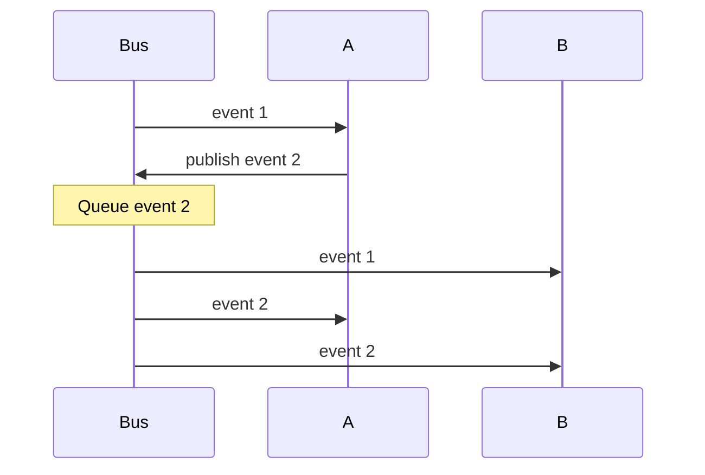

Publisher-subscriber separates event producers from independently subscribed consumers. A typed event bus can be a useful local implementation, but delivery timing, reentrancy, cancellation, and buffering are part of its contract.

An observer list that recursively invokes itself can create surprising order or an infinite feedback loop. This article queues nested events so every subscriber finishes the current event before the next event begins.

<!--more-->

The Swift 5.7 bus is synchronous and requires serialized access. It is an in-memory notification mechanism, not a durable broker. The existing [Observer article](/swift-protocol-observer-pattern/) develops a complementary policy that rejects nested emission.

## Make subscription lifetime explicit

```swift
final class Subscription {
    private var cancellation: (() -> Void)?
    init(_ cancellation: @escaping () -> Void) { self.cancellation = cancellation }
    func cancel() {
        let action = cancellation
        cancellation = nil
        action?()
    }
    deinit { cancel() }
}

enum PublishReport: Equatable {
    case queued
    case rejectedFull
    case drained(events: Int)
    case limitReached(processed: Int, discarded: Int)
}

final class QueuedEventBus<Event> {
    private var callbacks: [Int: (Event) -> Void] = [:]
    private var order: [Int] = []
    private var nextID = 0
    private var pending: [Event] = []
    private var head = 0
    private var draining = false
    private let maximumPending: Int
    private let maximumEventsPerDrain: Int

    init(maximumPending: Int = 100, maximumEventsPerDrain: Int = 1_000) {
        precondition(maximumPending > 0 && maximumEventsPerDrain > 0)
        self.maximumPending = maximumPending
        self.maximumEventsPerDrain = maximumEventsPerDrain
    }
    func subscribe(_ callback: @escaping (Event) -> Void) -> Subscription {
        nextID += 1
        let id = nextID
        callbacks[id] = callback
        order.append(id)
        return Subscription { [weak self] in
            self?.callbacks.removeValue(forKey: id)
            self?.order.removeAll { $0 == id }
        }
    }
    @discardableResult
    func publish(_ event: Event) -> PublishReport {
        guard pending.count - head < maximumPending else { return .rejectedFull }
        pending.append(event)
        if draining { return .queued }
        draining = true
        defer {
            draining = false
            pending.removeAll(keepingCapacity: true)
            head = 0
        }
        var processed = 0
        while head < pending.count {
            if processed == maximumEventsPerDrain {
                return .limitReached(processed: processed, discarded: pending.count - head)
            }
            let current = pending[head]
            head += 1
            let scheduled = order
            for id in scheduled { callbacks[id]?(current) }
            processed += 1
        }
        return .drained(events: processed)
    }
}
```

A delivery pass snapshots subscriber IDs, then looks up live callbacks before each call. Cancellation before a subscriber's turn suppresses it. A new subscription does not join the already scheduled pass.

The identifier counter assumes a bounded demonstration lifetime; a reusable implementation needs a checked counter or a suitable token identity scheme.

## Queued reentrancy preserves breadth-first event order

```swift
let bus = QueuedEventBus<Int>()
var trace: [String] = []
let first = bus.subscribe { value in
    trace.append("A\(value)")
    if value == 1 { assert(bus.publish(2) == .queued) }
}
let second = bus.subscribe { trace.append("B\($0)") }
assert(bus.publish(1) == .drained(events: 2))
assert(trace == ["A1", "B1", "A2", "B2"])
first.cancel()
second.cancel()
```

Subscriber B receives event one before either subscriber receives event two. A recursively delivered bus could instead produce `A1, A2, B2, B1`, which is a different contract.



## Bound feedback as well as pending capacity

```swift
let feedback = QueuedEventBus<Int>(maximumPending: 2, maximumEventsPerDrain: 3)
var observed: [Int] = []
let token = feedback.subscribe { value in
    observed.append(value)
    _ = feedback.publish(value + 1)
}
assert(feedback.publish(0) == .limitReached(processed: 3, discarded: 1))
assert(observed == [0, 1, 2])
token.cancel()
```

A queue limit alone does not stop a feedback loop that consumes one event and appends one forever. The per-drain work limit bounds that sequence and reports discarded work explicitly.

A nested `.queued` result acknowledges admission, not eventual delivery. A later limit can discard it. A durable command system needs stronger acknowledgements and persistence; this bus intentionally does not claim them.

The array retains processed prefix elements until the drain ends. Peak retained event storage therefore depends on both the work limit and pending limit, not only the number waiting. A deque can release processed payloads earlier.

## Events describe facts; commands request work

An event such as `ArticlePublished` can have zero or several subscribers. The publisher should not depend on one particular observer updating a hidden field before it can continue.

A command such as `PublishArticle` needs a responsible handler and an outcome. Sending it into an anonymous broadcast bus can hide missing handlers or duplicate effects.

If a workflow requires ordered transactional cooperation, use an explicit service or mediator rather than treating event delivery as a substitute for control flow.

## Typed events still need scope and version

A generic bus prevents accidental string-name collisions, but a shared event may still belong to a different account, document, or generation. Include the identity facts consumers need to reject irrelevant or obsolete events.

Payload value semantics matter too. Publishing a mutable class reference does not freeze its contents for subscribers. Prefer immutable snapshots when every subscriber should observe the same fact.

Subscriptions also retain callbacks. A callback strongly capturing its owner can keep that owner alive through the bus. Retain the subscription where observation is desired and cancel when the feature stops; weak captures and ownership decisions should follow the actual lifecycle.

## This is not Combine demand

Apple's [Combine framework](https://developer.apple.com/documentation/combine) supplies publisher/subscriber protocols with demand, completion, and operator semantics. This simple bus has no per-subscriber demand or asynchronous buffering.

Do not infer stream backpressure from a global pending-event limit. A slow synchronous subscriber blocks the whole drain, and the bus cannot selectively pause one observer while others proceed.

## Specify who receives a nested publication

A serial event bus can still be reentrant: a subscriber handling one event may publish another. The queue above makes the delivery order explicit, completing the current event's subscriber pass before draining the nested event. This avoids an uncontrolled recursive call stack and the surprising interleaving of half-finished deliveries.

Subscription changes during delivery need a similarly explicit rule. A useful approach takes a snapshot of recipient identities for the current event, then checks whether each recipient is still subscribed before invoking it. A newly registered subscriber participates in later events; a cancelled subscriber can be skipped if its turn has not occurred. Other policies are possible, but tests must pin down the one the bus promises.

Callback order also becomes an implicit dependency if one handler assumes another handler has already updated shared state. If the business operation requires those steps to happen in sequence, represent the sequence in a service or command handler. Relying on incidental subscription order makes that invariant hard to find.

## Event facts and requests have different failure semantics

An event such as `BookSaved` announces that something already happened. Dropping it might be acceptable for a transient animation but unacceptable for durable synchronization. A request such as `SaveBook` asks for an effect and usually needs a result addressed to its caller.

Do not put both behind an untyped “message” operation without defining acknowledgment and ownership. A fire-and-forget publish result can report local queue admission; it cannot establish that every subscriber completed an effect successfully.

For durable workflows, record pending delivery, stable message IDs, retry policy, and acknowledgments in persistent storage. Subscribers may see duplicates and need idempotent handling. An in-memory queue with a drain limit provides none of those guarantees by itself.

## Bounds prevent one failure mode, not all overload

A pending-event bound limits queued entries. The drain budget limits work performed in one drain, including feedback loops that keep the queue small while generating endless replacements. Neither bound limits the time spent inside one slow callback.

If callbacks perform blocking I/O, they can freeze the entire serial bus. Moving work to tasks changes ordering, cancellation, and lifetime rules, so define that as a different delivery contract rather than a hidden optimization.

Use separate channels when events have different durability or latency needs. A progress animation and an accounting update should not compete under an unspecified universal drop policy. The bus is useful only when subscribers understand what delivery actually means.

## Verify cancellation and registration during delivery

```swift
let changingBus = QueuedEventBus<Int>()
var changingTrace: [String] = []
var cancelledBeforeTurn: Subscription?
var addedDuringDelivery: Subscription?
let changingFirst = changingBus.subscribe { value in
    changingTrace.append("A\(value)")
    if value == 1 {
        cancelledBeforeTurn?.cancel()
        addedDuringDelivery = changingBus.subscribe { changingTrace.append("C\($0)") }
        assert(changingBus.publish(2) == .queued)
    }
}
cancelledBeforeTurn = changingBus.subscribe { changingTrace.append("B\($0)") }
assert(changingBus.publish(1) == .drained(events: 2))
assert(changingTrace == ["A1", "A2", "C2"])
changingFirst.cancel()
addedDuringDelivery?.cancel()
cancelledBeforeTurn?.cancel()
```

B was scheduled for the first event, but cancellation removed its callback before its turn. C was added too late for that event's recipient snapshot and participates in the next one. Explicit cancellation at the end also releases closures that capture the bus; token ownership remains part of the design even when delivery is synchronous.

## Exercise: add subscriber failure outcomes

Allow a subscriber to report a handled failure without throwing through the entire drain. Define whether remaining subscribers still receive the event, where diagnostics go, and whether any retry is permitted. Test that retries cannot silently duplicate an external effect under an event-delivery guarantee that only promised notification.

Return to the [Design Patterns roadmap](/swift-design-patterns/).
