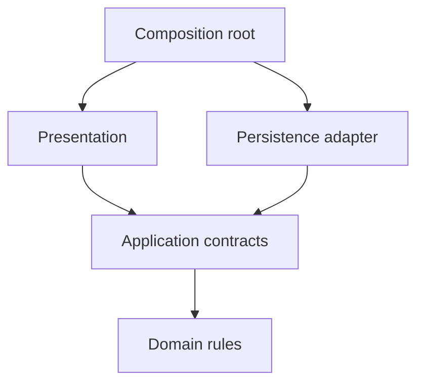

Extra architecture structure pays for itself when it isolates decisions that change independently or makes important failures controllable. It costs time when it only adds assembly, forwarding, and terminology around behavior that was already easy to understand.

A useful decision compares actual change scenarios. “Large app” and “clean code” are too vague to establish which boundaries a feature needs.

<!--more-->

This Swift 5.7 article uses a small module dependency model and an explicit cost estimate. The numbers are illustrative planning inputs, not measurements proving one architecture is universally better.

## State the pressure before selecting the structure

Consider a feature maintained by one team that displays a static catalog. It may need a view, a query, and a data adapter. Now add separate owners for inventory policy, account entitlement, and two different presentation surfaces. The useful boundaries have changed even if the screen's visual complexity has not.

List expected changes and who can make them independently. A schema change should stay behind the data adapter where possible. A borrowing policy change should not require editing both presentation surfaces. A new visual design should not rewrite the use case.

A boundary has value when its contract remains stable while one side changes. If both sides always change together and the boundary contains no invariant or useful test seam, the abstraction may only be adding coordination work.

## Use a cost model with honest assumptions

Let an added boundary cost `B` units of initial work, `M` units per period to maintain, and save `S_i` units on change `i` compared with the simpler design. Over `T` periods, the illustrative net saving is:

$$
G=\sum_i S_i-B-TM.
$$

The equation is bookkeeping, not an objective maintainability score. Estimates depend on team familiarity, tooling, review practices, and which changes actually happen. A negative estimate can still miss a critical reliability benefit; a positive estimate can be wrong if the boundary does not remain stable.

Use the model to expose assumptions. “This abstraction will pay off” becomes “we expect several storage changes, and this port should prevent each from affecting two presentation modules.” That prediction can be checked later.

## Model the source dependency graph

```swift
struct ModuleGraph {
    let dependencies: [String: Set<String>]

    func invalidEdges(allowed: [String: Set<String>]) -> Set<String> {
        var violations: Set<String> = []
        for (module, imports) in dependencies {
            for target in imports where !allowed[module, default: []].contains(target) {
                violations.insert(module + " -> " + target)
            }
        }
        return violations
    }
    func affected(by changed: String) -> Set<String> {
        var found: Set<String> = [changed]
        var pending = [changed]
        while let current = pending.popLast() {
            for (module, imports) in dependencies where imports.contains(current) {
                if found.insert(module).inserted { pending.append(module) }
            }
        }
        return found
    }
}
let graph = ModuleGraph(dependencies: [
    "Presentation": ["Application"],
    "Application": ["Domain"],
    "Persistence": ["Application", "Domain"],
    "App": ["Presentation", "Persistence"]
])
let allowed: [String: Set<String>] = [
    "Presentation": ["Application"],
    "Application": ["Domain"],
    "Persistence": ["Application", "Domain"],
    "App": ["Presentation", "Persistence"]
]
assert(graph.invalidEdges(allowed: allowed).isEmpty)
assert(graph.affected(by: "Persistence") == ["Persistence", "App"])
let leaking = ModuleGraph(dependencies: ["Application": ["Persistence"]])
assert(leaking.invalidEdges(allowed: allowed) == ["Application -> Persistence"])
```

This model checks declared edges, not actual Swift imports. A real gate must extract the real target graph or compile separate targets so forbidden dependencies cannot resolve. The demonstration makes the rule executable without pretending a manually typed dictionary enforces the repository.

`affected` computes possible reverse dependency reachability, including the changed module. It is a conservative structural set, not a prediction that every module will need a source edit or show a runtime defect.

## Draw the boundary that earns its cost



If changing persistence implementation leaves the application contract unchanged, presentation can remain untouched. If every vendor field is exposed through that contract, the arrows look correct while changes still propagate.

Review the values as carefully as the imports. A public DTO with twenty database-specific fields can become a more effective coupling mechanism than a direct import statement.

## Distinguish useful structure from ceremonial structure

A use-case type can isolate a transaction and its failure outcomes. A router can isolate destination construction. A presenter can isolate complex display rules. These types have reasons to exist beyond forwarding.

By contrast, a protocol per class, a request type identical to its response, and a repository that simply mirrors every database method can add navigation work without a stable seam. There may be a future reason for those types, but future possibility is weaker evidence than an observed change pressure.

Do not overcorrect by collapsing every layer. Removing a boundary that protects account isolation or atomic writes can make a small feature cheaper to type and much harder to trust. Preserve contracts that represent genuine invariants even when their current implementation is short.

## Reliability benefits need their own evidence

A design that makes stale callbacks rejectable may prevent a serious defect without saving many lines. Test that interleaving directly. A design that makes database replacement possible should have a contract suite for both adapters. A design that claims independent team delivery should be tried on a representative cross-team change.

Avoid using test count or coverage percentage as the only outcome. More tiny objects can produce more tests while the assembled flow still has a lifecycle leak. Measure the behavior the boundary was introduced to protect.

Similarly, code generation reduces typing but not conceptual cost. Reviewers still need to understand the generated graph and maintain its contracts. A template's convenience should not decide whether the feature needs that graph.

## Write an architecture decision record around a prediction

A compact decision record can state the problem, constraints, selected boundary, alternatives, expected benefit, and conditions for reconsideration. For example: “Two clients share loan policy; isolate one use case so changing the policy requires one implementation update and both clients consume the same outcomes.”

Record a review point after several real changes. If the use case accumulates presentation flags for both clients, the boundary may be wrong. If one client needs a genuinely different policy, forcing both through the same abstraction may be the new source of cost.

Architecture decisions should be revisable. A well-defined boundary can be merged or split later without a whole-app rewrite, especially when behavior is protected by tests at the consumer seam.

## Case study: a boundary saves code changes but adds coordination

Imagine extracting a shared use case for two clients. Policy changes now touch one implementation rather than two, but every contract change requires agreement between three owners. The extraction can still be worthwhile; the coordination cost must simply be included in the decision.

A stable value contract can keep that cost low. A frequently changing protocol containing every client's special flag can make it high. Track which changes actually cross the boundary and whether those changes represent shared policy or client-specific presentation.

Build and review cost also matter. Separate targets can enforce imports and improve independent ownership, yet a very fine target graph can increase configuration and test-discovery work. Measure the actual build environment instead of assuming that more modules always improve build time.

A useful review asks for a counterexample to the proposed benefit. Which realistic requirement would force both sides to change anyway? If the answer is nearly every ordinary change, the boundary may be in the wrong place. If the answer is an infrequent fundamental contract change, that may be an acceptable tradeoff.

Keep the decision record falsifiable. State which changes should remain local, what reliability property should improve, and how the team will notice if the abstraction instead accumulates exceptions. Revisit it after real work, not only after a successful prototype.

Finally, distinguish reversal cost from initial cost. A small internal protocol can be merged later with little disruption. A public persisted format or third-party framework can create a much longer commitment. Prefer reversible experiments while the team's understanding of the boundary is still changing.

## Exercise: evaluate one proposed layer

Choose a real feature and propose exactly one new boundary. Name the change it should localize, the failure it should make testable, and the assembly cost it introduces. Perform a small change experiment and compare the result with the prediction. Do not add unrelated layers merely because the selected architecture's diagram contains them.

Return to the [App Architectures roadmap](/swift-architectures/).
