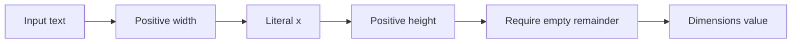

A parser consumes a prefix of input and returns both a value and the unconsumed suffix. A parser combinator builds a larger parser by combining smaller ones: transform a result, sequence two parses, choose an alternative, or repeat a pattern.

This approach lets the grammar remain visible in ordinary Swift code. It also creates responsibilities that simple tutorials often skip: repetition must make progress, full-input parsing must reject leftovers, and backtracking needs a cost and error policy.

<!--more-->

The examples use Swift 5.7 and parse a compact `widthxheight` format such as `12x8`. The format contains positive ASCII integers and no whitespace. This is a teaching parser, not a replacement for a production parser with diagnostics and resource controls.

## Model success as a value and a suffix

```swift
struct Parser<Value> {
    let run: (Substring) -> (value: Value, rest: Substring)?

    func map<NewValue>(_ transform: @escaping (Value) -> NewValue) -> Parser<NewValue> {
        Parser<NewValue> { input in
            guard let parsed = self.run(input) else { return nil }
            return (transform(parsed.value), parsed.rest)
        }
    }

    func flatMap<NewValue>(
        _ next: @escaping (Value) -> Parser<NewValue>
    ) -> Parser<NewValue> {
        Parser<NewValue> { input in
            guard let parsed = self.run(input) else { return nil }
            return next(parsed.value).run(parsed.rest)
        }
    }

    func or(_ alternative: Parser<Value>) -> Parser<Value> {
        Parser { input in self.run(input) ?? alternative.run(input) }
    }
}

func pure<Value>(_ value: Value) -> Parser<Value> {
    Parser { input in (value, input) }
}

func character(where accepts: @escaping (Character) -> Bool) -> Parser<Character> {
    Parser { input in
        guard let first = input.first, accepts(first) else { return nil }
        return (first, input.dropFirst())
    }
}

func literal(_ expected: String) -> Parser<String> {
    Parser { input in
        guard input.hasPrefix(expected) else { return nil }
        return (expected, input.dropFirst(expected.count))
    }
}
```

Failure is outer nil. Success returns a value and a genuine suffix of the original input. `pure` succeeds without consuming input, which is useful for sequencing and important for repetition safety.

`map` changes the parsed value without changing consumption. `flatMap` selects the next parser from the first value and runs it on the remaining suffix. `or` tries the second parser from the original input if the first fails.

Because input is a value and failed results are not returned, this version has full backtracking at each alternative. It does not distinguish failure after consumption from failure before consumption.

## Repetition must reject a nonadvancing parser

```swift
extension Parser {
    func many() -> Parser<[Value]> {
        Parser<[Value]> { input in
            var values: [Value] = []
            var rest = input
            while let parsed = self.run(rest) {
                guard parsed.rest.startIndex != rest.startIndex else { return nil }
                values.append(parsed.value)
                rest = parsed.rest
            }
            return (values, rest)
        }
    }
}

let digit = character { $0 >= "0" && $0 <= "9" }
let digits = digit.many()
assert(digits.run("123x"[...])?.value == ["1", "2", "3"])
assert(digits.run("x"[...])?.value.isEmpty == true)
assert(pure(1).many().run("abc"[...]) == nil)
```

Without the guard, repeating `pure(1)` would loop forever because each success returns the same input. This implementation treats a nonadvancing success as a grammar failure.

The index check relies on the parser contract: the returned remainder must be a suffix of the same input, not an unrelated string. A more defensive public parser API can track an explicit cursor offset and validate monotonic movement.

`many` allows zero matches. A positive integer parser must add a nonempty requirement; otherwise an empty digit list could be mistaken for a valid number.

## Build a positive integer with explicit conversion failure



Every stage receives the unconsumed suffix from the previous stage. A valid prefix becomes a valid complete setting only after the final remainder check.

```swift
let positiveInteger = digits.flatMap { characters -> Parser<Int> in
    guard !characters.isEmpty,
          let value = Int(String(characters)),
          value > 0 else {
        return Parser<Int> { _ in nil }
    }
    return pure(value)
}

struct Dimensions: Equatable {
    let width: Int
    let height: Int
}

let dimensions = positiveInteger.flatMap { width in
    literal("x").flatMap { _ in
        positiveInteger.map { height in
            Dimensions(width: width, height: height)
        }
    }
}

func parseAll<Value>(_ parser: Parser<Value>, _ input: String) -> Value? {
    guard let parsed = parser.run(input[...]), parsed.rest.isEmpty else { return nil }
    return parsed.value
}

assert(parseAll(dimensions, "12x8") == Dimensions(width: 12, height: 8))
assert(parseAll(dimensions, "0x8") == nil)
assert(parseAll(dimensions, "12x") == nil)
assert(parseAll(dimensions, "12x8junk") == nil)
assert(parseAll(dimensions, "12 x 8") == nil)
```

`Int` conversion can fail for a digit string larger than the supported integer range. That is preserved as parse failure, not an overflow trap in manually accumulated arithmetic.

The positive check is a semantic constraint layered on syntax. A negative sign is outside this grammar entirely; zero has valid digits but violates the chosen domain.

`parseAll` is essential at a document boundary. Without the empty-suffix check, `12x8junk` could be accepted as a valid prefix even though the entire supplied setting is malformed.

## Choice has an observable ordering

```swift
let shortFirst = literal("a").or(literal("ab"))
let longFirst = literal("ab").or(literal("a"))
assert(parseAll(shortFirst, "ab") == nil)
assert(parseAll(longFirst, "ab") == "ab")
```

The first parser succeeds on `a`, so the alternative is not tried. The later full-input check discovers leftover `b`, but it does not rerun the grammar to search for another successful branch.

This is ordered choice, not an automatic search for the longest match. For overlapping literals, order longer alternatives first when that matches the language, or factor out the common prefix and choose the suffix.

A richer parser can support committed choices and explicit backtracking. Those are semantics the grammar author must understand, not merely performance switches.

## Diagnostics need a richer failure type

Outer nil tells the caller nothing about where or why parsing failed. A production result might carry an offset, an expected token set, and whether input was consumed before failure.

When alternatives fail, retaining the furthest meaningful error often gives better diagnostics than returning whichever error happened last. If errors occur at the same position, combining expected tokens can explain the choice more clearly.

Semantic validation deserves its own message too. “Expected a positive dimension” is more useful for `0x8` than “expected digit,” because digits were parsed successfully.

Adding errors changes the combinators' contracts. A repetition parser needs to distinguish ordinary “no next item” from malformed input after a separator. Otherwise `1,2,` may silently parse as a shorter list instead of reporting the trailing comma.

## Avoid left recursion in this implementation

A grammar written as `expression = expression + term | term` immediately calls itself without consuming input. Recursive descent with these combinators does not handle that left recursion automatically.

Rewrite a left-associative sum as a first term followed by repeated operator-and-term pairs, then fold those pairs from the left. For precedence, build levels: factors inside products inside sums.

Recursive grammar construction also needs delayed parser creation so definitions do not recurse while merely building the parser value. That is separate from the runtime requirement to consume input on recursive paths.

Do not add expression recursion until the simple grammar's consumption and failure policies are clear. A direct handwritten recursive-descent parser may be easier to debug for some languages.

## Cost includes backtracking and retained input

Alternatives with long common prefixes can repeatedly scan the same characters. Nesting ambiguous alternatives can produce very poor runtime. Left factoring and committed choice can reduce repeated work.

Swift strings use grapheme-aware indexing. Treating character counts and offsets as constant-time byte arithmetic is unsafe. A byte-oriented grammar over UTF-8 can be more efficient for ASCII formats, but it has a different Unicode and diagnostic contract.

`Substring` also shares storage with its source. Retaining a tiny parsed substring can retain the entire document. Convert tokens intended for long-term storage to independent strings where appropriate.

Untrusted input needs limits on length, nesting, repetitions, and total work. These small functions are composable, but composition alone is not a resource bound.

## Test malformed prefixes as carefully as successes

For dimensions, test empty input, each missing component, wrong separators, whitespace, zero, overflow-length numbers, and trailing garbage. Check partial parsing separately if the parser is embedded in a larger grammar.

For combinators, verify `map` preserves the remainder, sequencing passes the correct suffix, choice restarts at the intended input, and repetition rejects a nonadvancing parser.

A round-trip property can generate valid dimension values, format them, and parse them back. Keep malformed-input tests too: round trips do not establish rejection behavior.

## Compose a separated list and test the separator boundary

The existing combinators can parse one dimension pair followed by zero or more comma-and-pair groups:

```swift
let dimensionList = dimensions.flatMap { first in
    literal(",").flatMap { _ in dimensions }.many().map { remaining in
        [first] + remaining
    }
}

assert(parseAll(dimensionList, "12x8,3x4") == [
    Dimensions(width: 12, height: 8),
    Dimensions(width: 3, height: 4)
])
assert(parseAll(dimensionList, "12x8,") == nil)
assert(parseAll(dimensionList, "12x8,,3x4") == nil)
assert(parseAll(dimensionList, "") == nil)
```

When the repeated comma-and-pair parser fails, `many` leaves the suffix from before that repeated attempt. For a trailing comma, the comma therefore remains unconsumed, and `parseAll` rejects the document.

This rejects malformed input correctly, but the optional failure type still cannot explain that a pair was expected after the comma. A richer committed-failure model would let the list parser report that location directly.

The grammar also requires at least one pair. Supporting an empty list should be a separate choice, not an accidental consequence of replacing the whole parser with `many`.

## Separate lexical policy from structural policy

The number parser currently accepts ASCII digits only. That is a reasonable machine-format policy, but it should not be confused with every Unicode character that a user may recognize as numeric.

Likewise, the separator is exactly lowercase `x`, not a multiplication sign or uppercase `X`. A human-facing editor may accept alternatives and normalize them; a strict configuration format may intentionally reject them.

Centralize those decisions in token parsers. The structural grammar can then describe a number, a separator, and another number without repeating normalization or whitespace rules throughout every production.

If normalization changes the input representation, diagnostics still need positions meaningful to the original text. Keep a mapping or parse against the original representation rather than reporting offsets into an invisible rewritten string.

## Parser laws help isolate combinator defects

Mapping identity should preserve both a successful value and its remainder. Sequencing with `pure` should not consume additional input. Alternative choice should follow the documented first-success rule.

For tests, compare parser observations over a bounded set of strings: success or failure, parsed payload, and unconsumed suffix. Comparing only payloads misses a parser that returns the correct number while consuming the wrong delimiter.

These tests are useful when adding optimizations. A faster literal scanner or byte cursor should preserve the grammar's observable behavior, including rejection and remaining input, not merely pass the valid examples.

## Make work limits part of the public entry point

The teaching parser accepts any input length supplied to it. An application parsing user-authored files should limit document size and nesting before or during parsing, and account for backtracking work.

An output count limit alone does not prevent expensive rejection. A long almost-matching prefix can consume substantial scanning before every branch fails. A cursor carrying a work budget can make that limit explicit across combinators.

Report budget exhaustion separately from ordinary invalid syntax if callers need to distinguish an unsupported input size from a grammar error. Hiding both behind nil is acceptable for this demonstration but insufficient for a robust editor.

## Exercise: add whitespace without accepting garbage

Define a parser for zero or more ASCII spaces and a token combinator that consumes surrounding spaces. Make `12 x 8` valid while keeping `12x8junk` invalid.

Then parse comma-separated dimensions. Decide whether an empty list and a trailing comma are allowed. Add an error representation that distinguishes an ordinary end of list from a separator followed by a missing item.

For the original functional treatment, see Hutton and Meijer's [Monadic Parser Combinators](https://www.cs.nott.ac.uk/~pszgmh/monparsing.pdf). Continue with the [Spreadsheet case study](/swift-functional-spreadsheet/) or return to the [Functional Programming roadmap](/swift-functional-programming/).
