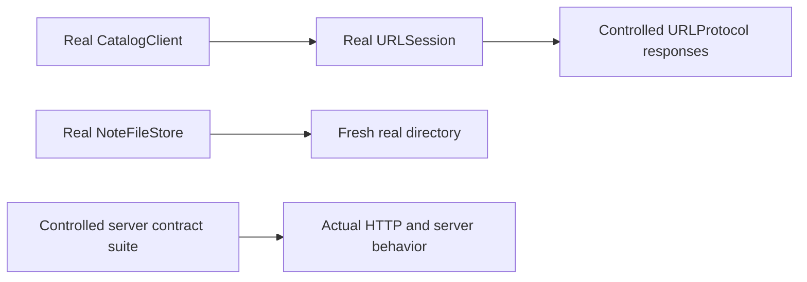

An integration test checks that real components honor their shared contract. A test using a fake repository can establish how a screen handles a conflict, but it cannot establish that a database detects the conflict. A test of decoded fixture bytes cannot establish that the networking adapter handles HTTP status codes correctly.

Choose the boundary before choosing the fixture. The test should use real behavior where it makes its claim and controlled dependencies outside that boundary.

<!--more-->

This Swift 5.7 article uses XCTest, an isolated `URLSession` with a `URLProtocol` fixture, and real files in unique temporary directories. The HTTP tests exercise request construction, session delivery, status handling, and decoding. They do not exercise DNS, TCP, TLS, or the remote server.

## Keep the client contract independent of the fixture

```swift
import Foundation
import XCTest

struct CatalogBook: Decodable, Equatable, Sendable {
    let id: Int
    let title: String
}
enum CatalogFailure: Error, Equatable { case nonHTTP, status(Int), invalidPayload }
struct CatalogClient {
    let baseURL: URL
    let session: URLSession
    func books() async throws -> [CatalogBook] {
        var request = URLRequest(url: baseURL.appendingPathComponent("books"))
        request.httpMethod = "GET"
        request.setValue("application/json", forHTTPHeaderField: "Accept")
        let (data, response) = try await session.data(for: request)
        guard let http = response as? HTTPURLResponse else { throw CatalogFailure.nonHTTP }
        guard http.statusCode == 200 else { throw CatalogFailure.status(http.statusCode) }
        let books: [CatalogBook]
        do { books = try JSONDecoder().decode([CatalogBook].self, from: data) }
        catch { throw CatalogFailure.invalidPayload }
        guard books.allSatisfy({ $0.id > 0 && !$0.title.isEmpty }),
              Set(books.map(\.id)).count == books.count else { throw CatalogFailure.invalidPayload }
        return books
    }
}
```

The client accepts its base URL and session. It distinguishes transport failure, non-HTTP response, rejected status, and invalid content instead of converting all of them into an empty successful catalog.

A valid empty JSON array is different from unavailable data. Whether a particular status represents absence, permission failure, or retryable service failure belongs in the application contract.

## Give each HTTP fixture its own identity

One static mutable `requestHandler` shared by every test can race under parallel execution. Instead, register immutable responses under unique hosts and protect the registry. Every session handles only reserved fixture hosts, so missing fixture data fails locally rather than falling through to a live service.

```swift
struct HTTPFixture: Sendable {
    let path: String
    let status: Int
    let data: Data
}
final class FixtureRegistry: @unchecked Sendable {
    private let lock = NSLock()
    private var values: [String: HTTPFixture] = [:]
    func install(_ fixture: HTTPFixture, host: String) {
        lock.lock(); defer { lock.unlock() }
        values[host] = fixture
    }
    func fixture(host: String) -> HTTPFixture? {
        lock.lock(); defer { lock.unlock() }
        return values[host]
    }
    func remove(host: String) {
        lock.lock(); defer { lock.unlock() }
        values.removeValue(forKey: host)
    }
}
final class FixtureURLProtocol: URLProtocol, @unchecked Sendable {
    static let registry = FixtureRegistry()
    override class func canInit(with request: URLRequest) -> Bool {
        request.url?.host?.hasSuffix(".example.invalid") == true
    }
    override class func canonicalRequest(for request: URLRequest) -> URLRequest { request }
    override func startLoading() {
        guard let url = request.url, let host = url.host,
              let fixture = Self.registry.fixture(host: host),
              request.httpMethod == "GET", url.path == fixture.path,
              request.value(forHTTPHeaderField: "Accept") == "application/json",
              let response = HTTPURLResponse(url: url, statusCode: fixture.status,
                                             httpVersion: "HTTP/1.1",
                                             headerFields: ["Content-Type": "application/json"]) else {
            client?.urlProtocol(self, didFailWithError: URLError(.badServerResponse))
            return
        }
        client?.urlProtocol(self, didReceive: response, cacheStoragePolicy: .notAllowed)
        client?.urlProtocol(self, didLoad: fixture.data)
        client?.urlProtocolDidFinishLoading(self)
    }
    override func stopLoading() {}
}
struct CatalogFixture {
    let client: CatalogClient
    let session: URLSession
    let host: String
    init(status: Int = 200, body: String) {
        host = UUID().uuidString.lowercased() + ".example.invalid"
        FixtureURLProtocol.registry.install(HTTPFixture(path: "/books", status: status,
                                                        data: Data(body.utf8)), host: host)
        let configuration = URLSessionConfiguration.ephemeral
        configuration.protocolClasses = [FixtureURLProtocol.self]
        configuration.urlCache = nil
        configuration.httpCookieStorage = nil
        session = URLSession(configuration: configuration)
        client = CatalogClient(baseURL: URL(string: "https://" + host)!, session: session)
    }
    func close() {
        session.invalidateAndCancel()
        FixtureURLProtocol.registry.remove(host: host)
    }
}
```

The registry's unchecked sendability is backed by a lock around every access to its mutable dictionary. Responses are immutable values. The protocol subclass adds no mutable instance state and completes delivery synchronously inside `startLoading`. These tests await request completion before closing the fixture; this fixture does not model cancellation races.

A delayed protocol fixture needs its own cancellation state so it cannot continue delivering after stop. Do not copy the empty stop implementation into an asynchronous transport stub.

## Test status, decoding, and parallel isolation

```swift
final class CatalogIntegrationTests: XCTestCase {
    func testSessionsReceiveOnlyTheirOwnFixtures() async throws {
        let first = CatalogFixture(body: #"[{"id":1,"title":"First"}]"#)
        let second = CatalogFixture(body: #"[{"id":2,"title":"Second"}]"#)
        defer { first.close(); second.close() }
        async let firstBooks = first.client.books()
        async let secondBooks = second.client.books()
        let (a, b) = try await (firstBooks, secondBooks)
        XCTAssertEqual(a, [CatalogBook(id: 1, title: "First")])
        XCTAssertEqual(b, [CatalogBook(id: 2, title: "Second")])
    }
    func testValidEmptyCatalogRemainsASuccess() async throws {
        let fixture = CatalogFixture(body: "[]")
        defer { fixture.close() }
        let books = try await fixture.client.books()
        XCTAssertTrue(books.isEmpty)
    }
    func testMalformedJSONIsRejected() async throws {
        let fixture = CatalogFixture(body: "not json")
        defer { fixture.close() }
        do {
            _ = try await fixture.client.books()
            XCTFail("Malformed data must remain a failure")
        } catch let error as CatalogFailure {
            XCTAssertEqual(error, .invalidPayload)
        }
    }
    func testRejectedStatusIsNotAnEmptyCatalog() async throws {
        let fixture = CatalogFixture(status: 503, body: "[]")
        defer { fixture.close() }
        do {
            _ = try await fixture.client.books()
            XCTFail("An unavailable response must remain a failure")
        } catch let error as CatalogFailure {
            XCTAssertEqual(error, .status(503))
        }
    }
    func testDuplicateIdentitiesAreRejectedAfterDecoding() async throws {
        let fixture = CatalogFixture(body: #"[{"id":1,"title":"A"},{"id":1,"title":"B"}]"#)
        defer { fixture.close() }
        do {
            _ = try await fixture.client.books()
            XCTFail("Rows require unique stable identities")
        } catch let error as CatalogFailure {
            XCTAssertEqual(error, .invalidPayload)
        }
    }
}
```

The concurrent test proves fixture isolation without relying on test method order. The status test provides valid JSON deliberately: it catches a client that decodes first and accidentally treats a failed HTTP request as successful content.

Add malformed JSON and transport-error scenarios when those adapter paths matter. A server contract suite should separately check that a real controlled endpoint returns the schema, status meanings, and authentication behavior the client expects.

## Test a real storage adapter in a fresh directory

```swift
struct StoredNote: Codable, Equatable { let title: String; let revision: Int }
enum NoteStorageFailure: Error { case invalid, corrupt }
struct NoteFileStore {
    let file: URL
    func save(_ note: StoredNote) throws {
        guard !note.title.isEmpty, note.revision > 0 else { throw NoteStorageFailure.invalid }
        let data = try JSONEncoder().encode(note)
        try data.write(to: file, options: .atomic)
    }
    func load() throws -> StoredNote {
        let data = try Data(contentsOf: file)
        do {
            let note = try JSONDecoder().decode(StoredNote.self, from: data)
            guard !note.title.isEmpty, note.revision > 0 else { throw NoteStorageFailure.corrupt }
            return note
        }
        catch { throw NoteStorageFailure.corrupt }
    }
}
final class NoteFileIntegrationTests: XCTestCase {
    private func makeDirectory() throws -> URL {
        let directory = FileManager.default.temporaryDirectory
            .appendingPathComponent("testing-" + UUID().uuidString, isDirectory: true)
        try FileManager.default.createDirectory(at: directory, withIntermediateDirectories: true)
        addTeardownBlock { try FileManager.default.removeItem(at: directory) }
        return directory
    }
    func testSavedNoteCanBeReadByANewAdapterInstance() throws {
        let file = try makeDirectory().appendingPathComponent("note.json")
        let expected = StoredNote(title: "Swift", revision: 2)
        try NoteFileStore(file: file).save(expected)
        let reloaded = try NoteFileStore(file: file).load()
        XCTAssertEqual(reloaded, expected)
    }
    func testInvalidWritePreservesPreviouslyStoredContent() throws {
        let file = try makeDirectory().appendingPathComponent("note.json")
        let store = NoteFileStore(file: file)
        let expected = StoredNote(title: "Original", revision: 1)
        try store.save(expected)
        XCTAssertThrowsError(try store.save(StoredNote(title: "", revision: 2)))
        XCTAssertEqual(try store.load(), expected)
    }
    func testDecodedValuesMustAlsoSatisfyTheStorageContract() throws {
        let file = try makeDirectory().appendingPathComponent("note.json")
        try Data(#"{"title":"Swift","revision":0}"#.utf8).write(to: file)
        XCTAssertThrowsError(try NoteFileStore(file: file).load()) { error in
            guard case NoteStorageFailure.corrupt = error else {
                return XCTFail("Expected invalid persisted state to be rejected")
            }
        }
    }
    func testCorruptionRemainsAFailure() throws {
        let file = try makeDirectory().appendingPathComponent("note.json")
        try Data("not json".utf8).write(to: file)
        XCTAssertThrowsError(try NoteFileStore(file: file).load()) { error in
            guard case NoteStorageFailure.corrupt = error else {
                return XCTFail("Expected corrupt storage, received \(error)")
            }
        }
    }
}
```

Reading through a new adapter instance helps establish persistence rather than an accidental in-memory cache. The invalid-write test also reads the old content afterward; an exception alone would not prove storage stayed unchanged.

Atomic replacement of one file is not a multi-file transaction or a complete crash-durability guarantee. It also does not solve concurrent conditional edits. Those requirements need their own storage protocol and tests.

## Keep the integration claims precise



A unit suite, adapter integration suite, and end-to-end suite provide complementary evidence. Keep their dependencies and runtime costs visible so developers know what a failure means and which lane should run for a change.

## Exercise: add an adapter conformance suite

Define a storage capability with revision conflicts, then run the same contract cases against a memory adapter and a persistent adapter. Use separate fixtures for each test, check state after rejected writes, and add two concurrent writes with the same base revision to verify the real atomic boundary.

Apple documents [`URLProtocol`](https://developer.apple.com/documentation/foundation/urlprotocol) as the URL-loading customization point used by the HTTP fixture.

Return to the [Testing roadmap](/swift-testing/).
