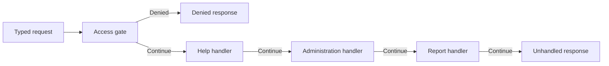

Chain of Responsibility passes a request through ordered handlers until one takes responsibility. Each handler must distinguish “not mine” from “handled and rejected.” Treating both as false can let an unauthorized request fall through to a later handler that performs the work.

The chain is useful when handlers can be assembled independently, while the request outcome and ordering remain explicit.

<!--more-->

These Swift 5.7 examples dispatch typed application requests. They are not an HTTP authentication implementation; request identity and roles are assumed to arrive from a trusted application boundary.

## Give fallthrough a distinct meaning

```swift
enum RequestKind { case help, report, administration, unknown }
enum Role { case reader, administrator }
struct AppRequest { let kind: RequestKind; let role: Role? }
enum AppResponse: Equatable { case help, report, administration, denied, unhandled }
enum Handling {
    case next
    case finished(AppResponse)
}
struct Handler {
    let name: String
    let handle: (AppRequest) -> Handling
}
struct RequestChain {
    let handlers: [Handler]
    func respond(to request: AppRequest) -> AppResponse {
        for handler in handlers {
            switch handler.handle(request) {
            case .next: continue
            case let .finished(response): return response
            }
        }
        return .unhandled
    }
}
```

The array defines a finite acyclic chain. A linked-handler implementation can also work, but must avoid successor cycles and ambiguous ownership.

The default unhandled result is visible. Silently reporting success when no handler accepted a request would hide assembly errors.

## A rejection is terminal handling

```swift
var administrationCalls = 0
let access = Handler(name: "access") { request in
    if request.kind == .administration && request.role != .administrator {
        return .finished(.denied)
    }
    if request.kind == .report && request.role == nil {
        return .finished(.denied)
    }
    return .next
}
let help = Handler(name: "help") { request in
    request.kind == .help ? .finished(.help) : .next
}
let administration = Handler(name: "administration") { request in
    guard request.kind == .administration else { return .next }
    administrationCalls += 1
    return .finished(.administration)
}
let report = Handler(name: "report") { request in
    request.kind == .report ? .finished(.report) : .next
}
let chain = RequestChain(handlers: [access, help, administration, report])
assert(chain.respond(to: AppRequest(kind: .administration, role: nil)) == .denied)
assert(administrationCalls == 0)
assert(chain.respond(to: AppRequest(kind: .administration, role: .administrator)) == .administration)
assert(administrationCalls == 1)
assert(chain.respond(to: AppRequest(kind: .help, role: nil)) == .help)
assert(chain.respond(to: AppRequest(kind: .unknown, role: nil)) == .unhandled)
```

The access handler returns a completed denial rather than declining the request. Later handlers never execute that rejected operation.

The count test protects that sequencing rule. It does not need to inspect every private branch in the administration handler to establish that denial prevented work.

## Ordering is part of configuration

Placing the administration handler before the access gate would change behavior. The chain's flexibility does not make every permutation valid.

Assembly can expose a constrained builder that always inserts required validation or authorization stages before effectful handlers. Another approach places the non-bypassable gate outside the configurable chain.

If adding a new handler requires a security-sensitive ordering decision, make that decision reviewable rather than appending handlers from arbitrary plugin discovery order.



The diagram omits successful terminal arrows for readability; each handler can return its response instead of continuing.

## First-handler and all-handler pipelines are different

This chain stops at the first finished result. An event broadcast intentionally invokes many subscribers. A validation accumulator may collect several independent failures. Neither is automatically the same chain contract.

Middleware can wrap a continuation to perform work before and after the next stage. That supports timing and response transformation, but also needs a rule for calling the continuation zero, one, or several times.

Calling it twice could repeat a database write. A simple boolean “continue” API should not be replaced with a callback continuation without considering that new power and its failure modes.

## Preserve the request facts handlers need

A handler receiving only a path string may have to rediscover account identity, locale, or request version from globals. A typed request can carry the validated facts that determine behavior.

Do not make the request a giant service locator. Data describes the operation; required capabilities can be supplied when constructing handlers. That keeps dependencies visible without passing every application service through every request.

If handlers can mutate the request, define which changes later handlers observe. Immutable requests simplify reasoning; a deliberate context object can carry derived facts when mutation is required.

## Failure and partial effects need an outcome model

The sample handlers return values synchronously. A real effectful handler may throw after partial work. Propagate a structured failure or receipt according to the use case rather than converting it to `.next`.

Falling through after a failed attempted write can let another handler perform it again. “Cannot handle this type” and “tried but failed” are separate states.

Similarly, a retry wrapper around the whole chain can repeat earlier stages. Keep pure checks separate from effects and define idempotency where external operations can be retried.

## Test the assembled chain, not only each handler

Unit-test handler-specific behavior, then exercise the real assembly with authorized, denied, unsupported, and ambiguous requests. Verify required gates run before effects and exactly one terminal result is chosen.

Include an empty handler list and a chain in which every handler declines. For configurable plugins, test overlapping claims and define which handler wins rather than relying on nondeterministic registration order.

## Rejection must be terminal when the policy is terminal

Consider a chain that first checks access, then tries help, administration, and report handlers. If an access failure were represented by the same result as “this handler does not recognize the request,” the chain could continue and eventually execute a protected action.

The distinction between `.next` and `.finished` prevents that ambiguity. A handler that recognizes a forbidden operation returns a terminal rejection. An unrelated handler returns `.next` without implying that the request is allowed. An unrecognized request reaches the final fallback and receives the application's unknown-operation result.

This distinction is just as important outside authorization. A parser that recognizes a format but detects corruption should not automatically let a more permissive parser reinterpret it as another format. Otherwise malformed input can escape the rules of the format it claimed to use.

## Order is part of the public behavior

Reordering handlers can change which one claims an overlapping request. Keep the chain assembly visible at the composition root and test representative overlaps. A list of independently correct handlers is not sufficient evidence that their ordering is correct.

Some policies should apply regardless of which handler claims the request. Put those policies in an outer workflow, or enforce their required placement when constructing the chain. A security check that callers can accidentally omit is a weak application boundary.

The array-based chain here also avoids mutable `next` links. A linked implementation permits reusable segments, but can accidentally form a cycle or share a tail whose later mutation changes several chains. Immutable assembly makes the sequence easier to inspect and test.

## Add async behavior without losing the decision model

An asynchronous handler may suspend while checking availability. During that wait, permissions or request context can change. Decide which facts are a snapshot of the incoming request and which must be rechecked immediately before an effect.

Cancellation should normally stop processing instead of falling through to another handler. Likewise, a transport failure is not necessarily evidence that another handler should try the same effect. Repeating an operation can create duplicates if the first attempt committed before its response was lost.

For cross-cutting behavior that must execute both before and after a downstream handler, middleware may be the better abstraction. A responsibility chain selects a handler or a terminal outcome; middleware wraps downstream execution. Mixing the two models without a clear contract makes cleanup and error propagation harder to reason about.

## Exercise: add a diagnostic trace

Return a diagnostic list of visited handler names alongside the domain response, without making the feature depend on that list for correctness. Verify a denial trace ends at the access gate and an unsupported request visits every handler. Then decide whether traces can contain sensitive request facts before persisting them.

Return to the [Design Patterns roadmap](/swift-design-patterns/).
