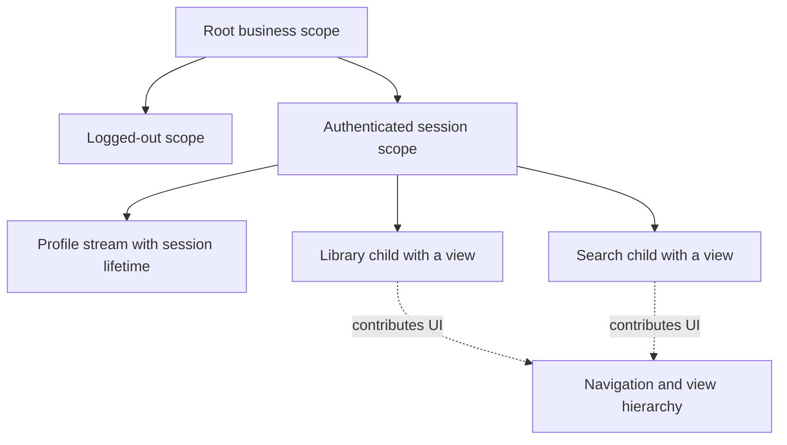

RIBs organizes an application around business scopes and their lifetimes. A Router attaches and detaches children, an Interactor owns active business behavior, and a Builder assembles the node's dependency graph. A business scope does not have to correspond to one visible screen.

That distinction is useful for an authenticated session: account streams can remain active while several screens appear and disappear beneath them.

<!--more-->

Uber's [RIBs documentation](https://github.com/uber/RIBs/wiki) describes the framework roles and lifecycle. The Swift 5.7 code below is an original, framework-independent model of those contracts. It does not define or replace Uber's `Router`, `Interactor`, or RxSwift APIs. Its purpose is to make activation, teardown, and construction order executable without requiring the framework.

## Begin with a viewless business scope

```swift
enum ProfileEvent { case updated(String), expired }
protocol WorkCancellation: AnyObject { func cancel() }
protocol ProfileWatching {
    func watch(accountID: Int, receive: @escaping (ProfileEvent) -> Void) -> any WorkCancellation
}
protocol SessionListening: AnyObject { func sessionExpired() }

final class SessionInteractor {
    private let accountID: Int
    private let profiles: any ProfileWatching
    private weak var listener: (any SessionListening)?
    private var work: (any WorkCancellation)?
    private var active = false
    private var epoch = 0
    private(set) var displayName: String?

    init(accountID: Int, profiles: any ProfileWatching, listener: any SessionListening) {
        self.accountID = accountID; self.profiles = profiles; self.listener = listener
    }
    func activate() {
        guard !active else { return }
        precondition(epoch < Int.max)
        epoch += 1
        let ticket = epoch
        active = true
        let returned = profiles.watch(accountID: accountID) { [weak self] event in
            guard let self = self, self.active, self.epoch == ticket else { return }
            switch event {
            case let .updated(name): self.displayName = name
            case .expired: self.listener?.sessionExpired()
            }
        }
        if active, epoch == ticket { work = returned }
        else { returned.cancel() }
    }
    func deactivate() {
        guard active else { return }
        active = false
        let old = work
        work = nil
        displayName = nil
        old?.cancel()
    }
    deinit { work?.cancel() }
}
```

Activation begins observation. Construction does not. Deactivation changes logical state before cancellation so a synchronous cancellation callback cannot act as if the scope were still active.

The epoch distinguishes activations of the same object. A late callback from a previous activation must not update the newly active session. All operations and callbacks require serialized access; a real adapter must deliver on the chosen executor.

The post-subscription check matters when the source synchronously reports an expired account. The parent can detach the node before `watch` returns its token. The token must then be cancelled rather than retained by a node that is already inactive.

## Let a builder assemble and a router own the node

```swift
struct SessionDependencies {
    let accountID: Int
    let profiles: any ProfileWatching
}
final class SessionNode {
    let interactor: SessionInteractor
    init(interactor: SessionInteractor) { self.interactor = interactor }
}
struct SessionBuilder {
    let dependencies: SessionDependencies
    func build(listener: any SessionListening) -> SessionNode {
        precondition(dependencies.accountID > 0)
        return SessionNode(interactor: SessionInteractor(
            accountID: dependencies.accountID,
            profiles: dependencies.profiles,
            listener: listener
        ))
    }
}
final class RootRouter: SessionListening {
    private(set) var session: SessionNode?
    func login(using builder: SessionBuilder) {
        logout()
        let child = builder.build(listener: self)
        session = child
        child.interactor.activate()
    }
    func logout() {
        let old = session
        session = nil
        old?.interactor.deactivate()
    }
    func sessionExpired() { logout() }
    deinit { session?.interactor.deactivate() }
}
```

The router installs ownership before activation, because activation can produce synchronous events. It removes ownership before deactivation, because teardown can also call external code.

This root intentionally treats login as replacement of the current session. A production authentication flow would validate credentials and account identity before building the logged-in scope. Construction is not authentication.

In Uber's framework, attachment and interactor lifecycle are coordinated through the actual RIB hierarchy. Do not copy this miniature router into a real RIB graph and independently activate the same interactor twice. Use the framework's lifecycle contracts and scoped subscription helpers for its chosen version.

## Test logical lifetime even when objects remain alive

```swift
final class WorkToken: WorkCancellation {
    private(set) var cancelled = false
    func cancel() { cancelled = true }
}
final class ProfileProbe: ProfileWatching {
    var accounts: [Int] = []
    var callbacks: [(ProfileEvent) -> Void] = []
    var tokens: [WorkToken] = []
    func watch(accountID: Int, receive: @escaping (ProfileEvent) -> Void) -> any WorkCancellation {
        accounts.append(accountID)
        callbacks.append(receive)
        let token = WorkToken(); tokens.append(token); return token
    }
}
let profiles = ProfileProbe()
let root = RootRouter()
let builder = SessionBuilder(dependencies: SessionDependencies(accountID: 7, profiles: profiles))
root.login(using: builder)
let retainedOldNode = root.session!
profiles.callbacks[0](.updated("Maya"))
assert(retainedOldNode.interactor.displayName == "Maya")
root.logout()
assert(profiles.tokens[0].cancelled && root.session == nil)
profiles.callbacks[0](.updated("Late"))
assert(retainedOldNode.interactor.displayName == nil)
root.login(using: builder)
profiles.callbacks[0](.expired)
assert(root.session != nil)
profiles.callbacks[1](.expired)
assert(root.session == nil && profiles.tokens[1].cancelled)
```

The old node stays intentionally retained by the test. The late event is rejected because its lifecycle ended, not because deallocation happened to remove the callback. This is the distinction lifecycle-oriented architectures need to make reliable.

## Draw business scope separately from screens



A deep business tree can support a different, shallower UI arrangement. A session does not need an invisible view controller merely to own its account stream.

Builders should receive declared dependencies from the parent scope. Children can receive read-only capabilities while one authoritative owner writes shared state. Passing an unrestricted global registry to every node hides those scope relationships.

## Distinguish topology from ordinary state

Attaching a logged-in node represents a substantial application state transition. Changing the person's display name does not require detaching and rebuilding the entire session. Ordinary values can flow through scoped streams while the topology remains stable.

Do not encode every Boolean as a child RIB. Topology is most useful for states with meaningful dependency and work lifetimes. Rebuilding a graph for a small visual toggle adds lifecycle churn without a useful boundary.

RIBs also does not require one universal state store. Each node needs a clear source of truth and communication contract. Children should return typed outcomes to their parent rather than reach into sibling internals.

## Case study: work belongs to a session, not a screen

An account profile stream may support the library, search, and settings simultaneously. Starting that stream in each screen duplicates subscriptions and makes logout cleanup depend on which views happen to exist.

A viewless session scope can own the stream once and supply read-only observations to children. A child can disappear without ending the account session. Logout ends the parent scope and stops the work even if a child object remains retained by a transition or a test.

This is also why attachment is more than showing a view. A business child can begin work without contributing any visible UI, and a visible screen can be temporarily covered while its business scope remains active. Map activation to the intended business lifetime rather than to every appearance callback.

In the real RIBs framework, use its interactor lifecycle and subscription-disposal conventions. The miniature example models the invariant directly so it can be inspected, but does not provide the framework's tooling, dependency components, or Rx integration.

A useful integration test attaches a child, starts its actual scoped subscription, detaches it, and then emits another upstream value. The child must not alter business state or route. A separate retention test releases intended owners and checks that the graph can deallocate.

Keep those claims distinct. A deallocated child cannot act, but an inactive retained child must also be harmless. Conversely, an inactive child that never acts can still leak resources if its parent retains it forever. Lifecycle correctness and memory ownership require complementary evidence.

## Exercise: test synchronous expiry during activation

Make `watch` emit `.expired` before returning its token. Verify the root ends logged out and the returned token is cancelled. Then reactivate one interactor and deliver an event from its previous epoch. Keep framework-specific integration tests separate from these lifecycle-model tests.

Return to the [App Architectures roadmap](/swift-architectures/).
